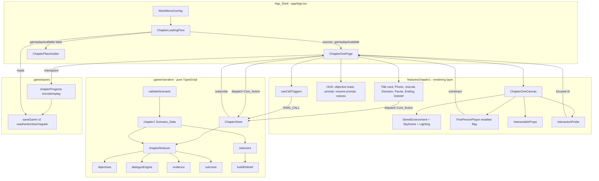
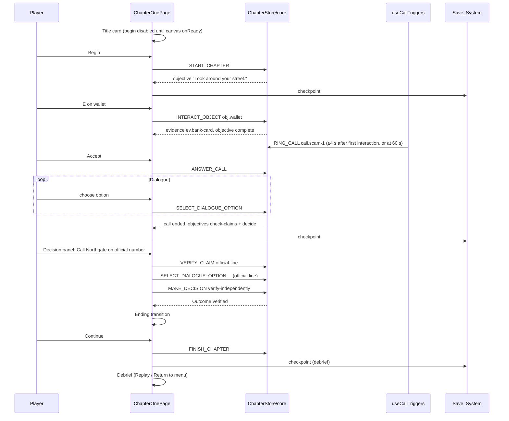
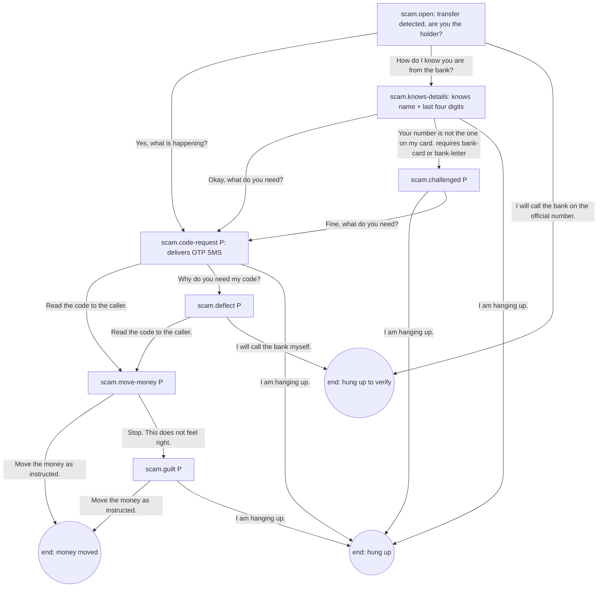

# Design Document: Chapter 1 "The Urgent Call"

## Overview

This design turns the existing loading pipeline and street scene into one complete, playable
chapter. It adds three layers, in this dependency order:

1. **Scenario data** (`apps/game/src/game/narrative/chapter1/`): typed, authored content for
   objectives, interactables, evidence, claims, dialogue, decisions, endings and debrief.
2. **Chapter core** (`apps/game/src/game/narrative/`): a pure, deterministic reducer
   `(state, action) → ActionResult` with an objective manager, dialogue engine, evidence registry,
   outcome function, debrief builder, scenario validator and a small framework-free store.
3. **Rendering layer** (`apps/game/src/features/chapter1/`): the Chapter_Page (HUD and overlays),
   the Chapter_Canvas (street, player, procedural props, interaction probe) and the Phone_UI.
   World and UI components only dispatch Core_Actions; they never write narrative state.

Save version 2 (`apps/game/src/game/saves/`) stores the accepted action list and replays it
through the core on restore, so a save is valid exactly when the core accepts every saved action.

Naming note: the brief's "SAFE" ending is the Outcome `verified`, shown as "Checked through a
trusted channel". The safety steering rule forbids calling anything "safe", and a content lint
test enforces it for all user-facing strings.

### Repository audit (main 72edd16)

Verified by reading source on `main` at 72edd16 before writing this design.

| # | Area | Status | Evidence and notes |
|---|---|---|---|
| 1 | Game bootstrap and routing | IMPLEMENTED | `app/App.tsx`: `Screen = menu \| chapter-loading \| chapter`; path routes `/hochiminh`, `/testmove`, `/ueh`, `/hue`. `chapter` renders `features/chapter/ChapterPlaceholder.tsx` because `gameplayAvailable: false`. Menu audio engine lives in App.tsx, gated by `route === "menu"` (so it also plays on the chapter screens today). |
| 2 | First-person camera and movement | IMPLEMENTED (shared) | `features/player/`: `FirstPersonPlayer.tsx` wraps `runtime/CharacterRuntime.ts` (props: spawn, yaw, bounds or adapter, consume triggers, keysRef, onStatsUpdate, `onInteract(position)`); `usePlayerControls.ts` (WASD/arrows incl. Telex `ư`, Shift, Space, F/left-click punch, right-click block, E interact, T/I inspect, Ctrl toggles lock, mousedown locks pointer). No enabled/paused option. `CharacterRuntime.triggerInteract()` calls `onInteract(cameraPosition)`; no per-object look-at prompt. |
| 3 | 3D world | IMPLEMENTED | `game/scenes/MainMenuScene/StreetEnvironment.tsx` (MenuBG.optimized.glb, compileAsync, `onReady`), `SkyDome.tsx`, `EnvironmentLighting.tsx`. `features/testmove/TestMoveCanvas.tsx` composes them with spawn `[188.6, -92.70, -88.89]`, yaw π, bounds `{180, 198.5, -92, 52, -92.70}`. UEH, Hue, HCM worlds are unrelated. |
| 4 | Scene loading and transitions | IMPLEMENTED | `game/loading/chapterLoader.ts` (byte-measured manifest download, verification, save restore), `features/loading/ChapterLoadingFlow.tsx`, `SceneTransition`, `LoadingScreen`, menu startup loading. Menu `GameCanvas` stays mounted with `frameloop="never"` when not on menu. |
| 5 | GLB asset management | PARTIAL | R3F/Drei loader cache, `streetGltfLoader.ts`, `CharacterAssetCache`. No chapter props GLB. |
| 6 | Object interactions | PARTIAL → system MISSING | E trigger and a raycaster exist (punch hit test); no typed interactable registry, look-at prompt or distance limit. |
| 7 | Game state management | MISSING | Zustand, Zod, Dexie are approved but not installed. |
| 8 | Scenario and narrative systems | MISSING | Only `chapterRegistry.ts` (manifest) and `chapterSession.ts` (chapterId, chapterNumber, sceneId, origin). |
| 9 | Device interfaces (phone) | MISSING | None. |
| 10 | Save and replay | PARTIAL | `game/saves/saveGame.ts` reads and validates `scammaze_save_v1` (formatVersion 1, chapterId, sceneId, savedAt) behind `SaveGameSource`; nothing writes. Continue gated by `readContinueAvailability()`; loader "continue" uses `restoreChapterSession`. |
| 11 | Automated tests | IMPLEMENTED (loading only) | Vitest + Testing Library + jsdom; seeded LCG helpers in `src/test/loadingRuns.ts` (`createLcg`, `randomInt`, `pick`); `tsconfig.test.json`. No gameplay tests. |
| 12 | Shared contracts | IMPLEMENTED | `packages/shared-types`: `SceneId`, `GameSettings`, `ScamThreatCategory` (`urgency-impersonation`), `ScenarioMeta`. |

### Key design decisions

| Decision | Choice | Alternatives considered | Rationale |
|---|---|---|---|
| State management | Pure reducer + ~40-line store using `useSyncExternalStore` | Zustand; `useReducer` | No new dependency. The store must be importable by non-React code (save writer, tests). AGENTS.md forbids Zustand inside the scenario engine anyway. |
| Runtime validation | Hand-written type guards | Zod | The only untrusted input is the save, and it is validated by replay through the core. One guard for the save envelope is small. |
| Save format | Action log + replay, format version 2, key `scammaze_save_v2` | Snapshot of `ChapterState` | Replay reuses the reducer's validation, so a tampered or stale save is rejected without a second schema. Deterministic core makes replay exact. |
| Storage | `localStorage` behind the existing `SaveGameSource` interface, extended with `write` and `clear` | Dexie/IndexedDB | Payload is small (< 50 KB at the 1000-action cap). Interface keeps the planned Dexie switch reversible. |
| v1 saves | Migrate to a v2 chapter-start Checkpoint, then delete the v1 key | Reject | v1 holds only chapterId and sceneId, both representable as a start Checkpoint. The app never wrote v1, so this mostly covers hand-made test data. |
| Menu canvas during chapter | Keep mounted with `frameloop="never"` (current behavior) | Unmount | Unmounting forces a full GLB re-upload and shader compile on return to menu without a loading screen. Cost: a second WebGL context holds a copy of the street GPU data while the chapter runs. Not measured; recorded as a follow-up to measure on a low-end device. |
| Interactable props | Procedural meshes (boxes, planes, cylinders) with `meshStandardMaterial` | New GLB props; scene nodes | No new assets or licenses. Scene node names in MenuBG are not stable identifiers. |
| Focus detection | Pure ray–sphere test in `findFocusedInteractable` (no three import), run in a `useFrame` probe | Three.js `Raycaster` against meshes | Pure function is property-testable; five spheres per frame is negligible work. |
| Call timing | Timers in the UI-layer `useCallTriggers` hook dispatch `RING_CALL`; core has no clock | Timers in core | Keeps the core deterministic. Timers count only unpaused, overlay-free time. |
| Phone ring sound | Visual and text only | Synthesized buzz; reuse `button_hover.mp3` | The brief allows existing audio only; no existing file sounds like a phone. Captions make the ring accessible. |
| Menu music in chapter | Fade music gain to 0 while `screen.kind === "chapter"`; keep street ambient | Leave unchanged | Menu theme over gameplay is out of place; street ambient fits the scene. Menu behavior is unchanged on the menu screen. |
| Ending names | `verified` / `risky` / `uncertain` | `safe` / `risky` / `uncertain` | Safety steering rule. |

## Architecture



### Runtime flow



### Module boundaries

- `game/narrative/**` imports only TypeScript and `@scammaze/shared-types`. A test
  (`narrative/boundaries.test.ts`) reads the source files and fails on imports of `react`,
  `three`, `@react-three/*`, `@dimforge/rapier*`, `zustand` or `dexie`.
- `features/chapter1/**` may import React, R3F, Drei, three and `lucide-react`. It reads state
  through `useChapterState(store, selector)` and writes only through `store.dispatch`.
- `features/player/usePlayerControls.ts` and `FirstPersonPlayer.tsx` get one optional `enabled`
  input; default `true` keeps `/testmove`, UEH and Hue unchanged.
- `features/testmove/**` is not modified. Play-area constants are copied into
  `game/scenes/MainMenuScene/streetPlayArea.ts` and used by the chapter canvas.

## Components and Interfaces

### 1. Scenario data (`game/narrative/chapter1/`)

| File | Content |
|---|---|
| `ids.ts` | String-literal unions: `ObjectiveId`, `InteractableId`, `EvidenceId`, `ClaimId`, `CallId`, `NpcId`, `DialogueGraphId`, `FlagId`, `DecisionId`, `OutcomeId`. |
| `objectives.ts` | Five objectives with text and activation/completion rules (see Data Models). |
| `interactables.ts` | Narrative side of the five Interactables: ID, label, action label, inspection text, resulting action (`INTERACT_OBJECT` or `TALK_TO_NPC`), evidence revealed. No positions. |
| `claims.ts` | Four Claims. |
| `evidence.ts` | Eleven Evidence_Items. |
| `dialogues/scamCall.ts`, `dialogues/callback.ts`, `dialogues/shopkeeper.ts`, `dialogues/officialLine.ts` | Dialogue_Graphs. |
| `phone.ts` | Message and app content: urgent SMS, one-time-code SMS, bank app screens, contact display names and Fictional_Phone_Numbers. |
| `decisions.ts` | Decision panel options with labels, requirements and hints. |
| `endings.ts` | Three Outcomes with titles, consequence text variants by flag and simulation label. |
| `debrief.ts` | Scam mechanism, safer alternatives, per-outcome summaries, decision notes per tagged event. |
| `scenario.ts` | `CHAPTER_1_SCENARIO: ScenarioDefinition` assembling the above. |

#### Story (morning, before breakfast)

The player stands outside their building with a coffee. The urgent text from the prologue is
unread on the phone: "Northgate Bank: Account ending 9284 is suspended due to unusual overseas
activity. Confirm your identity within 15 minutes at northgate-secure-verify.invalid to avoid a
permanent freeze." Soon a call arrives from "Northgate Bank Security", `+000 555 0142`. The caller,
"Alex from the security team", knows the player's name and the last four digits of the account,
says a transfer is pending, asks for the one-time code "we just sent", and then asks the player to
move their savings to a "protected holding account". On the street the player can find the
official number and website, a Northgate notice in the shop window, a neighbourhood alert and the
shopkeeper, Sam, who heard of the same pattern.

#### Interactables (narrative data; positions are in the rendering layer)

| ID | Object | Action label | Produces | Reveals |
|---|---|---|---|---|
| `obj.wallet` | Your wallet on the café table | "check" | `INTERACT_OBJECT` | `ev.bank-card` |
| `obj.mailbox` | Your mailbox | "open" | `INTERACT_OBJECT` | `ev.bank-letter` |
| `obj.shop-poster` | Northgate notice in the shop window | "read" | `INTERACT_OBJECT` | `ev.shop-poster` |
| `obj.shopkeeper` | Sam at the shop counter | "talk to" | `TALK_TO_NPC npc.sam` | via dialogue: `ev.sam-testimony` |
| `obj.notice-board` | Community notice board | "read" | `INTERACT_OBJECT` | `ev.community-alert` |

#### Claims

| ID | Claim text |
|---|---|
| `claim.caller-identity` | "The caller works for Northgate Bank." |
| `claim.account-suspended` | "Your account is suspended." |
| `claim.code-needed` | "The bank needs your one-time code to stop a transfer." |
| `claim.protected-account` | "Moving your money to a protected holding account protects it." |

#### Evidence (physical and device; stances never prove a claim on their own)

| ID | Title | Source | Location | Discovery | Stances | Warning signs |
|---|---|---|---|---|---|---|
| `ev.sms-alert` | Urgent text message | device | Phone · Messages | open the message (after START) | account-suspended: needs-verification | urgency, look-alike link |
| `ev.otp-sms` | One-time code message | device | Phone · Messages | open it after the scam call reached `scam.code-request` | code-needed: contradicts ("Never share this code with anyone, including bank staff.") | code request |
| `ev.caller-number` | Caller's number | device | Phone · Calls | open the call history entry after the first call rang | caller-identity: needs-verification | unknown number |
| `ev.bank-card` | Number on your bank card | physical | Café table · wallet | `INTERACT_OBJECT obj.wallet` | caller-identity: needs-verification | — |
| `ev.bank-letter` | Letter from Northgate Bank | physical | Mailbox | `INTERACT_OBJECT obj.mailbox` | caller-identity: needs-verification; account-suspended: needs-verification | — |
| `ev.bank-app` | Northgate Bank app | device | Phone · Northgate Bank | `VERIFY_CLAIM bank-app` (opening the app) | account-suspended: contradicts | — |
| `ev.shop-poster` | Northgate notice in the shop window | physical | Corner shop window | `INTERACT_OBJECT obj.shop-poster` | code-needed: contradicts; protected-account: contradicts | code request, move money |
| `ev.community-alert` | Neighbourhood alert | physical | Notice board | `INTERACT_OBJECT obj.notice-board` | protected-account: contradicts | move money |
| `ev.partial-info` | What the caller knew | dialogue | Scam call | reaching node `scam.knows-details` | caller-identity: inconclusive | partial personal details |
| `ev.sam-testimony` | Sam's story | NPC | Corner shop | shopkeeper node `sam.after-call.story` | caller-identity: inconclusive | emotional pressure |
| `ev.official-confirmation` | Northgate official line | verification | Phone · official call | official-line node `official.confirm` | caller-identity: contradicts; account-suspended: contradicts; code-needed: contradicts | — |

Contradiction chain (Requirement 11.10): `ev.caller-number` (`+000 555 0142`) differs from the
number on `ev.bank-card` and `ev.bank-letter` (`+000 555 0100`). The journal says: "The numbers
are different. That is a warning sign, but caller ID can be faked, so a matching number would not
prove anything either." Calling `+000 555 0100` from the phone (`VERIFY_CLAIM official-line`) is
the independent channel; it yields `ev.official-confirmation`, which sets
`claim.caller-identity` to `contradicted`.

Look-alike domain chain: the SMS link `northgate-secure-verify.invalid` differs from the official
website `northgate.example` printed on the letter. Domains are rendered as plain text only.

#### Dialogue graphs (summary; full lines live in data)

`dlg.scam-call` (persona "Alex, says he is from Northgate Bank security"; pressure nodes marked P):



Effects: entering `scam.knows-details` discovers `ev.partial-info`; entering `scam.code-request`
sets flag `otp_sent` (makes `ev.otp-sms` available); "Read the code" sets `code_shared`; "Move
the money" sets `money_moved` and records Decision `follow-request`; nodes marked P add 1 pressure
(capped at 3). Paths (Requirement 10.1): share code → move money; challenge → hang up; verify →
hang up.

`dlg.callback` (callback Call, rings at most once): "Why did you hang up? The transfer completes in
two minutes." Options: "Read the code to the caller." (only when `code_shared` is not set) → move
money request → same end as above; "I am hanging up." → end.

`dlg.shopkeeper` (Sam): start node depends on `call.scam-1` having ended. Before: small talk and
"Northgate put a notice in my window last month." After: "Did they ask for a code?" → story node
discovers `ev.sam-testimony` → "Call the number on your card, not the one that called you."
Always ends with "See you later, Sam."

`dlg.official-line` (Northgate customer support, reached by the player calling `+000 555 0100`):
automated greeting → agent asks how to help → player: "Someone called saying they were from your
security team." → `official.confirm`: "We have no record of a call to you today. Your account is
active. We never ask for one-time codes or ask you to move money." (discovers
`ev.official-confirmation`, sets claim statuses) → "Thank you. I will block that number." → end.
If `code_shared` is set, the agent adds a line that the account is now locked and a new card is on
its way (simulated), which the RISKY debrief references.

All lines are referenced by line ID (`lineId`) and stored in `lines` maps per graph
(Requirement 9.10). A future wording adapter would implement
`LineTextProvider = (lineId, approvedText) => string` and could only replace the text of an
existing approved line; it is not implemented.

#### Decisions

| Decision | Panel label | Requires | Effect |
|---|---|---|---|
| `follow-request` | "Call the number back and do what the caller asks" | first call ended | `MAKE_DECISION follow-request` sets `money_moved` (the ending text narrates the call-back; no extra dialogue). Also reachable inside the scam call and the callback via "Move the money as instructed". |
| `verify-independently` | "Call Northgate on the official number" then "Report the call and block the number" | `ev.bank-card` or `ev.bank-letter` for the call; `ev.official-confirmation` for the decision | `VERIFY_CLAIM official-line`; after the call, `MAKE_DECISION verify-independently`. |
| `stop-and-wait` | "Block the number and leave it for now" | first call ended | `MAKE_DECISION stop-and-wait`. |

#### Endings

| Outcome | Title | Consequence text (simulated) |
|---|---|---|
| `verified` | "Checked through a trusted channel" | "Northgate confirmed they did not call you. You blocked the number and reported it. Your simulated account stays active." |
| `risky` (`money_moved`) | "Followed the caller's request" | "The simulated savings balance now reads zero. The 'protected holding account' belonged to the caller." |
| `risky` (`code_shared` only) | "Followed the caller's request" | "The caller used your code to sign in to your simulated account. Northgate locked it after you called, but the account was compromised." |
| `uncertain` | "Stopped, but did not confirm" | "You ended the immediate risk, but you did not check with Northgate. If the alert had been real, you would not know. Next time, confirm through the number on your card." |

Every consequence panel shows "Simulation: nothing real happened." (Requirement 13.10).

### 2. Chapter core (`game/narrative/`)

```ts
// game/narrative/types.ts (abridged)
export type CoreAction =
  | { type: "START_CHAPTER" }
  | { type: "INTERACT_OBJECT"; objectId: InteractableId }
  | { type: "INSPECT_EVIDENCE"; evidenceId: EvidenceId }
  | { type: "OPEN_PHONE" }
  | { type: "CLOSE_PHONE" }
  | { type: "RING_CALL"; callId: "call.scam-1" | "call.callback"; reason: RingReason }
  | { type: "ANSWER_CALL" }
  | { type: "END_CALL" } // declines when ringing, hangs up when active
  | { type: "TALK_TO_NPC"; npcId: NpcId }
  | { type: "SELECT_DIALOGUE_OPTION"; optionId: string }
  | { type: "VERIFY_CLAIM"; claimId: ClaimId; method: "official-line" | "bank-app" }
  | { type: "MAKE_DECISION"; decision: DecisionId }
  | { type: "COMPLETE_OBJECTIVE"; objectiveId: ObjectiveId }
  | { type: "FINISH_CHAPTER" };

export type RingReason = "first-interaction" | "exploration-timer" | "re-ring" | "callback";

export interface ActionResult {
  state: ChapterState;
  accepted: boolean;
  reason?: string; // non-empty when accepted is false
}

export function chapterReducer(state: ChapterState, action: unknown, scenario?: ScenarioDefinition): ActionResult;
export function createInitialState(scenario?: ScenarioDefinition): ChapterState;
export function isCoreAction(value: unknown): value is CoreAction;
```

Reducer pipeline per action:

1. `isCoreAction` shape check → reject "Unknown action." (Requirement 5.4).
2. If `outcome` is set and action is not `FINISH_CHAPTER` → reject "The chapter has ended."
3. Per-action guard (status, call status, dialogue availability, evidence condition, decision
   requirements). Each guard returns a reason string on failure.
4. Apply the action (pure, returns a new object; no mutation of the input).
5. `runObjectiveManager(prev, next, action)` activates and completes objectives and appends
   internal `COMPLETE_OBJECTIVE` events with `source: "auto"`.
6. If a decision was recorded in step 4 or by a dialogue effect, `selectOutcome(next)` sets
   `outcome`.
7. Append the Event_Log entry `{ seq, action, derived }`, where `derived` lists evidence
   discovered, flags set, objectives changed and debrief tags.

Guard summary:

| Action | Accepted when |
|---|---|
| START_CHAPTER | `status === "not-started"` |
| INTERACT_OBJECT | `status === "playing"`, no active Call, no conversation, object exists and its action is `INTERACT_OBJECT` |
| INSPECT_EVIDENCE | evidence exists, discovery condition `inspect` holds, not yet discovered |
| OPEN_PHONE / CLOSE_PHONE | phone closed / open; CLOSE_PHONE rejected while a Call is active or ringing (the call screen must be ended first) |
| RING_CALL | `scam-1`: not yet answered, not currently ringing, no conversation; `callback`: scam-1 ended after being answered, callback never rang, no Decision |
| ANSWER_CALL | a Call is ringing |
| END_CALL | a Call is ringing (decline) or active (hang up). Hanging up an active scam call ends its conversation at the current node and records `hung-up` |
| TALK_TO_NPC | npc exists, no Call, no conversation |
| SELECT_DIALOGUE_OPTION | option is in `availableOptions(state)` |
| VERIFY_CLAIM `official-line` | `ev.bank-card` or `ev.bank-letter` discovered, no Call, scam-1 has rung, no Decision |
| VERIFY_CLAIM `bank-app` | phone open, no Call; repeat accepted only if `ev.bank-app` not yet discovered |
| MAKE_DECISION | no Decision; option requirements met (`verify-independently` needs `ev.official-confirmation`; others need scam-1 ended) and no conversation |
| COMPLETE_OBJECTIVE | objective active and its completion predicate holds |
| FINISH_CHAPTER | `outcome` set and `status !== "finished"` |

Phone open state is part of the core because OPEN_PHONE and CLOSE_PHONE are Core_Actions and
`bank-app` verification requires the phone. Which app screen is shown is UI state.

Decline of `call.scam-1` sets `scam1.status = "declined"`; RING_CALL with reason `re-ring` is then
accepted again (no limit, so the call can never be lost). Answering is the only way to end the
re-ring cycle.

#### Dialogue engine (`dialogueEngine.ts`)

```ts
export function startConversation(state, graphId, startNodeId?): ChapterState;
export function availableOptions(state, scenario): DialogueOptionView[]; // includes fallback when needed
export function selectOption(state, optionId, scenario): { state; ok: true } | { ok: false; reason };
export function evaluateCondition(cond: Condition, state): boolean;
export function applyEffect(state, effect: Effect): ChapterState;
```

Conditions: `hasEvidence`, `hasAnyEvidence`, `flag`, `notFlag`, `callEnded`, `claimStatus`.
Effects: `setFlag`, `discoverEvidence`, `addPressure`, `setClaimStatus` (allowed only in graphs
with `channel: "independent"`; the validator enforces it, Requirement 12.6), `recordDecision`,
`deliverMessage`. Node `onEnter` effects run when the node becomes current. The fallback option ID
is `__fallback.end` (Requirement 9.4).

#### Evidence registry (`evidence.ts`)

```ts
export function canDiscover(state, evidenceId, via: DiscoveryVia, scenario): boolean;
export function discover(state, evidenceId): ChapterState; // idempotent append
export function evidenceForClaim(state, claimId, scenario): Array<{ evidence; stance }>;
```

Discovery conditions are data: `{ via: "interact", objectId }`, `{ via: "inspect", requires:
Condition[] }`, `{ via: "dialogue-node", nodeId }`, `{ via: "verify", method }`.

#### Objective manager (`objectives.ts`)

Each objective has `activateWhen` and `completeWhen` predicates over `(prev, next, action)`. They
inspect accepted action types and state facts only. `OPEN_PHONE`, `CLOSE_PHONE` and journal UI
never satisfy a predicate (Requirement 6.9).

| ID | Text | Activates | Completes |
|---|---|---|---|
| `obj.look-around` | "Look around your street." | START_CHAPTER | first INTERACT_OBJECT or TALK_TO_NPC |
| `obj.answer-call` | "Your phone is ringing. Answer it or decline it." | first RING_CALL for scam-1 | ANSWER_CALL of scam-1 |
| `obj.check-claims` | "Check what the caller told you." | scam-1 ended after answer | ≥2 discovered evidence items that relate to any Claim, excluding `ev.sms-alert` |
| `obj.decide` | "Decide what to do about the caller's request." | scam-1 ended after answer | Decision recorded |
| `obj.review` | "Review what happened." | Decision recorded | FINISH_CHAPTER |

If the Decision is recorded inside the scam call (money moved), `obj.answer-call` completes and
`obj.decide` is activated and completed in the same step, so the debrief history stays consistent.

#### Outcome function (`outcome.ts`)

```ts
export function selectOutcome(state: ChapterState): OutcomeId | null {
  if (state.flags.code_shared || state.flags.money_moved) return state.decision ? "risky" : null;
  if (state.decision === "verify-independently" && state.claims["claim.caller-identity"] === "contradicted") return "verified";
  if (state.decision === "stop-and-wait") return "uncertain";
  return null;
}
```

`risky` requires a Decision so that sharing the code but hanging up still lets the player call
the official line (the agent locks the simulated account) before the chapter ends; any Decision
taken after `code_shared` yields `risky` with the matching consequence variant.

#### Debrief builder (`debrief.ts`)

```ts
export interface DebriefView {
  outcome: { id; title; summary; consequence };
  decisions: Array<{ seq; text }>;        // from Event_Log entries tagged in Scenario_Data
  evidenceFound: Array<{ id; title }>;    // state.discovered order
  warningSignsNoticed: Array<{ id; label }>; // union over discovered evidence
  cluesMissed: Array<{ id; title; hint }>;   // evidence with debriefHint not discovered
  mechanism: string;
  saferAlternatives: string[];
}
export function buildDebrief(state, scenario): DebriefView;
```

#### Scenario validator (`validateScenario.ts`)

`validateScenario(scenario): string[]` returns errors for: unknown node references, start nodes
missing, nodes with no reachable end node, evidence referencing unknown claims or objects,
interactables referencing unknown evidence, `setClaimStatus` effects outside independent-channel
graphs, decisions referencing unknown evidence, debrief tags with no text, and duplicate IDs.

#### Store (`store.ts`)

```ts
export interface ChapterStore {
  getState(): ChapterState;
  dispatch(action: CoreAction): ActionResult;
  subscribe(listener: () => void): () => void;
  replace(state: ChapterState): void; // used by restore and restart; notifies once
}
export function createChapterStore(initial: ChapterState, scenario?: ScenarioDefinition): ChapterStore;
```

React binding in `features/chapter1/useChapterState.ts`:
`useSyncExternalStore(store.subscribe, () => selector(store.getState()))`. Selectors return stable
references (state slices) or are memoized by state identity.

### 3. Saves (`game/saves/`)

- `saveGame.ts` (extended): keeps `parseSavedGame` for v1; adds `SAVE_STORAGE_KEY_V2 =
  "scammaze_save_v2"`, `SAVE_FORMAT_VERSION_V2 = 2`, `parseSaveEnvelopeV2`, and extends
  `SaveGameSource` with optional `write(save)` and `clear()`. `read()` order: v2 key → if absent,
  v1 key → migrate to v2 start Checkpoint, write it, remove v1. `SavedGame` keeps `chapterId`,
  `sceneId`, `savedAt` so `chapterLoader` and `restoreChapterSession` keep working; it gains
  `progress?: ChapterProgressV2`.
- `chapterProgress.ts` (new): `encodeProgress(state, playerPose, checkpointId)` and
  `restoreProgress(progress, scenario) → { ok, state, pose } | { ok: false, reason }`. Restore
  replays `actions` through `chapterReducer`; any rejection → invalid. Pose is checked for finite
  numbers and clamped to bounds.
- `chapterSession.ts` (extended): `ChapterSession` gains optional `progress` passed from the save
  to the Chapter_Page.
- `App.tsx` `readContinueAvailability` additionally runs `restoreProgress` when `progress` exists,
  so Continue is enabled only for replayable progress (Requirement 15.6, 15.11).

Checkpoint policy (`features/chapter1/useCheckpointSaver.ts`): subscribe to the store; when the
active or completed objective sets differ from the last saved ones and no Call is ringing or
active, write. If a change happens during a Call, set a pending flag and write when the Call
ends. Also write after FINISH_CHAPTER (`checkpointId: "debrief"`). Restart and Replay call
`clear()` then `store.replace(createInitialState())`.

### 4. Rendering layer (`features/chapter1/`)

| File | Responsibility |
|---|---|
| `ChapterOnePage.tsx` | Owns the store (from session progress or fresh), overlay stack, input enable flag, key bindings (Esc, P, J), resume prompt, checkpoint saver, call triggers, ending/debrief switch. |
| `ChapterOneCanvas.tsx` | `<Canvas>` with SkyDome, EnvironmentLighting, StreetEnvironment (`onReady`), FirstPersonPlayer (`enabled`, spawn from session or default), InteractableProps, InteractionProbe. |
| `world/propLayout.ts` | `INTERACTABLE_LAYOUT: Record<InteractableId, { position; radius; yaw }>` inside bounds. Initial positions: wallet `[184.5, -91.9, -78]`, mailbox `[197.6, -91.6, -70]`, shop poster `[180.4, -91.2, -55]`, shopkeeper `[181.6, -91.9, -50]`, notice board `[197.8, -91.4, -40]`; radius 0.6. Positions are a starting point and are calibrated against the street geometry during implementation. |
| `world/InteractableProps.tsx` | Procedural meshes per prop, Lavender emissive rim when focused. |
| `world/InteractionProbe.tsx` | `useFrame` reads camera position and direction, calls `findFocusedInteractable`, reports changes only. |
| `interaction/findFocusedInteractable.ts` | Pure ray–sphere test with max distance 3.0 m. |
| `interaction/interactionToAction.ts` | Maps InteractableId → Core_Action via Scenario_Data. |
| `useCallTriggers.ts` | Exploration clock (accumulates only while playing, no Overlay, tab visible). Rules: first interaction + 3 s; 60 s fallback; re-ring 20 s after decline; callback 90 s after scam-1 ended with no Decision. |
| `useCheckpointSaver.ts` | Checkpoint policy above. |
| `useChapterState.ts` | `useSyncExternalStore` binding. |
| `overlays.ts` | Overlay stack type and helpers (`push`, `pop`, `top`). |
| `hud/ObjectiveToast.tsx`, `hud/ObjectiveTracker.tsx` | Toast and persistent tracker; `aria-live="polite"` region. |
| `hud/InteractionPrompt.tsx` | "Press E to read Northgate notice in the shop window." |
| `hud/ResumePrompt.tsx` | "Click to resume". |
| `hud/EvidenceNotice.tsx` | "Evidence recorded: Number on your bank card." |
| `hud/HudButtons.tsx` | Phone (P) and Journal (J) buttons with `lucide-react` `Smartphone` and `NotebookText` icons and visible text. |
| `intro/ChapterTitleCard.tsx` | Chapter number, title, subtitle, "Preparing the street" until ready, Begin / Continue button. |
| `panels/InspectionPanel.tsx` | Interactable inspection text. |
| `phone/PhoneOverlay.tsx` | Phone frame and app router (home, messages, message detail, calls, bank app, incoming call, active call). |
| `phone/IncomingCallScreen.tsx`, `phone/CallScreen.tsx` | Caller name, Fictional_Phone_Number, Accept/Decline, dialogue lines and options, Hang up. |
| `phone/MessagesApp.tsx`, `phone/CallHistoryApp.tsx`, `phone/BankApp.tsx` | Device evidence; dispatch INSPECT_EVIDENCE / VERIFY_CLAIM. Plain-text domains and numbers. |
| `dialogue/DialoguePanel.tsx` | Shared line + options list for phone calls and Sam (face-to-face panel). |
| `journal/EvidenceJournal.tsx` | Discovered evidence, claim list with status text, stance text, "Decide" button. |
| `decision/DecisionPanel.tsx` | Three options with availability and hints. |
| `ending/EndingTransition.tsx` | Outcome title, consequence, simulation label, Continue. |
| `debrief/DebriefScreen.tsx` | DebriefView rendering, Replay, Return to menu. |
| `pause/PauseMenu.tsx` | Resume, Restart chapter (confirm), Save and return to menu. |
| `theme.ts` | Brand tokens as constants and Tailwind arbitrary values. |

Overlay and input rules:

- `inputEnabled = overlayStack.length === 0 && store status === "playing"`. Passed to
  `usePlayerControls({ enabled })` and `FirstPersonPlayer enabled`.
- `usePlayerControls` extension: optional `{ enabled?: boolean }` (default `true`). When `false`:
  clear all keys and triggers once, exit pointer lock, ignore keydown/mousemove/mousedown for
  gameplay, and do not lock on mousedown. Ctrl toggling is ignored while disabled.
- Ringing call: the phone opens to the incoming call screen (push `phone`), which releases pointer
  lock. The player cannot close the phone while ringing except with Decline.
- E key: `FirstPersonPlayer` already consumes the interact trigger and calls `onInteract`. The
  page's `onInteract` handler reads the latest focused ID from a ref and dispatches the mapped
  action. One E press yields one `onInteract` call (`!e.repeat` guard in controls).
- Escape: the browser exits pointer lock on Escape; the page's `keydown` handler closes the top
  Overlay (not title card, ending or debrief; not the phone while a Call is ringing or active) or
  opens the pause menu when the stack is empty.

### 5. App shell changes (`app/App.tsx`)

- `screen.kind === "chapter"`: if `getChapter(session.chapterId)?.gameplayAvailable` render
  `<ChapterOnePage session settings onReturnToMenu />`, else `ChapterPlaceholder`.
- Music gain target becomes 0 while `screen.kind === "chapter"`; ambient gain unchanged; menu
  behavior unchanged on `screen.kind === "menu"`.
- `readContinueAvailability` validates v2 progress via `restoreProgress`; messages updated: "No
  saved game found." when none.
- `IntroPrologueModal.tsx` status callout ("Scheduled for Milestone… In Progress") is updated to
  describe the playable chapter honestly ("Playable · about 8 to 15 minutes") since it would
  otherwise be inaccurate.

## Data Models

```ts
// game/narrative/types.ts
export type ChapterStatus = "not-started" | "playing" | "ended" | "finished";
export type CallStatus = "idle" | "ringing" | "active" | "declined" | "ended";
export type ClaimStatus = "unverified" | "supported" | "contradicted" | "inconclusive";
export type Stance = "supports" | "contradicts" | "inconclusive" | "needs-verification";

export interface CallRecord {
  callId: CallId;            // "call.scam-1" | "call.callback" | "call.official"
  direction: "incoming" | "outgoing";
  displayName: string;       // from Scenario_Data
  number: string;            // Fictional_Phone_Number
  status: "ringing" | "answered" | "declined" | "missed" | "ended";
  ringCount: number;
}

export interface ConversationState {
  graphId: DialogueGraphId;
  nodeId: string;
  callId: CallId | null;     // null for face-to-face (Sam)
  history: Array<{ nodeId: string; optionId: string }>;
}

export interface ChapterState {
  chapterId: "chapter-1";
  status: ChapterStatus;
  objectives: { active: ObjectiveId[]; completed: ObjectiveId[] };
  phone: { open: boolean; unread: string[]; messages: string[] };   // message IDs
  call: { current: CallId | null; status: CallStatus; log: CallRecord[] };
  conversation: ConversationState | null;
  conversationHistory: Array<{ graphId: DialogueGraphId; history: ConversationState["history"]; endNodeId: string | null }>;
  npc: Record<NpcId, { timesTalked: number }>;
  interacted: InteractableId[];
  discovered: EvidenceId[];                  // discovery order, no duplicates
  claims: Record<ClaimId, ClaimStatus>;
  decision: DecisionId | null;
  flags: Record<FlagId, boolean>;            // otp_sent, code_shared, money_moved, scam1_hung_up_to_verify, ...
  pressure: 0 | 1 | 2 | 3;
  outcome: OutcomeId | null;
  events: EventLogEntry[];
}

export interface EventLogEntry {
  seq: number;                               // 0-based, contiguous
  action: CoreAction;
  derived: {
    evidence: EvidenceId[];
    flags: FlagId[];
    objectivesActivated: ObjectiveId[];
    objectivesCompleted: ObjectiveId[];
    debriefTags: string[];                   // e.g. "shared-code", "challenged-number", "hung-up-to-verify"
  };
}

// Scenario types (abridged)
export interface EvidenceItem {
  id: EvidenceId;
  title: string;
  description: string;
  source: "physical" | "device" | "dialogue" | "npc" | "verification";
  location: string;
  discovery: DiscoveryCondition;
  relations: Array<{ claimId: ClaimId; stance: Stance; note: string }>;
  warningSigns: WarningSignId[];
  relevance: string;                         // educational relevance
  debriefHint?: string;                      // shown in "clues missed"
}

export interface DialogueGraph {
  id: DialogueGraphId;
  persona: { name: string; role: string; honesty: "scammer" | "trusted" | "neutral" };
  channel: "phone" | "face-to-face";
  independentChannel: boolean;               // only dlg.official-line is true
  startNodeId: string;
  startNodeWhen?: Array<{ when: Condition[]; nodeId: string }>;
  lines: Record<string, string>;             // approved line IDs → text
  nodes: Record<string, DialogueNode>;
}

export interface DialogueNode {
  id: string;
  speaker: "caller" | "player" | "npc" | "system";
  lineId: string;
  pressure?: boolean;
  onEnter?: Effect[];
  options: DialogueOption[];
  end?: { kind: "hung-up" | "completed"; debriefTag?: string };
}

export interface DialogueOption {
  id: string;
  lineId: string;
  conditions?: Condition[];
  effects?: Effect[];
  next: string | { end: "hang-up" };
  debriefTag?: string;
}
```

Save envelope v2:

```ts
// game/saves/saveGame.ts
export interface SavedGameV2 {
  formatVersion: 2;
  chapterId: string;
  sceneId: SceneId;
  savedAt: string;                           // ISO 8601
  progress: {
    checkpointId: string;                    // objective ID, "start" or "debrief"
    actions: CoreAction[];                   // accepted actions only, max 1000
    playerPose: { position: [number, number, number]; yaw: number } | null;
  };
}
```

The envelope contains no names, no free text and no device identifiers (Requirement 15.4).

State invariants (checked by `assertInvariants(state)` in tests):

- `discovered` and `interacted` have no duplicates; every ID exists in Scenario_Data.
- `objectives.active ∩ objectives.completed = ∅`.
- `conversation !== null` ⇒ its `nodeId` exists in its graph.
- `call.status ∈ {ringing, active}` ⇔ `call.current !== null`.
- `call.status === "active"` and the call is not the official line ⇒ `conversation.callId === call.current`.
- `outcome !== null` ⇒ `decision !== null`.
- `outcome === "verified"` ⇒ `claims["claim.caller-identity"] === "contradicted"` and no
  `code_shared`/`money_moved`.
- `claims[c] === "contradicted"` ⇒ `ev.official-confirmation` is discovered.
- `0 ≤ pressure ≤ 3`.
- `events[i].seq === i`.
- `status === "finished"` ⇒ `outcome !== null`.

## Correctness Properties

*A property is a characteristic or behavior that should hold true across all valid executions of a system-essentially, a formal statement about what the system should do. Properties serve as the bridge between human-readable specifications and machine-verifiable correctness guarantees.*

Reflection on redundancy: the per-action rejection criteria (6.8, 8.6, 8.8, 9.6, 11.4, 11.5, 12.3,
13.4) are all instances of "a rejected action leaves the state unchanged with a reason", so they
are folded into Property 1 and kept as named example tests. Duplicate-free evidence, pressure
bounds, history growth and "contradicted only through the independent channel" are folded into
the invariant property (Property 2). Fallback options (9.4) are part of Property 8 and also
required by the no-soft-lock property.

Action generator used by Properties 1–5, 7, 12–14: a seeded generator (`createLcg` from
`src/test/seededRandom.ts`) that mixes (a) actions currently accepted (drawn from
`enumerateCandidateActions(state)`), (b) well-formed but invalid actions (wrong IDs, wrong phase)
and (c) malformed values (`null`, numbers, objects with unknown `type`, missing fields). Weighting
70/20/10 keeps runs moving through the story while still covering rejection paths.

### Property 1: Every dispatch returns a result, and rejections change nothing

*For any* Chapter_State reachable from the initial state and *for any* dispatched value
(well-formed, invalid or malformed), `chapterReducer` returns an Action_Result without throwing;
if `accepted` is `false` then `result.state` is the same object as the input state and `reason` is
a non-empty string; if `accepted` is `true` then `result.state.events.length` equals the input's
length plus one.

**Validates: Requirements 5.2, 5.3, 5.4, 5.6, 6.8, 8.6, 8.8, 9.6, 11.4, 11.5, 12.3, 13.4**

### Property 2: Reachable states satisfy the state invariants

*For any* seeded random action sequence, every Chapter_State produced along the way satisfies
`assertInvariants` (no duplicate evidence or interactions, known IDs only, disjoint active and
completed objectives, valid conversation node, call status consistent with current call,
`0 ≤ pressure ≤ 3`, contiguous event sequence numbers, `outcome ⇒ decision`,
`verified ⇒ caller identity contradicted and no risky flag`, any `contradicted` claim ⇒
`ev.official-confirmation` discovered, `finished ⇒ outcome`).

**Validates: Requirements 5.1, 9.7, 10.6, 11.3, 12.6, 13.7, 18.3**

### Property 3: The core is deterministic

*For any* seeded action sequence, dispatching the same sequence twice from `createInitialState()`
produces deeply equal Chapter_States and identical accepted/rejected flags at every step.

**Validates: Requirements 5.5, 18.5**

### Property 4: No soft-lock

*For any* Chapter_State reachable by a seeded random action sequence in which no Outcome is set,
the guided completion policy (`completeChapterFrom(state)`, which repeatedly applies the next
action from a fixed priority list: answer the first scam call if it rings and was never answered,
otherwise end any current call; continue a face-to-face conversation through its first available
option; `MAKE_DECISION stop-and-wait` once the first scam call has ended; otherwise ring the scam
call with `exploration-timer` or `re-ring`) reaches a state with an Outcome and then
FINISH_CHAPTER within 60 accepted actions, with every action accepted.

**Validates: Requirements 8.1, 8.2, 8.4, 9.4, 18.4**

### Property 5: After the Outcome only FINISH_CHAPTER is accepted

*For any* reachable Chapter_State whose Outcome is set and *for any* Core_Action other than
FINISH_CHAPTER, the action is rejected; FINISH_CHAPTER is accepted exactly once.

**Validates: Requirements 5.9, 13.5**

### Property 6: Outcome function matches the outcome table

*For any* combination of `code_shared`, `money_moved`, Decision (including none) and caller
identity Claim status, `selectOutcome` equals the reference table: no Decision → `null`; Decision
and a risky flag → `risky`; otherwise `verify-independently` with `contradicted` → `verified`;
otherwise `stop-and-wait` → `uncertain`; otherwise `null`. And *for any* accepted MAKE_DECISION,
the resulting Outcome equals `selectOutcome(resultState)` and is not `null`.

**Validates: Requirements 13.6, 13.7, 13.9, 13.10**

### Property 7: Opening and closing the phone never changes objectives

*For any* reachable Chapter_State, an accepted OPEN_PHONE or CLOSE_PHONE leaves
`objectives.active` and `objectives.completed` equal to the input's.

**Validates: Requirements 6.9**

### Property 8: Dialogue options respect conditions and never dead-end

*For any* reachable Chapter_State with a current conversation on a non-end node,
`availableOptions` is non-empty, every listed authored option's conditions evaluate to `true`
against the state, and the fallback `__fallback.end` appears only when no authored option is
available.

**Validates: Requirements 9.3, 9.4**

### Property 9: Focus selection matches a brute-force reference

*For any* generated set of up to eight interactable spheres (centres within ±6 m of the origin,
radius 0.2–1.0 m), camera origin and non-zero view direction, `findFocusedInteractable` returns
the ID of the sphere with the smallest positive ray-entry distance not greater than 3.0 m, as
computed by a straightforward reference implementation, or `null` when there is none.

**Validates: Requirements 3.1, 3.2**

### Property 10: The journal shows exactly the discovered evidence in order

*For any* reachable Chapter_State, `selectJournalEntries(state)` returns entries whose IDs equal
`state.discovered` in the same order, and every entry's stance labels come from the Evidence_Item
relations in Scenario_Data.

**Validates: Requirements 11.7, 11.8**

### Property 11: The debrief is derived only from data and the Event_Log

*For any* Chapter_State with an Outcome reached by a seeded sequence, `buildDebrief(state)` lists
evidence found equal to `state.discovered`; warning signs equal to the union of the discovered
items' warning signs; clues missed equal to the Evidence_Items with a `debriefHint` that are not
discovered; and every decision line corresponds to a debrief tag present in the Event_Log.

**Validates: Requirements 14.4, 14.5**

### Property 12: Save round trip

*For any* Chapter_State reached by a seeded sequence of accepted actions and any finite player
pose inside the bounds, `restoreProgress(parseSaveEnvelopeV2(JSON.parse(JSON.stringify(encode(state, pose)))))`
succeeds and yields a Chapter_State deeply equal to `state` and the same pose.

**Validates: Requirements 15.3, 15.5, 15.8**

### Property 13: Tampered saves are rejected

*For any* encoded Checkpoint and *for any* position in its action list, inserting an action that
the core rejects at that position (for example ANSWER_CALL with no ringing call, or a
SELECT_DIALOGUE_OPTION with an unknown option) makes `restoreProgress` return `ok: false`.

**Validates: Requirements 15.6**

### Property 14: The store notifies exactly on accepted actions

*For any* seeded action sequence dispatched through `createChapterStore`, the number of
subscriber notifications equals the number of accepted actions, and `getState()` equals the state
produced by folding the reducer over the same sequence.

**Validates: Requirements 5.8**

## Error Handling

| Situation | Handling |
|---|---|
| Invalid or malformed Core_Action | Rejected with a reason; state unchanged. In development builds the store logs the reason with `console.debug`; nothing is shown to the player except where a UI element is disabled with a hint. |
| UI dispatches an action the UI thought was valid but the core rejects (race, double click) | Ignored; UI re-renders from core state. Buttons derive enabled state from selectors to keep this rare. |
| Scenario data invalid | `validateScenario` runs in a unit test (build gate) and in development at module load (`import.meta.env.DEV`), throwing with the error list. Production never ships invalid data because the test fails first. |
| Street scene fails to load in the chapter canvas | StreetEnvironment error path → Chapter_Page shows the existing `LoadingErrorState` with "Return to menu". The title card never enables Begin without `onReady`. |
| WebGL context lost | Existing `WebGLFallback` behavior; the core state is in memory and the last Checkpoint is saved, so Continue works after reload. |
| Player misses or declines the call | Re-ring 20 s later (unlimited); 60 s exploration fallback if never rung; callback once after 90 s without a Decision. |
| Player never finds the official number | `stop-and-wait` and `follow-request` stay available; the decision panel hint points to the card and letter; Sam suggests the card. |
| Pointer lock request denied or unsupported | "Click to resume" stays visible; keyboard look is not available, but all overlays work with mouse and keyboard. |
| localStorage unavailable or quota exceeded | `write` returns `false`; Chapter_Page shows "Progress cannot be saved on this device." once and gameplay continues. |
| Save invalid (bad JSON, unknown version, replay rejection, non-finite pose) | `read()` returns `invalid` with a reason; Continue disabled with "Your saved game could not be read. Start a new game instead."; New Game overwrites it. |
| v1 save present | Migrated to a v2 start Checkpoint; if writing v2 fails, the v1 key is left untouched and the migrated value is used for this session only. |
| Save action list over 1000 entries | Encoder stops saving and keeps the last valid Checkpoint; a normal play-through uses about 40–120 actions. |
| Restart chapter / Replay | Confirm dialog ("Restart Chapter 1? Your progress in this chapter will be lost."); on confirm `clear()` and fresh state. |

## Testing Strategy

Property-based testing applies to the pure core (reducer, dialogue engine, evidence, outcome,
debrief builder, save encode/restore, focus math). It does not apply to WebGL rendering, CSS
layout or audio, which use example-based component tests or manual checks.

**Library:** no property-based testing library is installed, and the brief asks for no new
dependency. Properties use the existing seeded Numerical Recipes LCG. `createLcg`, `randomInt`
and `pick` move from `src/test/loadingRuns.ts` into a dependency-free `src/test/seededRandom.ts`
(re-exported from `loadingRuns.ts` so existing tests keep working), because `loadingRuns.ts`
imports Testing Library and would pull React into pure core tests.

**Configuration:**

- Each property test runs at least 100 generated cases (`CORE_PROPERTY_RUNS = 200` for core
  sequences of up to 80 actions; 500 cases for focus math), with a fixed seed constant per file.
- Failures print the seed, case index and the minimal reproducing action prefix (found by
  re-running prefixes of the failing sequence).
- Each property test is a single `it(...)` tagged with a comment
  `// Feature: chapter-01-the-urgent-call, Property N: <title>`.

**Unit tests (example-based)** in `game/narrative/*.test.ts`:

- Transitions per action type, including the rejection reasons listed in the requirements.
- Objective activation/completion sequence; OPEN/CLOSE_PHONE neutrality example.
- Evidence discovery via interact, inspect, dialogue node and verify; duplicate and unavailable
  rejection.
- Dialogue: start node selection for Sam before and after the call; challenge option gated by
  `ev.bank-card`; OTP delivery at `scam.code-request`; pressure cap; fallback option.
- Decisions: panel availability and hint; `verify-independently` gated by confirmation; second
  decision rejected.
- Outcomes: the four consequence variants.
- Scenario validator: real data returns no errors; broken fixtures (dangling node, unreachable
  end, `setClaimStatus` in a non-independent graph) return the expected errors.
- Content lint (`chapter1/content.test.ts`): every domain matches a Reserved_Address, every phone
  number matches `^\+000 `, no currency symbols or ISO currency codes, no word "safe" (case
  insensitive, whole word; the scammer's phrase uses "protected holding account"), no banned
  blaming phrases ("your fault", "should have known", "careless", "stupid"), no emoji code points.
- Module boundary scan for forbidden imports in `game/narrative/**`.
- Save: v2 envelope validation, v1 migration, unknown version, non-finite pose, storage
  unavailable, `clear()`.

**Scripted end-to-end runs through the pure core** (`chapter1/playthroughs.test.ts`):

- `verified`: START → interact wallet → ring → answer → "How do I know…" → challenge → hang up →
  inspect caller number → VERIFY official-line → official dialogue → MAKE_DECISION
  verify-independently → FINISH. Asserts the contradiction chain and debrief content.
- `risky` (money moved in call) and `risky` (code shared, then official line).
- `uncertain`: decline, re-ring, answer, hang up immediately, MAKE_DECISION stop-and-wait.
- Each run also asserts the objective order and that every Event_Log decision tag appears in the
  debrief.

**Integration and component tests** (Vitest + Testing Library, jsdom; the R3F canvas is mocked by
a stub component that exposes `onReady` and `onInteract` callbacks):

- Interaction → core: focused ID + `onInteract` dispatches INTERACT_OBJECT once; no focus → no
  dispatch.
- Phone → dialogue: incoming call screen Accept → options render → selecting an option advances.
- Evidence → decision: discovering the card enables the official-line option in the decision
  panel.
- Consequence → debrief: risky run shows the simulation label and the debrief lists clues missed.
- Save → restore: checkpoint written after objective change; remount with session progress
  restores state and pose; invalid save disables Continue in App.
- Overlay/input: opening the phone sets `enabled=false` (controls hook test with dispatched key
  events), Esc closes the top overlay, P and J toggle, "Click to resume" appears after close.
- Call triggers with fake timers: ring after first interaction, 60 s fallback, re-ring after
  decline, callback after 90 s, timers paused while an overlay is open.
- Reduced motion: animated classes removed when `matchMedia` reports reduce (existing
  `mockReducedMotion` helper).

**Not covered by automated tests (manual verification, reported honestly):** WebGL rendering of
props and their calibrated positions, pointer lock behavior in real browsers, responsive phone
layout at 375 px and 1440 px, audio fade of menu music, and real play time. No frame-rate claims
are made without measurements.

**Quality gates:** `pnpm test`, `pnpm typecheck` and `pnpm build` from the repository root, with
results reported as observed.
