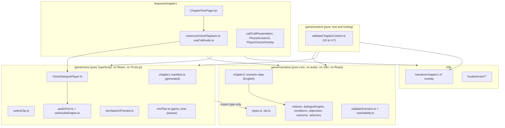
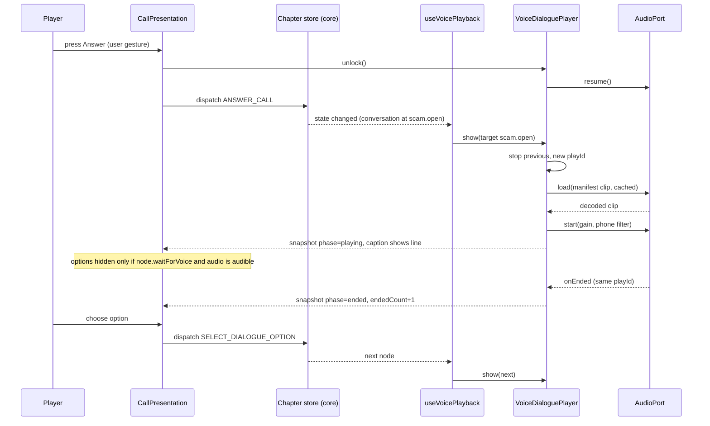
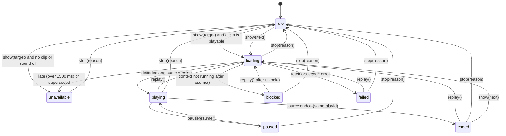
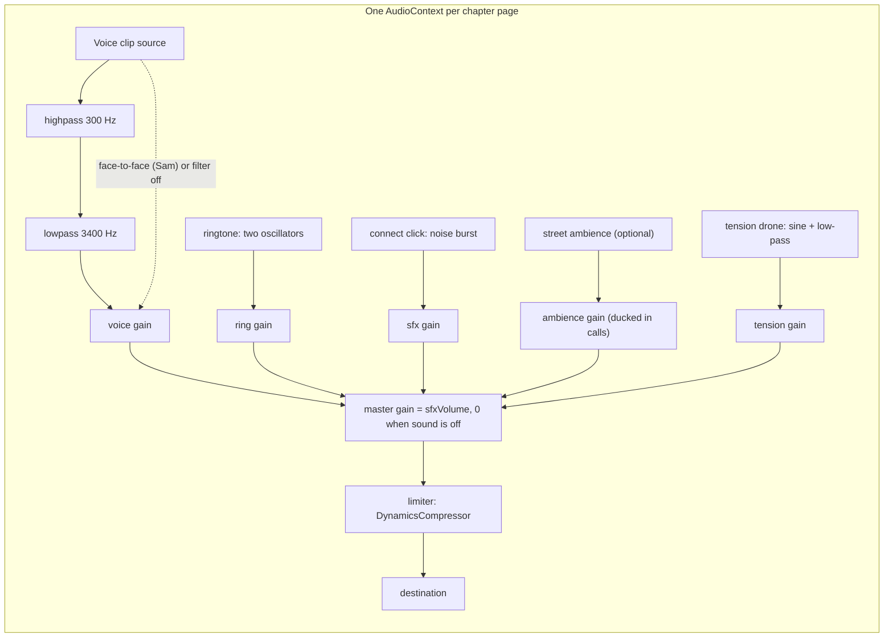
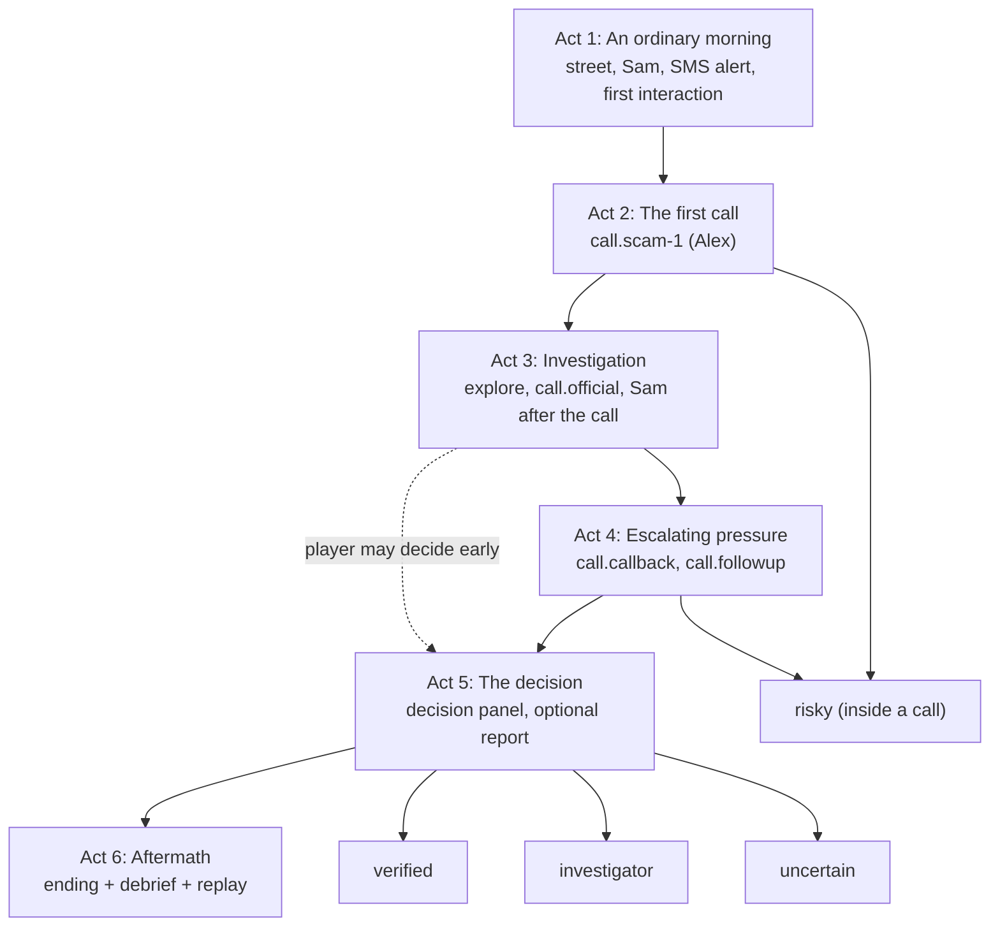

# Design Document: Chapter 1 Voice Narrative

## Overview

This feature turns Chapter 1 ("The Urgent Call") from a short scripted scam call into a full
first-person investigation in which characters speak. Caller and NPC lines are played from
pre-generated voice clips that are committed to the repository. Subtitles are always available.
The phone shows a voice-call screen (duration, mute, replay, one caption line). Player choices
stay outside the phone in the existing Choice_Overlay. The deterministic core still owns state,
rules, evidence, decisions, outcomes and saves. Voice, captions and sound are presentation only.

The work is deliberately additive. Every existing node ID, option ID, evidence ID, flag, claim,
decision and call ID is kept, and every existing option keeps its target, so the four scripted
playthroughs in `game/narrative/chapter1/playthroughs.test.ts` stay valid action logs. New story
is added as new nodes, new options on existing nodes (never more than four options available at
once), new graphs and new data.

### Key decisions

| ID | Decision | Why |
|---|---|---|
| D1 | Branch `feat/chapter-01-voice-narrative` from `feat/game-3d-phone-call-ui` (8c93d27). `main` is not merged. | Owner decision 2026-11-12. The 3D phone lives on that branch. Merges are handled by someone else. |
| D2 | Voices are pre-generated with the Windows built-in speech voices (Microsoft David, Mark, Zira for `en`; Microsoft An for `vi`), called locally through `Windows.Media.SpeechSynthesis`. | Verified on this machine: all four voices synthesize, including `vi-VN`. No install, no network, no project text leaves the machine. See "Voice engine decision". |
| D3 | Clips are MP3, mono, 16 kHz, 48 kbps, encoded with the Windows `MediaTranscoder`. | `ffmpeg`, `oggenc` and `opusenc` are not installed, so `.ogg` is not available. MP3 plays in every target browser. Measured size is about 4 KB per second at 32 kbps. |
| D4 | `clipId` equals the dialogue `nodeId`. Files are `apps/game/public/audio/chapter01/<locale>/<nodeId>.mp3`. The manifest is generated data in `apps/game/src/game/voice/chapter1.manifest.ts`. | Node IDs are stable and unique across graphs (the validator enforces this). Owner decision 2026-11-12 sets the folder. |
| D5 | The scenario schema gets only optional fields: `tone`, `speakerId`, `pauseBeforeMs`, `waitForVoice` on nodes; `acts`; `unlockWhen` on endings; four new `Condition` kinds. | Keeps the engine change small and old data valid. |
| D6 | A Spoken_Node is a node whose `speaker` is `caller` or `npc`. `system` nodes (end lines, the hold message `official.greeting`) are not voiced. | `PlayerChoiceOverlay.test.tsx` documents `official.greeting` as a `system` narration line. Keeping it avoids a test change. |
| D7 | One new incoming call, `call.followup`, is added as a third explicit branch in `RING_CALL`. No data-driven ring-rule abstraction. | Matches the existing code style and is the smallest change. |
| D8 | Acts are derived data (`ActDef` with `enterWhen`, `exitWhen`, `objectives`). The current act is a pure selector. Nothing is added to `ChapterState`. | No save impact. |
| D9 | Save format stays version 2. Content changes are append-only. Restore becomes lenient: it replays the longest accepted prefix and shows a localized notice. | An old save is an action log and state is always derived by replay, so a version bump cannot migrate it. A prefix replay is the only possible "last valid checkpoint". |
| D10 | `VoiceDialoguePlayer` is plain TypeScript in `game/voice/` and talks to audio through an `AudioPort` interface. A separate React hook connects it to the page. | Requirement 5.13. Allows a test double and no real audio device in tests. |
| D11 | `PhoneScreenUI` gets only optional props. When they are absent it renders exactly as today. | Existing `PhoneScreenUI`, `CallPresentation` and accessibility tests keep passing unchanged. |
| D12 | `GameSettings` gets six new fields (see "Settings"). Stored settings are merged with defaults and the new fields are sanitized. | Requirement 11. Old stored settings load without error. |
| D13 | The INVESTIGATOR ending needs the report step, which is a dialogue on the official line, and a threshold of evidence that does not require staying on a suspicious call. | Requirement 14.2 and 14.5. No new core action is needed. |
| D14 | Validation is split: pure scenario checks extend `validateScenario.ts`; reachability is a pure solver in `game/narrative/`; subtitle, manifest and file checks live in `game/content/` (they need the Vietnamese overlay and the manifest). | The core must not import i18n or audio (`boundaries.test.ts`). |
| D15 | The voice generator runs on Windows only. Committed clips are plain files, so other platforms can play and test everything. | The speech API used is a Windows API. |

### Voice engine decision

What was checked on this machine (Windows 11, build 10.0.26200, PowerShell 5.1, Node 22.20, Python 3.14.5):

| Check | Result |
|---|---|
| SAPI5 voices through `System.Speech` | Only Microsoft David Desktop and Microsoft Zira Desktop (`en-US`). No `vi-VN` voice. |
| OneCore voices through `Windows.Media.SpeechSynthesis` (`AllVoices`) | Microsoft David, Microsoft Zira, Microsoft Mark (`en-US`) and Microsoft An (`vi-VN`, male). All four synthesized a test line. Output is 16 kHz, 16-bit, mono WAV. A Vietnamese test line of 12.05 s produced a 385 KB WAV. |
| `SpeakingRate` option | Works. Rate 0.85 gave 11.94 s, 1.2 gave 8.46 s for the same line. |
| `AudioPitch` option and SSML `<prosody pitch>` | Both accepted and both produced audio. A crude zero-crossing measure did not show a clear pitch change for `An`. The audible effect is **not verified**. The cast table treats pitch as a proposal. |
| `ffmpeg`, `ffprobe`, `oggenc`, `opusenc` | None installed. |
| Windows `MediaTranscoder` | Encodes WAV to MP3 and M4A. Mono MP3 at 16 kHz and 32 kbps worked (48,239 bytes for 12.05 s). Mono at 44.1 kHz and 48 kbps worked (72,659 bytes). 48 kbps at 16 kHz was not tested. |
| Piper (offline neural TTS) | Feasible in principle but not installed and not verified here. It needs a Python package install plus model downloads (about 60 MB each). Licenses are mixed: Vietnamese `vais1000` is CC BY 4.0 but is fine-tuned from the English `lessac` voice, whose dataset has its own license page; Vietnamese `vivos` is CC BY-NC-SA 4.0; `25hours_single` has license "Unknown"; English `hfc_male` and `hfc_female` are CC BY-NC-SA 4.0. Each would be a third-party asset to record. |
| Cloud TTS | Not allowed (project text must not leave the machine). Not considered. |

Decision: use the Windows OneCore voices. They are the only option that is verified to work here for
both languages with no install, no download and no network. Piper is kept as a documented
replacement path: the manifest records `origin` and `credit` per clip, and the generator isolates the
engine in one PowerShell file, so clips can be replaced by Piper output or by human recordings
without changing any game code.

Terms of use of the generated audio: **not verified**. No Microsoft document was found that states
whether audio produced by the built-in Windows voices may be redistributed inside an open-source
repository. Answers on Microsoft Q&A are community answers and disagree in tone. This design therefore
records the clips as "terms not verified", puts that wording in the credits entry, and lists a
mandatory owner check before any public release (Risk R1). The repository MIT license does not cover
the audio.

Known limits of this choice (recorded so nobody oversells the result): there is one Vietnamese voice,
and it is male, so all Vietnamese characters share it and are told apart only by rate and filter;
the voices sound synthetic; quality has not been judged by ear in this phase. Vietnamese lines for
characters voiced by `An` use gender-neutral self-reference ("tôi") and the address "quý khách" for the
bank agent, so a male voice never contradicts the text.

### Audit findings (verified in this phase)

Paths are relative to `d:\scam-maze\apps\game\src` unless stated. "Reuse" means no change.

| Area | Finding | Plan |
|---|---|---|
| `game/narrative/types.ts` | Closed shapes for `Condition` (6 kinds), `Effect` (6 kinds), `DialogueNode` (no tone, no audio), `EndingDef`, `ScenarioDefinition` (no acts). | Extend with optional fields. |
| `game/narrative/chapter1/ids.ts` | Every ID list is a closed union that also feeds `createInitialState`, `isCoreAction` and the validator (for example `FLAG_IDS` builds `state.flags`). | Append new IDs at the end of each list. |
| `game/narrative/reducer.ts` | `isCoreAction` hard-codes `INCOMING_CALL_IDS` (`call.scam-1`, `call.callback`) and `RING_REASONS`. `RING_CALL` has one branch per call. `hangUpTag` maps two calls. | Add `call.followup`, reason `follow-up`, one more branch, one more tag. |
| `game/narrative/dialogueEngine.ts` | Pure and generic. Fallback option `__fallback.end` when no option is available. No change needed. | Reuse. |
| `game/narrative/objectives.ts` | `OBJECTIVE_RULES` is a `Record<ObjectiveId, ...>` of functions over `(prev, next, action, scenario)`. | Add three rules. |
| `game/narrative/outcome.ts` | `selectOutcome(state)` is hard-coded. | Add an optional `scenario` parameter and an `investigator` branch. |
| `game/narrative/selectors.ts` | `CALL_LOG_EVIDENCE` maps calls to evidence. `enumerateCandidateActions` lists ring actions. | Add one map entry and one ring candidate. |
| `game/narrative/localize.ts` | One walker lists every translatable field. Adding a field to the walker adds the Narrative_Text_Key automatically. | Add `acts/<id>/title` and the extra inspection text. |
| `game/narrative/validateScenario.ts` | Checks references, duplicate option IDs, "no end reachable" (static), independent-channel rule. No tone, speaker, count or reachability checks. | Extend. |
| `game/narrative/boundaries.test.ts` | Scans every `.ts` under `game/narrative/`. Bare imports and any import of `src/i18n` or other folders (except two allowlisted test helpers and `streetPlayArea.ts`) fail. | New narrative files import only inside the folder. No allowlist change. |
| `game/narrative/chapter1/playthroughs.test.ts` | Hard-codes option IDs, event indices (`state.events[9]`, `[7]`, `[2]`, `[5]`), exact objective timelines and `state.claims` with four keys. | Option IDs stay valid. Objective timelines and `objectives.active` expectations change. See "Known test updates". |
| `game/narrative/chapter1/content.test.ts` | Lints the scenario: reserved domains, `+000` numbers, no currency, **no word "safe"**, no blaming phrases, no emoji, no other bank name. | New content must pass. The "SAFE" ending of the requirements is the `verified` outcome and never appears as a word in game text. |
| `test/chapterRuns.ts` | Generator and guided policy hard-code `call.scam-1` and the incoming call list. | Add the new call and reason to the lists. Guided policy still works (`stop-and-wait` is available once the first call ends). |
| `game/saves/saveGame.ts`, `chapterProgress.ts` | A save is the list of accepted Core_Actions (max 1000). Restore fails if any action is rejected. | Lenient restore (D9). |
| `game/loading/chapterLoader.ts` | An invalid replay becomes a `invalid-save` loading error. | Use lenient restore and carry a notice instead of failing. |
| `features/chapter1/call/PhoneScreenUI.tsx` | Renders the caller line as a card in a polite live region (`call-line-region`, `dialogue-line`). No duration, mute or replay. Uses `usePrefersReducedMotion` (OS query only). | Add optional props. Confirmed: requirement 7 gaps are real. |
| `features/chapter1/call/PlayerChoiceOverlay.tsx` | Options from the view, number keys, autofocus first option. No waiting state. | Add an optional `waiting` state. |
| `features/chapter1/useCallTriggers.ts` | Pure `stepCallTriggers` with a fixed timer object for the two old calls. | Leave it unchanged. Add a second pure function for the follow-up so existing exact-equality tests stay valid. |
| `app/settingsStorage.ts` | `{ ...DEFAULT_SETTINGS, ...parsed }`, so missing keys get defaults. Invalid values of the five legacy fields pass through unvalidated on purpose. | Add defaults and sanitize only the new fields. |
| `features/menu/SettingsModal.tsx` | Master Volume slider writes `musicVolume` and `sfxVolume` together. | Master volume for chapter audio is `sfxVolume`. Add a "Voice and comfort" section. |
| `config/credits.ts` | Types `CreditGroupId` and `CreditItemId` are closed. No audio entry. Existing audio files (`menu_music.mp3`, `menu_ambient.mp3`, and others) have no credit entries. | Add a group and an item for the voice clips. The missing credits of existing audio are flagged, not fixed here. |
| `game/chapters/chapterRegistry.ts` | Chapter 1 lists scenes `apartment` and `street`, but `ChapterOneCanvas.tsx` renders only the street. No apartment scene exists. | Act 1 happens in the street (gap G1). |
| `i18n/narrative/chapter1.vi*` | Overlay keys follow the walker scheme. `i18n/narrative.test.ts` requires a non-empty Vietnamese text for every key. | New English content and its Vietnamese overlay must land together. |
| Baseline counts (measured with a temporary Vite script, deleted) | 4 graphs, **26 nodes**, **18 Spoken_Nodes**, **39 options**, 11 evidence items, 5 objectives. | Recorded as the baseline for requirement 1.2. Test, typecheck and build counts are not re-run in this phase. |

### Requirement gaps and deviations

| ID | Finding | Resolution in this design |
|---|---|---|
| G1 | Requirements 2.1 and 2.2 name Act 1 "An ordinary evening" and ask the player to explore "the apartment". The prologue says morning, and there is no apartment scene. | Act 1 is "An ordinary morning" and happens in the street. No new scene. |
| G2 | Requirement 4.4 puts clips under `/assets/audio/chapter01/`. | Owner decision 2026-11-12 overrides: `/audio/chapter01/<locale>/`. Add the constant `CHAPTER1_VOICE_BASE` to `config/assetPaths.ts`. |
| G3 | Requirement 4.7 asks for the full script list in the design. | The line text is the dialogue data itself. Copying it here would drift. This design lists every node ID with speaker, tone and target length. The generator prints the full list (`clipId`, speaker, locale, text, target seconds) on demand. |
| G4 | Requirement 4.7 proposes Opus in Ogg. | No encoder is available, so MP3 (D3). Numeric limits are restated in "Voice asset production plan". |
| G5 | Requirements 4.2 and 6.7 define `placeholder-tts` as a development preview and `present` as verified playable. The owner now commits real generated files. | Generated clips are `present` and carry `origin: "tts-generated"`. Reports count `present` by origin. `placeholder-tts` stays in the type and is unused. |
| G6 | Requirement 8.2 asks for 2 to 4 options per node. Existing nodes have 3 or 4. | Rule: at most four options are available at once in any reachable state, and at least two except for single-continuation nodes. The solver measures it. |
| G7 | Requirement 11.1 lists four settings. | Two more are needed: `phoneVoiceFilter` and `englishVoiceFallback`. |
| G8 | Requirement 12.4 says the English-voice fallback applies "where the owner enables it". | Setting `englishVoiceFallback`, default `false`, shown in Settings. With all Vietnamese clips present it is never used. |
| G9 | Requirement 13.1 lists ten failure kinds; the owner brief says seven checks. | They are grouped into seven checks V1 to V7. |
| G10 | Requirement 13.5 expects a graceful restore. Today an invalid replay is a loading error. | Behavior change in the loader (D9). |
| G11 | Requirement 14.5 forbids rewarding "staying on a suspicious call". | The INVESTIGATOR evidence set excludes evidence that needs a long exchange with a scammer. |
| G12 | Requirement 3.2 targets 20 to 30 minutes. | A single route probably takes less (Risk R4). Only a Playtest can report the time. |
| G13 | Requirement 3.3 sets 80 to 120 options. | Projected 130 defined option entries (Data Models). About 8% over. Reduction candidates are listed. |
| G14 | Requirement 10.2 mentions a clue "on a virtual device (phone or computer)". Requirement 10.4 allows a 2D computer overlay. | Not built. Phone only. |
| G15 | `usePrefersReducedMotion` reads the OS query only. | A context provides the effective value (setting plus OS). Components outside the provider keep the OS behavior. |
| G16 | Existing audio files have no credit entries. | Flagged for the owner. Not part of this feature. |

## Architecture

### Layers and module boundaries



| Module | May import | Must not import | Enforced by |
|---|---|---|---|
| `game/narrative/**` | itself, `@scammaze/shared-types` | React, Three.js, i18n, `game/voice`, any audio API | `boundaries.test.ts` (unchanged) |
| `game/voice/**` | `game/narrative` (types and IDs), `@scammaze/shared-types` | React, `react-dom`, Three.js, R3F, Drei, i18next, Zustand, Dexie | new `game/voice/boundaries.test.ts`, same scanner approach as the core test |
| `game/content/**` | core, voice, overlay | React, Three.js | review, plus it is only imported by tests and tools |
| `features/chapter1/voice/**` | React, `game/voice`, core | Three.js | `call/importBoundaries.test.ts` pattern, extended to this folder |
| `features/chapter1/call/PhoneScreenUI.tsx` | React, `lucide-react`, i18n hooks | `three`, `@react-three/*` | `call/importBoundaries.test.ts` (unchanged) |

### One spoken line, end to end



The voice player never dispatches to the store. Playback end is only a presentation signal. The
only effect on the UI is the optional `waitForVoice` gate, which opens on end, on skip, or on a
timeout (see below).

### Voice player state machine



Rules that the machine guarantees (each becomes a property or an example test):

1. Every `show`, `replay` and `stop` increments a monotonic `playId`. A fetch, a decode or an
   `onEnded` callback that carries an older `playId` is ignored. This is what prevents overlap
   when decoding finishes out of order.
2. `stop(reason)` is synchronous: it stops the source node, sets its gain to 0, cancels dev speech
   and clears timers. It does not wait for a promise. Reasons: `hang-up`, `declined`, `dialogue-end`,
   `unmount`, `exit`, `locale`, `pause-menu`, `settings-off`.
3. `dispose()` runs `stop("unmount")`, disconnects all nodes, removes every listener it added and
   closes the audio context it created. After `dispose()` every method is a no-op.
4. A clip that is not decoded within `LATE_CLIP_MS = 1500` after `show` is not played for that
   node (the caption is already visible). It keeps loading into the cache so Replay is instant.
5. `muted` is a separate flag. Mute sets the voice gain to 0 and does not stop the clip.
6. The player never throws. Every failure becomes a snapshot `reason` plus one log line per clip
   per session.

### Web Audio graph



All gains are linear and PROPOSED. Peak caps (requirement 11.10): ringtone, connect click, ambience
and tension are each capped at 0.2 linear (about -14 dBFS) before the master gain. The limiter
catches any sum above that. No sound is a jump-scare: the tension drone moves 1.5 s per step and
has no transient.

The phone-speaker filter (requirement 15.3) is two `BiquadFilterNode`s (high-pass 300 Hz, low-pass
3400 Hz, Q 0.707) created at playback time for clips played on a phone call. It is skipped for
face-to-face clips and when `phoneVoiceFilter` is off. The clip files are never modified by it.

### Saves and old saves (decision D9, requirement 13.4)

Chosen: **keep save format version 2**, with these rules.

1. Append-only content: no ID is removed or renamed, no existing option changes its `next`, no
   existing option becomes stricter, no existing node loses an `onEnter` effect. The four scripted
   playthroughs are frozen as fixtures in a new test (`savedPathsStillReplay.test.ts`) that replays
   them against the new scenario and requires every action to be accepted.
2. Start-node variants (`startNodeWhen`) added to existing graphs use only flags that can be set by
   new options. Old logs can never set those flags, so their start node does not change.
3. `restoreProgress` gets a lenient mode. It replays actions in order and stops at the first rejected
   action. The result is the state after the last accepted action, flagged `trimmed: true` and
   `acceptedActions: n`. Too many actions (over 1000) and a non-finite pose stay hard failures,
   because they mean the data is damaged and not just old.
4. `chapterLoader` uses the lenient mode. A trimmed restore is a success with a notice. The Chapter_Page
   shows a dismissible localized notice ("Your saved progress was updated for a new version of
   this chapter. It was restored to the last point that still fits."). With zero accepted actions the
   chapter starts at the beginning and shows the same notice.
5. Saves contain no audio state, call duration, caption or locale. `encodeProgress` is unchanged and
   a test checks that its output has only `checkpointId`, `actions` and `playerPose`.

Why not a version bump: state is always rebuilt by replay, so there is nothing to migrate except
by replay. A bump would add a second storage key and a dual-read path and would still end in the
same prefix replay. The effect on a player with an old save: if the new graphs accept their whole
log (likely, because of the append-only rule), nothing changes. If not, they continue from the last
point that still fits, with a notice. They never see a crash or an error screen.

## Components and Interfaces

### 1. Scenario schema (`game/narrative/types.ts`, `chapter1/ids.ts`)

All additions are optional or additive. Nothing is renamed.

```ts
// ids.ts (append to the end of each list)
export const SPEAKER_IDS = ["spk.alex", "spk.sam", "spk.northgate-agent", "spk.case-officer"] as const;
export type SpeakerId = (typeof SPEAKER_IDS)[number];
export const TONE_IDS = ["professional", "reassuring", "defensive", "impatient", "pressuring"] as const;
export type Tone = (typeof TONE_IDS)[number];
export const ACT_IDS = ["act.1", "act.2", "act.3", "act.4", "act.5", "act.6"] as const;
export type ActId = (typeof ACT_IDS)[number];
// plus new IDs listed in "Data Models": objectives, evidence, flags, warning signs, calls,
// graphs, messages, outcomes.

// types.ts
export interface DialogueGraph {
  persona: { speakerId: SpeakerId; name: string; role: string; honesty: "scammer" | "trusted" | "neutral" };
  // other fields unchanged
}
export interface DialogueNode {
  // existing fields unchanged
  tone?: Tone;              // required by the validator on every Spoken_Node
  speakerId?: SpeakerId;    // overrides graph.persona.speakerId for this node
  pauseBeforeMs?: number;   // presentation only, 0..3000, delays audio start (not the caption)
  waitForVoice?: boolean;   // presentation only, see "Choice gate"
}
export type Condition =
  | /* six existing kinds */
  | { kind: "callRang"; callId: CallId }                      // a log record exists for the call
  | { kind: "objectiveCompleted"; objectiveId: ObjectiveId }
  | { kind: "outcomeSet" }
  | { kind: "evidenceCountAtLeast"; evidenceIds: EvidenceId[]; count: number };
export interface EndingDef { /* existing */ unlockWhen?: Condition[] }  // extra conditions for this outcome
export interface ActDef {
  id: ActId;
  title: string;                 // translatable, key acts/<id>/title
  enterWhen: Condition[];        // monotonic: once true it stays true
  exitWhen: Condition[];         // equals the next act's enterWhen (validator checks)
  objectives: ObjectiveId[];     // each objective belongs to exactly one act
}
export interface ScenarioDefinition { /* existing */ acts: ActDef[] }
export type RingReason = /* existing */ | "follow-up";
```

`speaker` stays `"caller" | "player" | "npc" | "system"`. Voice casting uses `speakerId`; the
manifest records it so a voice or a human actor can be assigned per character.

### 2. Core changes (small and listed)

| File | Change |
|---|---|
| `conditions.ts` | Four new `case` branches in `evaluateCondition`. `callRang`: a log record exists. `objectiveCompleted`: ID is in `objectives.completed`. `outcomeSet`: `outcome !== null`. `evidenceCountAtLeast`: count of listed IDs in `discovered` is at least `count`. `assertNever` keeps the switch exhaustive. |
| `reducer.ts` | `INCOMING_CALL_IDS` and `RING_REASONS` get the new values. `RING_CALL` gets a third branch for `call.followup`: reject if it already has a record, if a decision exists, or if the callback is not closed (record status `ended` or `declined`); on accept set flag `followup_rang`. New `REASONS`: `followupNotYet`, `followupAlreadyRang`. `hangUpTag` maps `call.followup` to `hung-up-on-followup`. No other action changes. |
| `outcome.ts` | `selectOutcome(state, scenario = CHAPTER_1_SCENARIO)`. Order: risky flags first (unchanged); then `verify-independently` with `claim.caller-identity` contradicted gives `investigator` when `evaluateConditions(scenario.endings.investigator.unlockWhen)` holds, otherwise `verified`; then `stop-and-wait` gives `uncertain`. |
| `objectives.ts` | Three rules appended to `OBJECTIVE_RULES` (see "Objectives"). |
| `selectors.ts` | `CALL_LOG_EVIDENCE["call.followup"] = "ev.second-number"`. `enumerateCandidateActions` adds the follow-up ring candidate. New `selectCurrentAct(state, scenario): ActDef` (last act whose `enterWhen` holds). |
| `evidence.ts` | No change. New evidence uses existing discovery kinds (`interact`, `inspect`, `dialogue-node`, `verify`). |
| `localize.ts` | The walker also visits `acts[i].title` (key `acts/<id>/title`). Everything else is already covered because new fields live inside records the walker already maps. |
| `validateScenario.ts` | New checks listed in "Content validator". |
| `reachability.ts` (new) | Pure solver, see below. |
| `debrief.ts` | No code change. New debrief tags only need `decisionNotes` text. |
| `chapter1/*` data | New content, new fields on existing nodes (`tone`, `speakerId`, `waitForVoice`), new `persona.speakerId` on the four graphs. Existing option targets are untouched. |

The dialogue engine, the objective manager's loop, the reducer pipeline, the store and the debrief
builder are unchanged.

### 3. Content validator (requirement 13, design decision D14)

The seven checks group the ten failure kinds of requirement 13.1. Each returns issues as
`{ check, where, message }` and never throws on bad input, so tests can feed broken fixtures.

| Check | What it proves | Where | Method |
|---|---|---|---|
| V1 References | Every node, option target, line, evidence, flag, claim, objective, call, message, decision, speaker, act and tone exists. Node IDs are unique across all graphs (clip IDs depend on it). Option IDs are unique (existing rule). `pauseBeforeMs` is 0 to 3000. | `validateScenario.ts` (extended) | Static walk. |
| V2 Reachability | Every node and every option can be reached from some reachable state. Every Ending is reachable. From every reachable state an Outcome is reachable (no soft lock). | `reachability.ts` | Bounded search over reducer states (below). |
| V3 Termination and shape | No node that cannot reach an end (existing rule, kept). No cycle without an exit. Every pressure node can reach an end node within 3 option steps. No node has more than four unconditional options. Maximum options available at once is at most four in every reachable state, and at least two except single-continuation nodes. | `validateScenario.ts` (static part), `reachability.ts` (measured part) | Static graph search plus the solver. |
| V4 Impossible conditions | No condition can never be true: a flag that no effect sets, evidence with no reachable discovery, a claim status no effect produces, `callEnded` or `callRang` for a call that has no graph. No option or start variant that is never enabled in any reachable state. | both | Static producer sets, then solver confirmation. |
| V5 Subtitles | Every Spoken_Node has a non-empty English line and a non-empty Vietnamese overlay text. The failure names the node. | `game/content/validateChapterContent.ts` | Walk Spoken_Nodes, read `lines[lineId]` and `overlay["dialogues/<graph>/lines/<lineId>"]`. |
| V6 Manifest coverage | `schemaVersion` is supported. Every Spoken_Node has exactly one entry per locale, none is extra, `clipId === nodeId`, `speakerId` matches the node, `sourceTextHash` equals `fnv1a32(display line)` (stale clip check), statuses are known, `present` entries have `sources`, `durationMs` and `bytes`, `missing` entries have none. | same | Pure comparison. |
| V7 Files | Every `present` entry points to a file that exists (injected `fileInfo(publicPath)`), under `/audio/chapter01/<locale>/`, MIME `audio/mpeg`, `bytes` equal the real size, size at most 150 KB per clip and 6 MB per locale, duration 0.5 s to 25 s. | same | The Vitest wrapper supplies `fileInfo` from `node:fs`, so the module itself imports no Node API. |

Reachability solver (`reachability.ts`):

- Input: a scenario. Output: `{ states, truncated, outcomesReached, unreachableNodes, unreachableOptions, softLocks, maxAvailableOptions, minAvailableOptions }`.
- State key: JSON of `flags`, `claims`, `discovered` (sorted), `decision`, `outcome`, `pressure`, `call` (current, status, per-call record status), `conversation` (graph, node), `phone.open`, `interacted` (sorted). The `events` log, `conversationHistory` and `objectives` are left out of the key, because they cannot change which actions are possible. Objectives are still computed by the real reducer.
- Moves: `enumerateCandidateActions(state, scenario)` plus `ANSWER_CALL` and `END_CALL` variants it already lists. The real `chapterReducer` applies every move, so the solver cannot disagree with the game.
- Reduction: after each state is expanded, **free actions are saturated** (all `INTERACT_OBJECT`, `INSPECT_EVIDENCE`, `OPEN_PHONE`, bank-app `VERIFY_CLAIM`), because they only add evidence and never remove an option. Branching happens only on calls, dialogue options, decisions and `END_CALL`.
- Budget: `maxStates` default 100,000. If it is exceeded the report has `truncated: true` and the test fails with a clear message (so the model gets simplified and nobody trusts a partial proof). The size is not measured yet; the implementation task records it.
- Soft-lock check: after the search, compute states from which some state with `outcome !== null` is reachable (reverse edges). Any explored state outside that set is a soft lock.
- Used by the example test "all endings reachable" and by property tests with seeded mutations.

Fault injection (property 2) uses a catalogue of 24 single mutations applied to a deep copy of the
scenario: delete a node, point an option at a missing node, remove a line, delete an evidence entry
that a condition names, rename a flag in one condition, add an option with an impossible condition,
add a node nobody points to, add a cycle without exit, add a fifth unconditional option, drop a
tone, drop a manifest entry, flip a manifest hash, mark a missing file `present`, and so on.

### 4. Voice module (`game/voice/`, pure TypeScript)

Files: `manifestTypes.ts`, `chapter1.manifest.ts` (generated), `hash.ts` (`fnv1a32`), `selectClip.ts`,
`audioPort.ts` (interfaces only), `webAudioEngine.ts` (real port, ringtone, tension, ambience),
`VoiceDialoguePlayer.ts`, `devSpeechPreview.ts`, `mixPlan.ts`, `buildVoiceJobs.ts` and `renderManifest.ts`
(used by the generator and covered by tests).

```ts
// manifestTypes.ts
export const VOICE_MANIFEST_SCHEMA_VERSION = 1;
export type ClipStatus = "present" | "missing" | "placeholder-tts";   // placeholder-tts unused
export interface VoiceClipEntry {
  clipId: string;                    // equals nodeId
  nodeId: string;
  graphId: DialogueGraphId;
  speakerId: SpeakerId;
  locale: GameLocale;                // "en" | "vi"
  status: ClipStatus;
  sources: ReadonlyArray<{ src: string; type: "audio/mpeg" }>;   // empty when missing
  durationMs?: number;               // measured from the source WAV, absent when missing
  bytes?: number;
  tone: Tone;
  voiceNote: string;                 // character description for a voice actor or an engine
  origin: "tts-generated" | "human-recorded" | "none";
  credit: string;                    // "not provided" when origin is none
  sourceTextHash: string;            // fnv1a32 of the line text the clip was made from
}
export interface VoiceManifest {
  schemaVersion: typeof VOICE_MANIFEST_SCHEMA_VERSION;
  chapterId: "chapter-1";
  clips: ReadonlyArray<VoiceClipEntry>;   // sorted by clipId, then locale
}
```

`chapter1.manifest.ts` is a typed `const` with a header comment ("Generated by
`scripts/generate-chapter1-voice.mjs`. Do not edit by hand."). A typed `const` (not JSON) means a
wrong ID shape fails `tsc`. Existence of a node is checked by V6.

```ts
// selectClip.ts
export type ClipChoice =
  | { kind: "clip"; entry: VoiceClipEntry; label: "none" | "english-voice" }
  | { kind: "none"; reason: "missing" };
export function selectClip(m: VoiceManifest, graphId: DialogueGraphId, nodeId: string,
  locale: GameLocale, englishVoiceFallback: boolean): ClipChoice;
```

Rules: use the entry for `locale` when it is `present`. Otherwise, only when `locale !== "en"`, the
setting is on and the English entry is `present`, return it with `label: "english-voice"`. Otherwise
`missing`. The function can never return an entry whose `locale` differs from `locale` without the
`english-voice` label, and never labels an English entry as the player's language.

```ts
// audioPort.ts
export interface LoadedClip { readonly id: string; readonly durationMs: number }
export interface PlaybackHandle { stop(): void; setGain(v: number): void; positionMs(): number }
export interface AudioPort {
  readonly supported: boolean;
  resume(): Promise<"running" | "suspended">;
  load(url: string): Promise<LoadedClip>;                       // fetch + decode, rejects on error
  start(clip: LoadedClip, o: { offsetMs: number; gain: number; phoneFilter: boolean;
        onEnded: () => void }): PlaybackHandle;
  dispose(): void;
}
```

```ts
// VoiceDialoguePlayer.ts
export interface VoiceTarget {
  key: string;                       // `${graphId}:${nodeId}`
  graphId: DialogueGraphId; nodeId: string; speakerId: SpeakerId; tone: Tone;
  channel: "phone" | "face-to-face"; lineText: string;   // lineText only for the dev preview
  pauseBeforeMs: number;             // already adjusted for reduced stress
}
export interface VoiceSettings {
  locale: GameLocale; soundEnabled: boolean; masterVolume: number; voiceVolume: number;
  phoneFilter: boolean; englishVoiceFallback: boolean; devPreview: boolean;
}
export type VoicePhase = "idle" | "loading" | "playing" | "paused" | "ended" | "blocked" | "unavailable" | "failed";
export interface VoiceSnapshot {
  phase: VoicePhase; targetKey: string | null;
  source: "clip" | "dev-preview" | "none";
  label: "none" | "english-voice" | "dev-preview";
  reason: "disabled" | "missing" | "no-matching-voice" | "autoplay-blocked" | "load-failed" | "late" | null;
  muted: boolean; audible: boolean;          // audible: something can be heard right now
  durationMs: number | null; endedCount: number;
}
export interface VoiceDialoguePlayer {
  unlock(): Promise<void>;                    // call inside a user gesture
  configure(s: VoiceSettings): void;
  show(t: VoiceTarget): void;
  replay(): void;                             // replaying while muted unmutes first
  setMuted(m: boolean): void;
  pause(): void; resume(): void;
  stop(reason: StopReason): void;             // synchronous
  prefetch(keys: ReadonlyArray<{ graphId: DialogueGraphId; nodeId: string }>): void;
  subscribe(l: () => void): () => void; getSnapshot(): VoiceSnapshot;
  dispose(): void;
}
export function createVoiceDialoguePlayer(deps: {
  manifest: VoiceManifest; port: AudioPort; preview: PreviewPort | null;
  now: () => number; setTimer: (fn: () => void, ms: number) => number; clearTimer: (id: number) => void;
  log: (message: string) => void;
}): VoiceDialoguePlayer;
```

Behavior details:

- Gain: `voiceGain(settings, muted) = !soundEnabled || muted ? 0 : clamp01(voiceVolume) * clamp01(masterVolume)`. With gain 0 because of `soundEnabled = false` or `voiceVolume = 0`, no clip is fetched or started (`reason: "disabled"`, `audible: false`). Muted playback keeps running silently so Unmute is instant.
- `show` order: stop the previous playback; decide `selectClip`; if the dev preview is enabled and the clip is `missing`, hand the line to the preview port; start after `pauseBeforeMs`.
- Prefetch: the hook calls `prefetch` for the Spoken_Nodes that the current options lead to, and at page mount for the Act 1 and Act 2 nodes of the current locale (concurrency 2, low priority). The cache keeps at most 8 decoded buffers (least recently used). A failed prefetch is not retried until the node is shown. This satisfies requirement 4.11 without changing `chapterRegistry`: entry to the chapter never waits for audio.
- Logging: each clip failure is logged once per clip per session through `log` (the app passes `console.warn`).
- Dev preview: `devSpeechPreview.ts` implements `PreviewPort` over `speechSynthesis`. It is created only if `import.meta.env.DEV` or `import.meta.env.VITE_DEV_VOICE_PREVIEW === "true"`. It picks a voice whose `lang` starts with the locale tag. If none matches it stays silent (`reason: "no-matching-voice"`). It never speaks Vietnamese text with an English voice. It follows `stop`, `mute` and `dispose`. The Settings screen has no control for it.

The real port (`webAudioEngine.ts`) creates the `AudioContext` lazily in `unlock()`. When the
constructor is missing (jsdom, old browsers) `supported` is false and every playback request ends as
`unavailable`. It also exposes `ringtone.start/stop`, `connectClick()`, `tension.setLevel(0..3)`,
`ambience.start/stop/duck`, all created from the same context and master gain.

`mixPlan.ts` holds the numbers (all PROPOSED) as exported constants so tests and the Settings preview
read the same values:

| Constant | Value |
|---|---|
| `DEFAULT_PAUSE_MS` (professional, reassuring, defensive, impatient, pressuring) | 350, 450, 300, 150, 100 |
| `REDUCED_STRESS_EXTRA_PAUSE_MS` (impatient and pressuring only) | 1200 |
| `LATE_CLIP_MS` | 1500 |
| `GATE_AFTER_END_MS` | 300 |
| `GATE_TIMEOUT_EXTRA_MS` | 1500 |
| `PEAK_CAP` for ringtone, click, ambience, tension | 0.2 linear |
| ringtone gain / reduced stress factor | 0.15 / 0.5 |
| tension gain per pressure level (1, 2, 3) / reduced stress factor | 0.015, 0.03, 0.045 / 0.4 |
| tension fade time | 1.5 s |
| ambience gain / during a call | 0.12 / 0.04 |
| phone filter | high-pass 300 Hz, low-pass 3400 Hz, Q 0.707 |

### 5. React integration (`features/chapter1/voice/`)

- `useVoicePlayback.ts`: creates one player per page mount (`useState` initializer), disposes it on
  unmount, and returns a `VoiceController`:
  `{ snapshot, muted, unlock, replay, setMuted, optionsWaiting, skipWait }`. It subscribes to the
  chapter store, builds a `VoiceTarget` from `selectDialogueView` and `state.call` (phone: call status
  `active` and a linked conversation on a Spoken_Node; face-to-face: a conversation with no call on a
  Spoken_Node), calls `show` when the node key changes, and `stop` with the right reason when the
  target disappears (`hang-up` when the player ended it, `dialogue-end` when the graph ended,
  `declined`). It calls `configure` whenever settings or locale change. A locale change stops the
  current clip and does not start a new one; the next node uses the new locale and Replay uses it too
  (requirement 12.6). It calls `pause` when the pause overlay is on top and `resume` when it closes.
  It keeps the mute flag per call: `setMuted(false)` is applied when a new call becomes active.
- `useCallDuration.ts`: whole seconds since the call became `active`, counted from a presentation
  clock (`performance.now()`), frozen while paused, reset per call. Not in the store, not saved.
- `useCallAudio.ts`: ringtone while `call.status === "ringing"`, connect click on `active`, tension
  level from `state.pressure` while a call is active (0 when none), all with the reduced-stress
  factors. Stops everything on call end, pause menu and unmount. Shows nothing by itself: every ring
  is already visible on the phone screen, and the non-speech cues have captions (below).
- `useOptionsGate` (inside `useVoicePlayback`): described next.

Choice gate (requirement 5.9). A node with `waitForVoice: true` hides the player's options only
while `snapshot.audible && phase in { loading, playing }`. The options appear 300 ms after the clip
ends, when the player activates "Show replies now", or `durationMs + 1500` ms after the node started,
whichever comes first. If the phase is `blocked`, `failed`, `unavailable`, `idle` or the gain is 0,
the options appear at once. The first release marks four nodes: `scam.open`, `callback.open`,
`followup.open`, `followup.code-used`. Everything else shows options immediately. No timer starts a
dialogue transition, and `ended` never selects an option (requirements 5.10, 8.5).

Wiring in `ChapterOnePage.tsx`: create the controller; call `voice.unlock()` inside `handleBegin`
and `handleAnswerCall` (both run in click handlers); pass `voice` and `settings` down to
`CallPresentation` and to the `dialogue` overlay; wrap the page content in a `ComfortProvider` that
exposes the effective reduced motion and reduced stress. The pause overlay already exists
(`paused`), so `pause`/`resume` follow it.

### 6. Phone screen and choice overlay (requirements 7 and 8)

`PhoneScreenUI` new optional props (absent means today's rendering, so existing tests are untouched):

```ts
interface CallControlsView {
  durationSeconds: number;
  muted: boolean;
  replayEnabled: boolean;        // false when sound is off, volume is 0 or no clip and no preview
  captionVisible: boolean;       // subtitlesEnabled || nothing is audible
  notice: "none" | "autoplay-blocked" | "dev-preview" | "english-voice" | "no-audio";
  compact: boolean;              // true when layout.screen.height < 360
}
// props: controls?: CallControlsView; onToggleMute?: () => void; onReplay?: () => void;
```

Active layout, top to bottom: avatar (hidden when `compact`), caller name, number (`dir="ltr"`,
plain text), status text, duration, notice line, caption region, a row with Mute and Replay, Hang up.
No option, no long paragraph, no verified badge.

- Duration: `<time role="timer" aria-label="Call duration" dateTime="PT0M7S">0:07</time>`. A timer
  role is not announced on each tick.
- Mute: native button, `aria-pressed`, label changes between "Mute" and "Unmute", icon changes
  between `Volume2` and `VolumeX`. The pressed state therefore differs in text and icon, not color alone.
- Replay: native button with a `RotateCcw` icon. It is disabled when `replayEnabled` is false. The
  button element is never remounted, so keyboard focus stays on it after a replay.
- Caption: the existing `call-line-region` live region and `dialogue-line` card stay. When
  `captionVisible` is false the region stays in the DOM and is empty. The text shown is always the
  current line only.
- Notice: one polite line. Text from keys below. `english-voice` and `dev-preview` always name the
  audio kind. `autoplay-blocked` tells the player to press Replay.
- Contrast and focus: new controls use the existing `UI.*` classes, which the existing
  `contrast.test.ts` covers. The focus ring is the shared one (at least 3:1). Text is at least 14 px.
- Narrow screens: `layout.screen.height` is at least 288 px. At this height the compact mode removes
  the avatar and tightens gaps so the caption region keeps at least two lines. This is checked by a
  layout test with the numbers from `computeCallLayout`, not by eye.

`PlayerChoiceOverlay` new optional props `waiting?: boolean` and `onSkipWait?: () => void`. While
`waiting`, it shows a status line ("Listening...") and one "Show replies now" button instead of the
list; number keys are off; the Skip button takes focus. When waiting ends, the existing node-key
effect focuses the first option (the key now includes the waiting flag). Its position, region,
scroll and keyboard logic are unchanged. For a node with four options at the narrowest layout the
overlay already scrolls inside `layout.choice`.

`DialoguePanel` (Sam) gets an optional `voice` prop with a Replay button and the notice line. Its text
card is always visible. The Subtitles setting affects the phone caption only.

`CallPresentation` passes the controller state to the two components above, shows the non-speech
captions ("Phone ringing" while ringing, "Call connected" on answer) through the same notice
line, and keeps its single dispatch guard.

### 7. Settings (requirement 11)

`packages/shared-types/src/index.ts`:

```ts
export type ReducedMotionSetting = "system" | "on" | "off";
export interface GameSettings {
  // existing six fields unchanged
  voiceVolume: number;               // 0..1, default 1.0
  subtitlesEnabled: boolean;         // default true
  reducedStress: boolean;            // default false
  reducedMotion: ReducedMotionSetting; // default "system"
  phoneVoiceFilter: boolean;         // default true
  englishVoiceFallback: boolean;     // default false
}
```

`DEFAULT_SETTINGS` gets the six defaults. `parseStoredSettings` keeps its legacy merge, then runs
`sanitizeNewFields`: `voiceVolume` must be a finite number (clamped to 0..1, otherwise 1.0); the
three booleans must be booleans; `reducedMotion` must be one of the three strings; anything else
falls back to the default. Unknown keys are kept as before. A stored value from before this feature
has none of the six keys, so the spread fills them and every old value stays. The storage key stays
`scammaze_settings_v1`.

Master volume for chapter audio is the existing `sfxVolume` (the "Master Volume" slider writes it
together with `musicVolume`). Voice, ringtone, tension and ambience all multiply by it, and all are 0
when `soundEnabled` is false.

`SettingsModal` gets a section "Voice and comfort" with: Voice volume slider (shown only when sound is on),
Captions toggle, Phone speaker effect toggle, English voice fallback toggle (shown only when the
language is Vietnamese), Reduced-stress toggle with a one-line hint, and a three-option radio group
for reduced motion. Controls reuse the modal's existing button and slider classes and are native
elements, so keyboard use works.

Effective values: `effectiveReducedMotion = reducedMotion === "on" || (reducedMotion === "system" && osQuery)`.
`ComfortProvider` publishes `{ reducedMotion, reducedStress, subtitlesEnabled }`. `useReducedMotion()`
reads the provider and falls back to the OS query without a provider, so `usePrefersReducedMotion`
callers outside the chapter and existing tests behave as before. Reduced motion applies to the phone
entry animation, the ringing vibration (3D and 2D icon) and every new animated element.
Reduced stress applies: ringtone ×0.5, tension ×0.4, no vibration, +1200 ms before `impatient` and
`pressuring` lines. It changes no story data and no outcome.

### 8. Localization (requirement 12)

- English is authored in `game/narrative/chapter1/**`. Vietnamese goes in the overlay parts under
  `i18n/narrative/chapter1.vi/` (`dialogues.ts` gets the new graphs; `core.ts` the acts and objectives;
  `evidence.ts`; `phone.ts` for the new message, contact and call name; `decisions.ts`). A new part is not needed.
- UI text goes in `i18n/locales/{en,vi}/chapter1/phone.ts`, `hud.ts` and `settings.ts`, `credits.ts`,
  and `menu.ts`. One complete sentence per key. No concatenation. Interpolation uses `{{name}}`.
- Subtitle language and clip locale both come from `settings.language`. `useVoicePlayback` reads the
  same locale hook as the display scenario.
- Prologue: `menu.prologue.location` becomes "A city street · Morning" (`en`) and
  "Một con phố trong thành phố · Buổi sáng" (`vi`). The comment in `App.tsx` that says "District 4" is
  a code comment about an existing audio file and stays.
- Vietnamese rules from `content.vi.test.ts` apply to the new text: no "an toàn" as a safety claim,
  reserved domains only, `+000` numbers, no emoji, "Northgate Bank" not translated.
- English rules from `content.test.ts` apply to the new text, including **no word "safe"**.
  Use "protected", "secure", "trusted channel", "matches the official record".

New UI keys (namespace `chapter1` unless noted). Each exists in `en` and `vi`.

| Key | English source |
|---|---|
| `phone.call.duration` | Call duration |
| `phone.call.mute` / `phone.call.unmute` | Mute / Unmute |
| `phone.call.replay` | Replay |
| `phone.call.listening` | Listening to the caller. |
| `phone.call.showReplies` | Show replies now |
| `phone.call.notice.autoplayBlocked` | Sound is blocked by the browser. Press Replay to hear this line. |
| `phone.call.notice.devPreview` | Development preview voice. This is not a recording. |
| `phone.call.notice.englishVoice` | This line is spoken in English. The caption is in Vietnamese. |
| `phone.call.notice.noAudio` | There is no audio for this line. Read the caption. |
| `phone.sound.ringing` | Phone ringing |
| `phone.sound.connected` | Call connected |
| `hud.act.label` | Act {{number}}: {{title}} |
| `hud.saveTrimmed.message` | Your saved progress was updated for a new version of this chapter. It was restored to the last point that still fits. |
| `hud.saveTrimmed.dismiss` | Dismiss |
| `settings:voice.heading` | Voice and comfort |
| `settings:voice.volume` | Voice volume |
| `settings:voice.captions` | Captions |
| `settings:voice.phoneFilter` | Phone speaker effect |
| `settings:voice.englishFallback` | Use the English voice when Vietnamese audio is missing |
| `settings:comfort.reducedStress` | Reduced-stress mode |
| `settings:comfort.reducedStressHint` | Softer sounds, no ring vibration and longer pauses before tense lines. The story does not change. |
| `settings:comfort.motion.heading` | Reduce motion |
| `settings:comfort.motion.system` / `.on` / `.off` | Follow the system / On / Off |
| `settings:toggle.on` / `settings:toggle.off` | On / Off |
| `credits:groups.audio.category` | Voice and Audio |
| `credits:items.chapter1Voices.notes` | Voice clips for Chapter 1, generated on a computer with Windows speech voices. The terms of use for redistributing this audio have not been verified. |
| `menu:prologue.location` | A city street · Morning |

Narrative overlay keys follow the existing walker scheme. New keys appear for: each new line ID
(`dialogues/<graph>/lines/<lineId>`), persona name and role of `dlg.followup`, `acts/<id>/title`,
`objectives/<id>/text`, evidence fields and relation notes, warning signs, `phone/messages/msg.case-sms/*`,
`phone/contacts/+000 555 0177/name`, `calls/call.followup/displayName`, `endings/investigator/*`,
`debrief/outcomeSummaries/investigator` and `debrief/decisionNotes/<tag>`.

### 9. Voice asset production plan (requirement 4.7)

| Item | Proposal (all PROPOSED, unmeasured except where stated) |
|---|---|
| Script list | Generated, not copied here (gap G3). Command: `pnpm --filter @scammaze/game voice:script` prints `clipId`, speaker, locale, tone, text and target seconds for every Spoken_Node. The node list with speakers and tones is in "Data Models". |
| Format | MP3, mono, 16 kHz, 48 kbps (Windows `MediaTranscoder`). If 48 kbps at 16 kHz is refused, the script falls back to 32 kbps, which is verified to work. |
| Naming | `apps/game/public/audio/chapter01/<locale>/<nodeId>.mp3` |
| Target length | 3 to 15 s per clip. Hard limits 0.5 s to 25 s (validator). |
| Loudness | Normalize each clip to a peak of -3 dBFS before encoding. Record the measured RMS in the log. Aim for an RMS between -23 and -17 dBFS. LUFS is not measured because no tool is installed. |
| Max size | 150 KB per clip, 6 MB per locale (validator V7). |
| Projected size | 54 clips × about 8 s × 6 KB/s ≈ 2.6 MB per locale, about 5 MB for both. The owner budget of about 15 MB per locale is not approached. This is a projection from one measured clip (12.05 s → 48 KB at 32 kbps). |
| Source files | WAV working files go to `apps/game/.voice-cache/` (git-ignored). They are never in `public/`, so they never reach `dist`. |
| Credit | One credits entry (below). Each manifest entry has `origin` and `credit`. |

### 10. TTS generation pipeline

Files: `apps/game/scripts/generate-chapter1-voice.mjs` (orchestrator, Node), 
`apps/game/scripts/generate-chapter1-voice.ps1` (Windows speech and MP3 worker), and the pure helpers
`game/voice/buildVoiceJobs.ts` and `game/voice/renderManifest.ts` (unit tested).

Package scripts in `apps/game/package.json` (no new dependency; `vite` is already installed):

```
"voice:chapter1": "node scripts/generate-chapter1-voice.mjs",
"voice:script":   "node scripts/generate-chapter1-voice.mjs --print-script",
"voice:report":   "node scripts/generate-chapter1-voice.mjs --report"
```

Exact commands (from `d:\scam-maze`, Windows, PowerShell):

```
pnpm --filter @scammaze/game voice:chapter1                      # all missing or stale clips, both locales
pnpm --filter @scammaze/game voice:chapter1 -- --locale vi       # one locale
pnpm --filter @scammaze/game voice:chapter1 -- --only scam.open,scam.details --force
pnpm --filter @scammaze/game voice:chapter1 -- --dry-run         # list jobs, write nothing
pnpm --filter @scammaze/game voice:report                        # counts and missing list
pnpm --filter @scammaze/game voice:report -- --strict            # exit code 1 if any clip is missing
pnpm --filter @scammaze/game test                                # validator V5 to V7 run here
```

Pipeline steps:

1. **Load data.** The `.mjs` starts a Vite server in middleware mode (`createServer`, `appType: "custom"`,
   no HMR) and calls `ssrLoadModule` on the scenario, the Vietnamese overlay and `buildVoiceJobs.ts`.
   This was verified in this phase with a temporary script: it loaded `scenario.ts` and printed the node
   counts above. If a later Vite release removes `ssrLoadModule`, the replacement is the Vite module
   runner API; the rest of the pipeline does not change.
2. **Build jobs.** `buildVoiceJobs(scenario, overlays, cast)` returns one job per Spoken_Node and
   locale: `{ clipId, graphId, speakerId, tone, locale, text, textHash, voice, rate, pitch, outWav, outMp3 }`.
   `text` is the English line or the Vietnamese overlay text.
3. **Skip fresh work.** A job is skipped when the manifest entry exists, `sourceTextHash` equals the
   job hash, the cast values are unchanged and the MP3 file exists. `--force` overrides.
4. **Synthesize and encode.** One PowerShell process runs all jobs from a JSON job file:
   `powershell.exe -NoProfile -ExecutionPolicy Bypass -File scripts/generate-chapter1-voice.ps1 -JobFile <path>`.
   For each job it creates a `SpeechSynthesizer`, selects the voice by display name, sets
   `Options.SpeakingRate` and `Options.AudioPitch`, writes a 16 kHz mono WAV, normalizes the peak to
   -3 dBFS in a small compiled C# helper (`Add-Type`), measures duration and RMS, then encodes the MP3
   with `MediaTranscoder` and `MediaEncodingProfile.CreateMp3` (channels 1, rate 16000, bitrate 48000).
   It returns a JSON result list. No network call is made by any of this code.
5. **Verify.** Node reads each MP3, checks for an MPEG frame sync, checks size limits and compares the
   reported duration with the WAV duration (tolerance 120 ms for encoder padding).
6. **Write the manifest.** `renderManifest(entries)` produces deterministic TypeScript source (sorted,
   stable key order, `\n` line ends). Entries for jobs that failed are written as `missing` with
   `origin: "none"` and `credit: "not provided"`. The run never writes `present` for a file it did not
   verify.
7. **Report.** Prints counts by locale, status and origin, and every missing clip with `clipId`,
   locale, speaker and line text.

Voice cast (PROPOSED; pitch effects are unverified, rate effects are verified):

| speakerId | Used in | `en` voice, rate, pitch | `vi` voice, rate, pitch | Phone filter |
|---|---|---|---|---|
| `spk.alex` | `dlg.scam-call`, `dlg.callback` | Microsoft David, 1.0, 1.0 | Microsoft An, 1.0, 1.0 | yes |
| `spk.case-officer` | `dlg.followup` | Microsoft Mark, 0.95, 0.9 | Microsoft An, 0.95, 0.8 | yes |
| `spk.northgate-agent` | `dlg.official-line` | Microsoft Zira, 1.0, 1.0 | Microsoft An, 1.0, 1.2 | yes |
| `spk.sam` | `dlg.shopkeeper` | Microsoft Mark, 0.95, 1.0 | Microsoft An, 0.95, 0.9 | no (face to face) |

Tone adjusts the speaking rate: professional ×1.0, reassuring ×0.95, defensive ×1.0, impatient ×1.1,
pressuring ×1.05 (clamped to the API range). No other tone processing exists.

Records for credits and documentation (requirement 4.9, 4.10):

- Engine: Windows speech API (`Windows.Media.SpeechSynthesis`), Windows 11 build 10.0.26200.
- Voices: Microsoft David, Microsoft Mark, Microsoft Zira (`en-US`); Microsoft An (`vi-VN`).
- No voice cloning of a real person. No cloud service. No third-party model was downloaded.
- Terms for redistributing the generated audio: not verified (Risk R1).
- Credits entry in `config/credits.ts`: group `audio`, item `chapter1Voices`, name "Chapter 1 voice
  clips", creator "Generated locally with Microsoft speech voices David, Mark, Zira (en-US) and An
  (vi-VN) included in Windows", source "apps/game/scripts/generate-chapter1-voice.ps1", license
  "Terms of use not verified (see docs/PROJECT_PROGRESS.md)".
- Replacement path: a human recording or a Piper voice is a drop-in. Put the file at the same path,
  set `origin` and `credit`, set `sourceTextHash`, and run the validator.

### 11. Documentation and credits

`docs/PROJECT_PROGRESS.md` gets an entry per task (Requirement 18.5). `docs/architecture/OVERVIEW.md`
sections 4.2 and 4.3 get the voice module, the audio graph, the manifest and the lenient restore, with
status labels. `ACCESSIBILITY.md` gets captions, mute, replay, reduced stress, reduced motion.
`config/credits.ts` and both `credits.ts` dictionaries get the audio group. `.gitignore` gets
`apps/game/.voice-cache/`.

## Data Models

All content below is authored in English in `game/narrative/chapter1/**` with a Vietnamese overlay
(plan in "Components and Interfaces", section 8). Names and numbers are fictional. Lines are plain
English, short sentences, no real brand, no currency, no country-specific payment method, and the
word "safe" is never used. A `*` after an ID marks existing content whose ID, target and conditions
do not change. Numbers marked "projected" are counted from the tables below and are not measured in play.

### Story flow



### Acts (requirement 2.1, as data in `chapter1/acts.ts`)

`selectCurrentAct` returns the entry with the highest index whose `enterWhen` holds. Acts 4 and 5
can be entered in either order and the player can decide before Act 4 (so Act 4 may never appear).

| Act | Title (English) | `enterWhen` | `exitWhen` | Objectives |
|---|---|---|---|---|
| `act.1` | An ordinary morning | none | `flag scam1_rang` | `obj.look-around*` |
| `act.2` | The first call | `flag scam1_rang` | `callEnded call.scam-1` | `obj.answer-call*` |
| `act.3` | Investigation | `callEnded call.scam-1` | `callRang call.callback` | `obj.check-claims*`, `obj.call-bank` |
| `act.4` | Escalating pressure | `callRang call.callback` | `objectiveCompleted obj.call-bank` | `obj.hold-firm` |
| `act.5` | The decision | `objectiveCompleted obj.call-bank` | `outcomeSet` | `obj.decide*`, `obj.file-report` |
| `act.6` | Aftermath | `outcomeSet` | none | `obj.review*` |

Act 1 uses only the street: the café table (wallet), mailbox, shop window, shop counter (Sam) and
notice board (gap G1). Act 1's "plausible reason for the first call" is the SMS alert that is on the phone
at the start: the caller says they are calling about that same alert.

### New IDs (appended to the lists in `ids.ts`)

| List | New values |
|---|---|
| `OBJECTIVE_IDS` | `obj.call-bank`, `obj.hold-firm`, `obj.file-report` |
| `EVIDENCE_IDS` | `ev.transfer-check`, `ev.second-number`, `ev.case-sms`, `ev.shifting-story` |
| `FLAG_IDS` | `asked_details`, `asked_time`, `heard_deadline`, `link_questioned`, `secrecy_heard`, `case_sms_sent`, `followup_rang`, `report_filed` |
| `WARNING_SIGN_IDS` | `ws.secrecy`, `ws.inconsistent-story`, `ws.changing-numbers` |
| `CALL_IDS` | `call.followup` (incoming, display name "Northgate Case Desk", number `+000 555 0177`) |
| `DIALOGUE_GRAPH_IDS` | `dlg.followup` |
| `MESSAGE_IDS` | `msg.case-sms` (from "Northgate Bank", a case reference and the look-alike address `northgate-case-review.invalid`) |
| `OUTCOME_IDS` | `investigator` |
| `SPEAKER_IDS`, `TONE_IDS`, `ACT_IDS` | new lists (see schema) |

Unchanged: `CLAIM_IDS` (four claims), `DECISION_IDS`, `INTERACTABLE_IDS`, `NPC_IDS`, `VERIFY_METHODS`.
Keeping the claims unchanged keeps `state.claims` at four keys, so the claim assertions in the
existing playthrough tests stay valid.

New debrief tags (each needs `decisionNotes` text in `en` and `vi`): `asked-for-details`,
`asked-for-time`, `cited-bank-app`, `cited-otp-warning`, `challenged-link`, `noticed-isolation`,
`challenged-story`, `told-caller-bank-said-no`, `reported-details`, `reported-basic`,
`hung-up-on-followup`.

### Objectives per act (requirement 3.3: 8 objectives)

| Objective | Act | Text (English) | Activates when | Completes when |
|---|---|---|---|---|
| `obj.look-around*` | 1 | Look around your street. | chapter starts | any interaction (existing) |
| `obj.answer-call*` | 2 | Your phone is ringing. Answer it or decline it. | first call has rung | first call answered (existing) |
| `obj.check-claims*` | 3 | Check what the caller told you. | first call ended after answer | two claim-related evidence items (existing, unchanged) |
| `obj.call-bank` | 3 | Call Northgate on a number you already trust. | first call ended after answer | `ev.official-confirmation` discovered |
| `obj.hold-firm` | 4 | Stay calm. You can end any call or ask for time. | callback or follow-up has a log record | no live call, that record is `ended` or `declined`, and neither `code_shared` nor `money_moved` is set |
| `obj.decide*` | 5 | Decide what to do about the caller's request. | first call ended or a decision exists (existing) | a decision exists (existing) |
| `obj.file-report` | 5 | Tell Northgate what happened. This step is optional. | `ev.official-confirmation` discovered | flag `report_filed` |
| `obj.review*` | 6 | Review what happened. | a decision exists (existing) | status `finished` (existing) |

### Evidence (requirement 10, 15 items, projected)

Stance words follow `STANCE_TEXT`: "points against" never means "proved". Only the official line sets
a claim status.

| ID | Source | Discovery | Claim and stance | Meaning | Consequence in play |
|---|---|---|---|---|---|
| `ev.sms-alert*` | device | inspect at start | suspended: needs-verification | Urgent text with a 15-minute deadline and a look-alike link | Enables `opt.scam.code.link` and the link challenge |
| `ev.otp-sms*` | device | inspect after `otp_sent` | code-needed: points against | The bank's own text says never to share the code | Enables the OTP warning option at `scam.deflect` |
| `ev.caller-number*` | device | inspect after `scam1_rang` | identity: needs-verification | Call log number differs from the card | Journal note; enables `official.numbers` option; in INVESTIGATOR set |
| `ev.bank-card*` | physical (wallet) | interact | identity: needs-verification | Official number printed on the card | Enables number challenge; unlocks the official-line route; in set |
| `ev.bank-letter*` | physical (mailbox) | interact | identity, suspended: needs-verification | Statement letter with the same number | Same as card; in set |
| `ev.bank-app*` | device | verify `bank-app` | suspended: points against | App shows an active account, no pending transfer | Enables `scam.app-check` citation; in set |
| `ev.shop-poster*` | physical | interact | code-needed, protected-account: points against | Bank never asks for codes or to move money | In set |
| `ev.community-alert*` | physical | interact | protected-account: points against | Neighbours got the same calls | In set |
| `ev.partial-info*` | dialogue | node `scam.knows-details` | identity: inconclusive | Caller knew a few details, which proves nothing | In set |
| `ev.sam-testimony*` | npc | node `sam.after-call.story` | identity: inconclusive | Someone nearby heard the same story | In set |
| `ev.official-confirmation*` | verification | node `official.confirm` | identity, suspended, code-needed: points against (and statuses set to contradicted by the official line) | The bank, reached on its own number, did not call | Required for `verify-independently`; unlocks `obj.file-report`; in set |
| `ev.transfer-check` | verification | node `official.transfer` (the player must ask) | suspended: points against | The bank says there is no pending transfer and nothing is held on the account, which does not match the caller's "large transfer" story | Rewards asking a follow-up question on the trusted channel; in set |
| `ev.second-number` | device | inspect after `followup_rang` (Calls list) | identity: points against | A third number claims to be "Northgate" | Needs the follow-up call to ring, not to be answered; in set |
| `ev.case-sms` | device | inspect after `case_sms_sent` | identity: points against | The case text links to an address that is not the official site | Needs a pressure call to send it |
| `ev.shifting-story` | dialogue | node `callback.story-slip` | identity: points against | The caller's account of the deadline changed between calls | Needs the player to cite the earlier "few minutes" line |

No existing interactable, `reveals` list or inspection text changes. Old paths never enter the new
nodes, so evidence lists in existing tests do not change.

Evidence types required by requirement 10.2 and where they are covered: suspicious caller information
(`ev.caller-number`, `ev.second-number`), contradiction between account information and the caller's
claim (`ev.bank-app`, `ev.transfer-check`, `ev.official-confirmation`), Verification_Channel result
(`ev.official-confirmation`), historical notification or document (`ev.bank-letter`), clue in the 3D
environment (`ev.shop-poster`, `ev.community-alert`, `ev.bank-card`, `ev.bank-letter`), clue on a virtual device
(`ev.sms-alert`, `ev.otp-sms`, `ev.case-sms`, `ev.bank-app`). No new 3D object and no computer overlay (G14).

URLs in evidence are plain text on reserved domains (`.invalid`, `.example`) and are never fetched or linked.
Result wording is "matches the official record" or "does not match", never "safe".

### Dialogue graphs (requirement 9, projected 54 Spoken_Nodes)

Columns: node, tone, `P` = adds one pressure on entry (cap 3), role, options as `summary → target`.
`[cond]` is an option condition. At most four options are available at once everywhere. Ending
nodes (`*.end.*`) are `system` nodes and are not voiced. Option summaries are not the final text.

**`dlg.scam-call`, call `call.scam-1`, speaker `spk.alex`, Act 2: 18 Spoken_Nodes**

| Node | Tone | P | Role | Options |
|---|---|---|---|---|
| `scam.open*` | professional | | Opening claim. `waitForVoice`. | yes-what* → `code-request`; ask-proof* → `knows-details`; verify* → `end.verify`; **ask-details** → `details` |
| `scam.knows-details*` | reassuring | | Discovers `ev.partial-info`. | okay-what* → `code-request`; challenge* [card or letter] → `challenged`; verify* → `end.verify`; hang-up* → `end.hung-up` |
| `scam.challenged*` | defensive | P | Reacts to the number mismatch. | call-card* → `end.verify`; hang-up* → `end.hung-up`; fine-what* → `code-request` |
| `scam.code-request*` | pressuring | P | Sends the OTP text. | read-code* → `move-money`; why-code* → `deflect`; hang-up* → `end.hung-up`; **link** [`ev.sms-alert`] → `sms-link` |
| `scam.deflect*` | impatient | P | Adds `heard_deadline`. | read-code* → `move-money`; call-myself* → `end.verify`; **otp-warning** [`ev.otp-sms`] → `code-excuse` |
| `scam.move-money*` | pressuring | P | | move-money* → `end.money-moved`; stop* → `guilt`; **which-account** → `account-details`; **call-back** → `stay-on-line` |
| `scam.guilt*` | pressuring | P | | move-money* → `end.money-moved`; hang-up* → `end.hung-up`; **ask-friend** → `stay-on-line` |
| `scam.details` | professional | | Vague "large payment" claim. Sets `asked_details`, `heard_deadline`. | identity → `identity`; time → `time`; app → `app-check`; what-do → `code-request` |
| `scam.identity` | reassuring | | Gives a fake staff ID. | not-enough → `end.verify`; go-on → `code-request`; number [card or letter] → `challenged` |
| `scam.time` | impatient | | Sets `asked_time`. | check-first → `end.verify`; please-wait → `time-insist` |
| `scam.time-insist` | pressuring | P | Repeats a "few minutes" deadline. Sets `heard_deadline`. | verify → `end.verify`; okay-what → `code-request`; end-call → `end.hung-up` |
| `scam.app-check` | defensive | | Excuse: "the app is slow". | cite-app [`ev.bank-app`] → `app-excuse`; fine-what → `code-request`; call-bank → `end.verify` |
| `scam.app-excuse` | defensive | P | Reacts to the cited app result. | hang-up → `end.hung-up`; verify → `end.verify`; go-on → `code-request` |
| `scam.sms-link` | reassuring | | Asks to "confirm" on the link. | not-official [`ev.sms-alert`] → `link-defend`; read-code → `move-money`; call-bank → `end.verify` |
| `scam.link-defend` | defensive | P | Reacts to the link challenge. Sets `link_questioned`. | hang-up → `end.hung-up`; verify → `end.verify` |
| `scam.code-excuse` | defensive | P | Reacts to the OTP warning. | hang-up → `end.hung-up`; verify → `end.verify`; read-code → `move-money` |
| `scam.account-details` | pressuring | P | Promises details "after you agree". | move-money → `end.money-moved`; need-time → `guilt`; hang-up → `end.hung-up` |
| `scam.stay-on-line` | pressuring | P | Isolation: do not hang up, tell no one. Sets `secrecy_heard`. | end-call → `end.hung-up`; call-bank → `end.verify`; go-on → `move-money` |

Option effects reuse the existing ones: reading the code sets `code_shared` and tag `shared-code`;
moving money sets `money_moved` and records `follow-request`; ending to verify sets
`scam1_hung_up_to_verify`. New options carry the new debrief tags where listed above.

**`dlg.official-line`, call `call.official` (outgoing), speaker `spk.northgate-agent`, Act 3: 11 Spoken_Nodes**

| Node | Tone | Role | Options |
|---|---|---|---|
| `official.greeting*` | (system, not voiced) | Hold message. | wait* → `agent` |
| `official.agent*` | professional | | report* → `confirm` |
| `official.confirm*` | professional | Discovers `ev.official-confirmation`; contradicts three claims. | code-shared* [`code_shared`] → `locked`; block* [not `code_shared`] → `end`; **anything-else** → `hub` |
| `official.locked*` | reassuring | Sets `account_locked`. | block* → `end`; **anything-else** → `hub` |
| `official.hub` | reassuring | Menu. | transfer → `transfer`; numbers → `numbers`; report → `report-intro`; all-done → `end` |
| `official.transfer` | professional | "No pending transfer, nothing is held." Discovers `ev.transfer-check`. Sets `claim.protected-account` to contradicted. | advice → `advice`; back → `hub` |
| `official.numbers` | professional | "We call from listed numbers." | read-number [`ev.caller-number`] → `numbers-match`; advice → `advice`; back → `hub` |
| `official.numbers-match` | professional | "That is not a Northgate number." | back → `hub` |
| `official.advice` | reassuring | Never share codes; use the number on your card. | back → `hub` |
| `official.report-intro` | professional | Report step. | number [`ev.caller-number`] → `report-filed` (tag `reported-details`); code [flag `otp_sent`] → `report-filed`; no-details → `report-basic` |
| `official.report-filed` | reassuring | Sets `report_filed`. | back → `hub` |
| `official.report-basic` | professional | Sets `report_filed` (tag `reported-basic`). | back → `hub` |

The hub loop has an exit (`all-done`). Only this graph sets claim statuses (`independentChannel`).

**`dlg.callback`, call `call.callback`, speaker `spk.alex`, Act 4: 10 Spoken_Nodes.** Start node:
`callback.open`, except `callback.time-up` when flag `asked_time` is set (a flag only new options set).

| Node | Tone | P | Role | Options |
|---|---|---|---|---|
| `callback.open*` | impatient | P | `waitForVoice`. | read-code* [`otp_sent`, not `code_shared`] → `move-money`; what-need* [not `otp_sent`] → `code-request`; what-now* [`code_shared`] → `move-money`; hang-up* → `end.hung-up`; **i-called-bank** [`ev.official-confirmation`] → `exposed`; **story-changed** [`heard_deadline`] → `story-slip` |
| `callback.time-up` | impatient | P | "You asked for time." | what-need [not `code_shared`] → `code-request`; what-now [`code_shared`] → `move-money`; hang-up → `end.hung-up` |
| `callback.code-request*` | pressuring | P | | read-code* → `move-money`; hang-up* → `end.hung-up` |
| `callback.move-money*` | pressuring | P | | move-money* → `end.money-moved`; hang-up* → `end.hung-up` |
| `callback.exposed` | defensive | P | Isolation claim: the bank is "part of it". Sets `secrecy_heard`. Tag `told-caller-bank-said-no`. | hang-up → `end.hung-up`; prove-it → `number-again`; what-need → `code-request` |
| `callback.story-slip` | defensive | P | Discovers `ev.shifting-story`. Tag `challenged-story`. | hang-up → `end.hung-up`; why-changing → `threat`; go-on → `code-request` |
| `callback.number-again` | defensive | | "Numbers get changed by our system." | hang-up → `end.hung-up`; go-on → `code-request` |
| `callback.threat` | pressuring | P | Account "closed for good". | hang-up → `end.hung-up`; send-proof → `sms-case`; go-on → `code-request` |
| `callback.sms-case` | reassuring | | Delivers `msg.case-sms`, sets `case_sms_sent`. | hang-up → `end.hung-up`; okay → `final-call` |
| `callback.final-call` | pressuring | P | "Last call." | hang-up → `end.hung-up`; read-code [`otp_sent`, not `code_shared`] → `move-money` |

**`dlg.followup`, call `call.followup`, speaker `spk.case-officer`, Act 4: 7 Spoken_Nodes.** Rings once,
45 s after the callback is `ended` or `declined`, only while no decision exists and the phone is free.
Start node: `followup.open`, or `followup.code-used` when `code_shared` is set. Persona name "Morgan Hale",
role "Says they work in a financial crimes unit". Self-reference in Vietnamese is gender-neutral.

| Node | Tone | P | Role | Options |
|---|---|---|---|---|
| `followup.open` | pressuring | P | Opening. `waitForVoice`. (`followup_rang` is set by the ring, not by this node.) | who → `badge`; bank-said-no [`ev.official-confirmation`] → `secrecy`; hang-up → `end.hung-up` |
| `followup.code-used` | pressuring | P | "Your code was used." `waitForVoice`. | who → `badge`; call-bank → `end.hung-up`; hang-up → `end.hung-up` |
| `followup.badge` | professional | | Fake case ID. | callback-number → `case-details`; call-bank → `end.hung-up`; hang-up → `end.hung-up` |
| `followup.secrecy` | pressuring | P | "Tell no one." Sets `secrecy_heard`. | sounds-wrong → `close`; hang-up → `end.hung-up` |
| `followup.case-details` | reassuring | | Delivers `msg.case-sms` (once), sets `case_sms_sent`. | okay → `pressure-final`; hang-up → `end.hung-up` |
| `followup.pressure-final` | pressuring | P | Asks to move funds to a "secure case account". | move-money → `end.money-moved`; no → `close`; hang-up → `end.hung-up` |
| `followup.close` | impatient | | "Then the case is closed as uncooperative." | hang-up → `end.hung-up` |

Ends: `followup.end.hung-up` (kind `hung-up`, tag `hung-up-on-followup`) and `followup.end.money-moved`
(kind `completed`, tag `moved-money`, effects as in the first call, so the outcome is `risky`).

**`dlg.shopkeeper`, NPC `npc.sam`, speaker `spk.sam`, face to face, Acts 1 and 3: 8 Spoken_Nodes**

| Node | Tone | Role | Options |
|---|---|---|---|
| `sam.before.greet*` | reassuring | Act 1 | ask-notice* → `before.notice`; bye* → `end`; **chat** → `before.coffee` |
| `sam.before.notice*` | reassuring | Act 1 | bye* → `end` |
| `sam.before.coffee` | reassuring | Act 1, small talk | anything-new → `before.phones`; bye → `end` |
| `sam.before.phones` | reassuring | Act 1, foreshadowing: unknown numbers | bye → `end` |
| `sam.after-call.ask*` | reassuring | Act 3 (start when the first call ended) | yes-called* → `after-call.story`; bye* → `end` |
| `sam.after-call.story*` | reassuring | Discovers `ev.sam-testimony` | what-did-you-do* → `after-call.advice` |
| `sam.after-call.advice*` | reassuring | | bye* → `end`; **other-numbers** → `after-call.numbers` |
| `sam.after-call.numbers` | reassuring | "Check any number against your card." | bye → `end` |

### Where earlier choices change later dialogue (requirement 9.4, 9.5)

At least eleven links, all deterministic: `ev.sms-alert` shows the link option; `ev.otp-sms` shows
the OTP warning option; `ev.bank-app` shows the app citation; card or letter shows the number
challenges (existing and in `scam.identity`); `asked_time` changes the callback start node;
`heard_deadline` shows `story-changed` in the callback; `ev.official-confirmation` shows
`i-called-bank` in the callback and `bank-said-no` in the follow-up; `code_shared` changes the
follow-up start node and the callback options; `ev.caller-number` shows `read-number` on the official
line and the first report option; `otp_sent` shows the second report option; `followup_rang` and
`case_sms_sent` unlock two evidence items. Each reacting line is specific (it names the point raised).

### Escalation rules (requirement 9.6)

1. Pressure is the existing `0..3` counter. Only nodes marked `P` raise it, by one, once per entry. It never falls.
2. Tone is authored per line and never computed. Tones step from `professional` or `reassuring` in
   the first lines to `pressuring` in the last lines of each call.
3. Every call has an exit at every pressure level: the Hang up button dispatches `END_CALL`, which
   the reducer accepts in every active call. In the graph, every pressure node reaches an end node
   within three option steps (check V3).
4. Calls cannot overlap. A ring waits while another call or a conversation is active.
5. The tension sound follows `state.pressure` only while a call is active and fades out when it ends.
6. Reduced stress changes presentation only (volume, vibration, pauses).

### Decisions and endings (requirement 14)

Decisions are unchanged: `follow-request`, `verify-independently`, `stop-and-wait`, with the existing
`requires`, `preStep` and hints. A low-risk decision is always available: `stop-and-wait` after the
first call ends, and `verify-independently` after the official line confirms.

Outcome rules, checked in this order by `selectOutcome` (no random value, no audio event):

| Order | Outcome | Condition | Text variants (first match) |
|---|---|---|---|
| 1 | `risky` | `code_shared` or `money_moved`, and a decision exists | `risky.money-moved`, `risky.code-shared-locked`, `risky.code-shared` (existing) |
| 2 | `investigator` | decision `verify-independently`, `claim.caller-identity` contradicted, and the ending's `unlockWhen` holds | `investigator.report` (one variant, no condition) |
| 3 | `verified` | decision `verify-independently` and `claim.caller-identity` contradicted | `verified.reported` (existing) |
| 4 | `uncertain` | decision `stop-and-wait` | `uncertain.stopped` (existing) |

`investigator.unlockWhen` = `flag report_filed` and `evidenceCountAtLeast` 8 of these 11 items:
`ev.caller-number`, `ev.bank-card`, `ev.bank-letter`, `ev.bank-app`, `ev.shop-poster`,
`ev.community-alert`, `ev.sam-testimony`, `ev.official-confirmation`, `ev.transfer-check`,
`ev.second-number`, `ev.partial-info`. The set holds physical, device, NPC, dialogue and verification
evidence. It excludes items that need a long exchange with a scammer (`ev.otp-sms`, `ev.case-sms`,
`ev.shifting-story`) so that no ending rewards staying on a suspicious call (requirement 14.5, gap G11).
Nine items are reachable with no pressure call at all (card, letter, poster, board, Sam,
caller number, bank app, official line, transfer check), so the ending does not require waiting for the follow-up.
Because risky flags are checked first, `investigator` can never occur with a shared code or moved money.

Every ending shows the simulation label ("Simulation: nothing real happened.") and neutral wording
that does not blame the player. The ending title for `verified` is "Checked through a trusted channel";
the new `investigator` title is "Checked, reported and documented". `EndingTransition` gets one more entry
in its icon map (`FileCheck`), `DebriefScreen` needs no change, `debrief.outcomeSummaries.investigator`
and `endings.investigator.*` are new text in both languages.

### Content budget: proposed (requirement 3) and projected by this design

| Act | Proposed minutes | Proposed calls and Spoken_Nodes | Projected calls and Spoken_Nodes |
|---|---|---|---|
| 1 | about 4 | 0 to 1, 3 to 4 | 0, 4 (Sam before the call) |
| 2 | about 5 | 1, 18 to 24 | 1, 18 |
| 3 | about 7 | 1 outgoing, 10 to 14 | 1 outgoing, 15 (11 official + 4 Sam after the call) |
| 4 | about 5 | 1, 14 to 20 | 2 (callback, follow-up), 17 |
| 5 | about 3 | 0 | 0 (report step lives in Act 3 call) |
| 6 | about 3 | 0 | 0 |
| Total | 20 to 30 | about 5 calls, 50 to 70 nodes, 80 to 120 options, 12 to 16 evidence, 6 to 9 objectives, 4 to 5 endings | 4 calls, 54 nodes, about 138 option entries, 15 evidence, 8 objectives, 4 endings |

Option count by graph (projected): scam call 57, official line 23, callback 28, follow-up 17, Sam 13.
Baseline is 39. The projected 138 is above the proposed 120 (gap G13). About 40 of them are repeated
"end the call" or "call the bank" variants and conditional lines. Candidates to cut if the owner
wants the number: `scam.link-defend`, `callback.number-again`, `scam.account-details`.

Minutes are unmeasured proposals. My estimate for one route is lower than the proposal: about 20 to 30
voiced lines per run, a few seconds to read and choose each, plus walking and reading evidence and the
debrief, which suggests roughly 12 to 18 minutes (an estimate, not a result). Only a Playtest can say
(requirement 14.8, risk R4).

### Audio manifest data

Example entry (illustrative values, not measured):

```ts
{
  clipId: "scam.open", nodeId: "scam.open", graphId: "dlg.scam-call", speakerId: "spk.alex",
  locale: "en", status: "present",
  sources: [{ src: "/audio/chapter01/en/scam.open.mp3", type: "audio/mpeg" }],
  durationMs: 9100, bytes: 54600, tone: "professional",
  voiceNote: "Adult male, calm and polite, call-centre pace.",
  origin: "tts-generated",
  credit: "Microsoft David (Windows speech voice), generated locally",
  sourceTextHash: "3fa91c07",
}
```

Counts: 54 Spoken_Nodes × 2 locales = 108 entries. A clip that failed to generate is written as
`status: "missing"`, `sources: []`, `origin: "none"`, `credit: "not provided"`.

Public path constants live in `config/assetPaths.ts`: `CHAPTER1_VOICE_BASE = "/audio/chapter01"`.

### Files created or changed (planned)

New: `game/narrative/{reachability.ts, chapter1/acts.ts, chapter1/dialogues/followup.ts}` and their tests;
`game/voice/{manifestTypes, chapter1.manifest, hash, selectClip, audioPort, webAudioEngine,
VoiceDialoguePlayer, devSpeechPreview, mixPlan, buildVoiceJobs, renderManifest}.ts` and tests;
`game/content/validateChapterContent.ts` and test; `features/chapter1/voice/{useVoicePlayback,
useCallDuration, useCallAudio}.ts(x)`, `features/chapter1/comfort/ComfortProvider.tsx`,
`features/chapter1/hud/SaveTrimmedNotice.tsx`; `scripts/generate-chapter1-voice.{mjs,ps1}`;
`public/audio/chapter01/{en,vi}/*.mp3`.

Changed: `game/narrative/{types, conditions, reducer, outcome, objectives, selectors, localize,
validateScenario}.ts`, `chapter1/{ids, scenario, evidence, phone, objectives, endings,
debrief}.ts`, `chapter1/dialogues/{scamCall, callback, officialLine, shopkeeper}.ts`,
`game/saves/chapterProgress.ts`, `game/loading/chapterLoader.ts`, `game/chapters/chapterSession.ts`,
`features/chapter1/{ChapterOnePage, useCallTriggers, ChapterOneCanvas?}.tsx`,
`features/chapter1/call/{CallPresentation, PhoneScreenUI, PlayerChoiceOverlay}.tsx`,
`features/chapter1/dialogue/DialoguePanel.tsx`, `features/chapter1/ending/EndingTransition.tsx`,
`features/chapter1/hud/ObjectiveTracker.tsx`, `features/menu/SettingsModal.tsx`,
`app/settingsStorage.ts`, `packages/shared-types/src/index.ts`, `config/{credits, assetPaths}.ts`,
`components/ui/usePrefersReducedMotion.ts` (or a new `useReducedMotion.ts`), `i18n/format.ts`,
`i18n/locales/{en,vi}/{chapter1/*, settings, credits, menu}.ts`, `i18n/narrative/chapter1.vi/*`,
test helpers `test/chapterRuns.ts`, `docs/**`, `.gitignore`, `apps/game/package.json`.
`ChapterOneCanvas.tsx` is changed only if the 3D phone ring animation must read the effective reduced
motion value (it already receives `reducedMotion` as a prop from the page, so no change is expected).

## Correctness Properties

*Correctness here means a characteristic or behavior that should hold true across all valid executions of the system, written as a formal statement about what the system should do. These statements are the bridge between human-readable requirements and machine-verifiable guarantees.*

This feature suits property-based testing: the narrative core, the solver, the clip selection, the voice
player state machine, the settings parser and the manifest renderer are pure or injectable and have large
input spaces. Rendering, layout and visual states are tested with examples (see Testing Strategy).
After the property reflection step, the prework yields 21 distinct properties, because overlapping ones
were merged (a clip ending never advancing the dialogue is one property for requirements 5.8, 5.10 and 8.5;
replay, locale change and save contents are one "core independence" property).

### Property 1: Act progression is monotonic

*For any* sequence of accepted Core_Actions from the initial state, the index of `selectCurrentAct`
never decreases from one state to the next, and `act.6` is selected exactly when an outcome exists.

**Validates: Requirements 2.1**

### Property 2: The content validator detects injected faults

*For any* single mutation drawn from the fault catalogue (missing node, dangling option target, missing
line, unknown evidence, flag, claim or objective reference, impossible condition, unreachable node, cycle
without exit, fifth unconditional option, missing tone, missing manifest entry, extra manifest entry, stale
text hash, `present` entry whose file is missing, `present` entry without duration) applied to a valid
scenario, overlay and manifest, the validator returns at least one issue whose check code and message
name the mutated item, and the unmutated inputs return no issue.

**Validates: Requirements 4.2, 4.6, 9.2, 11.7, 13.1**

### Property 3: Every ending is reachable and no state is a soft lock

*For any* state reachable by the reducer from the initial state (explored by the solver), at least one
state with an outcome is reachable from it; `stop-and-wait` is accepted whenever the first call has ended,
no decision exists and the phone is free; `END_CALL` is accepted in every state with a live call; and each of `verified`,
`investigator`, `risky` and `uncertain` is reached by some path, including paths where the player
declines or hangs up early.

**Validates: Requirements 2.6, 2.7, 9.6, 10.6, 10.7, 13.3, 14.1**

### Property 4: Available options stay within bounds

*For any* reachable state with a current conversation, the number of available options (authored,
after conditions) is at most four; and it is at least two except at nodes that author exactly one option
(a single continuation).

**Validates: Requirements 8.2**

### Property 5: Evidence-conditioned options are deterministic and local

*For any* two states that agree on `flags`, `discovered`, `claims`, the call log statuses and the current
node, `availableOptions` and the start node are equal (no dependence on `events`, `pressure` or time);
and for every option whose only condition is `hasEvidence(e)`, the option is available exactly when `e`
is in `discovered`. For each link in the "earlier choices change later dialogue" table, adding the
named evidence or flag changes the available options or the start node.

**Validates: Requirements 9.3, 9.4**

### Property 6: Outcomes are deterministic, exact and never reward a dangerous action

*For any* state, `selectOutcome` returns the same value on repeated calls; it returns `investigator`
exactly when a decision `verify-independently` exists, `claim.caller-identity` is contradicted, no risky
flag is set, `report_filed` is set and at least eight of the eleven listed evidence items are discovered;
and for any outcome `investigator` or `verified`, neither `code_shared` nor `money_moved` is set.

**Validates: Requirements 14.2, 14.3, 14.5**

### Property 7: Presentation equivalence

*For any* seeded sequence of option choices in any call graph, driving the dialogue by activating the
buttons of `PlayerChoiceOverlay` inside `CallPresentation` produces a Chapter_State (including the event
log) equal to dispatching the same `SELECT_DIALOGUE_OPTION` actions directly to the reducer; the rendered
option IDs equal `availableOptions` in order without duplicates; each option's rendered text equals the
display scenario line in the selected locale; at most one action is dispatched per node however many times
the button is activated; and the run ends in an outcome or an authored exit.

**Validates: Requirements 8.1, 8.4, 8.8**

### Property 8: The core is independent of audio, locale and settings

*For any* sequence of Core_Actions interleaved with arbitrary player events (clip ended, clip error,
autoplay blocked, replay, mute, pause, volume change) and arbitrary language switches, the resulting
Chapter_State equals the state from the actions alone; a clip ending never selects an option or advances a
node; replay leaves the state unchanged; and `encodeProgress(state)` has exactly the keys `checkpointId`,
`actions` and `playerPose` and contains no audio, duration, caption or locale field.

**Validates: Requirements 5.8, 5.10, 7.7, 8.5, 12.6, 13.6**

### Property 9: Clip selection respects availability and labels

*For any* manifest, node, locale and `englishVoiceFallback` value, `selectClip` returns only an entry
with status `present`; the entry's locale equals the requested locale, or the result carries the
`english-voice` label and the requested locale is not `en`; it never returns an `en` entry without the
label for a non-`en` locale; every returned `src` matches `/audio/chapter01/<locale>/<nodeId>.mp3`; and
the clip requested by the player for the last shown node equals `selectClip` for that node and locale.

**Validates: Requirements 4.4, 4.5, 5.1, 12.1, 12.4, 12.5**

### Property 10: At most one clip is audible

*For any* sequence of `show`, `replay`, `stop`, `pause` and `resume` commands, with load and ended
callbacks completing in any order (including stale ones), the number of live playback handles with
non-zero gain is at most one at every step, and a callback carrying an older play ID changes nothing.
The same holds when the dev speech preview port is used.

**Validates: Requirements 5.3, 6.6**

### Property 11: Stopping is immediate and releases everything

*For any* command history, after `stop(reason)` the number of live handles is zero before the call
returns (no pending promise is needed), and after `dispose()` the number of live handles, scheduled
timers and registered listeners is zero and every later command is a no-op.

**Validates: Requirements 5.4, 15.6**

### Property 12: Failures fall back to captions and are logged once

*For any* clip that fails to load or decode any number of times, or an audio port that refuses to
resume, the player never throws, ends in `failed`, `blocked` or `unavailable`, does not block the next
`show`, and writes at most one log line for that clip per session.

**Validates: Requirements 5.5, 5.7**

### Property 13: Audibility, gain and caption visibility are consistent

*For any* combination of `soundEnabled`, `voiceVolume`, `masterVolume`, `muted`, `subtitlesEnabled`,
phase and channel, the voice gain is 0 exactly when sound is off, the volume is 0 or the player is muted;
no playback is started when sound is off or the volume is 0; `captionVisible` is true exactly when
`subtitlesEnabled` is true or nothing is currently audible; and the phone filter is applied exactly
when the channel is `phone` and `phoneVoiceFilter` is on.

**Validates: Requirements 5.11, 7.3, 7.6, 15.3**

### Property 14: The choice gate always opens

*For any* timeline of snapshot changes for a node with `waitForVoice`, the options are shown no later
than the first of: 300 ms after the clip ended, the skip action, `durationMs + 1500` ms after the node
started; they are shown at once when the audio is not audible; and options of a node without
`waitForVoice` are never delayed.

**Validates: Requirements 5.9**

### Property 15: Settings parsing is total, bounded and idempotent

*For any* stored JSON value (objects with random types in any field, primitives, `null`, arrays, invalid
text), `parseStoredSettings` returns a complete `GameSettings` with `voiceVolume` in 0..1, boolean
flags, a valid `reducedMotion` and a valid language; valid values stored before this feature are kept;
`parse(serialize(parse(x))) = parse(x)`; and the effective reduced motion is true exactly when the setting
is `on` or the setting is `system` and the OS query matches.

**Validates: Requirements 11.2, 11.4**

### Property 16: Lenient restore returns the longest accepted prefix

*For any* action log that is accepted up to index *k* and rejected at index *k* (an injected or drifted
action), the lenient restore returns the state obtained by replaying the first *k* actions, marks it
trimmed, never throws, and a log accepted in full is restored unchanged and not marked trimmed. The four
frozen playthrough logs are restored in full against the new scenario.

**Validates: Requirements 13.4, 13.5**

### Property 17: The missing-clip report is exact

*For any* manifest, the report lists exactly the entries with status `missing`, each with `clipId`,
locale, speaker and line text, and its counts per locale equal the number of entries per status and
origin; a dev preview line is never counted as `present`.

**Validates: Requirements 4.8, 6.7, 6.8**

### Property 18: The dev preview never speaks with the wrong language

*For any* list of installed speech voices and any locale, the voice chosen by the preview has a language
tag that starts with the locale tag, or no voice is chosen and nothing is spoken.

**Validates: Requirements 6.5**

### Property 19: The mix plan stays inside its caps

*For any* pressure level 0..3, call state and reduced-stress value, the tension gain is 0 without an
active call, never exceeds the peak cap, and changes by at most the fade slope; the ringtone, click and
ambience gains never exceed the cap; and the effective pause before a line equals the authored or tone
default value, plus the reduced-stress amount only for `impatient` and `pressuring`, and stays within
0 to 4200 ms.

**Validates: Requirements 11.3, 11.10, 15.4, 15.5**

### Property 20: Manifest source round trip

*For any* valid manifest value, parsing the TypeScript source produced by `renderManifest` gives back an
equal value, and rendering twice gives identical text.

**Validates: Requirements 4.1, 4.2**

### Property 21: The call duration is whole seconds and presentation only

*For any* sequence of clock readings while a call is active (with pauses), the displayed duration equals
the floor of the unpaused elapsed seconds, never decreases, resets for a new call, and the chapter state
and the saved progress are unchanged by it.

**Validates: Requirements 7.5**

## Error Handling

| Situation | Behavior |
|---|---|
| Manifest has no entry for a node, or the entry is `missing` | Caption only. `selectClip` returns `missing`. With the dev preview enabled and a matching voice, the preview speaks and is labelled. The validator (V6) fails the build-time test, so a gap is visible to developers, not silent. |
| Clip file returns 404, bytes are not audio, or decoding fails | Phase `failed`. Caption stays. One log line per clip per session. The next node plays normally. |
| Clip is not decoded within 1500 ms of the node start | Not played for that node (no late voice over a later line). Loading continues, so Replay is instant. |
| `AudioContext` is missing (jsdom, old browser) | `AudioPort.supported` is false. Every request ends as `unavailable`. Ringtone and tension do nothing. Visual ringing and captions remain. |
| Browser blocks audio (context stays suspended) | Phase `blocked`, notice "Sound is blocked...", Replay visible. `unlock()` runs again inside the Replay click and the title-card and Answer clicks. |
| `speechSynthesis` missing or no voice for the locale | The dev preview stays silent. No error. |
| Sound off, volume 0, or muted | Nothing is fetched or played (sound off, volume 0) or the gain is 0 (muted). Captions stay. Dialogue flow is identical. |
| Pause menu opens while a clip plays | `pause()` records the offset and stops the source; `resume()` restarts from the offset. If the node changed meanwhile, the stale target is dropped. |
| Language changes during a line | The current clip stops. State and call are unchanged. The next node and Replay use the new locale. |
| Player activates a button twice, or presses a number key repeatedly | Existing single dispatch guard in `CallPresentation` and `useDialogueOptionKeys` allow one action per node. |
| Component unmounts during a load | The play ID changed on `dispose`, so the late result is dropped. No orphan source node remains. |
| Stored settings are corrupt or from before this feature | Defaults fill missing keys; new fields are sanitized; legacy fields keep the existing behavior. |
| Saved action log no longer replays | Lenient restore: longest accepted prefix, notice, no error screen. More than 1000 actions or a non-finite pose is still `invalid-save`. |
| Storage is blocked | Existing behavior (no save, `SaveFailureNotice`). Unchanged. |
| Generator: not on Windows, PowerShell or the speech API missing | The script prints a clear message and exits with code 1 before changing any file. |
| Generator: a voice is not installed | That locale's jobs are listed, nothing is written for them, and their manifest entries stay `missing`. |
| Generator: one clip fails to synthesize or encode | That entry is written as `missing`; the others are kept; exit code 0 with a warning, or 1 with `--strict`. |
| Generator: MP3 at 48 kbps is refused | The worker retries at 32 kbps (verified to work) and logs the change. |
| Generator: the line text changed after the clip was made | `sourceTextHash` no longer matches, so the next run regenerates it and the validator (V6) reports it as stale until then. |
| Solver exceeds `maxStates` | The test fails with `truncated`. The model is simplified. No partial proof is accepted. |
| A cast voice is missing on another machine | Not a problem at runtime: clips are committed files. |

## Testing Strategy

### Approach

- **Dual approach.** Example tests cover specific screens, scripted playthroughs, wiring and defaults.
  Property tests cover the 21 properties above.
- **No new dev dependency.** The project has no property-test library (accepted deviation recorded in
  `docs/architecture/OVERVIEW.md` section 9: seeded generator instead of fast-check). The workflow prefers an
  existing library, but the owner forbids new dev dependencies. Property tests therefore use
  `src/test/seededRandom.ts` (`createLcg`, `pick`, `randomInt`) and `src/test/chapterRuns.ts`
  (`generateActionSequence`, `runSequence`, `completeChapterFrom`, `shrinkFailingPrefix`, `assertInvariants`),
  which 13 existing property files already use. Every failure prints the seed and case index and the
  shortest failing prefix.
- **Iterations.** At least 100 cases per property (`CORE_PROPERTY_RUNS` is 200). UI-driven properties
  (Property 7) use at least 100 cases per call graph, with a long timeout like the existing ones.
- **Tag format.** Every property test carries a comment
  `// Feature: chapter-01-voice-narrative, Property N: <text>`.
- **One test per property.** Each property is implemented by a single seeded test, with extra example
  tests only for fixed cases.
- **Doubles.** `src/test/fakeAudioPort.ts` implements `AudioPort` with manual control of load completion,
  `fireEnded(id)`, `failLoad(url)` and `refuseResume()`; it counts live handles, timers and listeners. A fake
  clock and timer replace `setTimeout`. A fake `speechSynthesis` backs the dev preview tests. No test uses
  a real audio device, the network, WebGL, a microphone or an AI provider.
- **Files on disk.** Only the real-manifest test (`validateChapterContent.test.ts`) reads `public/audio/**`
  through `node:fs`; it supplies `fileInfo` to the pure validator.

### Test map

| Area | Files (new unless marked) | Kind |
|---|---|---|
| Acts, outcome, conditions | `narrative/chapter1/acts.test.ts`, `narrative/properties/acts.property.test.ts` (P1), `narrative/properties/outcome.investigator.property.test.ts` (P6), `narrative/conditions.test.ts` (extend) | example, property |
| Validator and solver | `narrative/validateScenario.test.ts` (extend), `narrative/reachability.test.ts` (P3, P4), `narrative/properties/conditionedOptions.property.test.ts` (P5), `game/content/validateChapterContent.test.ts`, `game/content/validateChapterContent.faults.property.test.ts` (P2) | example, property |
| Saves | `narrative/chapter1/savedPathsStillReplay.test.ts` (four frozen logs), `saves/chapterProgress.lenient.property.test.ts` (P16), `saves/chapterProgress.test.ts` (extend: no extra keys), `loading/chapterLoader.test.ts` (extend: trimmed notice) | example, property |
| Playthroughs | `chapter1/playthroughs.test.ts` (updated, plus runs for investigator, callback exposed, follow-up money-moved, follow-up hang-up) | example |
| Voice logic | `voice/selectClip.property.test.ts` (P9), `voice/VoiceDialoguePlayer.property.test.ts` (P10, P11, P12, P13, P14), `voice/devSpeechPreview.property.test.ts` (P18), `voice/mixPlan.property.test.ts` (P19), `voice/renderManifest.property.test.ts` (P20), `voice/voiceReport.property.test.ts` (P17), `voice/boundaries.test.ts` | example, property |
| Core independence | `narrative/properties/audioIndependence.property.test.ts` (P8) | property |
| Settings | `app/settingsStorage.property.test.ts` (extend, P15), `features/menu/SettingsModal.test.tsx` (extend), `features/chapter1/comfort/comfort.property.test.ts` (P15 motion part) | property, example |
| UI | `call/PhoneScreenUI.controls.test.tsx`, `call/PlayerChoiceOverlay.gate.test.tsx`, `call/callPresentation.voiceEquivalence.property.test.tsx` (P7, extends the existing equivalence file), `voice/useCallDuration.property.test.tsx` (P21), `ChapterOnePage.voice.test.tsx`, `dialogue/DialoguePanel.voice.test.tsx`, `accessibility.test.tsx` (extend) | example, property |
| i18n and credits | existing `i18n/narrative.test.ts`, `i18n/content.vi.test.ts`, credits parity test (extended by the new keys), new check that no feature component contains authored line text | example |

### Known test updates (requirement 13.7)

The suite is run first to record the baseline (requirement 1.2; the phone branch baseline is 81 files and
752 tests passing). After the schema step, any failure outside this list is a bug, not a test update.
Each update is recorded in `docs/PROJECT_PROGRESS.md` with its reason, and no assertion is deleted,
skipped or weakened.

1. `narrative/chapter1/playthroughs.test.ts`: the exact `objectiveTimeline` arrays and the
   `state.objectives.active` expectations of the four runs change because of three new objectives. Option IDs,
   claim statuses, evidence lists, outcomes, consequence variants and event indices stay valid.
2. `narrative/objectives.test.ts`: its expectations about the objective list and rule table gain three entries.
   The two lint walkers (`narrative/chapter1/content.test.ts` and the copy in `i18n/narrative.test.ts`) keep a
   list of identifier-valued property names so that IDs such as `spk.alex` are not read as domains; the list
   gets `speakerId`, `objectiveId` and `objectives`. Test fixtures that build a `ScenarioDefinition` literal
   (if any) get `acts: []` and a `speakerId` in each persona.
3. `test/chapterRuns.ts`: `INCOMING_CALLS`, `RING_REASONS`, the random action generator and
   `assertInvariants` get the new call, reason and investigator invariants.
4. Fixtures typed `GameSettings` (`App.i18n.test.tsx`, `accessibility.test.tsx`,
   `call/ChapterOnePage.call.test.tsx`, `ChapterOnePage.test.tsx`, `ChapterOnePage.restore.test.tsx`,
   `SettingsModal.test.tsx`, `applyLocale.property.test.ts`, `settingsStorage.property.test.ts`) get the
   six new fields (spread of `DEFAULT_SETTINGS`).
5. Credits and chapters dictionaries tests that enumerate group and item IDs gain the new IDs.
6. `PlayerChoiceOverlay.test.tsx`, `PhoneScreenUI.test.tsx` and `callPresentation.*` tests need no change,
   because all new props are optional. If one fails, the cause is investigated before any edit.

### Run order and honesty (requirement 17.7, 17.8)

Run one after the other, never in parallel: `pnpm test`, then `pnpm typecheck`, then `pnpm build`
(from `d:\scam-maze`). Record the real exit status and the passed, failed and skipped counts of each.
The generator itself is not run by these commands; it is run on demand, and the validator test then proves
that the committed manifest and files agree.

Things automated tests cannot verify, to be reported as unverified until a human does them:

- how the clips sound (quality, whether the Vietnamese voice is understandable and the pitch settings matter);
- that the MP3 files play in Chrome, Firefox, Safari and on a phone (the tests check headers and sizes only);
- autoplay behavior in a fresh browser profile and on Safari;
- the screen-reader experience of the caption and notice lines;
- the playtime of the chapter and the narrative quality (Playtest);
- that generation works with the network off (run the generator once with the adapter disabled);
- the redistribution terms of the generated audio.

## Risks

| ID | Risk | Mitigation |
|---|---|---|
| R1 | Terms of use for redistributing audio from the Windows voices are not verified. | Credits say so. Owner confirms before any public release. Replacement path is documented (human recordings or an open model). The manifest records `origin` and `credit`. |
| R2 | One male Vietnamese voice for all characters; synthetic quality; pitch effect unverified; MP3 playback unverified in browsers. | Characters differ by rate and filter. Vietnamese lines avoid gendered self-reference. Report these limits. Plan a human voice pass later. |
| R3 | Content volume: 54 nodes and about 138 options, each with a Vietnamese translation, plus 15 evidence items and 4 endings. | Land English and overlay in the same task per graph. Cut candidates are named. Overlay completeness is enforced by the existing test. |
| R4 | The 20 to 30 minute target is probably not met on one route (my estimate is 12 to 18 minutes). | Do not claim it. Run a Playtest. Possible honest levers: more distinct branches and replay, not padding. |
| R5 | Existing tests encode objective timelines. | The update list above is explicit and small. Option IDs stay valid. |
| R6 | The reachability solver may exceed its state budget. | Free-action saturation and a compact state key. Budget failure is loud. If needed, split the search by call. |
| R7 | The phone screen is small (288 px minimum height) and now has more controls. | Compact mode, a layout test with real numbers, and a manual check on a narrow viewport. |
| R8 | Audio autoplay rules differ by browser. | Unlock in the Begin, Continue, Answer and Replay clicks; blocked state is visible and has a button. |
| R9 | Generator depends on `Vite` `ssrLoadModule` and on Windows APIs. | Verified once here. Isolated in one script. Non-Windows contributors use committed files. |
| R10 | Merge with `main` (PRs #18 and #19) may conflict in `App.tsx`, settings and locale files. | Owner decision: merges are handled by someone else. Keep edits to shared files small and listed. |
| R11 | Existing audio files have no credits. | Flagged. Not fixed here. |
| R12 | Lenient restore could hide a real bug by trimming progress. | The notice is shown and the prefix replay is covered by Property 16 and the frozen logs. |
| R13 | Adding fields to `GameSettings` touches fixtures in about eight tests. | Mechanical spread of the defaults; recorded. |
| R14 | The `apartment` scene in the chapter registry does not exist. | Act 1 stays in the street. Registry cleanup is out of scope and noted. |
