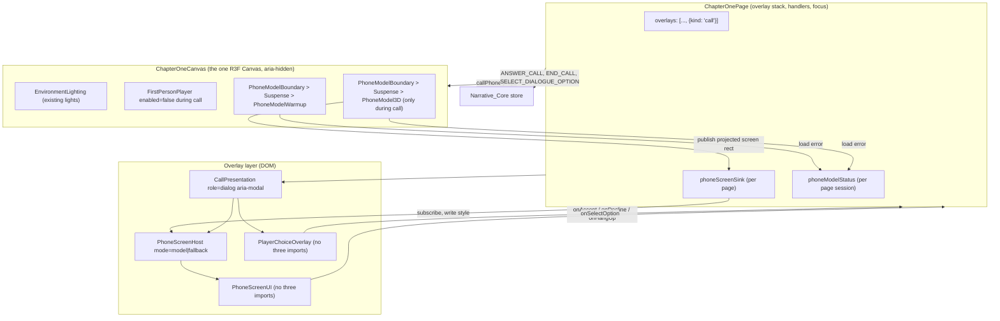
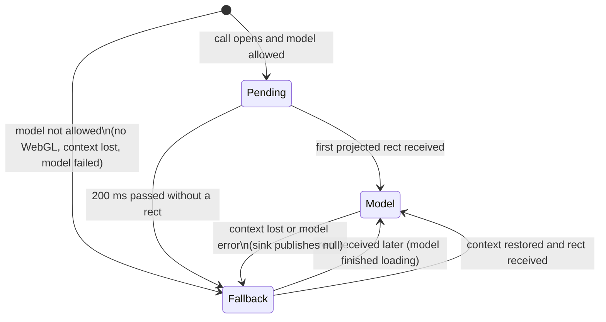

# Design Document: 3D phone call UI (`game-3d-phone-call-ui`)

## Overview

This design moves the Chapter 1 call presentation (ringing and active calls) from the flat 2D
`PhoneOverlay` to a 3D phone model in the chapter's existing React Three Fiber canvas. The phone
screen shows only phone-owned content. The player's replies move to a separate DOM overlay
(`PlayerChoiceOverlay`). When the 3D phone cannot render, the same screen content is shown in a 2D
frame at the same place, with the same handlers.

The change is presentation only. The Narrative_Core (`game/narrative/`) is not modified. The
existing actions `ANSWER_CALL`, `SELECT_DIALOGUE_OPTION` and `END_CALL`, the existing page handlers
`handleAnswerCall`, `handleEndCall` and `handleSelectOption`, and the selectors `selectDialogueView`
and `state.call` are reused.

### Owner decisions applied (2026-11-12)

| Decision | Applied as |
|---|---|
| Use `iphone-17-pro.glb` | Selected candidate; findings in "Phone model asset" below |
| Only ringing and active calls move to 3D | Phone home, Messages, Call history, Bank app and Decide stay in `PhoneOverlay` |
| Numeric targets are targets | 5 MB, 200–600 ms, 30 fps and 4 px are design targets; only the 5 MB file size is checked by a test |
| Phone asset is optional in the chapter loader | New `optional` flag on `ChapterAsset`; a failed optional asset does not block the chapter |
| Original candidates stay in `public/` | Not deleted or moved; dist size impact recorded as a limitation |
| Escape stays a no-op during calls | A locked `call` entry is pushed on the overlay stack for the whole call |

### Key design decisions

1. **Screen attachment: DOM overlay positioned by projecting the screen anchor**, not Drei
   `<Html transform>`. Rationale in "Screen attachment decision".
2. **The phone always faces the camera squarely.** The entry animation and the ring vibration are
   translations only. The screen plane stays parallel to the image plane, so its projection is an
   exact axis-aligned rectangle that a plain `div` can cover.
3. **One layout function for both modes.** `computeCallLayout(viewport)` returns the target
   screen rectangle and the choice region in CSS pixels. The 3D phone is posed so its screen
   lands on that rectangle; the 2D fallback frame is drawn at the same rectangle. Switching modes
   moves nothing.
4. **One `PhoneScreenUI` instance for both modes.** `PhoneScreenHost` keeps the same element
   type and position in the React tree in both modes, so a model-to-fallback switch (or back)
   never remounts the screen, and focus stays on the same button.
5. **The call does not move the camera.** The phone rig copies the camera pose each frame. No code
   in this feature writes to the camera, so no save and restore is needed (see "Camera").
6. **A new locked overlay kind `call`.** The call no longer opens the 2D phone (no `OPEN_PHONE`
   dispatch). When the call ends, the overlay stack is exactly the stack from before the call.

### Requirements gaps found during design

These are design interpretations. The owner may want to return to requirements to confirm them.

| Gap | Design interpretation |
|---|---|
| Caller_Line is defined as a line whose speaker is the `caller`. The official-line call (`dlg.official-line`) uses speaker `npc` for the bank agent, so its lines would never be shown. | For a dialogue linked to the current Call, lines with speaker `caller` or `npc` (the persona at the other end of the call) are Caller_Lines. |
| Call dialogues have `system` narration nodes (for example `scam.end.money-moved`, `official.greeting`). Requirement 2.4 removes them from the phone screen, but no requirement says where they go. | `PlayerChoiceOverlay` shows a non-caller line as a narration paragraph above the option list, labeled with `dialogue.systemSpeaker`. Without this, story text would be lost. |
| Requirement 10.4 says the Phone_Model_View renders the Phone_Screen_UI as HTML. With the chosen attachment, the HTML is rendered by `CallPresentation` and positioned by data from `PhoneModel3D`. | The Phone_Model_View is realized by `PhoneModel3D` (3D) plus `PhoneScreenHost` in model mode (HTML on the screen anchor). `PhoneModel3D` itself renders no HTML. |
| Requirement 9.4 requires the candidate file name in Asset_Credits; Requirement 9.11 forbids source references to the candidate file. | The credit names the candidate as plain text, without a path. The 9.11 check looks for asset paths (`props/phone/<candidate>.glb`) and URL imports, not credit text. |
| Requirement 9.7 adds a third Chapter 1 asset; the existing chapter loading test asserts "0 / 2" files for Chapter 1 (protected by 13.9). | The test's expected file count changes from 2 to 3, and the phone URL is registered with the fake fetch. The assertion keeps its strength. |
| Requirement 6.7 asks for a camera restore within 0.01 units. The player runtime keeps simulating with idle input while disabled (gravity, deceleration, a rolling car), as it does for every overlay today. | The call writes nothing to the camera. Residual settling after input is disabled is existing behavior and is recorded as a limitation; see "Camera". |
| The existing Chapter 1 page and accessibility tests expect the 2D "Phone" dialog to open on a ring and stay open after the call. Requirements 6.8 and 6.9 change this. | Those tests are updated to the new behavior. They are not in the protected list of Requirement 13.9. |

## Architecture

### Current state (audited)

- `ChapterOnePage.tsx` owns the store, the overlay stack (`overlays.ts`), focus management
  (`focusTrap.ts`) and the handlers. A busy call (`callInProgress`) pushes the `phone` overlay
  and dispatches `OPEN_PHONE`. `callSlot` puts `IncomingCallScreen` or `CallScreen` inside
  `PhoneOverlay`, and `CallScreen` embeds `DialoguePanel`. `canClose` refuses to close the phone
  while a call is busy, so Escape is a no-op.
- `ChapterOneCanvas.tsx` holds the only `<Canvas>`: `CameraFov`, `PoseGetter`, `SkyDome`,
  `EnvironmentLighting` (the lights), `StreetEnvironment`, `InteractableProps`,
  `InteractionProbe` and `FirstPersonPlayer` (each heavy part in its own `Suspense`). It has no
  error boundary of its own. A `webglcontextlost` listener only logs.
- `FirstPersonPlayer` with `enabled={false}` feeds idle input to the runtime; `usePlayerControls`
  with `enabled: false` clears keys and calls `document.exitPointerLock()` in an effect.
- `DialoguePanel.tsx` has the keyboard logic: number keys 1–9 on `window`, Arrow Up and Down,
  Home and End between options, focus on the first option when `graphId` or `nodeId` changes.
- `chapterLoader.ts` downloads every asset with one `AbortController`, verifies it with
  `verifyAsset`, and fails the whole chapter on any error. Its stall timer aborts all downloads.
- `checkBasicWebGLSupport()` (`deviceCapabilities.ts`) is the cheap WebGL check used by
  `GameCanvas`. In jsdom it returns `false`.
- Drei `useGLTF(url)` enables the Meshopt decoder by default (the street uses its own loader
  class only for progress reporting).
- Page tests mock `./ChapterOneCanvas` with a stub that records its props in a hoisted
  `harness`, and wrap `createChapterStore` to count dispatches.

### Target structure



### Call lifecycle on the overlay stack

```mermaid
stateDiagram-v2
  [*] --> NoCall
  NoCall --> CallOpen: callInProgress becomes true\n(push {kind:'call'}, remember opener)
  CallOpen --> CallOpen: ANSWER_CALL / SELECT_DIALOGUE_OPTION
  CallOpen --> NoCall: callInProgress becomes false\n(remove 'call' wherever it is;\nstack equals pre-call stack)
  CallOpen --> Ending: outcome set\n(chapter-end effect replaces stack with [ending])
```

### Presentation mode



"Model allowed" means `checkBasicWebGLSupport()` is true, no WebGL context loss is active, and
the phone model has not failed in this page session. In the `Pending` state the screen host is
rendered at the framed rectangle with `opacity: 0`, so initial focus can already be placed on
Accept or on the first option. The 200 ms grace keeps Requirement 8.3 (fallback within 500 ms).

### Screen attachment decision

| Criterion | Drei `<Html transform>` on the anchor | DOM overlay positioned by projecting the anchor (chosen) |
|---|---|---|
| Dialog and focus trap | Drei renders into a portal next to the canvas element (inside the game view), outside the page's overlay layer. One `role="dialog"` cannot contain both the phone screen and the choices without extra portals, and `topDialog()` would not find it. | The screen is a normal child of the `CallPresentation` dialog in the overlay layer. The existing `topDialog()` and `trapTabKey()` work unchanged. |
| Text size (Req 1.5) | Content is scaled by a CSS 3D matrix that depends on `distanceFactor` and distance. 14 CSS px on screen needs a much larger authored font at small viewports. | Text is laid out at real CSS pixel sizes inside a rectangle of real CSS pixel size. 14 px text is 14 px on screen. |
| Live region (Req 2.9) | Works, but the node can be re-created when Drei remounts the portal. | A stable DOM node; it is never remounted on a mode switch. |
| Alignment (Req 10.3) | Exact. | Exact while the screen plane is parallel to the image plane, which this design keeps true. |
| Rotation during motion | Supported. | Not supported; the design uses translation-only motion. |
| Tests (Req 13.11) | Needs a WebGL canvas to mount. | The DOM renders in jsdom. The projection math is pure and is tested with `THREE.PerspectiveCamera` math, which needs no WebGL context. |
| Occlusion (Req 10.6) | Optional occlusion; the HTML is drawn over the canvas. | The HTML is always over the canvas, so the bezel can never hide it. |

The only cost of the chosen approach is that the phone may not tilt. A slight tilt is not part of
any requirement, and a phone held flat toward the player reads well.

## Components and Interfaces

All new feature files live in one new folder, `apps/game/src/features/chapter1/call/`, next to
`phone/` (Requirement 11.1). The four required parts are in four files: `PhoneModel3D.tsx`,
`PhoneScreenUI.tsx`, `PlayerChoiceOverlay.tsx` and `CallPresentation.tsx`.

### `callLayout.ts` (pure TypeScript, no imports from three, React or i18n)

```ts
export interface Viewport { width: number; height: number } // CSS px
export interface Rect { left: number; top: number; width: number; height: number } // CSS px

export interface CallLayout {
  kind: "narrow" | "wide";       // narrow: width < 640
  screen: Rect;                   // target phone screen rectangle
  choice: Rect;                   // region for PlayerChoiceOverlay (its max height)
  screenCornerRadius: number;     // CSS px, SCREEN_CORNER_RATIO * screen.width
}

export const SCREEN_WIDTH_M = 0.0668;   // OLED primitive, see "Phone model asset"
export const SCREEN_HEIGHT_M = 0.1449;
export const SCREEN_ASPECT = SCREEN_WIDTH_M / SCREEN_HEIGHT_M; // 0.4610
export const SCREEN_CORNER_RATIO = 0.176; // 0.01174 m corner radius / 0.0668 m width
export const NARROW_BREAKPOINT = 640;     // same as Tailwind `sm`
export const MAX_SCREEN_HEIGHT = 720;
export const MIN_CHOICE_WIDTH = 280;

export function computeCallLayout(viewport: Viewport): CallLayout;
export function rectsIntersectArea(a: Rect, b: Rect): number;

/** Camera-space position (meters) of the screen center so it projects onto `target`. */
export function solveScreenPose(target: Rect, viewport: Viewport, fovDeg: number):
  { x: number; y: number; z: number /* negative, in front of the camera */ };

/** Pinhole projection of the screen anchor corners for a pose; the inverse of solveScreenPose. */
export function projectScreenRect(pose: { x: number; y: number; z: number }, viewport: Viewport, fovDeg: number): Rect;
```

Layout rules (margin `m` = 12 px narrow, 24 px wide):

- **Narrow** (`width < 640`): screen height `= min(max(0.6·H, 288), 720, (W − 2m) / SCREEN_ASPECT)`,
  centered horizontally, `top = m`. The choice region spans `left = m`, `width = W − 2m`, from
  `screen.bottom + m` to `H − m`; the overlay scrolls inside it. At 320×480 the screen is
  288×133 px and the choice region is 168 px tall.
- **Wide** (`width ≥ 640`): screen height `= min(0.9·H, 720, (W − 3m − 280) / SCREEN_ASPECT)`.
  `choiceWidth = min(W − 3m − screenWidth, 720)`. The choice region is `left = m`, from `H / 2`
  to `H − m`. The screen is centered vertically and horizontally in the space right of the
  choice region. This keeps the choice top at or below 50% of the viewport height (Req 3.3) and
  the rectangles apart for every viewport.

`solveScreenPose` uses `d = SCREEN_HEIGHT_M / (2 · tan(fov/2) · target.height / H)` and converts
the target center from CSS px to camera-space meters at distance `d`. The fov range in settings
is 60–85 degrees. The layout never asks for more than 90% of the viewport height (narrow: at
most 0.6·H, or 288 px of a 480 px viewport; wide: at most 0.9·H), so `d ≥ 0.087 m` at 85
degrees, which is in front of the camera near plane (0.05 m). `solveScreenPose` also clamps `d`
to `≥ 0.06 m` as a guard; the clamp never applies in the supported range.

### `phoneMotion.ts` (pure TypeScript)

```ts
export const ENTRY_DURATION_MS = 400;          // within 200–600 ms (Req 6.3)
export const VIBRATION_AMPLITUDE_RATIO = 0.015; // of screen height, below 2% (Req 6.5)
export const VIBRATION_PERIOD_MS = 1400;       // burst every 1.4 s, matching the old 2D icon
export const VIBRATION_BURST_MS = 450;
export const VIBRATION_FREQUENCY_HZ = 12;

export interface MotionInput {
  elapsedMs: number;          // since the presentation opened in model mode
  animateEntry: boolean;      // false when the model framed late (switch from fallback)
  ringing: boolean;
  reducedMotion: boolean;
  layout: CallLayout;
  viewport: Viewport;
}
/** Horizontal offset in CSS px to add to layout.screen.left this frame. */
export function phoneMotionOffset(input: MotionInput): number;
```

- Entry: the phone slides in from the right. At `elapsedMs = 0` the offset is
  `viewport.width − layout.screen.left` (fully outside the viewport); it eases out (cubic) to 0
  at `ENTRY_DURATION_MS`. A horizontal entry never crosses the choice region in either layout
  (wide: choices are to the left; narrow: choices are below).
- Vibration while `ringing`: `A · sin(2π · 12 Hz · t)` during the first 450 ms of each 1.4 s
  period, `A = 0.015 · screen.height`.
- `reducedMotion` gives 0 in every frame (Req 6.4). `ringing = false` gives no vibration term,
  so the vibration stops on the first frame after the status leaves `ringing` (Req 6.5).
- `animateEntry` is true only when the first rectangle is published within 150 ms of the call
  opening. A late switch from fallback to model appears at the framed position, so the screen
  content does not jump off screen under the player's focus.

### `phoneScreenSink.ts` (pure TypeScript)

A per-page channel from the canvas to the DOM, so the per-frame rectangle never goes through
React state.

```ts
export interface PhoneScreenSink {
  publish(rect: Rect | null): void;   // null when PhoneModel3D unmounts or loses the model
  current(): Rect | null;
  subscribe(listener: (rect: Rect | null) => void): () => void;
}
export function createPhoneScreenSink(): PhoneScreenSink;
```

`publish` ignores a rectangle that differs from the last one by less than 0.25 px on every edge.

### `phoneModelStatus.ts` (pure TypeScript)

Remembers a load failure for the page session (module lifetime) and logs exactly one warning.

```ts
export function hasPhoneModelFailed(): boolean;
/** First call logs one console.warn containing the asset path; later calls do nothing. */
export function reportPhoneModelFailure(url: string, error: unknown): void;
export function resetPhoneModelStatusForTests(): void;
```

Warning text (developer log, not user-facing): `Phone model could not be loaded: <url>` followed
by the error as a second `console.warn` argument.

### `PhoneModel3D.tsx` (React Three Fiber)

Exports three components. It imports `CALL_PHONE_GLB`, `callLayout.ts` and `phoneMotion.ts`, and
nothing from the narrative store or selectors (Requirements 11.3, 11.4).

```ts
export interface PhoneModel3DProps {
  ringing: boolean;            // call status from the page, as a prop
  reducedMotion: boolean;
  openedAt: number;            // performance.now() when the call overlay opened
  screenSink: PhoneScreenSink;
}
export const PhoneModel3D: React.FC<PhoneModel3DProps>;
export const PhoneModelWarmup: React.FC;   // calls useGLTF(CALL_PHONE_GLB), renders null
export class PhoneModelBoundary extends React.Component<{ onError: (error: unknown) => void; children: ReactNode }>;
```

Behavior:

- `const { scene } = useGLTF(CALL_PHONE_GLB)`. The scene is cloned once with `useMemo`
  (`scene.clone(true)`), so the cached original is not changed. Every mesh gets
  `castShadow = false`, `receiveShadow = false` and `frustumCulled = false` (the phone is always
  in view; culling a camera-attached object near the near plane is not useful).
- The clone sits in an inner group rotated by π about Y, because the screen of this model faces
  −Z (see "Phone model asset"). After the rotation the screen center is at local
  `(0, 0, +0.00343)` and faces the camera.
- A `rig` group is updated in `useFrame` (default priority 0, so R3F keeps rendering; a priority
  above 0 would take over the render loop, see the
  [R3F hooks documentation](https://r3f.docs.pmnd.rs/api/hooks)). The callback is subscribed
  after `FirstPersonPlayer`'s (it mounts later), so it runs after the player runtime moves the
  camera in the same frame. Per frame:
  1. `layout = computeCallLayout(size)`, with `size` from `useThree` (canvas CSS size, which is
     the full viewport because the canvas fills the page).
  2. `offset = phoneMotionOffset(...)`; `target = { ...layout.screen, left: layout.screen.left + offset }`.
  3. `pose = solveScreenPose(target, size, camera.fov)`.
  4. `rig.position.copy(camera.position)`, `rig.quaternion.copy(camera.quaternion)`, then
     `rig.translateX(pose.x)`, `translateY(pose.y)`, `translateZ(pose.z − 0.00343)`.
  5. Project the four anchor corners with `Vector3.project(camera)` and convert to CSS px; publish
     the bounding rectangle to the sink. This is the real rendered position, so the DOM follows
     exactly what is drawn, also during the entry animation and the vibration (Req 10.5).
- A dimming plane is a child of the rig: a `PlaneGeometry` sized to cover the frustum at
  `0.1 m` behind the screen, `MeshBasicMaterial({ color: BRAND.graphite, transparent: true,
  opacity: 0.6, depthWrite: false })`. It darkens the street behind the phone and adds no light
  (Req 1.6, 6.6). The phone is opaque and nearer, so it is not dimmed. The dimming plane (and the
  DOM backdrop in fallback and pending modes) is not a text background: the Choice_Overlay draws
  its text on the opaque `UI.choicePanel` surface (owner decision, 2026-11-12; see
  "PlayerChoiceOverlay.tsx").
- On unmount: `screenSink.publish(null)`.
- No lights, environment maps, post-processing or second canvas are added (Req 1.6).

`PhoneModelBoundary` catches errors from `useGLTF` (network, decode) inside the canvas. Its
`componentDidCatch` calls `onError`, then renders `null`. The page passes one handler that calls
`reportPhoneModelFailure(CALL_PHONE_GLB, error)` and sets its `phoneModelFailed` state.

### `ChapterOneCanvas.tsx` changes

New props:

```ts
/** Set while the call overlay is open and the 3D phone is allowed; null otherwise. */
callPhone?: { ringing: boolean; reducedMotion: boolean; openedAt: number; screenSink: PhoneScreenSink } | null;
/** False once the phone model failed in this session; no warmup or model is mounted then. */
phoneModelEnabled?: boolean;
onPhoneModelError?: (error: unknown) => void;
/** Called with true on webglcontextlost and false on webglcontextrestored. */
onWebGLContextChange?: (lost: boolean) => void;
```

- `<Canvas aria-hidden="true">` (the R3F Canvas forwards div props to its wrapper); the canvas
  has no accessible name (Req 7.9). The game view `div` keeps its `tabIndex={-1}` and is not
  hidden, because it is a focus target.
- After `onSceneReady` fires, and while `phoneModelEnabled`, the canvas mounts
  `<PhoneModelBoundary onError><Suspense fallback={null}><PhoneModelWarmup /></Suspense></PhoneModelBoundary>`.
  The street loads first; the phone parses from the HTTP cache that the chapter loader filled.
- While `callPhone` is set and `phoneModelEnabled`, it mounts
  `<PhoneModelBoundary onError><Suspense fallback={null}><PhoneModel3D {...callPhone} /></Suspense></PhoneModelBoundary>`.
  The Suspense boundary wraps only the phone, so the street stays rendered (Req 9.6). When
  `callPhone` becomes null, the phone unmounts in the same render (Req 1.7, 5.4).
- The existing `webglcontextlost` and `webglcontextrestored` listeners also call
  `onWebGLContextChange` through a ref to the latest prop.

### `PhoneScreenUI.tsx` (DOM only)

Imports only React, `react-i18next`, `lucide-react`, `usePrefersReducedMotion` and `theme.ts`.

```ts
export type CallScreenView =
  | { status: "ringing"; callerName: string; number: string }
  | { status: "active"; callerName: string; number: string;
      // "connecting": no dialogue node linked yet (Req 2.10); null: the current line is not a
      // Caller_Line, so the line area stays empty (Req 2.4)
      line: { speakerName: string; text: string } | "connecting" | null };

export interface PhoneScreenUIProps {
  view: CallScreenView;
  disabled: boolean;               // true while paused (Req 5.6)
  vibrateIcon: boolean;            // 2D icon wobble; true only in fallback mode, ringing, motion allowed
  onAccept: () => void;
  onDecline: () => void;
  onHangUp: () => void;
  acceptRef?: Ref<HTMLButtonElement>;
  hangUpRef?: Ref<HTMLButtonElement>;
}
```

Content, top to bottom (Requirement 2):

| Ringing | Active |
|---|---|
| `PhoneIncoming` icon + `phone.incomingCall.caption` | — |
| Avatar: `Phone` icon in a circle, `aria-hidden` (`data-testid="incoming-call-icon"`, `data-vibrating`) | Avatar: `PhoneCall` icon, `aria-hidden` |
| Caller name (`data-testid="incoming-call-name"`) | Caller name |
| Number `<p dir="ltr" class="whitespace-nowrap">` (`incoming-call-number`) | Number (`call-screen-number`) and `phone.call.status` |
| — | Caller_Line card: speaker name and line, `aria-live="polite"` `aria-atomic="true"` (`data-testid="dialogue-line"`); or `phone.call.connecting` in a polite live region |
| Decline (`incoming-call-decline`) and Accept (`incoming-call-accept`) buttons | Hang up (`call-screen-hang-up`) |

- The existing test IDs are kept, so the updated page and accessibility tests can find the same
  controls.
- All text is at least 14 CSS px (`text-sm` or larger; no `text-xs`) (Req 1.5).
- The Caller_Line card is the only flexible part: `min-h-0 flex-1 overflow-y-auto`. At the
  smallest viewports, a long line scrolls inside the screen. It is not a Tab stop, so the focus
  order stays "call buttons, then options" (Req 7.2).
- Ringing buttons sit side by side when the screen is at least 220 px wide and stack otherwise
  (a container query on the host, `@container` with Tailwind v4 `@min-[220px]:flex-row`).
- The number has no link, no `tel:` and no tab stop (Req 2.5). No trust badge (Req 2.11).
- No `role` other than the native buttons; the root is a `section` with
  `aria-label={t("phone.callPresentation.screenLabel")}`.

### `PlayerChoiceOverlay.tsx` (DOM only)

```ts
export interface PlayerChoiceOverlayProps {
  view: DialogueView;            // call-linked view from selectDialogueView
  narration: string | null;      // non-caller line text, see "Requirements gaps"
  disabled: boolean;             // paused
  onSelectOption: (optionId: string) => void;  // the page's handleSelectOption
  region: Rect;                  // from computeCallLayout
}
```

- Root: `div` positioned `fixed` at `region.left`, `region.top`, `width: region.width`,
  `maxHeight: region.height`, `overflow-y: auto`, `overflow-x: hidden`. It is a sibling of
  `PhoneScreenHost` inside the dialog, never a descendant of it (Req 3.2).
- Surface (owner decision, 2026-11-12): the root uses `UI.choicePanel` from `theme.ts`, an opaque
  surface `rounded-xl border border-[#38344f] bg-[#171521] p-4` with `overflow-y-auto
  overflow-x-hidden`. The options label, the narration paragraph and the option focus outline
  sit on this panel, not on the dimming layer, so their contrast does not depend on what the 3D
  street shows behind the dim. Earlier, these sat directly on the dim and failed 4.5:1 (text) and
  3:1 (outline) over a bright world. The 16 px padding is larger than the 2 px outline plus its
  2 px offset, so the outline of any option always lies on the panel (Req 6.6, 7.7, 7.8).
- A visible label `<p id={labelId} class={UI.label}>{t("dialogue.optionsLabel")}</p>` (Req 3.8);
  the `ol` uses `aria-labelledby={labelId}` (Req 7.10).
- Optional narration paragraph (`dialogue.systemSpeaker` label and the line) above the list.
- `ol` of `li > button`. Each button shows the 1–9 key hint (`aria-hidden`) and the option text,
  or `t("dialogue.fallbackOption")` when `option.fallback` (Req 3.6). Text wraps
  (`whitespace-normal break-words`), with no truncation (Req 3.5). Test IDs stay
  `dialogue-option-<id>`.
- Zero options: `t("dialogue.noOptions")` and no list (Req 3.7).
- Styles: a new `UI.choiceOption` class string in `theme.ts`, built only from `BRAND` colors and
  the existing border color `#38344f`: default `bg-[#171521] border-[#38344f] text-[#f7f5ff]`;
  hover `border-[#7654d6] bg-[#26233a]`; pressed `active:border-[#b9a5f5] active:bg-[#2f2a48]`;
  keyboard focus `focus-visible:outline-2 outline-offset-2 outline-[#b9a5f5]`; disabled
  `disabled:text-[#a9a4c4] disabled:border-[#38344f] disabled:bg-[#171521]` with no opacity
  change, so disabled text keeps a contrast above 4.5:1 (Req 3.9, 7.7, 7.8).
- Keyboard logic comes from `useDialogueOptionKeys` (below).

### `dialogue/useDialogueOptionKeys.ts` (extracted hook)

The logic moves out of `DialoguePanel.tsx` without behavior changes; `DialoguePanel` and
`PlayerChoiceOverlay` both use it.

```ts
export interface DialogueOptionKeysInput {
  options: readonly DialogueOptionView[];
  onSelectOption: (optionId: string) => void;
  disabled: boolean;
  numberKeys: boolean;        // window listener for 1–9
  autoFocus: boolean;         // focus first option on node change
  nodeKey: string;            // `${graphId}:${nodeId}`
}
export function useDialogueOptionKeys(input: DialogueOptionKeysInput): {
  setOptionRef: (index: number) => (element: HTMLButtonElement | null) => void;
  onOptionKeyDown: (event: React.KeyboardEvent<HTMLButtonElement>, index: number) => void;
  focusFirst: () => boolean;  // false when there is no option to focus
};
```

Number keys: ignored with Alt, Ctrl or Meta, on repeat, in typing targets, while disabled, and
when N is larger than the option count (Req 4.2, 4.3, 4.7). Arrow Down and Up wrap, Home and End
jump (Req 4.4).

### `PhoneScreenHost.tsx` (the Fallback_Phone_Screen and the model-mode screen slot)

```ts
export interface PhoneScreenHostProps {
  mode: "pending" | "model" | "fallback";
  layout: CallLayout;
  screenSink: PhoneScreenSink;
  children: ReactNode;  // the single PhoneScreenUI instance
}
```

- Always renders the same element: `<div data-testid="phone-screen-host" data-mode={mode}>`,
  `position: fixed`, `left: 0`, `top: 0`, `transform: translate(x, y)`, `width`, `height`,
  `border-radius`, `container-type: inline-size`, opaque screen background `#1d1b2b`.
- `fallback` and `pending`: position and size from `layout.screen`. `fallback` adds a 2D bezel
  (`outline: 6px solid #38344f` outside the rectangle, `shadow-xl`). `pending` sets `opacity: 0`.
- `model`: subscribes to `screenSink` in an effect and writes `transform`, `width`, `height` and
  `border-radius` directly on the element ref (no React render per frame). Because the host uses
  real CSS pixel sizes, the content inside is laid out at real text sizes.
- The fallback is not a separate component type, so switching modes never remounts
  `PhoneScreenUI` (Req 8.6).

### `CallPresentation.tsx` (wiring)

```ts
export interface CallPresentationProps {
  store: ChapterStore;
  scenario: ScenarioDefinition;   // display scenario from useDisplayScenario
  paused: boolean;
  modelAllowed: boolean;          // WebGL, no context loss, model not failed
  screenSink: PhoneScreenSink;
  onAnswer: () => void;           // page handleAnswerCall
  onEnd: () => void;              // page handleEndCall
  onSelectOption: (optionId: string) => void; // page handleSelectOption
}
```

- Reads `state.call` and `selectDialogueView(state, scenario)` with `useChapterState`. It creates
  no store and holds no dialogue state (Req 4.8, 11.8).
- Builds `CallScreenView`: caller name and number from `scenario.calls[call.current]`
  (Req 2.6). The dialogue view counts only when `view.callId === call.current`. Its line is a
  Caller_Line when `view.speaker` is `caller` or `npc`; otherwise the line becomes the
  `narration` prop of `PlayerChoiceOverlay` and the phone shows no line (Req 2.4).
- Viewport: `useViewport()` (a small local hook: `window.innerWidth/innerHeight` and a `resize`
  listener) feeds `computeCallLayout`.
- Mode: `pending` → `model` on the first non-null sink rectangle, `pending` → `fallback` after
  200 ms, `model` → `fallback` when the sink publishes `null` or `modelAllowed` turns false.
- Render:

  ```tsx
  <div role="dialog" aria-modal="true" aria-label={t("phone.callPresentation.name")}
       className="fixed inset-0 z-40" data-testid="call-presentation" data-mode={mode}>
    {mode !== "model" && <div className="absolute inset-0 bg-[#171521]/70" aria-hidden="true" />}
    <PhoneScreenHost mode={mode} layout={layout} screenSink={screenSink}>
      <PhoneScreenUI ... />
    </PhoneScreenHost>
    {call.status === "active" && view && (
      <PlayerChoiceOverlay view={view} narration={narration} disabled={paused}
                           onSelectOption={onSelectOption} region={layout.choice} />
    )}
  </div>
  ```

  The screen host comes before the overlay in DOM order, so Tab visits the call buttons first and
  the options next (Req 7.2). The existing page Tab handler traps focus inside this dialog
  because it is the top-most `role="dialog"` in the overlay layer.
- Single dispatch guard (Req 5.7): `handledRef` stores `${call.current}:${call.status}` after a
  call button fires; a second activation with the same key does nothing. The key changes as soon
  as the status changes.
- Paused (Req 4.7, 5.6): `paused` disables every call button and option and turns off number keys.
- Initial focus (Req 7.3, 7.4): an effect keyed on `call.status`, `view?.graphId`,
  `view?.nodeId` and `paused`:
  - `ringing` → Accept.
  - `active` with options → `useDialogueOptionKeys` focuses the first option (`autoFocus`).
  - `active` with zero options or no linked node → Hang up.
  - `paused` → no focus change.
- No Escape handling here; the page handles Escape through the overlay stack (Req 7.5).

### `ChapterOnePage.tsx` changes

- `overlays.ts`: add `{ kind: "call" }` to `Overlay`. Add `"call"` to `ESCAPE_LOCKED`.
- Replace the effect that opens the phone for a busy call:

  ```ts
  useEffect(() => {
    if (titleCardOpen || status !== "playing") return;
    const open = isOpen(overlays, "call");
    if (callBusy && !open) {
      callOpenedAtRef.current = performance.now();
      openOverlay({ kind: "call" });     // records the opener; no OPEN_PHONE
    } else if (!callBusy && open) {
      removeOverlay("call");             // removes it wherever it is (also under a pause)
    }
  }, [callBusy, openOverlay, overlays, removeOverlay, status, titleCardOpen]);
  ```

- Remove `callSlot`, the `IncomingCallScreen` and `CallScreen` imports, and the `callSlot` prop
  of `PhoneOverlay`.
- `renderOverlay` case `"call"` renders `CallPresentation` with the existing handlers.
- Overlays below a `call` entry are kept mounted but hidden: each overlay is wrapped in
  `<div key={overlay.kind} className="contents" hidden={belowCall}>`. The 2D phone, journal or
  decision panel keeps its state (for example the open Messages app) and is not drawn over the 3D
  phone. `getTabbable` already skips elements inside `[hidden]`.
- New page state: `webglAvailable` (from `checkBasicWebGLSupport()` once at mount),
  `webglLost` (from `onWebGLContextChange`), `phoneModelFailed` (initialized from
  `hasPhoneModelFailed()`), and `phoneScreenSink` (`useState(createPhoneScreenSink)`).
- `modelAllowed = webglAvailable && !webglLost && !phoneModelFailed`.
- `paused = top(overlays)?.kind === "pause"`.
- Canvas props: `callPhone = isOpen(overlays, "call") && callBusy && modelAllowed ? { ringing, reducedMotion, openedAt, screenSink } : null`,
  `phoneModelEnabled = webglAvailable && !phoneModelFailed`, `onPhoneModelError`,
  `onWebGLContextChange`.
- Player control: `inputEnabled` is already false while any overlay is open, so
  `FirstPersonPlayer` gets `enabled={false}` for the whole call (Req 6.1), and
  `usePlayerControls` releases pointer lock in its disable effect (Req 6.2). When the call ends
  with an empty stack, `inputEnabled` becomes true and the existing `ResumePrompt` shows
  (Req 6.8). The pointer is not locked until the player clicks the game view.
- Focus after the call (Req 7.6): the existing "top overlay closed" effect already returns focus
  to the opener inside the overlay now on top, to the start of that overlay, or to the game view.
  No change is needed.
- `useCallTriggers(store, overlayOpen)` keeps pausing its timers, because the `call` entry keeps
  `overlayOpen` true during the call.

### Camera

The call adds no code that writes to the camera. `PhoneModel3D` only reads `camera.position`,
`camera.quaternion` and `camera.fov`. So there is nothing to save or restore: the camera pose
after the call is whatever the player runtime holds, which is the pose it had when input was
disabled plus any residual settling of the runtime. That settling (deceleration of a walking
player, gravity, a car that rolls to a stop) is existing behavior for every overlay. The manual
check in the testing strategy measures it. If the owner requires a hard 0.01 bound, a follow-up
would add a pose snapshot and restore API to `CharacterRuntime`; this design does not change the
player runtime.

### Phone model asset

Inspection of `apps/game/public/assets/3d/props/phone/iphone-17-pro.glb` (25,657,660 bytes) with
`@gltf-transform/core` 4.5.1 (installed at the workspace root):

| Item | Finding |
|---|---|
| Generator | `glTF-Transform v4.5.1`; no `copyright` or author field (creator: not stated) |
| Extensions used | `KHR_materials_emissive_strength`, `KHR_texture_transform` |
| Nodes | 2 nodes at the scene root, both with rotation quaternion `[0.7071, 0, 0, 0.7071]` (+90° about X): `iPhone 17 Pro` (body, 14 primitives, 49,019 triangles) and `iPhone 17 Pro.001` (front, mesh `iPhone 17 Pro.004`, 5 primitives, 2,216 triangles) |
| Scene bounds (m) | x ±0.03655, y ±0.07500, z −0.00438 to +0.00892 (73 × 150 × 13 mm; the camera bump is at +z) |
| Screen mesh | Primitive with material `OLED` in mesh `iPhone 17 Pro.004`. Flat; local x ±0.03340, local z ±0.07245 at local y −0.00343. After the node rotation: a 0.0668 × 0.1449 m rectangle centered at (0, 0) in the plane z = −0.00343, facing −Z. Corner radius about 0.0117 m. UVs cover 0–1. This is the usable screen mesh (Req 10.1). |
| Screen materials | `OLED` (base color and emissive texture `wallpaper`, JPEG 1280×2781, emissive strength 10), `OLED off` (small black area at the top center: the camera cut-out), `Glass` (black, alpha 0.78, in front of the OLED) |
| Wallpaper | Abstract light-line artwork, no text or logo found. It looks like stock product wallpaper art, so it is removed. |
| Other textures | Normal maps `Anodized aluminum normal` (2048², 13.5 MB PNG), `Keyboard normal` (2048², 6.2 MB), `Concentrico`, `LED normal`, `mesh normal` (1024²) and base color `mesh color` (1024², a diamond lattice for the speaker grille). Previews show grain, noise or the lattice only; no text, brand name or logo. |
| Logo mesh | No primitive or material is named for a logo, and no texture contains one. The back panel is covered by `Frosted glass` (591 triangles) and `Glass tint` (379 triangles); an embossed logo cannot be ruled out from data alone. |
| Names | Node and mesh names contain the product name. They are not visible in the game but are renamed in the optimized file. |

Branding plan (Req 9.3):

1. `OLED`: remove the `wallpaper` base color and emissive textures; set base color to
   `BRAND.navy` (`#1D1B2B`, linear factor `[0.0123, 0.0110, 0.0250, 1]`) and emissive to black.
   The DOM screen covers this area during calls anyway.
2. Rename nodes and meshes to `CallPhoneBody` and `CallPhoneFront`; materials keep their generic
   names (`Glass`, `Display Frame`, and so on).
3. The back is never visible: the phone always faces the camera and every motion is a
   translation (see `phoneMotion.ts`). This covers any embossed logo on the back.
4. The script prints a primitive inventory (mesh, material, triangle count, bounds) and has a
   `REMOVE_PRIMITIVES` list (mesh name + material name). The list is empty today. The developer
   renders the back once in a local dev check, adds any logo primitive to the list if one is
   found, and records the result in `SOURCE.md`.

Optimization (Req 9.2): a new script `apps/game/scripts/optimize-call-phone.cjs`, because the
existing `optimize-environment.cjs` hard-codes the MenuBG paths and decimation rules. It reuses the
same tools (`@gltf-transform/core`, `extensions`, `functions`, `meshoptimizer`, `sharp`, all
already root devDependencies):

1. Read the candidate; apply the branding plan.
2. Textures: resize to at most 1024 px; WebP quality 90 for normal maps, 85 for color; set
   `EXT_texture_webp` as required.
3. `prune()`, `dedup()`, `weld({ tolerance: 0.0001 })`, `quantize()`, `reorder()`,
   `meshopt({ level: "medium" })`. No decimation (51k triangles is fine for one close prop).
4. Write `apps/game/public/assets/3d/optimized/call-phone.optimized.glb`; print the sizes before
   and after; exit with code 1 when the output is above 5,242,880 bytes.

Command: `node apps/game/scripts/optimize-call-phone.cjs` from the workspace root.

Measured during this design (dry run written to the system temp folder, not to the repository,
with WebP quality 85 for all textures): **1,864,572 bytes**, from 25,657,660 bytes. The
committed file will be measured again by the script, because quality 90 for normal maps adds a
little. The 5 MB target is reachable.

Asset path constant in `config/assetPaths.ts`:

```ts
/** Call phone (Meshopt + WebP, produced by scripts/optimize-call-phone.cjs). */
export const CALL_PHONE_GLB = "/assets/3d/optimized/call-phone.optimized.glb";
```

### Chapter loader: optional assets

`ChapterAsset` gets `optional?: boolean`. Chapter 1 adds:

```ts
{ id: "call-phone", url: CALL_PHONE_GLB, kind: "gltf", loadingText: "Loading the phone", optional: true }
```

`loadAssets` changes, per asset:

- The download and verification run as today. For an optional asset, a rejection (network
  error, HTTP error, verification failure, or the shared abort) is caught: the asset is marked
  done, `totals[index]` is set to the bytes received so far (or 0), and loading continues. No
  console output, so the in-game warning stays the only one (Req 8.5).
- A required asset failure still fails the chapter as today.
- The stall timer still aborts all downloads. When only optional downloads are pending, the abort
  rejects only those, they are caught as skipped, and the chapter becomes ready. When a required
  download is pending, it fails with "stalled" as today.
- The progress fraction stays byte-based. A skipped asset contributes its received bytes to both
  the loaded and the total sums, so progress still reaches 100%.

The page learns about the failure when `PhoneModelWarmup` fails to load the same URL, which logs
the single warning (Req 9.12, 8.2).

### Credits

`config/credits.ts`: add `CreditItemId` `"callPhone"` to the `vehicles` group ("3D Vehicles &
Street Props"):

```ts
{
  id: "callPhone",
  name: "call-phone.optimized.glb",
  creator: "not stated",
  sourceUrl: "Owner-provided file iphone-17-pro.glb (source URL not provided)",
  license: "Free to use (owner statement, 2026-11-12)",
  notes: "Handheld phone model used for phone calls. Optimized copy with the wallpaper removed and no visible brand marks.",
}
```

`SOURCE.md` records the selected candidate, the output file name, the command and settings, the
sizes, the branding changes and the inspection table above (Req 9.5).

## Data Models

No Narrative_Core type changes. New or changed UI and loader types:

```ts
// overlays.ts
export type Overlay = /* existing kinds */ | { kind: "call" };

// chapterRegistry.ts
export interface ChapterAsset {
  id: string; url: string; kind: ChapterAssetKind; loadingText: string;
  /** When true, a failed download or verification skips this file instead of failing the chapter. */
  optional?: boolean;
}

// call/callLayout.ts
interface Viewport { width: number; height: number }
interface Rect { left: number; top: number; width: number; height: number }
interface CallLayout { kind: "narrow" | "wide"; screen: Rect; choice: Rect; screenCornerRadius: number }

// call/PhoneScreenUI.tsx
type CallScreenView =
  | { status: "ringing"; callerName: string; number: string }
  | { status: "active"; callerName: string; number: string; line: { speakerName: string; text: string } | "connecting" | null };

// call/CallPresentation.tsx
type PresentationMode = "pending" | "model" | "fallback";
```

### Derived view rules (in `CallPresentation`)

| State | Phone screen | Choice overlay |
|---|---|---|
| `call.status === "ringing"` | Ringing view | absent |
| `active`, no linked view (`view === null` or `view.callId !== call.current`) | Active view, `line: "connecting"` (connecting text in a polite live region) | label + `dialogue.noOptions` |
| `active`, linked view, speaker `caller` or `npc` | Active view with the Caller_Line | label + options (or `noOptions`) |
| `active`, linked view, speaker `system` or `player` | Active view, `line: null` (no line text on the phone) | label + narration paragraph + options (or `noOptions`) |

In the last row, the phone shows the header, the status and Hang up only, and the previous
Caller_Line is not kept. The connecting text is used only when no dialogue node is linked
(Req 2.10).

### i18n keys

All keys are in the `chapter1` namespace unless the namespace is written.

| Key | en | vi | Status |
|---|---|---|---|
| `phone.callPresentation.name` | Phone call | Cuộc gọi điện thoại | new: dialog accessible name (Req 7.1) |
| `phone.callPresentation.screenLabel` | Phone screen | Màn hình điện thoại | new: `aria-label` of the screen section |
| `phone.incomingCall.caption` | Incoming call | Cuộc gọi đến | existing, reused |
| `phone.incomingCall.accept` | Accept | Nghe máy | existing, reused |
| `phone.incomingCall.decline` | Decline | Từ chối | existing, reused |
| `phone.call.status` | Call in progress | Đang trong cuộc gọi | existing, reused |
| `phone.call.connecting` | Connected. Waiting for the caller to speak. | Đã kết nối. Đang chờ người gọi lên tiếng. | existing, reused |
| `phone.call.hangUp` | Hang up | Cúp máy | existing, reused |
| `dialogue.optionsLabel` | Your reply | Câu trả lời của bạn | existing, now also a visible label (Req 3.8) |
| `dialogue.noOptions` | No replies available. | Không có câu trả lời nào. | existing, reused |
| `dialogue.fallbackOption` | End the conversation | Kết thúc cuộc trò chuyện | existing, reused |
| `dialogue.systemSpeaker` | Narration | Dẫn truyện | existing, reused for the narration paragraph |
| `phone.overlay.callInProgress` | Call | Cuộc gọi | removed: no longer used after `callSlot` is removed |
| `chapters:chapter-1.assets.call-phone` | Loading the phone | Đang tải điện thoại | new (Req 9.10) |
| `credits:items.callPhone.notes` | Handheld phone model used for phone calls. Optimized copy with the wallpaper removed and no visible brand marks. | Mô hình điện thoại cầm tay dùng cho các cuộc gọi. Bản đã tối ưu, đã bỏ hình nền và không có dấu hiệu thương hiệu nào. | new |

Narrative text (caller name, Caller_Line, speaker name, option text) comes from the display
scenario, so the `vi` overlay applies and missing entries fall back to English (Req 12.2, 12.3).
No sentence is built by concatenation (Req 12.4).

### File list

Created:

| File | Purpose |
|---|---|
| `apps/game/scripts/optimize-call-phone.cjs` | Branding fix and Meshopt + WebP optimization |
| `apps/game/public/assets/3d/optimized/call-phone.optimized.glb` | Phone_Model (generated) |
| `apps/game/src/features/chapter1/call/PhoneModel3D.tsx` | `PhoneModel3D`, `PhoneModelWarmup`, `PhoneModelBoundary` |
| `apps/game/src/features/chapter1/call/PhoneScreenUI.tsx` | Phone-owned content |
| `apps/game/src/features/chapter1/call/PlayerChoiceOverlay.tsx` | Reply options |
| `apps/game/src/features/chapter1/call/CallPresentation.tsx` | Wiring, dialog, mode, focus |
| `apps/game/src/features/chapter1/call/PhoneScreenHost.tsx` | Fallback frame and model-mode screen slot |
| `apps/game/src/features/chapter1/call/callLayout.ts` | Layout, pose and projection math |
| `apps/game/src/features/chapter1/call/phoneMotion.ts` | Entry and vibration offsets |
| `apps/game/src/features/chapter1/call/phoneScreenSink.ts` | Canvas-to-DOM rectangle channel |
| `apps/game/src/features/chapter1/call/phoneModelStatus.ts` | Session failure memory, one warning |
| `apps/game/src/features/chapter1/dialogue/useDialogueOptionKeys.ts` | Extracted keyboard hook |
| `apps/game/src/features/chapter1/call/*.test.ts(x)` | Tests listed in "Testing Strategy" |

Modified: `ChapterOnePage.tsx`, `ChapterOneCanvas.tsx`, `overlays.ts`, `theme.ts`
(`UI.choiceOption`, call button disabled styles without opacity), `dialogue/DialoguePanel.tsx`
(uses the hook), `phone/PhoneOverlay.tsx` (no `callSlot`), `game/chapters/chapterRegistry.ts`,
`game/loading/chapterLoader.ts`, `config/assetPaths.ts`, `config/credits.ts`,
`i18n/locales/{en,vi}/chapter1/phone.ts`, `i18n/locales/{en,vi}/chapters.ts`,
`i18n/locales/{en,vi}/credits.ts`, `public/assets/3d/props/phone/SOURCE.md`, tests
`ChapterOnePage.test.tsx`, `ChapterOnePage.restore.test.tsx`, `accessibility.test.tsx`,
`phone/PhoneOverlay.test.tsx`, `features/loading/ChapterLoadingFlow.test.tsx` (file count 2 → 3),
`game/chapters/chapterRegistry.test.ts`, `game/loading/chapterLoader.test.ts`, and the docs
(`docs/PROJECT_PROGRESS.md`, `docs/architecture/OVERVIEW.md` where it describes the call UI).

Deleted: `phone/IncomingCallScreen.tsx` and `phone/CallScreen.tsx` (replaced by
`PhoneScreenUI`). The owner's candidate GLB files are not deleted or moved.

## Correctness Properties

*A property is a characteristic or behavior that should hold true across all valid executions of a system-essentially, a formal statement about what the system should do. Properties serve as the bridge between human-readable specifications and machine-verifiable correctness guarantees.*

Reflection on the prework: it produced about thirty testable criteria. Criteria about the same
rendered subject are merged. The checks "rendered options equal the selector after every step"
(4.8) and "only existing actions are dispatched" (11.8) are folded into the equivalence
property. Screen content, single copy, one dialog and the caller line rule form one screen
property. Containment, separation and the breakpoint rules form one layout property. Pose,
motion following and resize realignment form one round-trip property. Hang up from any node and
the double-activation guard form one call button property.

Generated call states come from a new seeded helper, `src/test/callStates.ts`. For a seed it
picks one of the three Chapter 1 calls and builds its setup prefix (scam call: `START_CHAPTER`,
`RING_CALL call.scam-1`; callback: a scam-call run that ends with no Decision, then `RING_CALL
call.callback`; official line: the decision-panel prefix from `playthroughs.test.ts`, then
`VERIFY_CLAIM claim.caller-identity official-line`). It then either stops while ringing or
answers, and walks 0 to 6 randomly chosen available options. Locale (`en` or `vi`) is also
generated. States come from `chapterReducer` through `runSequence` in `src/test/chapterRuns.ts`.

### Property 1: Presentation does not change game state

*For any* Chapter 1 call (scam call, callback, official line), *for any* seeded sequence of
option positions and activation methods (pointer click, Enter, Space, number key), and *for any*
presentation mode (model or fallback), selecting the options through `CallPresentation` produces
the same Narrative_Core state as dispatching the same `SELECT_DIALOGUE_OPTION` actions directly
on the reducer. After every step, the rendered option IDs, order and text equal
`selectDialogueView(state).options`, every activation dispatches exactly one action, and every
dispatched action type is `ANSWER_CALL`, `SELECT_DIALOGUE_OPTION` or `END_CALL`.

**Validates: Requirements 4.1, 4.6, 4.8, 11.8, 13.3, 13.10**

### Property 2: The phone screen holds only phone-owned content

*For any* generated call state and locale, the rendered `CallPresentation` contains exactly one
`role="dialog"` with `aria-modal="true"` and exactly one phone screen host; no call content is
inside a `[data-phone-frame]` element; the buttons inside the screen host are exactly Decline and
Accept while ringing and exactly Hang up while active; the screen shows the caller name and
number of `scenario.calls[call.current]` from the display scenario (the number with the same
characters in both locales, `dir="ltr"`, no link ancestor); and the screen shows line text only
when the current linked line's speaker is `caller` or `npc`, and then exactly that line.

**Validates: Requirements 1.2, 2.1, 2.2, 2.3, 2.4, 2.6, 12.6, 13.1, 13.2**

### Property 3: The choice overlay mirrors the dialogue options

*For any* generated call state, locale and presentation mode: while ringing the choice overlay
is absent; while active with a linked node it is a sibling of the screen host (not a descendant)
and contains one `ol` with one `li > button` per option of `selectDialogueView(state).options`,
in the same order, each button's accessible name equal to the option text, or to
`dialogue.fallbackOption` in the selected locale when the option has `fallback: true`.

**Validates: Requirements 3.1, 3.2, 3.6, 3.10, 7.10, 13.2**

### Property 4: Fallback parity

*For any* generated call state and *for any* sequence of mode switches between `pending`,
`model` and `fallback`, the screen host element and the `PhoneScreenUI` element are the same DOM
nodes before and after each switch; the screen's text content and its button names and order are
identical in every mode; the focused control before a switch is still focused after it; and
activating a call button or an option produces the same dispatched action in every mode.

**Validates: Requirements 5.8, 8.4, 8.6**

### Property 5: Layout keeps the screen and the choices inside the viewport and apart

*For any* viewport with width from 320 to 2560 CSS px and height from 480 to 1600 CSS px,
`computeCallLayout` returns a screen rectangle and a choice region that both lie inside the
viewport, whose intersection area is 0, whose screen aspect equals `SCREEN_ASPECT` within 0.001,
and whose screen width is at least 132 px. When the width is at least 640, the choice top is at
or below half the viewport height; when the width is below 640, the choice top is at or below the
screen bottom and the choice bottom is at or above the viewport bottom minus the margin.

**Validates: Requirements 1.3, 1.4, 3.2, 3.3, 3.4**

### Property 6: Pose and projection round trip

*For any* viewport in the range of Property 5, *for any* field of view from 60 to 85 degrees,
and *for any* horizontal motion offset produced by `phoneMotionOffset`, posing the screen anchor
with `solveScreenPose` for the offset target rectangle and projecting its four corners with a
`THREE.PerspectiveCamera` of the same size and fov gives a rectangle whose four edges are each
within 0.5 CSS px of the target rectangle, and whose distance is in front of the near plane.

**Validates: Requirements 10.3, 10.5, 10.7**

### Property 7: Motion stays within bounds

*For any* layout from Property 5 and *for any* elapsed time from 0 to 10 seconds:
with reduced motion the offset is 0; with `animateEntry` and motion allowed, the screen at
elapsed time 0 is fully outside the viewport, the entry part of the offset is 0 from
`ENTRY_DURATION_MS` on, and `ENTRY_DURATION_MS` is from 200 to 600; after the entry, the
absolute offset while ringing is at most 2% of the screen height, and it is 0 while not ringing.

**Validates: Requirements 6.3, 6.4, 6.5**

### Property 8: Option keyboard rules

*For any* option count from 0 to 9, *for any* key event (digits 0 to 9, Arrow Up, Arrow Down,
Home, End, other keys) with any combination of Alt, Ctrl, Meta and `repeat`, from any focused
option index or from a typing target, and *for any* paused flag, `useDialogueOptionKeys`
selects option N exactly when the key is digit N from 1 to 9, N is at most the count, no
modifier is held, the event is not a repeat, the target is not a typing target and not paused;
arrow, Home and End keys move focus to the expected wrapped index and select nothing; and no
other event selects anything or moves focus.

**Validates: Requirements 4.2, 4.3, 4.4, 4.7**

### Property 9: Call buttons dispatch once and always end the call

*For any* generated call state and *for any* number k from 1 to 5 of activations of the same
call button within one React batch, at most one `ANSWER_CALL` or `END_CALL` action is dispatched
for that call status, and the resulting state equals the state after one direct dispatch. *For
any* active state (any node, with or without options, or no linked node), activating Hang up
leaves the call status outside `ringing` and `active` or sets an Outcome.

**Validates: Requirements 5.3, 5.7**

### Property 10: Optional assets never block the chapter

*For any* chapter manifest with required and optional assets and *for any* seeded failure
pattern (each asset succeeds, returns HTTP 404, fails verification, or stalls), the chapter
loader reaches `ready` exactly when every required asset succeeds, ends in `error` otherwise,
reports `filesCompleted === filesTotal` when ready, and writes nothing to the console for a
skipped optional asset.

**Validates: Requirements 9.12**

## Error Handling

| Condition | Detection | Behavior |
|---|---|---|
| WebGL not available when a call starts | `checkBasicWebGLSupport()` is false at page mount | `modelAllowed` is false; no `PhoneModel3D` or warmup is mounted; `CallPresentation` starts in `fallback` (Req 8.1). In practice the chapter loader already blocks devices without WebGL 2, so this mainly covers tests and unusual browsers. |
| Phone model download or decode fails (warmup or during a call) | `PhoneModelBoundary.componentDidCatch` | `reportPhoneModelFailure` logs one `console.warn` with `CALL_PHONE_GLB`; page sets `phoneModelFailed`; the sink publishes `null` (or never publishes); `CallPresentation` shows `fallback` at once. Call state, node and choices are untouched because nothing dispatches (Req 8.2, 8.5). |
| Same session, later call | `hasPhoneModelFailed()` | Fallback from the start, no second warning (Req 8.8). |
| Model still loading when a call rings | No sink rectangle yet | `pending` (invisible host, focus already placed) for up to 200 ms, then `fallback`; switches to `model` when the first rectangle arrives, without remount (Req 8.3, 8.6, 9.8). |
| Optional download failed in the loader | Caught per asset in `loadAssets` | Asset skipped silently; the warmup fetch of the same URL fails in the page and logs the one warning (Req 9.12). |
| WebGL context lost during a call | `webglcontextlost` → `onWebGLContextChange(true)` | `modelAllowed` false → `callPhone` null → `PhoneModel3D` unmounts → sink `null` → `fallback` in the next render (Req 8.7). On `webglcontextrestored`, the model mounts again and the presentation returns to `model` once it frames. |
| Canvas size differs from the window size (for example a scroll bar) | — | Model mode uses the projected rectangle from the canvas, so the screen still matches the drawn phone. The choice region uses the window size; the layout margin (12 or 24 px) absorbs a small difference. |
| Repeated click on a call button | `handledRef` key | Ignored until the status changes (Req 5.7). |
| Click on a stale option after the node changed | Core rejects `SELECT_DIALOGUE_OPTION` | State unchanged (Req 4.9). |
| Outcome set during an active call (money moved) | Existing chapter-end effect | Stack replaced by `[ending]`; the `call` entry disappears with it; `PhoneModel3D` unmounts. |
| Restart or replay during a call | `restartChapter` empties the stack and remounts the canvas | Presentation and model unmount; the sink is shared and simply gets `null`. |
| Phone geometry closer than street geometry | Not detected | Accepted risk: the phone is 7–25 cm from the camera and the player collision keeps walls farther away. |

No error dialog, toast or other blocking element is added for any of these cases (Req 8.5).

## Testing Strategy

### Approach

- Vitest with jsdom, Testing Library, and the existing canvas stub pattern (`vi.mock("./ChapterOneCanvas")`
  with a hoisted `harness` that records props). No new dev dependencies.
- Property tests use the project's existing seeded generator (`src/test/seededRandom.ts`:
  `createLcg`, `randomInt`, `pick`) and `caseSeed`, `CORE_PROPERTY_SEED`, `CORE_PROPERTY_RUNS`
  (200) and `runSequence` from `src/test/chapterRuns.ts`. The owner asked for no new dev
  dependencies, so no property-based testing library is added; this is the established pattern
  in `game/narrative/properties/*.property.test.ts`. Each property test runs at least 100 cases,
  prints the seed and case on failure, and implements exactly one design property.
- Each property test carries a tag comment:
  `// Feature: game-3d-phone-call-ui, Property <n>: <property title>`.
- Model mode is simulated without WebGL: the test defines `window.WebGLRenderingContext`, then
  calls `harness.canvasProps.callPhone.screenSink.publish(rect)` to act as `PhoneModel3D`, and
  `harness.canvasProps.onPhoneModelError(new Error(...))` or `onWebGLContextChange(true)` for
  failures. `resetPhoneModelStatusForTests()` runs in `afterEach`.
- Pure math tests import `three` for `PerspectiveCamera` and `Vector3.project` only; these need
  no WebGL context.

### Property tests

| File | Property |
|---|---|
| `call/callPresentation.equivalence.property.test.tsx` | Property 1 |
| `call/callPresentation.content.property.test.tsx` | Properties 2 and 3 (two `it` blocks, one per property) |
| `call/callPresentation.parity.property.test.tsx` | Property 4 |
| `call/callLayout.property.test.ts` | Properties 5 and 6 (one `it` each) |
| `call/phoneMotion.property.test.ts` | Property 7 |
| `dialogue/useDialogueOptionKeys.property.test.tsx` | Property 8 |
| `call/callButtons.property.test.tsx` | Property 9 |
| `game/loading/chapterLoader.optional.property.test.ts` | Property 10 (uses `createFakeFetch` and `createTestDeps` from `src/test/fakeAssets.ts`) |

### Example and unit tests

- `call/PhoneScreenUI.test.tsx`: ringing and active content; number `dir="ltr"`, no link, no
  focus stop (Req 2.5, 13.1); connecting state (2.10); live region node is stable across
  re-render and its text changes only with the line (2.9); `aria-hidden` icons and no emoji
  (2.8); no `text-xs` class (1.5); no "safe", "verified" or "trusted" text (2.11); disabled
  buttons while paused (5.6).
- `call/PlayerChoiceOverlay.test.tsx`: visible label (3.8); `noOptions` (3.7); narration
  paragraph for a system line; wrap classes and no truncate (3.5); `UI.choiceOption` state
  classes (3.9).
- `call/contrast.test.ts`: WCAG contrast of the color pairs used by the screen, buttons, options
  (including disabled) and focus outline, computed from `BRAND` hex values (Req 6.6, 7.7, 7.8).
  The Choice_Overlay options label, narration and option focus outline are checked against the
  `UI.choicePanel` color; the dimming checks composite the panel over the dimmed white and black
  world, so they fail if the panel becomes translucent. The test also checks that the panel is
  opaque, has at least 12 px padding and scrolls only vertically.
- Page tests (update `ChapterOnePage.test.tsx` and `accessibility.test.tsx`, add
  `call/ChapterOnePage.call.test.tsx`):
  - ring → one "Phone call" dialog, focus on Accept, canvas `enabled=false`, pointer lock
    released (1.1, 6.1, 6.2, 7.1, 7.3);
  - Accept → active, `enabled` stays false (13.4a); Decline and Hang up → presentation gone,
    `enabled=true`, `ResumePrompt` visible, focus on the game view (13.4b, 13.4c, 6.8, 7.6);
  - ring while the 2D phone is open → after Hang up the "Phone" dialog is back with the same
    stack and focus inside it (6.9, 7.6);
  - official call from the decision panel → after Hang up the decision panel is on top again;
  - Escape while ringing and active changes nothing (7.5); P and J do nothing;
  - Tab and Shift+Tab wrap inside the dialog in the order call buttons, then options (7.2);
  - no WebGL → fallback, `callPhone` null (8.1, 13.5); model error → fallback and one warning
    with the asset path, no `alert` role (8.2, 8.5, 13.5); loading → fallback after 200 ms with
    working controls (8.3); context loss → fallback (8.7); later call after a failure → fallback,
    still one warning (8.8);
  - `vi` locale, ringing and active: every chrome text equals the `vi` dictionary value
    (12.2, 13.7); locale switch during a call keeps the state (12.7);
  - pressing P with no call shows the 2D phone apps and no call presentation (11.6); talking to
    Sam shows `DialoguePanel` and no call presentation (11.7);
  - `ChapterOnePage.restore.test.tsx`: mounting with a restored active call opens the call
    presentation after the title card (1.1).
- Effect test for a call that ends under a pause: stack `[call, pause]` becomes `[pause]`, and
  resume returns to an empty stack with `enabled=true` (6.10).
- `call/importBoundaries.test.ts` (Req 11.2, 11.3, 11.4, 11.9, 9.11, 1.6, 6.7, 7.9): walks the
  relative imports of `PhoneScreenUI.tsx`, `PlayerChoiceOverlay.tsx`, `PhoneScreenHost.tsx`,
  `CallPresentation.tsx`, `callLayout.ts` and `phoneMotion.ts` and fails on `three`,
  `@react-three/fiber` or `@react-three/drei`; checks that `PhoneModel3D.tsx` imports no
  `game/narrative/store`, `selectors` or `useChapterState`, uses no `Light`, `Environment` or
  `EffectComposer`, and never assigns `camera.position`, `camera.rotation` or
  `camera.quaternion`; checks that no file under `src/` contains `props/phone/iphone-17-pro.glb`
  or `props/phone/phone-17-pro-max.glb`; and checks that `ChapterOneCanvas.tsx` passes
  `aria-hidden` to `Canvas`.
- `chapterRegistry.test.ts` (Req 9.2, 9.7, 13.6): `CALL_PHONE_GLB` appears exactly once in the
  Chapter 1 assets, is `optional`, exists under `public/`, is at most 5,242,880 bytes, has no
  product name in the file name, passes `verifyAsset`; its GLB JSON has no image named
  `wallpaper` and no node or mesh name containing the product name; the `OLED` accessor bounds
  match `SCREEN_WIDTH_M` and `SCREEN_HEIGHT_M` within 0.5 mm (Req 10.1).
- `chapterLoader.test.ts`: an optional asset that fails is skipped and progress reaches 1; a
  stall with only optional downloads pending still reaches `ready`.
- `ChapterLoadingFlow.test.tsx`: register the phone URL with the fake fetch and expect
  "0 / 3 tệp" instead of "0 / 2 tệp" (see "Requirements gaps"); the Vietnamese loading text for
  `call-phone` is shown (9.10).
- `CreditsModal.test.tsx` or a small credits unit test: exactly one `callPhone` entry with the
  four fields (9.4).
- Existing tests that must keep passing unchanged: main menu, startup loading, chapter loading
  (except the file count noted above), `game/narrative/boundaries.test.ts` (13.9, 11.5), and the
  `DialoguePanel` behavior tests after the hook extraction.

### Manual checks (not automated; recorded in `docs/PROJECT_PROGRESS.md`)

- Frame rate: mean fps over 10 s with and without a call, same device and viewport (Req 9.9).
- Alignment: screenshots at 320×480, 375×667, 1280×720 and 2560×1440; screen edges within 4 px of
  the glass (Req 10.3).
- Branding: render the optimized model from the back and the sides once in a dev build; record
  in `SOURCE.md` that no logo or product name is visible (Req 9.3).
- Camera: log the camera pose before and after a call while standing still and while walking;
  record the difference (Req 6.7, see "Camera").

### Validation commands

`pnpm test`, then `pnpm typecheck`, then `pnpm build`, with exit codes and test counts recorded
honestly (Req 13.8). The optimization script is run once by the developer:
`node apps/game/scripts/optimize-call-phone.cjs`.

## Known limitations

- The two unoptimized candidates (25,657,660 and 25,267,540 bytes) stay in
  `apps/game/public/assets/3d/props/phone/`, so Vite copies about 51 MB of unused files into
  `apps/game/dist`. The owner decides later whether to move them out of `public/`.
- At the smallest supported viewport (320×480) the phone screen is about 133×288 CSS px. A long
  Caller_Line scrolls inside the screen, and that scroll area is not a Tab stop; screen reader
  users get the line through the live region, and pointer users can scroll it.
- The phone never tilts or rotates; this is the price of exact DOM alignment.
- The camera may settle by a small amount after input is disabled (existing runtime behavior).
- The 30 fps target and the 4 px alignment are checked manually, not by automated tests.
- No logo primitive was found in the model data, and none can be seen because the back never faces
  the camera; an embossed back logo cannot be ruled out without the manual render check.
