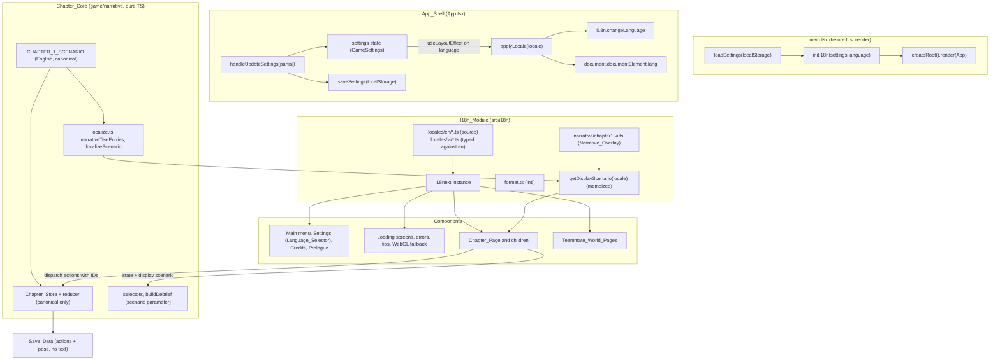
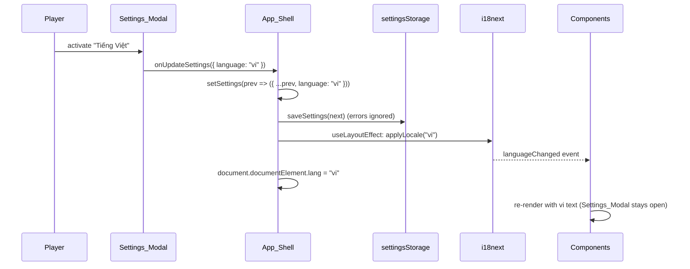

# Design Document: Game localization (English and Vietnamese)

## Overview

This design adds English (`en`) and Vietnamese (`vi`) localization to `apps/game`. English is the
default locale and the fallback. The player chooses the language in the existing Settings modal;
the choice is stored in `GameSettings.language`, applied at once, and restored on the next visit.

The design has three layers:

1. **I18n_Module** (`apps/game/src/i18n/`): one i18next instance, initialized synchronously with
   bundled TypeScript dictionaries before the first render. Components read text through
   `useTranslation()` from react-i18next and re-render when the language changes.
2. **Settings integration**: `GameSettings` gains `language: GameLocale`. A small, validated
   settings storage module replaces the inline `localStorage` code in `App.tsx`. The App_Shell
   keeps i18next and `<html lang>` in sync with the setting.
3. **Narrative overlay** for Chapter 1: the English authored scenario stays the canonical source.
   A pure `localizeScenario(scenario, overlay)` function builds a display-only copy with
   Vietnamese text, keyed by the existing content IDs. The UI passes that copy to the selectors
   and the debrief builder. The reducer, store and saves only ever see the canonical scenario, so
   the language can never change state or outcomes.

Working assumptions and decisions (owner decisions, final):

| Topic | Decision |
|---|---|
| Libraries | `i18next` 27.1.1 and `react-i18next` 18.0.1. Peer ranges checked on npm: i18next peers `typescript ^5 \|\| ^6 \|\| ^7` (repo: `~5.9.0`); react-i18next peers `react >= 18.0.0` (repo: `^19.2.0`), `i18next >= 27.0.1`. Re-check the installed versions in `node_modules` after `pnpm add`. |
| Loading | Bundled resources, `initAsync: false`, no HTTP backend, no language detector, `useSuspense: false`. |
| Locale source | `GameSettings.language` only. The browser language is not used; first visit is English. |
| Narrative | English stays inline in scenario data; Vietnamese is an overlay keyed by content IDs. Missing overlay text falls back to English per field. |
| Landing app | Out of scope, unchanged. No shared storage is assumed. |
| `index.html` | Title and meta stay English; only `<html lang>` changes at runtime. |
| AI | No AI code exists. A future locale contract is documented, not built. |
| Teammate worlds | `/hochiminh`, `/testmove`, `/ueh`, `/hue` get string extraction only, with no behavior change. |
| Branch | `feat/game-i18n-en-vi` from `feat/chapter-01-playable` (`8fed327`). The pull request depends on the Chapter 1 pull request, because `main` (`72edd16`) does not contain Chapter 1 yet. |

### Research findings

- **Synchronous init.** The i18next configuration reference describes `initAsync` (default
  `true`): with `false`, resources load without a `setTimeout`, so `t()` works directly after
  `init()`. With in-memory `resources` and no backend, `init({ initAsync: false })` is
  synchronous. Source: [i18next configuration options](https://www.i18next.com/overview/configuration-options).
- **Empty strings.** Since i18next v27, `returnEmptyString` defaults to `false`: an empty
  translation falls back like a missing one (same source). We still forbid empty strings by test,
  so a mistake never silently shows English.
- **Plurals.** i18next uses `Intl.PluralRules` with suffixes such as `_one` and `_other`.
  `new Intl.PluralRules("vi").resolvedOptions().pluralCategories` is `["other"]`, so Vietnamese
  needs only `_other` keys.
- **Re-render on change.** react-i18next binds to the `languageChanged` event by default, so every
  component using `useTranslation()` re-renders after `i18n.changeLanguage()`.
- **Key separators.** Content IDs contain dots (`ev.bank-card`, `call.scam-1`). i18next uses `.`
  as key separator, so narrative text does not go through i18next keys; it uses its own flat map
  with `/` separators (see "Narrative overlay").

## Architecture



### Dependency direction

- `game/narrative/**` imports nothing from `src/i18n/`, `i18next` or `react-i18next`. The existing
  `boundaries.test.ts` already rejects any bare package import other than `@scammaze/shared-types`
  and any relative import that leaves `game/narrative/`; this design adds `i18next` and
  `react-i18next` to its explicit forbidden list so the rule is named.
- `src/i18n/**` may import from `game/narrative/` (to build display scenarios) and from
  `@scammaze/shared-types` (for `GameLocale`).
- `game/loading/**`, `config/**` and `app/**` may import English dictionaries from
  `src/i18n/locales/en/` to keep their exported English constants as aliases (see "Existing
  English constants").

### Runtime sequence for a language change



`applyLocale` is idempotent: when i18next is already on the requested locale it only sets
`<html lang>`. Because resources are bundled, `changeLanguage` finishes before it returns
control; components do not render a mixed-language frame. A test checks that `i18n.language`
equals the new locale right after the call.

## Components and Interfaces

### 1. I18n_Module (`apps/game/src/i18n/`)

```
src/i18n/
  index.ts            # i18n instance, initI18n, applyLocale, re-exports
  locales.ts          # SUPPORTED_LOCALES, DEFAULT_LOCALE, isSupportedLocale, LOCALE_LABELS
  resources.ts        # resources object { en: {...}, vi: {...} }, NAMESPACES
  types.ts            # LocaleShape<T> helper type
  i18next.d.ts        # CustomTypeOptions augmentation (typed t)
  format.ts           # formatNumber, formatPercent, formatDate (Intl)
  useGameLocale.ts    # hook: current GameLocale from react-i18next
  narrative.ts        # getDisplayScenario(locale), getDisplayPrompts(locale), NARRATIVE_OVERLAYS
  narrative/
    chapter1.vi.ts    # CHAPTER_1_NARRATIVE_VI: merges the area parts below
    chapter1.vi/      # one part per scenario area (parallel translation work)
      core.ts         # title, subtitle, objectives, claims, warningSigns, journalNotes, prompts
      evidence.ts     # evidence/*
      world.ts        # interactables/*, npcs/*, calls/*
      dialogues.ts    # dialogues/*
      phone.ts        # phone/*
      decisions.ts    # decisions/*, endings/*, debrief/*
  locales/
    en/ common.ts menu.ts settings.ts loading.ts credits.ts chapters.ts
        chapter1/ index.ts hud.ts phone.ts story.ts outcome.ts
        worlds/   index.ts hcm.ts testmove.ts ueh.ts hue.ts
    vi/ (same file names as en)
```

File-split rule: `chapter1` and `worlds` are each one i18next namespace, but their dictionaries
are composed in `index.ts` from area files, so separate tasks (and separate agents) can translate
different areas without editing the same file. The `chapter1` areas are: `hud.ts` (title card,
HUD buttons, badges, objectives, toasts, notices, resume prompt, save failure, interaction
prompt chrome, page-level announcements), `phone.ts` (phone frame, home, messages, call history,
bank app, incoming call, call screen), `story.ts` (dialogue panel, journal, inspection panel) and
`outcome.ts` (decision panel, reasons, ending, debrief, pause menu). Each area file owns one
top-level key group, so the merge in `index.ts` is a plain object spread with no key collisions;
the key-consistency test asserts that the area key groups are disjoint. The Vietnamese narrative
overlay is merged the same way from the parts in `narrative/chapter1.vi/`; the overlay test
asserts that the parts have disjoint keys.

```ts
// locales.ts
import type { GameLocale } from "@scammaze/shared-types";
export const SUPPORTED_LOCALES = ["en", "vi"] as const satisfies readonly GameLocale[];
export const DEFAULT_LOCALE: GameLocale = "en";
export function isSupportedLocale(value: unknown): value is GameLocale {
  return typeof value === "string" && (SUPPORTED_LOCALES as readonly string[]).includes(value);
}
/** Each label in its own language. Not translated. */
export const LOCALE_LABELS: Record<GameLocale, string> = { en: "English", vi: "Tiếng Việt" };
```

```ts
// index.ts (sketch)
import i18next from "i18next";
import { initReactI18next } from "react-i18next";

export const i18n = i18next.createInstance();

export function initI18n(locale: GameLocale): typeof i18n {
  if (!i18n.isInitialized) {
    i18n.use(initReactI18next).init({
      resources,                 // bundled, typed
      lng: locale,
      fallbackLng: DEFAULT_LOCALE,
      supportedLngs: [...SUPPORTED_LOCALES],
      ns: [...NAMESPACES],
      defaultNS: "common",
      initAsync: false,          // synchronous with in-memory resources
      interpolation: { escapeValue: false }, // React escapes output
      react: { useSuspense: false },
      returnNull: false,
    });
  }
  applyLocale(locale);
  return i18n;
}

export function applyLocale(locale: GameLocale): void {
  if (i18n.language !== locale) void i18n.changeLanguage(locale);
  if (typeof document !== "undefined") document.documentElement.lang = locale;
}
```

`main.tsx` calls `initI18n(loadSettings(window.localStorage).language)` before
`createRoot().render()`, and wraps `<App />` in `<I18nextProvider i18n={i18n}>`. The test setup
(`src/test/setup.ts`) calls `initI18n("en")` once and `applyLocale("en")` in `afterEach`.

`useGameLocale()` returns `isSupportedLocale(i18n.resolvedLanguage) ? i18n.resolvedLanguage : "en"`
from `useTranslation()`, so components that need the locale value (formatting, display scenario)
re-render on change.

### 2. Typed dictionaries

English dictionaries are plain objects (string values, not `as const`, so that Vietnamese is not
forced to equal the English literals). Vietnamese dictionaries are typed with `LocaleShape`:

```ts
// types.ts
/** Same keys as the English dictionary. `_one` plural keys are optional (vi has one form). */
export type LocaleShape<T> = {
  [K in keyof T as K extends `${string}_one` ? never : K]: T[K] extends string ? string : LocaleShape<T[K]>;
} & {
  [K in keyof T as K extends `${string}_one` ? K : never]?: string;
};

// locales/vi/menu.ts
import type en from "../en/menu";
const vi: LocaleShape<typeof en> = { /* ... */ };
export default vi;
```

A missing or misspelled Vietnamese key is a TypeScript error (excess property checks on object
literals catch extra keys). The key-consistency test repeats the check at runtime, plus
interpolation variables, empty strings and NFC.

`i18next.d.ts` augments `CustomTypeOptions` with `defaultNS: "common"` and
`resources: typeof enResources`, so `t("menu:buttons.newGame.label")` is checked. If the typed
`t` slows down the editor or conflicts with v27 types, the fallback is to keep the augmentation
for `resources` only and rely on the runtime key test; the implementing task records which one
was used.

### 3. Namespaces and key scheme

Keys describe meaning and location, never the English wording. Count text uses `_one`/`_other`.
Interpolation uses `{{name}}`.

| Namespace | Content (examples) |
|---|---|
| `common` | `appName` ("SCAMMAZE", identical in both), `actions.close`, `actions.back`, `actions.cancel`, `actions.retry`, `actions.reload`, `actions.returnToMenu`, `actions.continue`, `audio.on`, `audio.muted`, `audio.muteTitle`, `audio.unmuteTitle`, `chapterLabel` ("Chapter {{number}}"), `loading` ("Loading"), `logoAlt` |
| `menu` | `nav.label`, `buttons.newGame.label` ("NEW GAME"), `buttons.newGame.sublabel` ("Begin Chapter {{number}}: {{title}}"), `buttons.continue.*`, `buttons.settings.*`, `buttons.credits.*`, `continueReasons.none`, `continueReasons.invalid`, `prologue.*`, `credits.title`, `credits.subtitle`, `credits.licenseLabel`, … |
| `settings` | `title`, `subtitle`, `language.heading`, `language.groupLabel`, `graphics.heading`, `graphics.quality.low\|medium\|high`, `graphics.description.low\|medium\|high`, `fov.heading`, `fov.cinematic`, `fov.default`, `fov.wide`, `sound.heading`, `sound.enabled`, `sound.muted`, `sound.masterVolume` |
| `loading` | `stage.<LoadingStage>`, `menuStartup.*`, `continueEyebrow`, `continueTitle`, `continueSubtitle`, `tipLabel`, `nextTip`, `progressLabel`, `fileCount_one`/`_other` ("{{completed}} of {{count}} file(s)"), `errors.<LoadingErrorCode>.title\|message`, `tips.<tipId>`, `webgl.*` |
| `credits` | `groups.<groupId>.category`, `items.<itemId>.notes` (names, creators, licenses, URLs are not keys) |
| `chapters` | `<chapterId>.title`, `<chapterId>.subtitle`, `<chapterId>.assets.<assetId>`, `scenes.<SceneId>`, `placeholder.*` |
| `chapter1` | UI chrome by component: `titleCard.*`, `hud.*` (`unreadMessages_one/_other`, `newEntries_one/_other`), `objectives.*`, `toast.*`, `notice.*`, `resume`, `saveFailure.*`, `phone.*`, `call.*`, `dialogue.*` (`playerSpeaker`, `fallbackOption`, `caption`), `journal.*` (`stance.<Stance>`, `claimStatus.<ClaimStatus>`, `source.<source>`), `inspection.*`, `decision.*`, `reasons.<ReasonCode>`, `ending.*`, `debrief.*`, `pause.*` (`restartConfirm` with `{{number}}`), `announce.objectiveCompleted` ("Objective complete: {{objective}}") |
| `worlds` | `hcm.*`, `testmove.*`, `ueh.*`, `hue.*` (UI labels only; landmark and place names are not translated) |

Note on chapter keys: `chapter-1` is a valid i18next key segment (only `.` and `:` are
separators).

### 4. Formatting (`format.ts`)

```ts
export function formatNumber(locale: GameLocale, value: number, options?: Intl.NumberFormatOptions): string;
export function formatPercent(locale: GameLocale, fraction: number): string; // style: "percent", maximumFractionDigits: 0
export function formatDate(locale: GameLocale, date: Date, options?: Intl.DateTimeFormatOptions): string;
```

Formatters are cached per locale and options key. i18next is configured with
`interpolation.format`-free usage: components pass already-formatted numbers as interpolation
values (for example `t("loading:fileCount", { count: total, completed: formatNumber(locale, completed) })`),
and plural selection uses the raw `count`. The field-of-view value keeps the `°` sign after a
formatted integer. No screen shows a date today; `formatDate` exists for Requirement 6.4 and is
covered by one unit test.

### 5. Settings storage (`apps/game/src/app/settingsStorage.ts`, new)

```ts
export const SETTINGS_STORAGE_KEY = "scammaze_settings_v1";
export const DEFAULT_SETTINGS: GameSettings = {
  graphicsQuality: "medium", soundEnabled: true, musicVolume: 1.0, sfxVolume: 1.0, fov: 72,
  language: "en",
};

/** Same merge as the previous inline code, plus a validated `language`. */
export function parseStoredSettings(raw: string | null): GameSettings {
  if (raw === null) return DEFAULT_SETTINGS;
  let parsed: unknown;
  try { parsed = JSON.parse(raw); } catch { return DEFAULT_SETTINGS; }
  if (parsed === null || typeof parsed !== "object" || Array.isArray(parsed)) return DEFAULT_SETTINGS;
  const merged = { ...DEFAULT_SETTINGS, ...(parsed as Partial<GameSettings>) };
  return { ...merged, language: isSupportedLocale(merged.language) ? merged.language : DEFAULT_LOCALE };
}

export function loadSettings(storage: Pick<Storage, "getItem"> | undefined): GameSettings;  // catches access errors
export function saveSettings(storage: Pick<Storage, "setItem"> | undefined, settings: GameSettings): boolean; // false on error
```

`App.tsx` changes:

- `useState(() => loadSettings(window.localStorage))` replaces the inline reader;
  `handleUpdateSettings` keeps its merge and calls `saveSettings` (errors ignored, as today).
- `useLayoutEffect(() => applyLocale(settings.language), [settings.language])`, placed before the
  route branches so the Teammate_World_Pages follow the same setting.
- `ContinueAvailability` gains `reasonCode: "none" | "invalid"` (the English `reason` stays for
  existing tests); `MainMenuOverlay` shows `t(`menu:continueReasons.${reasonCode}`)`.

The other fields keep their current, unvalidated merge behavior (Requirement 2.7). Validating them
is out of scope.

### 6. Language_Selector (in `SettingsModal.tsx`)

A new first section "Language" above "Graphics Quality", built like the graphics quality group:

```tsx
<div role="radiogroup" aria-labelledby="settings-language-heading" className="grid grid-cols-2 gap-2">
  {SUPPORTED_LOCALES.map((locale) => (
    <button key={locale} type="button" role="radio" aria-checked={settings.language === locale}
      lang={locale} onClick={() => onUpdateSettings({ language: locale })}
      className={/* same selected / unselected classes as the graphics buttons */}>
      {LOCALE_LABELS[locale]}
    </button>
  ))}
</div>
```

- Heading `settings:language.heading` with the lucide `Languages` icon (`aria-hidden="true"`).
- Native `<button>` elements give Enter and Space activation and normal Tab order. Arrow-key
  roving focus is not added, so each option stays a Tab stop, which matches the existing graphics
  buttons. `role="radio"` with `aria-checked` exposes the selected state; the selected style
  (`bg-[#7654d6]`, `border-[#b9a5f5]`, bold) gives the visual state, and the label text, not color
  alone, names each option.
- `lang={locale}` lets screen readers pronounce "Tiếng Việt" correctly.
- `grid-cols-2` keeps both options visible at 320 CSS pixels.
- Graphics quality buttons stop using the raw enum (`capitalize` on `low`) and show
  `t("settings:graphics.quality.<q>")`. The badge next to the heading shows the same text.

### 7. Shared UI string extraction

Each component calls `useTranslation(ns)` and renders `t(key)`. Non-component helpers take a
`TFunction` argument instead of returning English. Inventory (verified on `8fed327`):

| File | Text to extract | Notes |
|---|---|---|
| `features/menu/MainMenuOverlay.tsx` | button labels and sublabels, audio indicator, tooltips, nav label, logo alt | Sublabel uses chapter title from `chapters` |
| `features/menu/SettingsModal.tsx` | all labels and descriptions | plus Language_Selector |
| `features/menu/IntroPrologueModal.tsx` | prologue title, body, buttons | |
| `features/menu/CreditsModal.tsx` | title, subtitle, field labels | data from `config/credits.ts` |
| `components/ui/LoadingScreen.tsx`, `LoadingProgress.tsx`, `LoadingErrorState.tsx`, `LoadingTip.tsx` | cancel, progress label, error buttons, tip label, next tip | error text by `error.code` |
| `components/ui/WebGLFallback.tsx` | heading, body, troubleshooting list, reload button | `get.webgl.org` stays as plain text |
| `components/ui/BrandLogo.tsx` | logo alt | "SCAMMAZE" unchanged |
| `config/credits.ts` | add stable `id` to each group and item | `category` and `notes` stay as English source; UI reads `credits:groups.<id>.category`, `credits:items.<id>.notes`, default to the English value |
| `config/loadingTips.ts` | tips become `LOADING_TIP_IDS` + `loading:tips.<id>` | English array alias kept |
| `game/loading/loadingStrings.ts` | `LOADING_TEXT`, `formatChapterLabel`, `formatFileCount`, `describeChapterStage` | helpers take `t` |
| `game/loading/loadingErrors.ts` | titles and messages | English stays for `LoadingError.title/message`; UI translates by `code`; `detail` stays technical English |
| `game/loading/chapterLoader.ts` | snapshot gains `currentAssetId: string \| null` | UI shows `chapters:<chapterId>.assets.<assetId>` |
| `game/chapters/chapterRegistry.ts` | title, subtitle, asset loading text, `SCENE_LABELS` | English stays as source; UI uses `chapters` keys by ID |
| `features/loading/ChapterLoadingFlow.tsx`, `MenuStartupLoading.tsx` | eyebrow, title, subtitle, stages, notices, buttons | |
| `features/chapter/ChapterPlaceholder.tsx` | local `TEXT`, scene labels | |
| `app/continueAvailability.ts` | `CONTINUE_REASONS` | add `reasonCode` |
| `index.html` | none | `lang` set at runtime only |

### 8. Chapter 1 UI chrome

All `*_TEXT`, `*_LABEL` constants and text functions in `features/chapter1/**` move to the
`chapter1` namespace (inventory: `ChapterOnePage.tsx` `objectiveCompletedAnnouncement`,
`DIALOGUE_OVERLAY_TEXT`; `intro/ChapterTitleCard.tsx` `TITLE_CARD_TEXT`, `chapterEyebrow`;
`hud/HudButtons.tsx` `HUD_BUTTON_TEXT`, `unreadMessagesText`, `newEntriesText`;
`hud/ObjectiveTracker.tsx`, `hud/ObjectiveToast.tsx`, `hud/EvidenceNotice.tsx`,
`hud/ResumePrompt.tsx`, `hud/SaveFailureNotice.tsx`, `hud/InteractionPrompt.tsx`;
`phone/PhoneOverlay.tsx`, `PhoneHome.tsx`, `MessagesApp.tsx`, `CallHistoryApp.tsx`, `BankApp.tsx`,
`IncomingCallScreen.tsx`, `CallScreen.tsx` (including `CONNECTING_TEXT`);
`dialogue/DialoguePanel.tsx`; `journal/EvidenceJournal.tsx` (`EVIDENCE_JOURNAL_TEXT`,
`EVIDENCE_SOURCE_TEXT`); `panels/InspectionPanel.tsx`; `decision/DecisionPanel.tsx`;
`ending/EndingTransition.tsx`; `debrief/DebriefScreen.tsx`; `pause/PauseMenu.tsx`
(`PAUSE_MENU_TEXT`, `restartConfirmText`)).

Code-driven text from the core is translated by its code, not by its English string:

| Core output | UI rendering |
|---|---|
| `DialogueView.speaker === "player"` (core `speakerName` "You") | `t("chapter1:dialogue.playerSpeaker")` |
| `JournalStance.stance` (core `stanceText`) | `t("chapter1:journal.stance.<stance>")` |
| `ClaimStatusView.status` (core `statusText`) | `t("chapter1:journal.claimStatus.<status>")` |
| Dialogue option with `fallback: true` (core text `FALLBACK_OPTION_TEXT`) | `t("chapter1:dialogue.fallbackOption")` |
| Decision `hintCode` (new, see below) | `t("chapter1:reasons.<hintCode>")`; otherwise the localized scenario `hint` |
| Keyboard keys `E`, `P`, `J`, `Esc` | unchanged literal text |

### 9. Narrative overlay (`game/narrative/localize.ts`, new, pure)

```ts
export type NarrativeOverlay = Readonly<Record<string, string>>;
export interface NarrativeTextEntry { key: string; text: string }

/** Every translatable text field of the scenario and the interaction prompts, in a fixed order. */
export function narrativeTextEntries(
  scenario: ScenarioDefinition,
  prompts: Readonly<Record<InteractableId, string>>,
): NarrativeTextEntry[];

/** Display-only copy; IDs, structure, conditions and effects are copied unchanged. */
export function localizeScenario(scenario: ScenarioDefinition, overlay: NarrativeOverlay): ScenarioDefinition;
export function localizeInteractionPrompts(
  prompts: Readonly<Record<InteractableId, string>>, overlay: NarrativeOverlay,
): Record<InteractableId, string>;
```

Narrative_Text_Key scheme (segments joined with `/`; IDs are used verbatim):

| Field | Key |
|---|---|
| `title`, `subtitle` | `title`, `subtitle` |
| objective text | `objectives/<objectiveId>/text` |
| interactable `label`, `actionLabel`, `inspectionText` | `interactables/<id>/<field>` |
| interaction prompt | `prompts/<interactableId>` |
| claim text | `claims/<claimId>/text` |
| evidence `title`, `description`, `location`, `relevance`, `debriefHint` | `evidence/<id>/<field>` |
| evidence relation note | `evidence/<id>/relations/<claimId>/note` (the walker fails loudly if two relations of one item share a `claimId`) |
| warning sign `label`, `description` | `warningSigns/<id>/<field>` |
| journal note | `journalNotes/<noteId>/text` |
| call `displayName` | `calls/<callId>/displayName` |
| NPC `name` | `npcs/<npcId>/name` |
| dialogue persona `name`, `role` | `dialogues/<graphId>/persona/<field>` |
| dialogue line | `dialogues/<graphId>/lines/<lineId>` |
| message `from`, `body` | `phone/messages/<messageId>/<field>` |
| contact name | `phone/contacts/<number>/name` (the `+000` number is the stable ID) |
| bank app `title`, screen `title`, `body` | `phone/bankApp/title`, `phone/bankApp/screens/<screenId>/<field>` |
| decision `label`, `unavailableHint`, pre-step `label`, `unavailableHint` | `decisions/<id>/<field>`, `decisions/<id>/preStep/<field>` |
| ending `title`, `simulationLabel`, variant text | `endings/<outcomeId>/<field>`, `endings/<outcomeId>/variants/<variantId>/text` |
| debrief `mechanism` | `debrief/mechanism` |
| safer alternative | `debrief/saferAlternatives/<index>` (authored order is fixed) |
| outcome summary | `debrief/outcomeSummaries/<outcomeId>` |
| decision note | `debrief/decisionNotes/<debriefTag>` |

Not translated (copied as is): every ID, `number`, `officialWebsite`, conditions, effects,
`honesty`, `channel`, `source`, `speaker`, `stance`, `status`, `debriefTag`.

`localizeScenario` builds a new object; for each key it uses `overlay[key]` when it is a
non-empty string, otherwise the English text. Implementation: one walker that both lists the
entries and rebuilds the object, so the two can never disagree.

### 10. Display scenario (`src/i18n/narrative.ts`)

```ts
export const NARRATIVE_OVERLAYS: Record<GameLocale, NarrativeOverlay> = { en: {}, vi: CHAPTER_1_NARRATIVE_VI };
export function getDisplayScenario(locale: GameLocale): ScenarioDefinition;   // en → CHAPTER_1_SCENARIO itself; vi → cached localizeScenario
export function getDisplayPrompts(locale: GameLocale): Record<InteractableId, string>;
export function useDisplayScenario(): ScenarioDefinition;                     // via useGameLocale
```

For `en` the canonical object is returned unchanged, so English behavior and memoization are
exactly as today. For `vi` the result is computed once and cached, so selectors memoized by
`(state, scenario)` keep stable references and `useSyncExternalStore` does not loop.

### 11. Chapter_Page wiring

- `const scenario = useDisplayScenario();` and per selector
  `const selectX = useCallback((s: ChapterState) => selectors.selectX(s, scenario), [scenario]);`.
  `useChapterState(store, selectX)` re-subscribes when the scenario changes.
- `buildDebrief(chapterState, scenario)`.
- Every direct `CHAPTER_1_SCENARIO.<...>` read in `ChapterOnePage.tsx` (objective toasts, evidence
  notices, inspection panel, call screens, bank app, dialogue persona, title card fallback)
  reads from `scenario` instead.
- Toasts and notices store IDs (`objectiveId`, `evidenceId`) and resolve text at render, so an
  open toast also switches language.
- `InteractionPrompt` receives `getDisplayPrompts(locale)`.
- The store is still created with `createChapterStore(initial)` (canonical default). The page
  never remounts on a language change (no `key` on locale).

Small, additive core changes (pure, no i18n):

- `export type ReasonCode = keyof typeof REASONS;` in `reducer.ts`.
- `DecisionOptionView.hintCode: ReasonCode | null` and `DecisionPreStepView.hintCode`: set when
  the hint comes from `REASONS` (busy call or conversation, decision already made), `null` when it
  comes from scenario data. `hint` is unchanged.
- `selectCallLog` sets `displayName` from `scenario.calls[record.callId].displayName` when present
  (falls back to the record). For the canonical scenario the value is identical to today.
- Reducer `ActionResult.reason` is not shown to players (the page only checks `accepted`), so it
  stays English developer text.

### 12. Teammate_World_Pages

`features/hochiminh/{HCMOverlay,HCMPage,types}`, `features/testmove/{TestMovePage,TestMoveOverlay}`,
`features/ueh/UEHOverlay`, `features/hue/{HuePage,components/HueHUD}`: extract labels, loading text
and buttons into `worlds.<world>.*`. Existing Vietnamese strings in source (for example the HCM and
TestMove loading text) move to the `vi` dictionary, with an English source written for `en`.
Landmark and place names (for example "Landmark 81", "Cố Đô Huế") stay literal in code or in
data, not in dictionaries. Behavior, layout, timing and controls do not change.

### 13. Future AI locale contract (documentation only)

No AI code exists (verified: no AI provider, client or prompt code in `apps/game`). OVERVIEW.md
records the future contract: an AI dialogue request carries `locale: GameLocale` and stable line
or intent IDs; AI output is validated per locale with the same content lint; authored text in the
active locale is the fallback; AI never changes IDs, state or outcomes.

## Data Models

### `packages/shared-types/src/index.ts`

```ts
export type GameLocale = "en" | "vi";

export interface GameSettings {
  graphicsQuality: GraphicsQuality;
  soundEnabled: boolean;
  musicVolume: number; // 0.0 to 1.0
  sfxVolume: number;   // 0.0 to 1.0
  fov: number;         // Field of View, e.g. 65 - 85
  /** UI language. Display only; never affects game state. */
  language: GameLocale;
}
```

Every place that builds a full `GameSettings` (App defaults, test fixtures such as the
`settings` props in Chapter 1 and world tests) adds `language: "en"`; the type checker lists them.

### Stored settings (`localStorage["scammaze_settings_v1"]`)

```json
{ "graphicsQuality": "medium", "soundEnabled": true, "musicVolume": 1, "sfxVolume": 1, "fov": 72, "language": "vi" }
```

Old values without `language` load as `en`. No version bump is needed because the field is
additive and validated.

### Locale dictionary shape (example)

```ts
// locales/en/menu.ts
const menu = {
  nav: { label: "Game main menu" },
  buttons: {
    newGame: { label: "NEW GAME", sublabel: "Begin Chapter {{number}}: {{title}}" },
    continue: { label: "CONTINUE", sublabel: "Resume saved progress" },
    settings: { label: "SETTINGS", sublabel: "Language, graphics, camera FOV and audio" },
    credits: { label: "CREDITS & LICENSES", sublabel: "3D city and vehicle pack attribution" },
  },
  continueReasons: {
    none: "No saved game found.",
    invalid: "Your saved game could not be read. Start a new game instead.",
  },
};
export default menu;

// locales/vi/menu.ts (excerpt)
buttons: {
  newGame: { label: "TRÒ CHƠI MỚI", sublabel: "Bắt đầu Chương {{number}}: {{title}}" },
  continue: { label: "TIẾP TỤC", sublabel: "Chơi tiếp từ chỗ đã lưu" },
  settings: { label: "CÀI ĐẶT", sublabel: "Ngôn ngữ, đồ họa, góc nhìn và âm thanh" },
  credits: { label: "GHI CÔNG & GIẤY PHÉP", sublabel: "Ghi công gói mô hình thành phố và xe 3D" },
},
```

The English text in dictionaries must equal today's English UI text, except where the existing
test suite allows a change (for example the settings sublabel now mentions language; tests that
assert the old sublabel are updated in the same task).

### Narrative overlay

```ts
// src/i18n/narrative/chapter1.vi/core.ts (excerpt)
export const CORE_VI: NarrativeOverlay = {
  title: "Cuộc gọi khẩn cấp",
  "objectives/obj.<id>/text": "…",
};

// src/i18n/narrative/chapter1.vi.ts
export const CHAPTER_1_NARRATIVE_VI: NarrativeOverlay = {
  ...CORE_VI, ...EVIDENCE_VI, ...WORLD_VI, ...DIALOGUES_VI, ...PHONE_VI, ...DECISIONS_VI,
};
```

### Vietnamese terminology (translation guide)

| English | Vietnamese | Note |
|---|---|---|
| New game / Continue / Settings | Trò chơi mới / Tiếp tục / Cài đặt | |
| Credits & licenses | Ghi công & giấy phép | |
| Loading | Đang tải | |
| Return to menu | Về menu chính | |
| Chapter {{number}} | Chương {{number}} | |
| The Urgent Call | Cuộc gọi khẩn cấp | canonical title `chapterRegistry.ts` |
| Evidence / Journal | Bằng chứng / Sổ ghi chép | |
| Claim | Lời khẳng định | what the caller says is true |
| Objective | Mục tiêu | |
| Debrief | Tổng kết | |
| Verify / official number | Xác minh / số điện thoại chính thức | |
| One-time code (OTP) | mã xác thực một lần (OTP) | explain acronym once |
| Hang up / Decline / Accept | Cúp máy / Từ chối / Nghe máy | |
| Points toward / against this claim | Ủng hộ / Phản bác lời khẳng định này | never "chứng minh" |
| Simulation: nothing real happened. | Mô phỏng: không có điều gì xảy ra thật. | |
| Northgate Bank | Northgate Bank | proper noun, never "Ngân hàng Northgate" |
| safe (any sense) | not used | "an toàn" is forbidden by lint; the verified ending says what was checked, for example "Bạn đã kiểm tra qua số chính thức của Northgate Bank." |

A native-speaker review of all Vietnamese text is recommended before release; the
PROJECT_PROGRESS entry records this.

## Correctness Properties

*A property is a characteristic or behavior that should hold true across all valid executions of a system-essentially, a formal statement about what the system should do. Properties serve as the bridge between human-readable specifications and machine-verifiable correctness guarantees.*

### Property 1: Stored settings parsing matches the legacy merge and validates the language

*For any* raw stored value (absent, non-JSON text, JSON primitive, JSON array, or JSON object
with arbitrary extra fields and an arbitrary `language` value), `parseStoredSettings(raw)` returns
the default settings when the value is absent, not JSON or not a JSON object; otherwise it returns
the five existing fields exactly as `{ ...DEFAULT_SETTINGS, ...parsed }` would, and `language`
equals the stored value when `isSupportedLocale` holds for it and `"en"` in every other case.

**Validates: Requirements 1.1, 2.2, 2.4, 2.5, 2.6, 2.7**

### Property 2: Settings serialization round trip

*For any* valid `GameSettings` value (any graphics quality, sound flag, volumes in [0, 1], field
of view in [60, 85] and Supported_Locale), `parseStoredSettings(JSON.stringify(settings))` is
deep-equal to `settings`.

**Validates: Requirements 2.3, 2.4**

### Property 3: Language selections change only the language and the document language follows

*For any* initial `GameSettings` and any non-empty sequence of Supported_Locale selections, applying
each selection as `{ ...prev, language }` followed by `applyLocale(language)` yields settings equal
to the initial settings except `language`, which equals the last selection, and afterwards
`i18n.language` and `document.documentElement.lang` both equal the last selection.

**Validates: Requirements 2.8, 4.1, 4.3**

### Property 4: Missing Vietnamese text falls back to English

*For any* subset of the Vietnamese Translation_Keys removed from the resources of a fresh i18next
instance initialized in `vi` with `fallbackLng: "en"`, every removed key resolves to its English
text and every kept key resolves to its Vietnamese text.

**Validates: Requirements 1.7, 5.6**

### Property 5: Plural selection and count formatting

*For any* plural Translation_Key and any integer count from 0 to 1,000,000, the English text is the
`_one` form exactly when the count is 1 and the `_other` form otherwise, the Vietnamese text is
always the `_other` form, and both texts contain the count formatted with
`formatNumber(locale, count)`.

**Validates: Requirements 5.7, 6.3**

### Property 6: Localization replaces only text and falls back per field

*For any* Narrative_Overlay built from a random subset of the Chapter 1 Narrative_Text_Keys with
random non-empty strings (plus random empty strings and unknown keys), `localizeScenario` returns a
scenario that (a) is deep-equal to the Canonical_Scenario after every Narrative_Text_Key field is
blanked in both, (b) has, for every Narrative_Text_Key, the overlay text when the overlay has a
non-empty value for that key and the English text otherwise, and (c) leaves the input scenario and
overlay unmodified.

**Validates: Requirements 9.3, 9.4, 9.5, 10.3**

### Property 7: The core gives the same results with any Localized_Scenario

*For any* seeded action sequence (including malformed values), running `chapterReducer` step by
step with the Vietnamese Localized_Scenario and with the Canonical_Scenario gives the same
`accepted` value at every step, and the two final states are deep-equal after the
`call.log[].displayName` fields are removed.

**Validates: Requirements 10.4, 9.4**

### Property 8: Saves do not depend on the UI language

*For any* seeded action sequence dispatched through a Chapter_Store and any set of steps at which
the UI locale is switched with `applyLocale`, the final store state and the
`encodeProgress(state, pose)` output are deep-equal to those of the same sequence run with no
switch, and the serialized progress contains none of the Vietnamese overlay strings.

**Validates: Requirements 10.5, 10.6**

### Property 9: Decision hint codes match their reasons

*For any* state reached by a seeded action sequence, every decision option and pre-step in
`selectDecisionPanel(state)` with a non-null `hintCode` has `hint === REASONS[hintCode]`, and
every option or pre-step whose `hint` comes from scenario data has `hintCode === null`.

**Validates: Requirements 8.6**

## Error Handling

| Situation | Behavior |
|---|---|
| `localStorage` unavailable or `getItem` throws | `loadSettings` returns defaults (`language: "en"`). |
| Stored value is not JSON, not an object, or an array | Defaults (Property 1). |
| Stored `language` invalid (`"fr"`, `"EN"`, `"vi-VN"`, `42`, `null`) | `"en"`; other fields keep today's merge. The corrected value is written on the next settings change. |
| `setItem` throws (quota, private mode) | Ignored as today; the new locale still applies for the session. |
| Translation key missing in `vi` at runtime | i18next falls back to `en` (`fallbackLng`). Type checking and the key test make this a development-time error. |
| Translation key missing in `en` | i18next returns the key; the key test fails in CI, so this never ships. |
| Interpolation variable missing at a call site | i18next leaves `{{name}}`; the interpolation test compares variables between locales, and component tests cover call sites. |
| Narrative overlay text missing or empty | English field text (Property 6). |
| Narrative overlay has a stale key (content ID renamed) | The overlay completeness test fails and names the key. |
| Two relations of one evidence item share a `claimId` | `narrativeTextEntries` throws with the evidence ID; the localize test fails. |
| `changeLanguage` called with an unsupported value | Not possible through the typed API (`GameLocale`); `applyLocale` is only called with validated settings. |
| Loading error | Title and message translated by `LoadingError.code`; `detail` shown as technical plain text, untranslated. |

No error message is added for language problems: every failure path ends in readable English or
the selected language.

## Testing Strategy

### Tools and conventions

Reflection on the prework: the settings criteria 1.1, 2.2 and 2.4 to 2.7 collapse into one
model-based parsing check plus one round trip; 2.8 and 4.3 into one selection-sequence check;
1.7 and 5.6 into one fallback check; 5.7 and 6.3 into one plural check; 9.3 to 9.5 and 10.3 into
one localization check; 10.5 and 10.6 into one save check. Exhaustive checks over finite data
(key consistency, NFC, content lint, overlay completeness) are example tests.

- Vitest, Testing Library and jsdom, as today (`pnpm test` runs `vitest run`).
- Property tests use the repository's existing seeded generator (`src/test/seededRandom.ts`:
  `createLcg`, `randomInt`, `pick`; `src/test/chapterRuns.ts`: `generateActionSequence`,
  `runSequence`, `caseSeed`, `CORE_PROPERTY_SEED`, `CORE_PROPERTY_RUNS` = 200). This follows the
  convention already used by the 11 Chapter 1 property test files and avoids adding a dev
  dependency such as fast-check, in line with AGENTS.md ("avoid unnecessary dependencies").
  Each property test runs at least 100 cases (the shared constant is 200), prints the seed of a
  failing case, and uses `shrinkFailingPrefix` for action sequences.
- Each property test carries a tag comment:
  `// Feature: game-i18n-en-vi, Property <n>: <property title>`.
- Each correctness property is implemented by exactly one property test.
- `src/test/setup.ts` calls `initI18n("en")` once and `applyLocale("en")` after each test, so
  every existing English assertion keeps passing (Requirement 14.1, 14.11).

### Property tests (one file per property or per area)

| Property | File (proposed) |
|---|---|
| 1, 2 | `src/app/settingsStorage.property.test.ts` |
| 3 | `src/i18n/applyLocale.property.test.ts` |
| 4, 5 | `src/i18n/i18n.property.test.ts` |
| 6 | `src/game/narrative/properties/localize.property.test.ts` (imports only narrative modules and test helpers) |
| 7, 8 | `src/i18n/localeIndependence.property.test.ts` (outside `game/narrative/`, because it imports the vi overlay and the I18n_Module) |
| 9 | `src/game/narrative/properties/decisionHints.property.test.ts` |

### Example and exhaustive tests

- **Key consistency** (`src/i18n/resources.test.ts`): per namespace, the same Plural_Base_Keys in
  `en` and `vi`; the same `{{variables}}` per key; no empty or whitespace-only text; every `vi`
  text is NFC; no emoji in any dictionary; `LOCALE_LABELS` are "English" and "Tiếng Việt".
- **Init** (`src/i18n/init.test.ts`): `t` returns `vi` text directly after `initI18n("vi")` on a
  fresh instance; resources are bundled (no backend plugin); `react.useSuspense` is false;
  `navigator.language = "vi"` with no stored settings still starts in English; `formatDate` and
  `formatPercent` examples for both locales.
- **Narrative overlay** (`src/i18n/narrative.test.ts`): the vi overlay has a text for every
  Narrative_Text_Key and no extra key; `validateScenario(getDisplayScenario("vi"))` returns no
  errors; `getDisplayScenario("en") === CHAPTER_1_SCENARIO`; repeated calls return the same
  object; `narrativeTextEntries` covers every text string found by the content-lint walker.
- **Vietnamese content lint** (`src/i18n/content.vi.test.ts`): applies Requirement 11 to all vi
  dictionaries and the vi overlay: no "an toàn" (case-insensitive); reserved domains only in the
  overlay and `chapter1`; `+000` numbers only; the same phone numbers and domains per key as the
  English source; no emoji, currency symbol, ISO currency code or blaming phrase (a vi list, for
  example "lỗi của bạn", "ngu ngốc", "cả tin", "bất cẩn", "dại dột", "nhẹ dạ"); "Northgate Bank"
  appears verbatim wherever the English source has it and "Ngân hàng Northgate" never appears.
- **Boundaries** (`game/narrative/boundaries.test.ts`): add `i18next` and `react-i18next` to the
  forbidden list and a fixture line for each.
- **Settings selector** (`features/menu/SettingsModal.test.tsx`, new): two radios with native
  labels; `aria-checked` follows `settings.language`; click, Enter and Space call
  `onUpdateSettings({ language })`; group name localized; Tab reaches both options.
- **App** (`app/App.i18n.test.tsx`, new): English on first start; selecting "Tiếng Việt" switches
  the menu and the open Settings_Modal at once and sets `<html lang="vi">`; a stored `vi` survives
  a remount; an invalid stored value gives English; other settings fields are kept after a
  language change; a `setItem` failure still switches the locale; the menu shows "TRÒ CHƠI MỚI",
  "TIẾP TỤC", "CÀI ĐẶT", "GHI CÔNG & GIẤY PHÉP".
- **Loading** (extend `MenuStartupLoading.test.tsx`, `ChapterLoadingFlow.test.tsx`,
  `LoadingScreen.test.tsx`): in `vi`, stage text, file count, tip label, every error code's
  title, "Về menu chính", chapter title "Cuộc gọi khẩn cấp".
- **Chapter 1** (extend `ChapterOnePage.test.tsx`, `accessibility.test.tsx`,
  `PhoneOverlay.test.tsx`, `DecisionPanel.test.tsx`, `DebriefScreen.test.tsx`): in `vi`, HUD,
  phone, journal stance and claim status, player speaker, fallback option, decision reason hints,
  debrief headings and accessible names; switching locale while the journal is open keeps the
  store state object, the open overlay and the event log, and changes the visible text.
- **Credits** (`features/menu/CreditsModal.test.tsx`, new): in `vi`, category headings change and
  every name, creator, license and source URL is identical to `en`.
- **Teammate worlds**: one render test per overlay or HUD component in `vi` (3D canvas mocked as
  in existing tests); existing behavior tests unchanged.
- **Existing tests**: tests that deep-compare decision panel views, loader snapshots or continue
  availability are updated for the additive fields (`hintCode`, `currentAssetId`, `reasonCode`)
  in the same task as the field change.

### Why some criteria have no automated test

- Visual style reuse (3.6) and the 320 px layout (3.7) need a real browser; they are checked by
  code review against the existing classes and `grid-cols-2`.
- Equal educational meaning (9.11) and natural Vietnamese (11.10) need human judgement; the
  progress entry recommends a native-speaker review.
- Documentation (Requirement 15) and branch rules (Requirement 16) are process requirements.

### Quality gates

`pnpm typecheck`, `pnpm test` and `pnpm build` must pass (CI runs the same three in
`.github/workflows/ci.yml`). The baseline on `8fed327` is 48 test files and 392 tests; the final
report states the new counts honestly.
