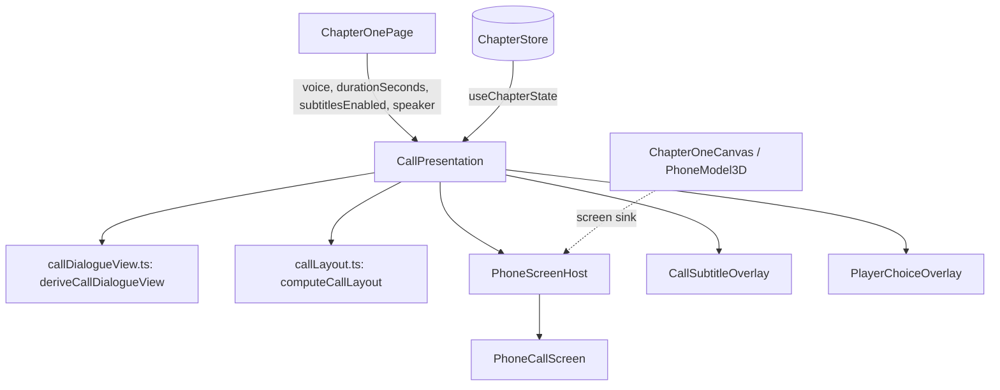

# Design Document

## Overview

This design turns the Chapter 1 call screen into a believable in-call phone interface and moves
all caller text off the phone. The change is presentation only. It builds on the code of branch
`feat/chapter-01-voice-narrative` (`f5694a6`) and keeps the deterministic narrative core, the
voice engine, the 3D phone, `PhoneScreenHost` and `PlayerChoiceOverlay` as they are.

Summary of decisions:

1. `PhoneScreenUI.tsx` becomes `PhoneCallScreen.tsx` (renamed with `git mv`). The component is
   rewritten as a device UI: avatar, name, number, status, timer, a 3-column row of round buttons
   and a red End call button. It no longer receives a caller line, a connecting text or a notice.
   Reason for the rename instead of keeping the file name: only one production file
   (`CallPresentation.tsx`) and four test files import it, and a permanent misnomer
   ("ScreenUI" that shows no UI content) costs more than the one-time import update.
2. A new `CallSubtitleOverlay.tsx` shows the current caller line, the connecting text and the voice
   notice outside the phone, in a new `subtitle` rectangle of `computeCallLayout`.
3. The "CallDialogueController" role (state, timing, node progression) stays in
   `CallPresentation` plus the existing hooks `useVoicePlayback` and `useCallDuration`. The
   derivation of what to show moves into a pure module `callDialogueView.ts`, so it can be tested
   without React. No new store and no new hook is added.
4. "Speaker" toggles the existing phone-speaker filter for the current call only. The page keeps
   one `useState<boolean | null>` override and passes it to `useVoicePlayback` as
   `phoneVoiceFilter`. Honest semantics: the filter is read when a line starts, so the toggle
   applies to the next line and to Replay.
5. Keypad, Hold and the optional "Call" header are omitted. "Call ended" is not displayed (see
   "Resolved assumptions").

### Resolved assumptions

- No screenshots were attached; the layout comes from the owner's text.
- "Call ended" status: the `call` overlay closes in the same update that ends the call
  (`ChapterOnePage.call.test.tsx` expects no presentation after End call). A delay would change
  the locked overlay contract, so only "Incoming call" and "Call in progress" are displayed.
  Follow-up: a short ended state would need a design for the overlay stack.
- The connecting text and the voice notices move to the subtitle overlay, because they are
  sentences and the phone must not show sentences.
- With no `voice` prop (older tests, voice disabled in wiring) the active screen shows the End call
  button only and the subtitle shows the line, as the current code does.
- `hangUp` keeps its key name; its English value becomes "End call" (the key name is used by
  existing tests, the value is read through `t`).
- The Speaker button is always enabled. It changes a sound effect only, so it needs no audio
  availability check.

## Architecture



Layout of the screen (wide viewport, not to scale):

```text
+-----------------------------------------------+
|  [subtitle overlay]               +---------+ |
|  Caller name: one line of speech  |  phone  | |
|                                   | avatar  | |
|  [choice overlay]                 | name    | |
|  1  option                        | number  | |
|  2  option                        | status  | |
|                                   | 00:12   | |
|                                   | M  S  R | |
|                                   | End call| |
|                                   +---------+ |
+-----------------------------------------------+
```

DOM order inside the `call-presentation` dialog: backdrop (fallback only), `PhoneScreenHost`,
`CallSubtitleOverlay`, `PlayerChoiceOverlay`. Tab order therefore visits the phone buttons, then
the options. The subtitle overlay has no tab stop.

## Components and Interfaces

### `PhoneCallScreen` (`call/PhoneCallScreen.tsx`)

Pure DOM, no three, R3F or Drei imports. Same single instance in `model` and `fallback` modes.
The types `PhoneCallView` and `SubtitleContent` are defined in `callDialogueView.ts` (pure
module) and imported by the components, so the pure module imports no component.

```ts
// defined in callDialogueView.ts
export type PhoneCallView =
  | { status: "ringing"; callerName: string; number: string }
  | { status: "active"; callerName: string; number: string };

export interface CallControlsView {
  durationSeconds: number;
  muted: boolean;
  speakerOn: boolean;
  replayEnabled: boolean;
  compact: boolean; // screen height below 360 CSS px
}

export interface PhoneCallScreenProps {
  view: PhoneCallView;
  controls?: CallControlsView; // absent: End call only, no timer
  disabled: boolean; // paused
  vibrateIcon: boolean; // fallback and ringing only
  onToggleMute?: () => void;
  onToggleSpeaker?: () => void;
  onReplay?: () => void;
  onAccept: () => void;
  onDecline: () => void;
  onHangUp: () => void; // End call
  acceptRef?: Ref<HTMLButtonElement>;
  hangUpRef?: Ref<HTMLButtonElement>;
}
```

Removed from the old props: `view.line`, `controls.captionVisible`, `controls.notice`.

Visual spec (CSS px; the host sets `containerType: inline-size`, so width rules use container
queries):

| Part | Spec |
|---|---|
| Surface | Host background `#1d1b2b` (unchanged). Content padding 16 px sides, 20 px top and bottom; 24 px gap between groups (12 px in Compact_Layout). |
| Avatar | Circle 80 px (56 px compact), border `#7654d6` at 50 percent, fill `#171521`, lucide `User` icon 40 px (28 px), `aria-hidden`. No initials, no image. |
| Status | `text-sm` uppercase tracking, `#b9a5f5` while ringing, `UI.textPositive` (teal) while active. Text: "Incoming call" or "Call in progress". |
| Name | `text-xl` bold, `#f7f5ff`, wraps with `break-words`. |
| Number | `text-sm`, `#a9a4c4`, `dir="ltr"`, plain text. |
| Timer | `time role="timer"`, `text-lg tabular-nums`, format `mm:ss`, `aria-label` from `phone.call.duration`. Active only, when `controls` exists. |
| Button row | CSS grid, 3 equal columns, gap 12 px. Each cell is a vertical stack: round button 56 px (44 px compact) and a `text-sm` label below. |
| Round button | Secondary surface (`#171521` fill, `#38344f` border), lucide icon 24 px. Pressed state (`aria-pressed`) uses the purple accent fill `#7654d6` and the text "pressed" is carried by `aria-pressed`, plus an icon change for Mute (`Volume2` / `VolumeX`). |
| End call | Red pill, `#c93c47` fill, white text and `PhoneOff` icon, centered, height 48 px (44 px compact), min width 140 px. Contrast of white on `#c93c47` is about 4.98:1. Hover `#d9505b`. |
| Narrow container | Below 200 px container width the labels become `sr-only` and the buttons shrink to 40 px. Accessible names stay. |
| Motion | Ringing wobble only in fallback and only without reduced motion (unchanged). `motion-safe:transition-colors` only. |

Icons (lucide-react): `User`, `PhoneIncoming`, `Mic`/`MicOff` is not used; Mute uses `Volume2` /
`VolumeX` as today, Speaker uses `Speaker`, Replay uses `RotateCcw`, End call and Decline use
`PhoneOff`, Accept uses `Phone`. If `Speaker` is missing from the installed `lucide-react`
version, use `Volume1`. No emoji.

Ringing layout: avatar, status, name, number centered; Decline (red, same style as End call) and
Accept (teal `UI.buttonAccept`) side by side, as today.

Button accessible names: Mute / Unmute (visible label equals name), Speaker (visible "Speaker",
`aria-pressed`), Replay (visible "Replay", `aria-label` "Replay last line"), End call. Names contain
their visible labels (Requirement 10.1).

Test IDs kept: `incoming-call-screen`, `call-screen`, `incoming-call-icon`, `incoming-call-name`,
`incoming-call-number`, `incoming-call-accept`, `incoming-call-decline`, `call-screen-number`,
`call-duration`, `call-screen-mute`, `call-screen-replay`, `call-screen-hang-up`. New:
`call-screen-speaker`, `call-screen-avatar`. Removed: `call-line-region`, `dialogue-line` (in the
phone), `call-notice` (moves to the overlay).

Compact layout: `controls.compact` is `layout.screen.height < 360` (constant unchanged). In
Compact_Layout the avatar shrinks (it is not hidden any more), gaps tighten, and buttons use the
44 px size. The timer and all buttons stay visible (Requirement 4.4). Minimum phone screen is
132 px wide and 288 px high; the content height needed is about 270 px compact, which fits.

### `CallSubtitleOverlay` (`call/CallSubtitleOverlay.tsx`)

Pure DOM. Rendered by `CallPresentation` while the call is active, as a sibling after
`PhoneScreenHost`.

```ts
export type SubtitleContent =
  | { kind: "line"; speakerName: string; text: string; nodeKey: string }
  | { kind: "connecting" }
  | { kind: "none" };

export interface CallSubtitleOverlayProps {
  content: SubtitleContent;
  visible: boolean; // isSubtitleVisible(...)
  notice: "none" | "autoplay-blocked" | "dev-preview" | "english-voice" | "no-audio";
  region: Rect; // layout.subtitle
}
```

Behavior:

- Root `div` (`data-testid="call-subtitle-overlay"`, `role="region"`, `aria-label` from
  `phone.subtitle.label`), `position: fixed` at `region`, `pointer-events: none`, no tab stop,
  `overflow-y: auto` with `max-height = region.height`. Surface: `#171521` at 92 percent, border
  `#38344f`, radius 8 px, padding 8 px 12 px. The surface is transparent and has no border when
  there is nothing to show, so an empty overlay is invisible.
- Inside, one persistent `div` (`data-testid="call-subtitle-region"`, `aria-live="polite"`,
  `aria-atomic="true"`). When `visible` and `content.kind === "line"` it holds the speaker name
  (`UI.label` style) and the line (`text-base leading-snug`, 16 px, `#f7f5ff`,
  `data-testid="call-subtitle-line"`). For `connecting` it holds the connecting text. Otherwise
  it is empty.
- Truncation policy: the overlay shows the whole current line and never an earlier line, so there
  is at most one line of speech (one utterance) at a time. A line taller than the rectangle scrolls
  vertically; it is never cut or ellipsized. The overlay uses `whitespace-normal break-words`.
- A second persistent polite `div` (`data-testid="call-notice"`) holds the voice notice text
  (`text-sm`, `#a9a4c4`) and is empty for `none`.
- Fade: the line element is keyed by `nodeKey`. Without reduced motion it plays a 150 ms
  opacity animation (`scammaze-subtitle-in`) on change. With reduced motion (via
  `usePrefersReducedMotion`) there is no animation and no transition.
- The live region node is never remounted, so a re-render with the same line makes no new
  announcement.

Visibility rule (pure, in `callDialogueView.ts`):

```ts
export function isSubtitleVisible(input: {
  subtitlesEnabled: boolean;
  audible: boolean | undefined; // undefined: no voice controller
}): boolean {
  return input.audible === undefined || input.subtitlesEnabled || !input.audible;
}
```

The notice is shown whenever its value is not `none`, independent of `visible`, because it carries
accessibility information (for example "There is no audio for this line").

### `callDialogueView.ts` (pure derivation, the controller role)

No React, three, i18n or store imports.

```ts
export interface CallDialogueView {
  screen: PhoneCallView | null; // null: no call to show
  subtitle: SubtitleContent;
  narration: string | null; // non-caller line, shown by PlayerChoiceOverlay
}

export function deriveCallDialogueView(input: {
  call: CallState;
  callDef: CallDefinition | undefined;
  dialogueView: DialogueView | null;
}): CallDialogueView;
```

It contains the logic that is now inline in `CallPresentation`: linked-view check
(`dialogueView.callId === call.current`), `callerLine` (speaker `caller` or `npc`), `narration`
(linked and not a caller line), and the screen view for `ringing` and `active`. The `subtitle`
is `line` for a caller line, `connecting` when active with no linked view, and `none` otherwise.
`nodeKey` is `${graphId}:${nodeId}`.

### `callTimer.ts`

```ts
export function formatCallDuration(totalSeconds: number): { text: string; iso: string };
```

`text` is `mm:ss` with at least two minute digits (`125` seconds gives `02:05`); non-finite and
negative input gives `00:00`. Moved from the old `PhoneScreenUI.tsx`.

### `CallPresentation` (refactor)

Props are unchanged except one new optional prop:

```ts
speaker?: { on: boolean; onToggle: () => void };
```

Changes: use `deriveCallDialogueView`; render `PhoneCallScreen` instead of `PhoneScreenUI`; render
`CallSubtitleOverlay` with `layout.subtitle` when `call.status === "active"`; compute
`visible = isSubtitleVisible({ subtitlesEnabled, audible: voice?.snapshot.audible })`; build
`controls` without caption and notice; pass `voiceNotice(snapshot)` to the overlay; pass
`speaker` to the screen. Focus, dispatch guard, mode logic, `PhoneScreenHost` and
`PlayerChoiceOverlay` wiring are unchanged. `voiceNotice` stays in this file.

### `ChapterOnePage` (small change)

```ts
const [speakerOverride, setSpeakerOverride] = useState<boolean | null>(null);
const speakerOn = speakerOverride ?? settings.phoneVoiceFilter;
// useVoicePlayback settings: phoneVoiceFilter: speakerOn
useEffect(() => setSpeakerOverride(null), [call.current]); // reset per call
// <CallPresentation speaker={{ on: speakerOn, onToggle: () => setSpeakerOverride(!speakerOn) }} />
```

The saved setting is never written. The reset also runs when the call ends, so the next call
starts from the saved setting (Requirement 8.5). Mute reset per call already exists
(`ACCESSIBILITY.md`, line 46).

### `callLayout.ts` (extension)

`CallLayout` gains `subtitle: Rect`. New constants: `SUBTITLE_MAX_HEIGHT = 104`,
`SUBTITLE_MIN_HEIGHT = 56`, `SUBTITLE_NARROW_SHARE = 0.35`.

Narrow (`W < 640`), after the screen (`screen.bottom = m + h`):

```ts
const remaining = Math.max(0, H - screenBottom - 2 * m);        // subtitle + gap + choice
const subtitleHeight = Math.min(
  remaining,
  SUBTITLE_MAX_HEIGHT,
  Math.max(SUBTITLE_MIN_HEIGHT, Math.round(SUBTITLE_NARROW_SHARE * remaining)),
);
const subtitle = { left: m, top: screenBottom + m, width: W - 2 * m, height: subtitleHeight };
const choiceTop = subtitle.top + subtitleHeight + (subtitleHeight > 0 ? m : 0);
// choice: left m, top choiceTop, width W - 2m, height max(0, H - m - choiceTop)
```

Wide (`W >= 640`), the choice rectangle is unchanged (`top = H / 2`). The subtitle sits in the
same left column directly above it:

```ts
const subtitleHeight = Math.min(SUBTITLE_MAX_HEIGHT, Math.max(0, H / 2 - 2 * m));
const subtitle = { left: m, top: H / 2 - m - subtitleHeight, width: choice.width, height: subtitleHeight };
```

At the smallest wide height (480) this gives 104 px. The phone screen starts to the right of
`choice.left + choice.width + m`, so the subtitle (same left and width as the choice) never meets
the phone. In the narrow layout the existing guarantees hold: `choice.top >= screen.bottom` and
`choice.bottom = H - m`. The projected 3D phone can differ from `layout.screen` by the entry slide
and the ringing wobble (`phoneMotion.ts`); the subtitle is only shown while active, after the
entry (400 ms), and this is listed as a risk.

### `PhoneScreenHost`, `PlayerChoiceOverlay`, `PhoneModel3D`, `useVoicePlayback`, `useCallDuration`, `useCallAudio`

No code change. `importBoundaries.test.ts` lists the DOM entry files; it is updated for the
renamed and new files.

## Data Models

No new persisted data and no store. New types are listed above (`PhoneCallView`,
`CallControlsView`, `SubtitleContent`, `CallDialogueView`, `Rect` field `subtitle`).

### i18n key table (`chapter1` namespace, `phone` area, both locales)

| Key | en | vi | Change |
|---|---|---|---|
| `phone.call.hangUp` | End call | Kết thúc cuộc gọi | value changed |
| `phone.call.speaker` | Speaker | Loa ngoài | new |
| `phone.call.replay` | Replay | Nghe lại | vi value checked, en unchanged |
| `phone.call.replayAria` | Replay last line | Nghe lại câu vừa rồi | new |
| `phone.subtitle.label` | Caller subtitles | Phụ đề cuộc gọi | new |
| `phone.call.status` | Call in progress | (existing) | unchanged |
| `phone.incomingCall.caption` | Incoming call | (existing) | unchanged |
| `phone.call.connecting`, `phone.call.notice.*` | (existing) | (existing) | unchanged, now shown in the overlay |

Each sentence is a complete string; there is no concatenation. Vietnamese is typed against English
(`phone.ts` in `vi` is typed from the English file), so a missing key fails typecheck.

## Correctness Properties

*A property is a characteristic or behavior that should hold true across all valid executions of a system-essentially, a formal statement about what the system should do. Properties serve as the bridge between human-readable specifications and machine-verifiable correctness guarantees.*

Reflection on the prework: the criteria 2.1 to 2.4, 3.1, 7.1 and 1.1 to 1.2 all describe what the phone
contains, so they merge into the first property below. Criteria 5.1 to 5.5 merge into the second.
Criteria 6.x merge into the third. Criteria 2.6 and 9.3 are covered by the existing equivalence
property tests, extended in the fifth.

### Property 1: The phone screen holds only call content

For any generated call state (ringing or active, any locale, any dialogue node, any voice state)
the text of the phone screen host contains no Caller_Line text, no connecting text, no notice
text and no option text, contains no element with a `dialogue-option-*` test ID, and the set of
its buttons is exactly Decline and Accept while ringing, and Mute, Speaker, Replay and End call
while active with voice controls.

**Validates: Requirements 1.1, 1.2, 2.1, 2.2, 2.3, 2.4, 3.1, 7.1**

### Property 2: Subtitle visibility and content

For any call state, any value of the Subtitles_Setting and any audible flag, the subtitle region
holds the speaker name and the text of the current Caller_Line if and only if the node is a
Caller_Line and (subtitles are enabled or the voice is not audible); it never holds the text of
any other line; and `isSubtitleVisible` equals `subtitlesEnabled || !audible`.

**Validates: Requirements 5.1, 5.2, 5.3, 5.4, 5.5**

### Property 3: Subtitle rectangle is inside the viewport and apart from the phone and the choices

For any viewport from 320 to 2560 CSS px wide and 480 to 1600 CSS px high, `computeCallLayout`
returns a `subtitle` rectangle with non-negative size, inside the viewport, with zero intersection
area with `screen` and with `choice`; it is between the screen and the choice in the narrow layout
and above the choice in the left column in the wide layout; and the existing guarantees of the
layout (aspect ratio, minimum screen width, choice inside the viewport) still hold.

**Validates: Requirements 6.1, 6.2, 6.3, 6.4, 6.5, 6.6, 6.7**

### Property 4: Call timer format

For any non-negative integer number of seconds `n`, `formatCallDuration(n).text` matches
`^\d{2,}:[0-5]\d$` and parsing it as `minutes * 60 + seconds` returns `n`; for any negative or
non-finite input it returns `00:00`.

**Validates: Requirements 1.4**

### Property 5: Presentation equivalence across modes

For any generated call run, the visible phone content, the subtitle text and the options are the
same in `model` mode and `fallback` mode, and the state transitions of the store are identical
(the existing equivalence, parity and voice-equivalence property tests, re-pointed to the new
test IDs).

**Validates: Requirements 2.6, 9.3**

## Error Handling

| Situation | Behavior |
|---|---|
| No `voice` prop | Active screen shows End call and the name, number, status; no timer; the subtitle shows the line (visible). |
| Voice blocked, failed or missing clip | The overlay shows the notice; the line is visible because nothing is audible; Replay is disabled when `source === "none"`. |
| Line taller than `subtitle` rect | Overlay scrolls vertically; no truncation. |
| `subtitle.height` is 0 (very short viewport) | Overlay renders with zero height and the notice and line are still in the DOM live regions. Risk noted below. |
| Paused | All phone buttons and the Choice_Overlay are disabled; the subtitle stays visible. |
| 3D model fails | `fallback` mode; the same Phone_Call_Screen is shown on the 2D bezel. |
| Speaker toggled during a line | Applies from the next line or Replay; the button state changes immediately. |
| Number or name missing in scenario data | The scenario schema already requires them; no new handling. |

## Testing Strategy

Dual approach: property tests for the universal rules above, example tests for specific behavior.
Property tests are seeded with `src/test/seededRandom.ts` and generated states from
`src/test/callStates.ts`, run at least 100 cases, set `PROPERTY_TIMEOUT_MS = 60_000`, and start
with `// Feature: game-phone-call-ui-redesign, Property N: <title>`. No new dependency.

Property tests (new or re-pointed):

| Property | File | Notes |
|---|---|---|
| 1 | `call/callPresentation.content.property.test.tsx` (rewritten Property 2 of the old spec) | Renders `CallPresentation` for generated states and checks the phone host and the button set. |
| 2 | `call/callSubtitle.property.test.tsx` (new) | Random subtitles flag, audible flag and node; also pure `isSubtitleVisible` and `deriveCallDialogueView`. |
| 3 | `call/callLayout.property.test.ts` (extended) | Adds subtitle assertions to the existing generator; the existing Property 5 stays valid. |
| 4 | `call/callTimer.property.test.ts` (new) | Pure. |
| 5 | `call/callPresentation.equivalence|parity|voiceEquivalence.property.test.tsx` | Update selectors only. |

Existing tests that must be updated on purpose (they assert the caller line or old controls in
the phone):

| Test file | Update |
|---|---|
| `call/PhoneScreenUI.test.tsx` | Rename to `PhoneCallScreen.test.tsx`; ringing and active content, no `call-line-region`, new button set, `mm:ss`. |
| `call/PhoneScreenUI.controls.test.tsx` | Rename to `PhoneCallScreen.controls.test.tsx`; drop caption and notice cases (lines about `captionVisible`, `call-line-region`, `dialogue-line`), add Speaker and compact cases. |
| `call/callPresentation.content.property.test.tsx` | Property 2 now asserts absence of the line in the phone and presence in the overlay. |
| `call/ChapterOnePage.call.test.tsx` | Control-order and focus checks around `call-screen-mute`, `replay`, `hang-up` (about lines 389 to 400) include the Speaker button; line assertions move to the overlay; `expectVi` for `hangUp`. |
| `accessibility.test.tsx` | Lines about `call-line-region` (about 515 to 518, 647 to 648) and `dialogue-line` (about 615 to 620) point to the subtitle overlay; button list includes Speaker. |
| `ChapterOnePage.voice.test.tsx` | `queryCaption` uses `call-subtitle-line`; `call-notice` stays (now in the overlay). |
| `call/callPresentation.parity.property.test.tsx`, `call/PhoneScreenHost.test.tsx` | Import rename. |
| `call/importBoundaries.test.ts` | Entry file list: `PhoneCallScreen.tsx`, `CallSubtitleOverlay.tsx`, `callDialogueView.ts`. |
| `call/contrast.test.ts` | Add the End call red pair (white on `#c93c47`). |
| `noAuthoredText.test.ts`, `i18n` key parity tests | Must pass with the new keys. |

Example tests (new): phone model still renders (existing `phoneModelStatus` and canvas tests keep
passing); call screen is projected onto the phone host; caller name, number and `mm:ss` timer are
shown; Speaker toggles the filter for one call and resets; Replay and Mute call the handlers;
End call stops voice and removes the overlay once; choosing an option advances the node; overlay
is outside the phone host (DOM containment) and has no tab stop; reduced motion removes the fade;
`vi` labels contain their visible text in the accessible name.

Manual checks (not claimed unless performed): visual look in the browser, readability at
320, 768 and 1920 px, fade feel, and sound with a real speaker. The task list records them as not
executed unless the owner runs them.

## File list

New: `call/PhoneCallScreen.tsx` (renamed), `call/CallSubtitleOverlay.tsx`,
`call/callDialogueView.ts`, `call/callTimer.ts`, `call/callSubtitle.property.test.tsx`,
`call/callTimer.property.test.ts`, `call/CallSubtitleOverlay.test.tsx`.

Modified: `call/CallPresentation.tsx`, `call/callLayout.ts`, `ChapterOnePage.tsx`, `theme.ts`
(End call red class), `i18n/locales/{en,vi}/chapter1/phone.ts`, the tests above,
`docs/PROJECT_PROGRESS.md`, `ACCESSIBILITY.md`, `docs/architecture/OVERVIEW.md`.

Removed: `call/PhoneScreenUI.tsx` (renamed).

All paths are under `apps/game/src/features/chapter1/` unless stated.

## Risks

- The caller line is now off the phone, so a player who reads only the phone sees no text. This is
  intended; the subtitle overlay is the accessible path and is forced visible when nothing is
  audible.
- Entry slide and ringing wobble can move the projected phone toward the left column for a short
  time. The subtitle is hidden while ringing and the entry is 400 ms, so overlap is brief; the
  layout property uses the static `layout.screen`.
- On the shortest narrow viewports the choice rectangle shrinks (about 88 px at 320 by 480). It
  scrolls, as before.
- The Speaker toggle changes a sound effect, not real audio routing; the label could suggest
  more. The accessibility notes document the exact behavior.
- Renaming `PhoneScreenUI` touches many tests; a missed rename fails typecheck, so it is caught.
- `Speaker` may not exist in the installed lucide version; fallback icon `Volume1`.
