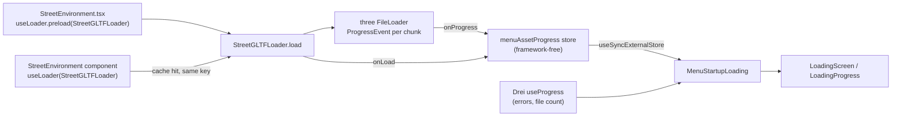

# Design Document: Startup Loading Percentage

## Overview

The startup screen gets a real percentage measured from the bytes of the Street_GLB download.
The percentage comes from the `ProgressEvent`s that three.js `FileLoader` emits while it streams
the file. A small framework-free store keeps the highest value seen so far, and the startup
screen reads it with `useSyncExternalStore`. No timer touches the value.

### Findings from the installed sources

- **R3F 9.8.2 `useLoader`** (`@react-three/fiber/dist/events-*.esm.js`): results are cached by
  `suspend-react` under the key `[LoaderClass, url]`. The extensions function is **not** part of
  the key. `useLoader(loader, url, extensions, onProgress)` passes `onProgress` to
  `loader.load`, but `useLoader.preload(loader, url, extensions)` has **no** `onProgress`
  parameter. Loader instances are memoized per constructor (`memoizedLoaders`).
- **Drei 10.7.9 `useGLTF`** (`core/Gltf.js`) is `useLoader(GLTFLoader, path, extensions(...))`
  with `GLTFLoader` from `three-stdlib`, Draco (decoder from gstatic.com) and Meshopt enabled.
  `useGLTF.preload` uses `useLoader.preload`, so it cannot report progress.
- **Consequence:** `StreetEnvironment.tsx` calls `useGLTF.preload` at module scope. The preload
  starts the only download. If the component switched to `useLoader(..., onProgress)` with the
  same key, it would hit the cache and the callback would never fire. If it used a different key,
  the 26 MB file would download twice. Option (a) from the request therefore does not work on
  its own.
- **three 0.174 `FileLoader`** streams the response body and emits
  `new ProgressEvent('progress', { lengthComputable, loaded, total })` per chunk. `total` comes
  from `X-File-Size` or `Content-Length`; `lengthComputable` is `total !== 0`. `loaded` counts
  decoded bytes, so with `Content-Encoding` compression `loaded` can exceed `total`. Without a
  readable stream no progress events are emitted.
- `three-stdlib` is not resolvable from `apps/game` (pnpm strict layout, not a direct
  dependency). `three/examples/jsm/loaders/GLTFLoader.js` and
  `three/examples/jsm/libs/meshopt_decoder.module.js` are available through the direct `three`
  dependency, with types from `@types/three`.
- `TextureLoader` (used by `useTexture` for the sky) goes through `ImageLoader`, which reports
  no byte progress. The sky texture is therefore not measured.

### Chosen approach

Combine options (a) and (b):

1. A dedicated loader class `StreetGLTFLoader extends GLTFLoader` (three's own `GLTFLoader`).
   Its `load` method wraps `onProgress` and `onLoad` and forwards them to the
   Byte_Progress_Store. Because R3F memoizes loader instances per class and caches results per
   `[class, url]`, the module-level `useLoader.preload(StreetGLTFLoader, url, ext)` and the
   component's `useLoader(StreetGLTFLoader, url, ext)` share one cache entry and one request.
   Progress is reported by the preload's own `load` call, so it no longer matters that preload
   has no `onProgress` parameter.
2. A framework-free store `game/loading/menuAssetProgress.ts` (option b), read by
   `MenuStartupLoading` through `useSyncExternalStore`.

Rejected alternatives:

- Patching `loader.load` from Drei's `extendLoader` callback: it would mutate the shared
  `GLTFLoader` instance also used by `HCMModel.tsx`. Hard to reason about.
- A separate `fetch` with `fetchAssetBytes` before the loader: risks a second download when the
  HTTP cache is cold or disabled, and duplicates parsing work.
- Adding `three-stdlib` as a direct dependency to keep Drei's exact loader: a new dependency for
  no behavior gain. three's `GLTFLoader` is the upstream of the `three-stdlib` copy.

Draco is not configured: the Street_GLB is produced by `scripts/optimize-environment.cjs` with
Meshopt and WebP only. If a future Street_GLB used Draco, `GLTFLoader` would fail with a clear
error that reaches the existing error state.

### Honest display after the download

When the bytes are complete but the scene is still compiling shaders, the bar stays full (100%)
and the status reads "Preparing the street scene". The number is true (all bytes are in), and the
status text tells the player that work remains. While the screen is held for the Minimum_Display_Hold
after Scene_Ready, the bar is full and the status reads "Ready". If the total size was never
known, the bar stays indeterminate until Scene_Ready, then shows full with "Ready": at that point
loading has really finished.

## Architecture



## Components and Interfaces

### 1. `apps/game/src/game/loading/menuAssetProgress.ts` (new)

Pure TypeScript, no React or three imports.

```typescript
export interface ByteProgressEvent {
  loaded: number;
  total: number;
  lengthComputable: boolean;
}

export interface ByteProgressStore {
  /** Byte_Percent: null while unknown, otherwise an integer 0..100. */
  getPercent(): number | null;
  subscribe(listener: () => void): () => void;
  report(event: ByteProgressEvent): void;
  markComplete(): void;
  reset(): void;
}

/** Highest download percent for one file. Never decreases until reset. */
export function createByteProgressStore(): ByteProgressStore;

/** Candidate percent for one event, or null when the event has no known total. */
export function percentFromEvent(event: ByteProgressEvent): number | null;

/** Singleton for the main menu Street_GLB. */
export const menuAssetProgress: ByteProgressStore;
```

`percentFromEvent` returns `null` unless `lengthComputable === true`,
`Number.isFinite(total) && total > 0` and `Number.isFinite(loaded) && loaded >= 0`. Otherwise it
returns `Math.min(99, Math.floor((loaded / total) * 100))`. The cap at 99 keeps 100 for
Download_Complete and absorbs `loaded > total` under compression.

`report` sets the value only when the candidate is a number and the current value is `null` or
lower. `markComplete` sets 100. Listeners are called once per actual change, never for a
no-op. `getPercent` returns a primitive, so it is a stable `useSyncExternalStore` snapshot.

### 2. `apps/game/src/game/scenes/MainMenuScene/streetGltfLoader.ts` (new)

```typescript
import { GLTFLoader, type GLTF } from "three/examples/jsm/loaders/GLTFLoader.js";
import { MeshoptDecoder } from "three/examples/jsm/libs/meshopt_decoder.module.js";
import { menuAssetProgress, type ByteProgressStore } from "../../loading/menuAssetProgress";

/** GLTFLoader that reports Street_GLB byte progress to a store. Used only for the street file. */
export class StreetGLTFLoader extends GLTFLoader {
  progressStore: ByteProgressStore = menuAssetProgress;

  override load(
    url: string,
    onLoad: (gltf: GLTF) => void,
    onProgress?: (event: ProgressEvent) => void,
    onError?: (error: unknown) => void,
  ): void {
    super.load(
      url,
      (gltf) => {
        this.progressStore.markComplete();
        onLoad(gltf);
      },
      (event) => {
        this.progressStore.report(event);
        onProgress?.(event);
      },
      onError,
    );
  }
}

/** R3F loader extensions: Meshopt decoding, as Drei's useGLTF configured for this file. */
export const streetLoaderExtensions = (loader: GLTFLoader) => {
  loader.setMeshoptDecoder(MeshoptDecoder);
};
```

The exact `onError` parameter type follows `@types/three` 0.174 for `Loader.load`.

### 3. `StreetEnvironment.tsx` (modified, loading lines only)

Replace the Drei import, the preload and the hook call:

```typescript
import { useFrame, useLoader, useThree } from "@react-three/fiber";
import { StreetGLTFLoader, streetLoaderExtensions } from "./streetGltfLoader";

useLoader.preload(StreetGLTFLoader, CITY_MODEL_PATH, streetLoaderExtensions);
// in the component:
const cityGltf = useLoader(StreetGLTFLoader, CITY_MODEL_PATH, streetLoaderExtensions);
```

Nothing else in the file changes: traversal, calibration, `compileAsync`, `onReady`, and
animations stay identical. The loader uses `THREE.DefaultLoadingManager`, so Drei `useProgress`
still sees the item and its errors.

### 4. `MenuStartupLoading.tsx` (modified)

```typescript
const bytePercent = useSyncExternalStore(
  menuAssetProgress.subscribe,
  menuAssetProgress.getPercent,
  menuAssetProgress.getPercent,
);
```

`subscribe` and `getPercent` must be bound (closures from the factory), so passing them
directly is safe.

Display mapping (no error shown):

| Condition | `progress` | Status | Detail |
|---|---|---|---|
| `sceneReady` | `1` | Ready | none |
| `bytePercent === 100` | `1` | Preparing the street scene | none |
| `bytePercent` is a number < 100 | `bytePercent / 100` | Loading the street scene | none |
| `bytePercent === null` | `null` | existing Drei-based status | existing file count |

`LoadingProgress` rounds `progress × 100`; since `bytePercent` is an integer, the shown percent
equals `bytePercent`. The watchdog effect adds `bytePercent` to its dependency list so real byte
progress restarts the 30-second slow notice. Error, hold, "Continue to menu", reduced motion and
`SceneTransition` code are unchanged. The component doc comment is updated to describe the byte
source.

## Data Models

- `ByteProgressEvent`: `{ loaded: number; total: number; lengthComputable: boolean }`. A DOM
  `ProgressEvent` satisfies it structurally.
- Byte_Percent: `number | null`, integer 0..100.

## Error Handling

- Unknown size (no `Content-Length`, no stream, or `lengthComputable` false): the store stays
  `null`; the screen keeps the indeterminate bar and file count.
- `loaded > total` (compressed transfer): the value is capped at 99 until `onLoad`.
- Load or parse failure: `onError` is forwarded unchanged; Drei `useProgress` reports the URL;
  the existing error state appears. The store keeps its last value, which is hidden behind the
  error state.
- Malformed events (`NaN`, negative, infinite): ignored.

## Correctness Properties

*A property is a characteristic or behavior that should hold true across all valid executions of a system-essentially, a formal statement about what the system should do. Properties serve as the bridge between human-readable specifications and machine-verifiable correctness guarantees.*

Reflection on redundancy: the separate store criteria (formula, monotonic max, ignoring unknown
events, completion at 100, initial null) are all checked by one model-based property. The
startup screen mapping criteria (3.1 to 3.4, 3.6, 3.7) are checked by one model-based property;
monotonic display (3.5) is kept as its own property because the request names it.

### Property 1: Store matches the running-max model

*For any* sequence of Progress_Events (known and unknown totals, `loaded` above or below `total`,
malformed values) with an optional Download_Complete at any position, after each step the
Byte_Progress_Store value equals the reference model: `null` until the first number, then the
maximum of all candidate percents so far (each `min(99, floor(loaded / total × 100))`), and 100
from Download_Complete onward.

**Validates: Requirements 2.1, 2.2, 2.3, 2.4, 2.5, 2.6, 2.9**

### Property 2: One notification per change

*For any* sequence of store operations, every subscriber is notified exactly as many times as the
Byte_Percent value changed, and an unsubscribed listener is not notified again.

**Validates: Requirements 2.7, 2.8**

### Property 3: Startup screen matches the display model

*For any* sequence of steps that change Byte_Percent, the Drei `loaded`/`total` values and
Scene_Ready (false to true at most once), each followed by a random wait below the slow-notice
time, the Progress_Bar state, `aria-valuenow` and status line equal the display mapping table,
both right after the step and after the wait.

**Validates: Requirements 3.1, 3.2, 3.3, 3.4, 3.6, 3.7**

### Property 4: The shown percentage never decreases

*For any* such step sequence, the sequence of `aria-valuenow` values shown by the Progress_Bar is
non-decreasing, ignoring steps where the bar is indeterminate.

**Validates: Requirements 3.5**

## Testing Strategy

The repository has no property-testing library. Property tests follow the existing pattern in
`src/test/loadingRuns.ts`: seeded LCG (`createLcg`, `PROPERTY_SEED`, `randomInt`),
`PROPERTY_RUNS` cases (at least 100 per property for the pure store; the existing count for
component runs), and failure collection with counterexample descriptions. Each test names its
property: `Feature: startup-loading-percentage, Property N: ...`. No new dependency.

- `src/game/loading/menuAssetProgress.test.ts` (new): Properties 1 and 2, plus examples: initial
  `null`; unknown total gives `null`; `loaded > total` gives 99; reset returns `null`;
  `markComplete` gives 100.
- `src/game/scenes/MainMenuScene/streetGltfLoader.test.ts` (new): spy on
  `GLTFLoader.prototype.load` to capture the wrapped callbacks; check that progress events reach
  an injected store, `onLoad` marks complete before forwarding, and caller callbacks still run.
- `src/features/loading/MenuStartupLoading.test.tsx` (modified): `beforeEach` resets
  `menuAssetProgress`; byte reports happen inside `act`. New examples: percentage shown when
  known; indeterminate with file count when unknown; full bar with "Preparing the street scene"
  after completion; slow-notice restarts on byte progress. Update "shows Ready while the screen
  is held" to expect a determinate bar at 100. Rework the Property 2 "progress honesty" run so
  its generated steps also include byte events and Scene_Ready, checked against the display
  model (Properties 3 and 4); keep its time-does-not-change-the-bar check. Keep the watchdog test's
  "never invents progress" assertion for the case with no byte events. Property 1 and Continue
  tests stay as they are.
- The single-download guarantee (Requirement 1.1, 1.2) rests on R3F's `[class, url]` cache key;
  it is documented in code comments and covered by using the same class and URL in both calls.
