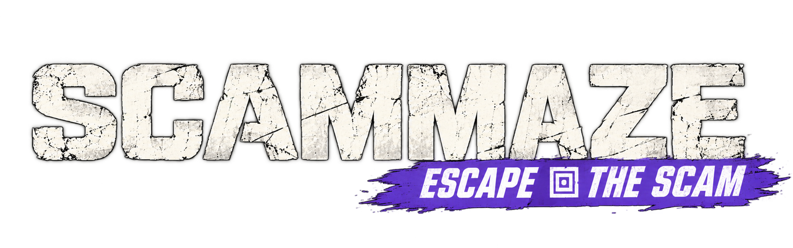
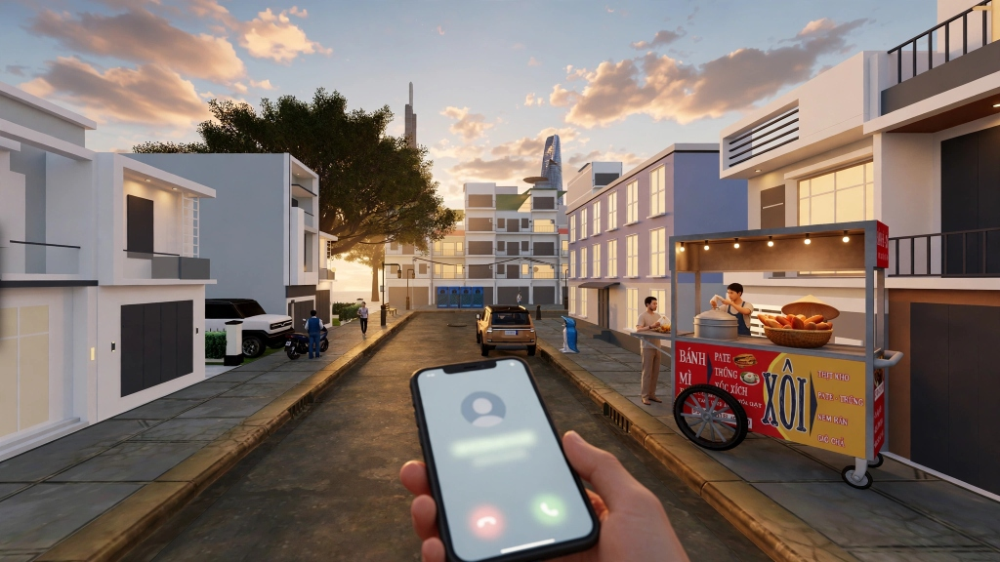
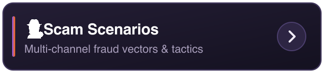
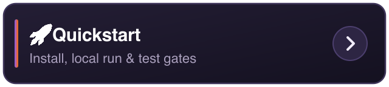

# SCAMMAZE

<p align="center">
  
</p>

<p align="center">
  <strong><em>"Trust no one. Question everything. Every scam starts on an ordinary day."</em></strong>
</p>

<p align="center">
  <a href="https://github.com/teehihi/scam-maze"></a>
  <a href="https://teehihi.github.io/scam-maze/"></a>
  
  
  
  
  
  
</p>

<p align="center">
  
</p>

<div align="center">

### 🧭 Quick Navigation

| [](#about-the-game) | [](#core-gameplay-loop) | [](#scam-scenarios-and-vectors) |
| :---: | :---: | :---: |
| [](#ui--systems-showcase) | [](#immersive-3d-worlds) | [](#technology-stack) |
| [](#controls) | [](#getting-started) | [](#safety--ethics) |

</div>

---

<a id="about-the-game"></a>
## 🎮 About the Game

**SCAMMAZE** is an interactive, browser-based, first-person 3D narrative game built for **Kiroween 2026** (Frankenstein category).

In the real world, scams never look like multiple-choice quizzes or dry security warnings. They happen while you are walking down your street, relaxing in your room, or heading to work. 

Crucially, **scams do not only happen on phones**. While an in-game smartphone serves as one prominent digital interaction surface, SCAMMAZE is designed around a **multi-channel threat landscape**. Players experience diverse, evolving scam vectors that manifest across both digital devices (calls, SMS, emails, rogue portals) and physical in-person interactions (street recruiters, counterfeit goods, fraudulent flyers, impersonated service agents).

In **SCAMMAZE**, you live an ordinary life in a living fictional neighborhood. You must inspect both physical clues and digital signals to uncover contradictions, resist psychological manipulation, and make high-stakes decisions with lasting consequences.

* **Target Audience:** Young adults, university students, and everyday internet users in Vietnam and worldwide (equal weight).
* **Core North Star:** *A safe, living world where people learn to spot scams before facing them in real life.*
* **Full Product Definition:** [`docs/product/PRODUCT_POSITIONING.md`](docs/product/PRODUCT_POSITIONING.md)
* **Live Landing Portal:** [https://teehihi.github.io/scam-maze/](https://teehihi.github.io/scam-maze/)

---

<a id="core-gameplay-loop"></a>
## 🔄 Core Gameplay Loop

The detective loop connects the physical world with the digital world:

```
┌────────────────────────┐      ┌────────────────────────┐      ┌────────────────────────┐
│  1. Physical 3D World  │ ───► │ 2. Deception Trigger   │ ───► │ 3. Cross Investigation │
│  Explore neighborhood, │      │ Urgent call, street NPC│      │ Compare physical clues │
│  talk to local NPCs    │      │ SMS, or suspicious flyer│     │ against digital claims │
└────────────────────────┘      └────────────────────────┘      └────────────────────────┘
                                                                            │
                                                                            ▼
┌────────────────────────┐      ┌────────────────────────┐      ┌────────────────────────┐
│  6. Forensic Debrief   │ ◄─── │ 5. Consequence Branch  │ ◄─── │  4. Critical Decision  │
│  Full timeline review, │      │ Real-time simulated    │      │ Hang up, verify, stall,│
│  missed red flags & tips│     │ aftermath & story shift│      │ or comply with threat  │
└────────────────────────┘      └────────────────────────┘      └────────────────────────┘
```

1. **Physical World Exploration:** Walk freely in first person through a living 3D environment.
2. **Deception Trigger:** Encounter a suspicious situation through phone calls, street flyers, stranger requests, or SMS alerts.
3. **Cross-World Investigation:** Clues in the physical world contradict deceptive claims (e.g. an "undelivered package" message arrives when you already collected it from the locker downstairs; or an in-person flyer promises unrealistic wages).
4. **Critical Decision:** Confront psychological pressure (authority impersonation, fake urgency, guilt trips, too-good-to-be-true deals). Choose how to respond.
5. **Branching Consequences:** Choices trigger deterministic scenario outcomes that carry forward across chapters.
6. **Forensic Debrief:** Every chapter concludes with an educational breakdown detailing every red flag and where it could have been detected.

---

<a id="scam-scenarios-and-vectors"></a>
## 🕵️ Diverse Scam Scenarios & Vectors (Under Continuous Development)

SCAMMAZE is designed as an extensible platform for a wide spectrum of modern social engineering and fraud techniques. The scam vectors span digital channels, physical street life, and hybrid interactions:

| Scam Vector | Channel | Attack Mechanism & Scenario | Key Defensive Reflex |
|---|---|---|---|
| **The Urgent Voice Call (Vishing)** | Audio Call | Scammer impersonates a bank security officer or police authority demanding immediate verification under threat of legal action. | Never share OTPs; hang up and call official public hotline. |
| **The Missing Parcel (Smishing & Quishing)** | SMS / QR Code | Look-alike logistics tracking link claiming a parcel is held, asking for fee payment or identity upload. Physical parcel locker contradicts the claim. | Verify tracking code directly on the official courier portal. |
| **The Dream Job (Advance-Fee Recruitment)** | Café Flyer / Chat | High-paying remote tasks or job flyers placed around campus/cafés requiring an upfront "equipment deposit" or "training fee". | Legitimate employers never ask candidates to pay for employment. |
| **The Impossible Deal (Marketplace Fraud)** | Marketplace / In-Person | Second-hand electronics sale meeting on the street; seller insists on off-platform gift cards or fake escrow payment apps. | Inspect physical item carefully; refuse off-platform payment methods. |
| **The Family Emergency (Social Engineering)** | Voice / Message | Spoofed message or voice claiming a loved one is hospitalized or arrested, demanding instant money transfers. | Perform out-of-band verification by contacting family directly. |
| **Street Impersonation & Rogue Solicitations** | In-Person NPC | Shady street encounters, bogus donation drives, fake building utility inspectors requesting cash or personal data. | Demand official physical credentials; verify with building management. |

> *Note: New scenario modules, in-person street interactions, and multi-channel scam archetypes are actively being designed and added to the scenario engine.*

---

<a id="ui--systems-showcase"></a>
## 📱 UI & Systems Showcase

The interface is engineered to seamlessly blend a 3D game engine with an authentic, interactive smartphone, in-world physical inspection, and forensic HUD:

### 1. In-Game Smartphone (Digital Interaction Gateway)
The player's smartphone is accessible via `[Tab]` or `[P]`:
* **Incoming Audio Call Screen:** Displays simulated caller ID, pulsating audio waveform, and voiced dialogue playback with real-time text sync.
* **SMS & Messaging App:** Threaded chats with spoofed corporate accounts, urgent delivery deadlines, and disguised links.
* **Simulated Mobile Web Browser:** Displays fictional corporate portals and landing pages built exclusively on reserved domains (`.test`, `.example`, `.invalid`).
* **Banking & OTP Simulator:** Educational mock transaction confirmation screens (strictly non-functional, zero real financial data).

```text
┌──────────────────────────────────────┐
│  10:42 📶 🔋 98%                      │
│                                      │
│           [ 👤 UNKNOWN SENDER ]      │
│         +84 90 123 4567 (.test)      │
│                                      │
│        "URGENT: Your account has     │
│         been flagged for fraud!      │
│         Verify immediately at:       │
│         https://bank-verify.test"    │
│                                      │
│   [ ⚠️ Inspect Link ]   [ 🚫 Block ]  │
└──────────────────────────────────────┘
```

### 2. Main Menu & Cinematic 3D Scene
* **First-Person Street Camera:** Dynamic camera breathing, realistic mouse parallax, and customizable Field of View (FOV).
* **Atmospheric Environment:** Low-poly city pack, animated moving vehicles, customizable sky dome with cloud drift.
* **Bilingual Switcher:** Instant runtime language toggle between **English** and **Tiếng Việt**.
* **Settings & Credits Modals:** Full control over graphics quality tiers, audio volume, and verified asset licenses.

### 3. In-World Inspection & Evidence Journal
* **Contextual Reticle:** Dynamic hover feedback when targeting interactable world items (`[E] Inspect`, examining flyers, posters, lockers, or talking to NPCs).
* **Clue Journal:** Automatically logs collected evidence, conflicting statements, and suspicious URL strings.
* **Dual-Language Subtitles:** Synchronized with professional voice narration for both English and Vietnamese clips.

---

<a id="immersive-3d-worlds"></a>
## 🗺️ Immersive 3D Worlds

SCAMMAZE features multiple custom-built 3D environments crafted with Three.js, React Three Fiber, and optimized low-poly assets:

| Environment | Route | Atmosphere & Narrative Setting |
|---|---|---|
| **Main Menu Street** | `/` | Cinematic dusk street scene with parallax camera, moving cars, and low-poly city backdrop. |
| **Khu Phố** | `/khupho` | Authentic Vietnamese neighborhood with alleyways, street vendors, shophouses, and sidewalk life. |
| **Room V2 ("After the Rain")** | `/roomv2` | Cozy first-person apartment room with warm desk lighting, atmospheric rain sounds, and interactive items. |
| **Miền Tây (Mekong Delta)** | `/mientay` | Peaceful river waterways, traditional wooden sampans, lush tropical greenery, and floating market vibes. |
| **Huế Heritage** | `/hue` | Historic Citadel architecture, ancient bridges, royal tombs, and imperial stone monuments. |
| **UEH Campus** | `/ueh` | Modern university campus grounds featuring interactive vehicle exploration. |
| **Chapter 1: The Urgent Call** | `/chapter1` | The flagship playable narrative chapter: an urgent voice call threatens your security. |

---

<a id="technology-stack"></a>
## 🛠️ Technology Stack

SCAMMAZE is architected as an ultra-fast, modern **pnpm monorepo**:

| Layer | Technologies | Purpose |
|---|---|---|
| **Core 3D Engine** | Three.js r174 · React Three Fiber v9 · Drei v10 | First-person camera, scene rendering, lighting, and low-poly shaders |
| **Frontend Framework** | React 19 · Vite 8 · TypeScript 5.8 | High-performance client-side rendering with instant HMR |
| **Styling & Design** | Tailwind CSS v4 · Lucide React | Modern dark-mode UI with custom glassmorphism and keycap components |
| **Audio & Voice** | Web Audio API · Native HTML5 Audio | Dual-language voiced dialogue (EN/VI) with typed text synchronization |
| **Localization (i18n)** | i18next v27 · react-i18next v18 | Seamless bilingual support across all UI, subtitles, and world text |
| **State & Logic** | Pure TypeScript Deterministic Engine | Decoupled game state, branching consequences, and scenario rules |
| **Testing & Quality** | Vitest · TypeScript Workspace Check | 130+ test suites and 1,170+ unit & component tests |

---

<a id="controls"></a>
## ⌨️ Controls

| Action | Primary Key | Secondary Key |
|---|---|---|
| **Move Forward / Backward** | `W` / `S` | `Up` / `Down` Arrow |
| **Strafe Left / Right** | `A` / `D` | `Left` / `Right` Arrow |
| **Look Around** | `Mouse Movement` | — |
| **Toggle Smartphone** | `Tab` | `P` |
| **Interact / Inspect** | `E` | `Left Click` |
| **Advance Narration** | `Left Click` | `Space` |
| **Pause / Main Menu** | `Escape` | — |

---

<a id="getting-started"></a>
## 🚀 Getting Started

### Prerequisites
* **Node.js:** `>= 22.12.0`
* **pnpm:** `>= 10.0.0` (`corepack enable pnpm`)

### Installation & Run

```bash
# Clone the repository
git clone https://github.com/teehihi/scam-maze.git
cd scam-maze

# Install workspace dependencies
pnpm install

# Run the 3D Game & Worlds locally (Port 5174)
pnpm dev:game

# Run the Landing Page & Knowledge Hub locally (Port 5173)
pnpm dev:landing
```

### Verification & Quality Gates

```bash
# Run workspace-wide TypeScript verification
pnpm typecheck

# Run Vitest test suites (130+ files, 1170+ unit & component tests)
pnpm test

# Build production artifacts for game and landing
pnpm build
```

---

<a id="project-structure"></a>
## 📁 Project Structure

```text
scam-maze/
├── apps/
│   ├── game/                         # 3D First-Person Game Application
│   │   ├── public/
│   │   │   ├── assets/branding/      # Official game logos & title banners
│   │   │   ├── assets/ui/            # Cinematic backgrounds & UI frames
│   │   │   ├── assets/3d/            # Optimized GLTF/GLB models & textures
│   │   │   └── audio/                # Voiced dialogue clips (EN & VI) & BGM
│   │   └── src/
│   │       ├── app/                  # Route manager & global settings state
│   │       ├── components/ui/        # Reusable UI (Modals, Buttons, LoadingScreen)
│   │       ├── features/
│   │       │   ├── chapter1/         # The Urgent Call (Phone, Dialogue, HUD, Debrief)
│   │       │   ├── menu/             # Main menu overlay, Settings, Credits
│   │       │   ├── khupho/           # Vietnamese neighborhood world engine
│   │       │   ├── roomv2/           # "After the Rain" room engine
│   │       │   ├── mientay/          # Mekong Delta world engine
│   │       │   ├── hue/              # Imperial Citadel world engine
│   │       │   └── ueh/              # Campus vehicle explorer
│   │       ├── game/world/           # Shared world lifecycle, stats & quality probe
│   │       └── i18n/                 # Localization dictionaries (en / vi)
│   │
│   └── landing/                      # Marketing portal & Full-Page Knowledge Hub
│       ├── public/                   # Favicons, Halloween art, custom cursors
│       └── src/                      # Marketing landing sections & documentation
│
├── packages/
│   └── shared-types/                 # Framework-agnostic contracts & scenario types
│
├── docs/                             # Architecture, product positioning, and progress
├── .kiro/                            # Kiro steering rules, specs, and hooks
└── README.md                         # Main repository documentation
```

---

<a id="safety--ethics"></a>
## 🛡️ Safety & Ethics

SCAMMAZE is designed with strict cybersecurity education and safety guidelines:
* **Fictional Brands Only:** All organizations, companies, banks, and authorities are completely fictitious.
* **Reserved Domains Only:** All digital URLs strictly utilize RFC-reserved domains (`.test`, `.example`, `.invalid`). Live links are never generated.
* **No Real Credentials or OTPs:** The game never asks for, accepts, or transmits real usernames, passwords, bank account numbers, or authentication codes.
* **Defensive Reflexes:** The educational objective is strictly defensive: identifying psychological manipulation, verifying out-of-band, checking domain strings, and rejecting urgency traps.
* **Offline-First Deterministic Core:** All gameplay logic, choices, and consequences execute entirely inside the client browser.

---

<a id="license--credits"></a>
## 📜 License & Credits

### Source Code
The source code is licensed under the [MIT License](LICENSE).

### Verified 3D Asset Attribution
Detailed licensing and provenance are maintained in [THIRD_PARTY_NOTICES.md](THIRD_PARTY_NOTICES.md):
* **Low Poly City Asset Pack:** By Calipo (Sketchfab, CC-BY 4.0).
* **Low Poly Cars Pack:** By matisosanimation (Sketchfab, CC-BY 4.0).

### Original Soundtrack & Audio
* **Original Soundtrack (`apps/game/public/reality/`):** Composed by **Lê Quốc Khánh (Men Le)**. All rights reserved (not covered by the MIT license).
* **Voice Acting Narration:** Recorded specifically for SCAMMAZE bilingual chapters.

---

<p align="center">
  Built with ❤️ for <strong>Kiroween 2026</strong>.
</p>
