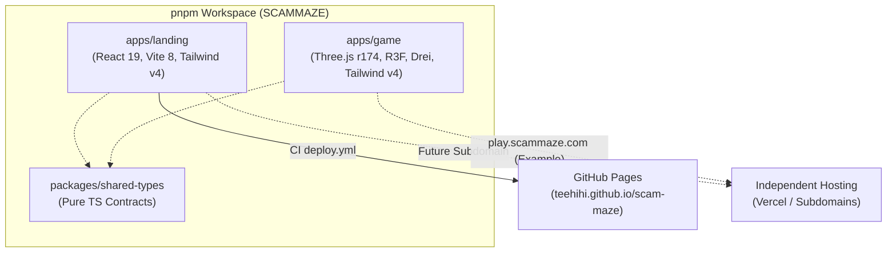
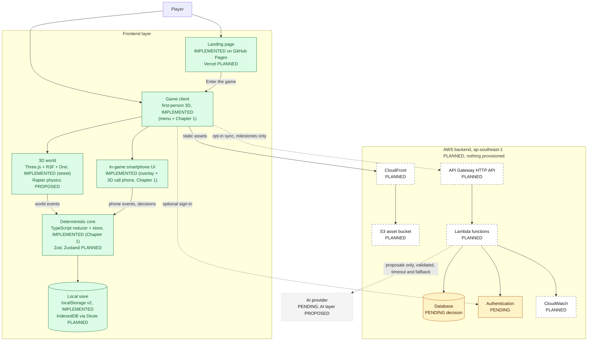

# SCAMMAZE architecture overview

> **Last reviewed:** 11 Nov 2026 · **Scope:** current implementation and target architecture
> **Sources of truth:** the repository on `main`; the canonical product definition
> [`docs/product/PRODUCT_POSITIONING.md`](../product/PRODUCT_POSITIONING.md) (owner decision of
> 8 Nov 2026: first-person 3D narrative game); the master plan
> [`SCAMMAZE_KIROWEEN_2026_FULL_PLAN.md`](../../SCAMMAZE_KIROWEEN_2026_FULL_PLAN.md)
> (added in commit [`0665897`](https://github.com/teehihi/scam-maze/commit/0665897619ed026cf1166288e32579b9a0969228),
> translated to English in PR #3, product framing amended 8 Nov 2026); and the owner's target
> architecture brief of 7 Nov 2026.
>
> This file fulfils the "architecture" deliverable listed in section 14 of the master plan
> (`docs/architecture/ARCHITECTURE.md` there).

Related documents: [Deployment](DEPLOYMENT.md) · [Database strategy](DATABASE_STRATEGY.md) ·
[Cost estimation](../finops/COST_ESTIMATION.md) · [Project progress](../PROJECT_PROGRESS.md)

## 1. Status legend

Every architecture statement in `docs/` uses one of these labels.

| Label | Meaning |
|---|---|
| `IMPLEMENTED` | Verified in the repository or in the deployed environment. |
| `PLANNED` | Part of the intended architecture, not implemented yet. |
| `PROPOSED` | An option under consideration, not agreed. |
| `PENDING` | A decision that has not been made. |
| `DEPRECATED` | Previously considered, no longer recommended. |

**Nothing on AWS has been provisioned.** No custom domain has been purchased. The database is not chosen.

## 2. What exists today (`IMPLEMENTED`)

Verified on `feat/chapter-01-playable` (11 Nov 2026):

| Area | Current implementation |
|---|---|
| Repository Architecture | **pnpm monorepo** with `apps/landing`, `apps/game`, and `packages/shared-types`. Unified workspace scripts: `pnpm dev:landing`, `pnpm dev:game`, `pnpm build:landing`, `pnpm build:game`, `pnpm build`, `pnpm typecheck`. |
| Landing Application | Located in `apps/landing`: React 19, TypeScript, Vite 8, Tailwind CSS v4, `lucide-react`, self-hosted fonts. Deploys to GitHub Pages via `.github/workflows/deploy.yml`. Features 4 responsive landing sections and a 9-section Full-Page Knowledge Hub (`/#docs`, `/#privacy`, `/#license`, etc.). |
| Game Application | Located in `apps/game`: React 19, TypeScript, Vite 8, **Three.js r174**, **React Three Fiber v9**, **Drei v10**, Tailwind CSS v4. Implements the cinematic first-person 3D street scene serving as the game's Main Menu. |
| 3D Environment & Assets | Binary glTF models verified from `Kiroween/Asset3D/`: `low_poly_city_asset_pack.glb` (Calipo, CC-BY 4.0) and `low_poly_cars_pack.glb` (matisosanimation, CC-BY 4.0). Renders modular buildings (B1–B5, corner, shopfront, hospital), road asphalt with dashed lines, streetlights with warm point lights, low-poly trees, and parked cars along curbs. |
| Camera & Controls | First-person eye-level camera (`y ≈ 2.05m`) facing down the street towards an atmospheric vanishing point. Smooth breathing idle motion and pointer parallax lerping. Configurable FOV (60°–85°). |
| Menu UI & Modals | Interactive UI overlay over 3D Canvas: `NEW GAME` (opens the Prologue modal, whose "Begin Chapter 1" action starts chapter loading), `CONTINUE` (enabled only when the local save names a known chapter and, for a version 2 save, its progress replays through the chapter core; `app/continueAvailability.ts`), `SETTINGS` (real-time graphics quality, FOV, sound toggle, master volume with `localStorage` persistence), `CREDITS` (verified third-party asset licenses), and WebGL fallback detector. |
| Loading screens | Startup screen for the menu scene and a chapter loading pipeline with byte-measured progress, asset verification, error recovery and fade transitions. Loading ends in the playable Chapter 1 page (`ChapterOnePage`); a chapter with `gameplayAvailable: false` still ends on the "in development" screen. See [section 4.2.1](#421-chapter-loading-implemented). |
| Chapter 1 "The Urgent Call" | Playable from start to debrief on the menu street scene (`features/chapter1/`): first-person movement, in-world interactables with a focus probe, a scam phone call and three other dialogues, evidence journal, objectives, a final decision, three outcome groups (verified, risky, uncertain) with variants, and a debrief. Play time and frame rate have not been measured. Story and content: [`docs/gameplay/CHAPTER_01_THE_URGENT_CALL.md`](../gameplay/CHAPTER_01_THE_URGENT_CALL.md). |
| Game core (deterministic) | `game/narrative/`: pure TypeScript reducer `chapterReducer(state, action, scenario)` with dialogue engine, evidence, objectives, outcome and debrief modules; Chapter 1 content in `game/narrative/chapter1/`; hand-written scenario validation (`validateScenario.ts`); a framework-free `ChapterStore` read through `useSyncExternalStore`; a pure `localize.ts` for display-only translated copies of the scenario. No React, Three.js, Zustand, Dexie or i18n imports. See [section 4.3](#43-deterministic-core-narrative-engine-and-scam-intelligence-engine-implemented-for-chapter-1). |
| In-game phone | 2D React overlay in `features/chapter1/phone/`: home screen, call history, messages and a fictional bank app. Phone calls (ringing and active) are shown on a 3D phone in the chapter canvas, with a DOM screen and a separate choice panel, and fall back to a 2D phone screen when the 3D phone cannot be shown (`features/chapter1/call/`, see [section 4.2](#42-game-client-implemented-for-the-menu-and-chapter-1-later-chapters-planned)). Phone actions are dispatched to the core as Core_Actions. |
| Local saves (format v2) | `game/saves/saveGame.ts` behind the `SaveGameSource` interface, stored in `localStorage` (key `scammaze_save_v2`). A save holds the accepted Core_Actions (at most 1000), a checkpoint ID and the player pose. Restore replays the actions through the core (`game/saves/chapterProgress.ts`) and rejects saves that do not replay. Version 1 saves are migrated to a chapter-start checkpoint. Checkpoints are written by `features/chapter1/useCheckpointSaver.ts`. |
| Game localization (English, Vietnamese) | `apps/game/src/i18n/`: i18next 27.1.1 and react-i18next 18.0.1 with bundled dictionaries, English as default and fallback, Vietnamese as second locale. The choice is stored in `GameSettings.language` (`localStorage` key `scammaze_settings_v1`) and `<html lang>` follows it. Chapter 1 narrative text is translated through a display-only overlay; the chapter core, its state and saves do not depend on the language. The landing app stays English-only. See [section 4.2.2](#422-localization-implemented). |
| Shared Contracts | `packages/shared-types`: pure TypeScript definitions for scene IDs, graphics quality, game settings (including `language: GameLocale`), and scenario metadata. |
| Quality Gates | Root `pnpm typecheck`, `pnpm test` (Vitest + Testing Library in `apps/game`) and `pnpm build`. On 11 Nov 2026, `pnpm test` reported 48 test files and 392 tests passed. Property tests use a seeded generator in `apps/game/src/test/` (no fast-check dependency). No lint script exists. |

## 3. Target architecture

The target separates a **landing page** from a **first-person 3D game client**, keeps gameplay
**local and deterministic**, and uses a small **serverless AWS backend** only for optional AI
proxying, persistence and server-side operations.

| Layer | Target technology | Status |
|---|---|---|
| Landing page | React + Vite (in `apps/landing`) | `IMPLEMENTED` (on GitHub Pages) |
| Landing page hosting on Vercel | Vercel | `PLANNED` (today: GitHub Pages) |
| Game client (`apps/game`) | First-person 3D game client with Main Menu scene; React 19 + TypeScript + Vite 8 (section 3.1) | `IMPLEMENTED` (foundation & 3D main menu) |
| 3D rendering | **Three.js r174** (primary 3D engine) via **React Three Fiber v9**, with **Drei v10** utilities; WebGL 2 baseline | `IMPLEMENTED` |
| Physics | **Rapier** | `PROPOSED`; prototype required |
| Gameplay state | **Zustand** stores | `PLANNED`; Chapter 1 uses a framework-free store with `useSyncExternalStore` instead (`IMPLEMENTED`, deviation, section 4.3) |
| In-game smartphone UI | 2D React UI rendered as an overlay or in-world surface; fictional apps | `IMPLEMENTED` for Chapter 1: phone apps as a 2D overlay; phone calls on a 3D phone in the chapter canvas with a projected DOM screen and a 2D fallback. In-world surface for the other apps `PLANNED` |
| Narrative engine + scam intelligence engine (deterministic core) | Pure **TypeScript** chapter state machines, evidence and tactic definitions, versioned scenario files validated with **Zod** | `IMPLEMENTED` for Chapter 1 as a pure TypeScript reducer with hand-written validation; Zod not used (deviation); downloaded scenario files `PLANNED` |
| Local progress store | **IndexedDB** through **Dexie** | `PLANNED`; today `localStorage` save v2 behind `SaveGameSource` (`IMPLEMENTED`, deviation) |
| Game UI localization | **i18next** + **react-i18next** with bundled dictionaries; English source and fallback, Vietnamese second locale (section 4.2.2) | `IMPLEMENTED` in `apps/game`; landing page English-only |
| Offline shell | Service worker / PWA (plan F11, section 3.3) | `PLANNED` |
| Backend API | Amazon API Gateway **HTTP API** | `PLANNED` |
| Compute | AWS Lambda | `PLANNED` |
| Lambda runtime language | Python (plan: FastAPI + Pydantic) or TypeScript (shares types with the client) | `PENDING` |
| Database | DynamoDB, RDS PostgreSQL or Neon PostgreSQL | `PENDING`, see [Database strategy](DATABASE_STRATEGY.md) |
| Static assets | Amazon S3 | `PLANNED` |
| CDN | Amazon CloudFront | `PLANNED` |
| Authentication | Amazon Cognito or an alternative | `PENDING` |
| Monitoring | Amazon CloudWatch | `PLANNED` |
| AI layer | Bounded AI scam actor (signature capability) and optional hint/debrief phrasing, behind the backend, with schema validation and authored fallbacks | `PROPOSED` |
| AI provider | Not selected | `PENDING` |
| Region | `ap-southeast-1` (Singapore) | `PLANNED` |

**Reading the diagram**

- The **game runs in the browser**: the 3D world and the phone emit events; the deterministic
  core (narrative engine and scam intelligence engine) decides what happens. Branching, evidence,
  consequences, replay and the transfer check do not need the backend.
- The **backend handles persistence and server-side operations** only (dotted lines are optional
  and opt-in).
- **Static assets** are delivered through CloudFront from a private S3 bucket.
- The **database is undecided**; Lambda code should talk to it through a small storage interface.
- **AI only proposes**. The game works when AI is off, slow, rate-limited or unreachable;
  authored dialogue is used instead.

### 3.1 Game application stack

**Owner decision, 8 Nov 2026.** This is the stack for the game application. Statuses
were updated on 11 Nov 2026 to match `apps/game`. The landing page keeps its own verified
stack (section 2) and is not changed by this decision.

| Concern | Technology | Role | Status |
|---|---|---|---|
| Application | React 19 + TypeScript + Vite | Same base as the landing page; separate app | `IMPLEMENTED` (Vite 8) |
| 3D rendering engine | **Three.js** | The primary and only 3D renderer (WebGL 2 baseline) | `IMPLEMENTED` (r174) |
| React integration | **React Three Fiber** | Declarative Three.js scene graph inside React | `IMPLEMENTED` (v9) |
| 3D utilities | **Drei** | Reusable helpers (for example controls, loaders, LOD, instancing helpers) | `IMPLEMENTED` (v10) |
| Physics | **Rapier** | Character collision, movement against walls and props | `PROPOSED`; not installed |
| Gameplay state | **Zustand** | Container for engine state and UI/game state; no rules inside stores | `PLANNED`; not installed. Chapter 1 uses a framework-free store (section 4.3) |
| Deterministic scenario engine | **TypeScript** (pure functions) | Chapter state machines, evidence, tactics, consequences, scoring; no React, Three.js or network imports | `IMPLEMENTED` for Chapter 1 (`game/narrative/`) |
| Runtime schema validation | **Zod** | Validates scenario files, saved state on load, and AI proposals before the engine sees them | `PLANNED`; not installed. Chapter 1 uses hand-written validation (section 4.3) |
| Local persistence | **IndexedDB** via **Dexie** | Local saves with versioned schema; clear-data support | `PLANNED`; not installed. Chapter 1 saves to `localStorage` (section 4.3) |
| In-game phone and overlays | React (2D DOM) | Phone apps, dialogue, debrief; the call screen and choice panel are DOM placed over the 3D call phone | `IMPLEMENTED` for Chapter 1 |
| Localization | **i18next** + **react-i18next** | UI text per language from bundled dictionaries; display only, never read by the deterministic core | `IMPLEMENTED` (i18next 27.1.1, react-i18next 18.0.1; section 4.2.2) |
| Entity Component System (ECS) | Not chosen | Option for future evaluation only if prototype profiling shows a need (for example many NPCs or props with shared behaviour) | `PROPOSED` (not approved) |

Boundaries:

- **Three.js is the 3D engine.** PixiJS is a 2D renderer and is **not** the 3D engine for
  SCAMMAZE; it is not part of this stack.
- **ECS is not an architectural decision.** Do not introduce an ECS library or structure the
  engine around ECS without a documented evaluation and owner approval.
- **Dependency direction:** React Three Fiber scene → reads Zustand → Zustand applies events
  through the pure TypeScript engine. The engine never imports React, Three.js, Rapier, Zustand
  or Dexie, so it can be unit-tested on its own and stays deterministic.
- **Physics is not game logic.** Rapier (if adopted) only handles movement and collision; it
  emits events such as "entered locker area" but never decides outcomes.
- **Versions are not pinned yet.** When installing, choose versions that are compatible with
  React 19 and with each other, and record them in the pull request.

**Requires a prototype or benchmark before the MVP build relies on it** (results to be recorded
in [Project progress](../PROJECT_PROGRESS.md)):

| Item | What to measure |
|---|---|
| Three.js + React Three Fiber + Drei scene | Frame rate and frame time on integrated-GPU laptops for the apartment and street; draw calls; memory; load time and download size |
| Rapier | WebAssembly download size and initialisation time; first-person character controller behaviour; CPU cost per frame |
| Quality tiers (Low/Medium/High) | Whether the Low tier stays playable on the weakest target device |
| Dexie persistence | Save and load time; schema migration between scenario versions |
| Zustand + React Three Fiber | That state updates do not trigger unnecessary React re-renders of the 3D scene |
| ECS (only if considered) | Whether it measurably simplifies or speeds up NPC and prop updates compared with plain components |

No triangle, draw-call or memory budgets are set until these benchmarks exist
([product positioning, section 10.1](../product/PRODUCT_POSITIONING.md#101-performance-first-browser-3d)).

## 4. Component responsibilities

### 4.1 Landing page (`IMPLEMENTED`, hosting move to Vercel `PLANNED`)

Introduces SCAMMAZE and links to the game through `VITE_GAME_URL`. It has no backend dependency
and must stay fully static. Its copy still describes the earlier "linked digital environments"
concept; see section 10. The landing page is English-only and has no i18n library; game
localization (section 4.2.2) does not change it, and the two apps do not share the language
setting.

### 4.2 Game client (`IMPLEMENTED` for the menu and Chapter 1; later chapters `PLANNED`)

**Owner decision, 8 Nov 2026:** the game is a browser-based, **first-person 3D narrative game**
in a small persistent world (one apartment and one street for the MVP) with chapter-based
stories. The digital interfaces (messages, email, websites, marketplace, bank and parcel apps)
live on an **in-game smartphone** inside the 3D world. Full definition:
[product positioning](../product/PRODUCT_POSITIONING.md).

Components inside the game client (paths relative to `apps/game/src/`):

- **3D world runtime** (Three.js + React Three Fiber + Drei, Rapier proposed for physics; see
  section 3.1).
  - `IMPLEMENTED`: first-person movement and arms reused from `features/player/`
    (`FirstPersonPlayer`, `usePlayerControls`); the Chapter 1 canvas
    `features/chapter1/ChapterOneCanvas.tsx`, which renders the menu street
    (`StreetEnvironment`, `SkyDome`, `EnvironmentLighting`), the chapter props
    (`world/InteractableProps.tsx`) and a focus probe (`world/InteractionProbe.tsx`) that reports
    the interactable in front of the camera; graphics quality from settings.
  - Controls `enabled` flag (`IMPLEMENTED`): `ChapterOneCanvas`, `FirstPersonPlayer`,
    `usePlayerControls` and `InteractionProbe` take `enabled`. When it is `false` (an overlay such
    as the phone, a dialogue, the journal or the pause menu is open), movement keys read as
    released, look and trigger input are drained and ignored, and the probe stops, so input does
    not leak into the world or fire on resume.
  - `PLANNED`: NPC characters, area-based loading, the apartment, physics.
- **In-game smartphone UI** (`IMPLEMENTED` for Chapter 1): 2D React overlay `PhoneOverlay` in
  `features/chapter1/phone/` (home, call history, messages, bank). Phone calls are not shown in
  this overlay; they use the call UI below. Phone actions are sent to the core as Core_Actions;
  the phone does not change state itself. An in-world surface for the other phone apps is
  `PLANNED`.
- **Chapter 1 call UI** (`IMPLEMENTED`; verified by unit, component and property tests,
  typecheck and build; not checked in a browser, and frame rate not measured). Files in
  `features/chapter1/call/`:
  - Overlay entry: a ringing or active call pushes a locked `call` entry on the page overlay
    stack (`overlays.ts`). Escape, P and J do nothing while it is on top, and player input stays
    disabled. Hang up or Decline removes the entry and returns to the previous stack.
  - `CallPresentation.tsx` (DOM wiring, no Three.js imports): reads `state.call` and
    `selectDialogueView` through `useChapterState`, holds no dialogue state of its own, and sends
    every change through the page handlers (answer, end, select option) to the core. It places
    one `PhoneScreenUI` instance in `PhoneScreenHost` and renders `PlayerChoiceOverlay` beside it.
    Layout comes from `callLayout.ts` (`computeCallLayout`) and the window size (`useViewport.ts`).
  - 3D phone: `PhoneModel3D.tsx` renders the optimized phone model inside the existing
    `ChapterOneCanvas` (no second canvas, no added lights, environment map or post-processing),
    placed in front of the camera. It reads the camera pose and field of view but never writes to
    the camera. Ringing vibration and the entry slide come from `phoneMotion.ts`; both respect
    reduced motion. The file imports nothing from the narrative store or selectors.
  - Projected screen: every frame, `PhoneModel3D` projects the four corners of the screen anchor
    with the camera matrices and publishes the resulting rectangle to a per-page
    `PhoneScreenSink` (`phoneScreenSink.ts`, created in `ChapterOnePage`). `PhoneScreenHost`
    subscribes and writes the position and size directly on its element, so the DOM screen
    follows the 3D screen without a React render per frame.
  - `PhoneScreenUI.tsx`: phone-owned content only. Ringing shows the caller, number, Decline and
    Accept; active shows the caller, status, the caller's line and Hang up. The number is plain
    text (no link). Player choices are never shown on the phone screen.
  - `PlayerChoiceOverlay.tsx`: the player's dialogue options as a labelled list of buttons on
    the opaque `UI.choicePanel` surface, beside the phone. Long options wrap; the panel scrolls
    vertically. Options work by click, Enter or Space and are disabled while paused.
  - 2D fallback: `PhoneScreenHost` shows the same `PhoneScreenUI` instance on a 2D bezel when
    WebGL is not available, the model has not published a rectangle after 200 ms (still
    loading), the model failed to load (`phoneModelStatus.ts`, one console warning with the asset
    path, no error alert), or the WebGL context is lost (`ChapterOneCanvas` reports
    `webglcontextlost`). Switching between the 3D and the 2D screen keeps the same content,
    controls and call state.
  - Asset: `call-phone` (`/assets/3d/optimized/call-phone.optimized.glb`, `CALL_PHONE_GLB`) is an
    optional asset in the Chapter 1 manifest. See section 4.2.1.
- **Chapter 1 voice layer** (spec `chapter-01-voice-narrative`). Voice, captions and sound are a
  presentation layer: they never change state, evidence, decisions or outcomes, and the game
  stays playable with sound off. Status labels:
  - `IMPLEMENTED`, verified by unit, component and property tests (19 files, 123 tests in
    `game/voice`, `features/chapter1/voice`, `game/saves` and `game/chapters` passed on
    12 Nov 2026): the pieces below. The tests use a fake audio port; no real audio device, network
    or browser was involved.
  - `PLANNED` or not verified: see the last bullet of this list.
  - **Voice module** (`game/voice/`, plain TypeScript). Files: `manifestTypes.ts` and
    `chapter1.manifest.ts` (manifest), `renderManifest.ts` (writes and parses the manifest
    file), `selectClip.ts` (picks the clip for a node and locale), `buildVoiceJobs.ts` (spoken
    lines, voice cast and tone rate for the generator), `hash.ts` (FNV-1a hash of the source
    text, used to detect stale clips), `voiceReport.ts` (missing-clip report),
    `VoiceDialoguePlayer.ts` (phases, prefetch cache of 8 clips with 2 loads at a time, pause,
    resume, replay and mute through ports only), `mixPlan.ts` (pure gain, pause and filter
    numbers), `optionsGate.ts` (see below), `audioPort.ts` (`AudioPort` and `PreviewPort`
    interfaces), `webAudioEngine.ts` and `devSpeechPreview.ts`. `boundaries.test.ts` fails if a
    voice file imports React, Three.js, i18next, Zustand, Dexie or `src/i18n/`, if any file other
    than `webAudioEngine.ts` and `devSpeechPreview.ts` touches audio or speech globals, or if a
    file in `game/narrative/` imports the voice layer.
  - **Audio graph** (`webAudioEngine.ts`, the only file that creates an `AudioContext`): a clip
    goes through a high-pass and a low-pass filter (phone voice), a playback gain, the voice bus,
    the master gain and a limiter to the destination. The ringtone, connect click, street
    ambience and tension drone are generated in code (no audio files) and each has its own gain,
    capped by `PEAK_CAP`, before the master gain. Clips load only from the page's own origin.
    The gain and filter numbers in `mixPlan.ts` are `PROPOSED` and were not tuned by ear.
  - **Manifest and clips**: `chapter1.manifest.ts` is generated, not edited by hand. It lists 108
    clips, 54 for `en` and 54 for `vi`, all with status `present`, under
    `apps/game/public/audio/chapter01/{en,vi}/` as MP3 (`audio/mpeg`). Each entry records the
    node, speaker, tone, duration, byte size, source-text hash, origin (`tts-generated`) and a
    credit line. A clip is `present` only if the file exists and the generator wrote it; a missing
    voice leaves the clip `missing` and the game falls back to captions.
  - **Generator** (`apps/game/scripts/generate-chapter1-voice.mjs` with the Windows worker
    `generate-chapter1-voice.ps1`; `package.json` scripts `voice:chapter1`, `voice:script`,
    `voice:report`): runs locally, makes no network call and adds no dependency. It uses the
    Windows speech voices installed on the machine (the manifest names Microsoft David, Mark and
    Zira for English and Microsoft An for Vietnamese), checks size and duration limits, and
    rewrites the manifest. It is a developer tool and does not run in the browser. Its
    Windows-only synthesis was run for this feature; running it on another machine was not tested.
  - **Dev-only speech preview** (`devSpeechPreview.ts`): a `speechSynthesis` preview that exists
    only in a development build or with `VITE_DEV_VOICE_PREVIEW=true`. It is not in Settings,
    never counts as a present clip, and stays silent when no voice matches the locale.
  - **Page hooks** (`features/chapter1/voice/`): `useVoicePlayback.ts` creates one player per
    mount over the Web Audio engine, builds the voice target from the dialogue view and the call,
    and applies settings, locale changes and the pause overlay; `useCallAudio.ts` drives the
    ringtone, connect click, ambience and tension; `useCallDuration.ts` counts the call time.
    `ChapterOnePage.tsx` calls all three. The hooks only read state and send nothing to the core.
  - **Options gate extraction** (`optionsGate.ts`): the rule that decides when the player's
    options appear (`waitForVoice`, audible clip, 300 ms after the clip ends, 1500 ms after the
    expected duration, "Show replies now") was extracted from the hook into a pure function
    `areOptionsVisible` with its own input type, so a property test can check it without the
    player. The input uses elapsed-time fields instead of an end timestamp. This is a small
    deviation from the original design, which kept the gate inside `useVoicePlayback`. Playback
    ending alone never advances the dialogue.
  - **Not verified**: playback in a browser (Chrome, Firefox, Safari, phones), MP3 decoding in
    each browser, autoplay behavior, sound quality and clarity of every clip, the mix levels,
    screen reader behavior, and the playtime of Chapter 1. The redistribution terms of the
    generated audio are not verified; the owner must check them before a public release. Only one
    male Vietnamese voice is used. No new service was added, so there is no cost change (see
    [cost estimation](../finops/COST_ESTIMATION.md)).
- **Chapter page and UI** (`IMPLEMENTED`): `features/chapter1/ChapterOnePage.tsx` owns the
  chapter store (created from the initial state, or from the state the loader already rebuilt
  during `validating-save`), computes the controls `enabled` flag, writes checkpoints (`useCheckpointSaver.ts`),
  triggers calls (`useCallTriggers.ts`) and renders the canvas plus the 2D UI: title card, HUD
  (objectives, interaction prompt, evidence notice, save-failure notice, resume prompt),
  inspection and dialogue panels, evidence journal, decision panel, ending transition, debrief
  and pause menu. `interaction/interactionToAction.ts` maps a focused interactable to a
  Core_Action.
- **Deterministic core** (section 4.3, `IMPLEMENTED` for Chapter 1): the only component that
  changes game state.
- **Debrief** (`IMPLEMENTED` for Chapter 1): `game/narrative/debrief.ts` builds the debrief from
  the event log and evidence state; `features/chapter1/debrief/DebriefScreen.tsx` shows it.
  Replay of alternative branches is `PLANNED`.

Open follow-up (`PLANNED`): while Chapter 1 is open, the menu canvas stays mounted with
`frameloop="never"` and `ChapterOneCanvas` creates a second WebGL context. The memory and
start-up cost of that second context has not been measured; measure it on an integrated-GPU
laptop and decide whether to unmount the menu canvas or share one canvas.

Performance principles (WebGL 2 baseline, integrated GPUs first, baked lighting, LOD and
instancing, quality tiers, budgets set from prototype benchmarks) are in
[product positioning, section 10.1](../product/PRODUCT_POSITIONING.md#101-performance-first-browser-3d).

#### 4.2.1 Chapter loading (`IMPLEMENTED`)

Rendering is separate from orchestration:

| Layer | Files (`apps/game/src/`) | Role |
|---|---|---|
| Chapter manifest | `game/chapters/chapterRegistry.ts` | Chapter id, number, title, subtitle, scenes, required files, `gameplayAvailable` |
| Orchestrator (no React) | `game/loading/chapterLoader.ts` | State machine, downloads, verification, stall watchdog, cancellation |
| Helpers | `game/loading/assetFetcher.ts`, `assetVerification.ts`, `deviceCapabilities.ts`, `game/saves/saveGame.ts`, `game/saves/chapterProgress.ts`, `game/chapters/chapterSession.ts` | Byte-streamed fetch, GLB/image header checks, WebGL 2 probe, save parsing and v1 migration, replay of saved actions, session creation |
| React binding | `game/loading/useChapterLoader.ts`, `features/loading/ChapterLoadingFlow.tsx` | One loader per attempt; cancelled on retry, back or unmount |
| Presentation | `components/ui/LoadingScreen.tsx`, `LoadingProgress.tsx`, `LoadingTip.tsx`, `LoadingErrorState.tsx`, `SceneTransition.tsx` | Props only, no loading logic |

Flow. New game: `checking-device → loading-assets → initializing-state → ready`. Continue:
`restoring-save → checking-device → loading-assets → validating-save → ready`. In
`validating-save`, a version 2 save is replayed through the chapter core (`restoreProgress`); if
any saved action is rejected, loading fails with an invalid-save error, otherwise the rebuilt
state and clamped player pose go into the session (`session.restored`). After `ready`, the
screen fades out and `App` switches to the chapter. For a chapter with `gameplayAvailable: true`
(Chapter 1) that is `features/chapter1/ChapterOnePage.tsx`; otherwise it is the "in development"
screen `features/chapter/ChapterPlaceholder.tsx`. The menu canvas keeps its scene but stops
rendering (`frameloop="never"`) while covered (see the second-WebGL-context follow-up in
section 4.2).

Progress. Each manifest file is fetched with `fetch` and read as a stream. Progress is
`loaded bytes / total bytes` only when every file reports `Content-Length` without
`Content-Encoding`; otherwise it is `null` and the bar is indeterminate with a file count. No timer
changes progress. Files go through the normal HTTP cache, so a later `useGLTF` for the same URL can
reuse them; cached files finish without any delay. Each file is then checked (GLB header, version,
length, required extensions; image signature), which also catches the SPA fallback page that
`vercel.json` returns for missing files. Geometry decoding and shader compilation are not part of
this step; they belong to the future chapter scene.

Optional assets. A manifest file can be marked `optional: true` (Chapter 1: the call phone
`call-phone`). If an optional file fails to download or verify, the loader skips it without an
error or console output, counts only the bytes it received so progress can still reach 100%, and
loading still reaches `ready`; a stall with only optional files pending does not fail loading.
The chapter then shows calls on the 2D fallback screen. A failed required file still ends in an
error.

Errors (`game/loading/loadingErrors.ts`): invalid chapter, missing file, invalid file, network,
stalled download (no bytes for 30 s), unsupported device, WebGL start failure, invalid save. Each
has a message, "Return to menu", and "Try again" when retrying can help.

The startup screen (`features/loading/MenuStartupLoading.tsx`) shows a percentage measured from
the downloaded bytes of the street GLB (`STREET_ENVIRONMENT_GLB`). The street file loads through a
dedicated class, `StreetGLTFLoader` (`game/scenes/MainMenuScene/streetGltfLoader.ts`, a subclass
of three's `GLTFLoader` with the Meshopt decoder). R3F caches loader results by
`[loader class, url]`, so the module-level `useLoader.preload` and the component's `useLoader` in
`StreetEnvironment.tsx` share one cache entry and the file downloads once. The loader forwards
three's `FileLoader` progress events to a framework-free store (`game/loading/menuAssetProgress.ts`),
which keeps the highest percent seen (capped at 99 until the load finishes, then 100). The screen
reads the store with `useSyncExternalStore`; no timer changes the value. When the file size is
unknown, the bar stays indeterminate and shows the file count from Drei `useProgress`. When all
bytes are in but the scene is still compiling shaders (`compileAsync`), the bar is full and the
status reads "Preparing the street scene". During the minimum display hold after the scene
reports ready, the bar is full and the status reads "Ready". The sky texture is not measured,
because its image loader reports no byte progress. Drei `useProgress`, which follows
`THREE.DefaultLoadingManager` for the whole page (valid only at startup, when the menu scene is
the only thing loading), is still the source of load errors. The screen offers "Continue to
menu" after 30 s without progress or on error.

Status of items from the 7 Nov brief: main menu and loading screens `IMPLEMENTED`; Chapter 1
gameplay `IMPLEMENTED`, later chapters `PLANNED`; level selection replaced by chapter progression in one world `PLANNED`; character
customization `PROPOSED`, future scope, not in the MVP. A *full* or open 3D world and
multiplayer remain out of scope.

#### 4.2.2 Localization (`IMPLEMENTED`)

The game app ships in English (`en`, source and fallback) and Vietnamese (`vi`). Localization is
display only: it changes the text on screen, never game state. Spec:
[`.kiro/specs/game-i18n-en-vi/`](../../.kiro/specs/game-i18n-en-vi/design.md).

**I18n_Module** (`apps/game/src/i18n/`, `IMPLEMENTED`):

| Part | Files | Role |
|---|---|---|
| Instance and start-up | `index.ts` | Own i18next instance (`i18next.createInstance()`), no backend and no language detector. `initI18n(locale)` initializes it synchronously (`initAsync: false`) with the bundled dictionaries before the first render (`main.tsx`); `fallbackLng` is `en`. `applyLocale(locale)` changes the language and sets `document.documentElement.lang` |
| Locales | `locales.ts` | `SUPPORTED_LOCALES = ["en", "vi"]`, `DEFAULT_LOCALE = "en"`, `isSupportedLocale`, labels shown in their own language |
| Dictionaries | `locales/en/*.ts`, `locales/vi/*.ts`, `resources.ts`, `types.ts`, `i18next.d.ts` | Typed TypeScript objects in the namespaces `common`, `menu`, `settings`, `loading`, `credits`, `chapters`, `chapter1` and `worlds`. English is the source; the Vietnamese files are typed against the English shape. Plural keys use `_one` and `_other` |
| Formatting | `format.ts` | `formatNumber`, `formatPercent`, `formatDate` through `Intl`, cached per locale |
| React binding | `useGameLocale.ts`, `I18nextProvider` in `main.tsx` | Components read text with `useTranslation` and the current locale with `useGameLocale` |

Settings and document language (`IMPLEMENTED`):

- The locale is stored in `GameSettings.language` (`GameLocale = "en" | "vi"` in
  `packages/shared-types`), saved with the other settings under the `localStorage` key
  `scammaze_settings_v1` by `app/settingsStorage.ts`. A missing or unknown value becomes `en`.
- The player picks the language in the Settings modal. `App.tsx` calls `applyLocale` when
  `settings.language` changes, so `<html lang>` always follows the active locale. The
  `index.html` title and meta tags stay English.
- The game reads only its own `localStorage`; it does not share the setting with the landing
  page.

**Narrative_Overlay** (`IMPLEMENTED` for Chapter 1):

- The English Chapter 1 content in `game/narrative/chapter1/` stays the authored source and the
  canonical scenario (`CHAPTER_1_SCENARIO`).
- The Vietnamese text lives in `src/i18n/narrative/chapter1.vi.ts` (split by area in
  `chapter1.vi/`), a flat map from stable text keys built from scenario IDs (for example
  `evidence/<id>/title` or `dialogues/<graphId>/lines/<lineId>`) to translated text.
- `game/narrative/localize.ts` is pure TypeScript with no i18n import. `localizeScenario` returns
  a copy of the scenario in which only text fields are replaced; IDs, structure, conditions and
  effects are copied unchanged, and each field falls back to English when the overlay has no
  non-empty entry. `narrativeTextEntries` lists every translatable field with the same walker.
- `src/i18n/narrative.ts` builds the **display scenario**: `getDisplayScenario("en")` returns the
  canonical object itself; other locales are localized once and cached. `ChapterOnePage` reads
  text through `useDisplayScenario()` and `getDisplayPrompts(locale)` and passes the display
  scenario to selectors and `buildDebrief`.

**Locale independence of the Chapter_Core** (`IMPLEMENTED`):

- The reducer, the chapter store and save format v2 always use the canonical English scenario.
  The store is created with `createChapterStore(initial)`; actions carry IDs, not text, so the
  same actions give the same state in every locale.
- Saves hold Core_Actions, a checkpoint ID and the player pose, never displayed text, so a save
  made in one language restores in the other. Changing the language does not remount the chapter
  page or reset progress.
- `game/narrative/boundaries.test.ts` fails if any file in `game/narrative/` imports `i18next`,
  `react-i18next` or the `src/i18n/` module. The dependency goes one way: `src/i18n/` may import
  from `game/narrative/`, not the reverse.
- Reducer rejection reasons stay English developer text; they are not shown to players.

Adding a language: see the "Adding a language" section of [CONTRIBUTING.md](../../CONTRIBUTING.md#adding-a-language).

### 4.3 Deterministic core: narrative engine and scam intelligence engine (`IMPLEMENTED` for Chapter 1)

**What exists (`IMPLEMENTED`, verified 11 Nov 2026)**, in `apps/game/src/game/narrative/`:

| Part | Files | Role |
|---|---|---|
| Types | `types.ts` | `CoreAction` union, `ChapterState` (status, call and conversation state, evidence, claims, objectives, pressure, event log `events`), `ScenarioDefinition` |
| Reducer | `reducer.ts` | `chapterReducer(state, action, scenario) → ActionResult` (`accepted`, next state, rejection reason); `createInitialState()`; `isCoreAction()` guard for untrusted input. Accepted actions are appended to the event log |
| Rule modules | `conditions.ts`, `dialogueEngine.ts`, `evidence.ts`, `objectives.ts`, `outcome.ts`, `debrief.ts`, `selectors.ts` | Condition checks, dialogue graph traversal, evidence discovery and claim status, objective progress, ending selection, debrief view, read-only selectors |
| Chapter 1 content | `chapter1/` (`scenario.ts`, `claims.ts`, `evidence.ts`, `interactables.ts`, `objectives.ts`, `phone.ts`, `decisions.ts`, `endings.ts`, `debrief.ts`, `dialogues/`) | Authored data only; fictional names and reserved domains |
| Scenario validation | `validateScenario.ts` | Hand-written checks of the scenario data for broken references and unreachable dialogue; returns error strings and is run by tests |
| Store | `store.ts` | `createChapterStore(initial)`: `getState`, `dispatch`, `subscribe`, `replace`. Notifies listeners only when an action is accepted. React reads it with `useSyncExternalStore` (`features/chapter1/useChapterState.ts`) |

Save format v2 (`game/saves/`, `IMPLEMENTED`):

- `saveGame.ts` defines the `SaveGameSource` interface (`read`, `write`, `clear`) and the
  `localStorage` implementation. Key `scammaze_save_v2`; the envelope holds `chapterId`,
  `sceneId`, `savedAt` and `progress` (`checkpointId`, accepted Core_Actions up to 1000,
  `playerPose`). Parsing rebuilds the save from known fields and rejects unknown actions. No
  names, free text or device identifiers are stored.
- **Replay validation** (`chapterProgress.ts`): `restoreProgress` replays the saved actions from
  `createInitialState()` through `chapterReducer`. If any action is rejected, the save is invalid,
  Continue stays disabled and loading reports an invalid-save error. The player pose is clamped to
  the play area. `encodeProgress` writes only accepted actions.
- **v1 migration**: a version 1 save (`scammaze_save_v1`, chapter and scene only) is converted to
  a v2 checkpoint at the chapter start (`checkpointId: "start"`, no actions), written to the v2
  key, and the v1 key is removed when the write succeeds.
- Blocked storage or a failed write does not stop gameplay; the chapter shows a save-failure
  notice.
- **Lenient restore** (`IMPLEMENTED`, unit-tested in `chapterProgress.test.ts`; the Chapter 1
  voice work added it). `restoreProgress(progress, scenario, { lenient: true })` stops at the
  first rejected action and returns the state after the last accepted one, with `trimmed`. The
  chapter session (`game/chapters/chapterSession.ts`) uses it, so a save made before a scenario
  change resumes from the last valid point instead of failing; it then sets `saveTrimmed` and the
  page shows the `hud.saveTrimmed.*` notice. If no action is accepted, the chapter starts at the
  beginning with the same notice. Strict mode (the default of `restoreProgress`) is unchanged. In the
  loader's `validating-save` step, the invalid-save error described above now applies only to
  damaged data (for example an unknown chapter or unreadable progress), not to a save whose
  actions are partly rejected. Not checked in a browser.

**Deviations from the documented stack** (sections 3 and 3.1; to confirm with the owner):

| Documented | Implemented for Chapter 1 | Reason |
|---|---|---|
| Zustand store | Framework-free `ChapterStore` read through React `useSyncExternalStore` | One store with four methods needed no new dependency; the reducer stays the only place with rules, so moving to Zustand later does not change the core |
| Zod validation of scenarios and saves | Hand-written validation (`validateScenario.ts`, `isCoreAction`, `parseSaveEnvelopeV2`) | Scenario content is compiled TypeScript, not downloaded files; save shapes are small |
| IndexedDB via Dexie | `localStorage` behind `SaveGameSource` | A save is a short action list; the interface keeps the switch to IndexedDB reversible |

Zod, Zustand and Dexie are not installed. Downloaded, versioned scenario files, tactic
definitions shared across chapters, scoring and AI proposal checks are still `PLANNED`.

**Target design** (unchanged):

Pure TypeScript, no network access, no AI SDK (plan section 4.5). It runs outside the render
loop and does not depend on the 3D library. It owns game, mission and chapter state, persistent
world and player state (exposed information, simulated balance, NPC trust, skills demonstrated),
evidence and tactic definitions, decision validation, consequences and scoring. AI proposals are
accepted or rejected here. It also owns:

- loading downloaded, versioned scenario definitions;
- branching state and deterministic transitions (same scenario version + same decisions →
  same result);
- evidence inspection state and the evidence graph data;
- replay of the user's own decision sequence, with alternative branches labelled hypothetical;
- scoring as a pure function that never turns "unknown" into "safe".

State ownership (owner decision, 8 Nov 2026; resolves the plan's open "XState or Zustand"
choice in favour of **Zustand**; the pure `(state, event) → state` part is `IMPLEMENTED`, the
Zustand and Dexie parts are `PLANNED`, see the deviations above): the engine's transitions are pure TypeScript functions
`(state, event) → state`; a Zustand store holds the current engine state, applies events through
those functions and persists through Dexie. Zustand is the state *container*; the rules live in
the engine, so they stay testable without React, Three.js or Zustand. XState is not used.

### 4.4 Backend (`PLANNED`)

Request flow: `Game client → API Gateway HTTP API → Lambda → Database`.

| Use the backend for | Do not use the backend for |
|---|---|
| Optional account and profile | Each click, choice, evidence inspection or graph interaction |
| Opt-in progress sync across devices | Scenario branching or scoring |
| Mission completion summaries | Rendering scenario content |
| Learning reports and transfer test results | Analytics of raw behaviour by default |
| Achievements and inventory, **if** approved | |
| Server-side validation, authentication, authorization | |
| Administrative operations | |
| Optional AI requests (keys stay server-side) | |

Sync is batched at milestones (for example "mission completed") and must tolerate failure: the
client keeps local progress and retries later.

### 4.5 Static assets (`PLANNED`)

`Game client → CloudFront → S3 (private, origin access control)`.

3D models (glTF with mesh compression), compressed textures, audio, UI assets and chapter
resources. The 3D direction is approved, so asset size is now a primary cost and performance
driver. Assets use content-hashed file names, long cache lifetimes, compression, and loading per
area and per chapter, so the game does not download everything at start-up. Until the game
client exists, the landing page keeps its assets in its own build. For the hackathon, assets may
also ship inside the game's own static build if that keeps cost and setup lower (`PENDING`).

## 5. Data flow and ownership

| Data | Where it lives | Notes |
|---|---|---|
| Scenario definitions | Client (downloaded, cached) | Versioned; authored content only. |
| Branching state, temporary decisions, evidence state, replay data | Client memory, then IndexedDB | Never sent by default. |
| Current mission progress | IndexedDB | Survives reloads and network loss. |
| Persistent world and player state (exposed fictional information, simulated balance, NPC trust, skills demonstrated, chapter flags) | IndexedDB | Written only by the deterministic core; never by AI. Includes `scenarioVersion` so saves do not mix versions. |
| AI conversation context | Client memory for the current scene | Only minimal, fictional game context is sent to the AI proxy; not stored remotely by default. |
| Profile, preferences | Backend database (`PENDING`) | Only if the user creates an account. |
| Completed mission summaries, learning progress, transfer test results | Backend database (`PENDING`) | Only with opt-in sync; summaries, not raw event streams. |
| Achievements, inventory, customization | Backend database (`PENDING`) | Only if these features are approved. |

The table describes the target. Today (`IMPLEMENTED`), Chapter 1 keeps its state in memory and
saves checkpoints to `localStorage` (save format v2, section 4.3); nothing is sent to a backend.

The plan requires that **guest play works without an account or email** (F01) and that
**nothing is sent to the backend unless the user opts in** (section 4.4). Accounts are therefore
optional add-ons, not a gate. Retention and deletion rules must be defined before any personal
data is stored; see [Database strategy](DATABASE_STRATEGY.md#7-privacy-retention-and-deletion).

## 6. Authentication boundary (`PENDING`)

- Default: **guest mode**, no authentication, no backend calls.
- Optional sign-in only to enable sync. Candidate: Amazon Cognito (`PROPOSED`). Alternatives
  stay open until the database and sync scope are decided.
- Backend routes that read or write user data require a valid token; public routes (for example
  a health check) carry no user data.
- No SMS-based sign-in or MFA in the MVP: it adds per-message cost, and a scam-awareness product
  should not train people to type codes received by SMS.

## 7. AI layer (`PROPOSED`; provider `PENDING`)

The AI layer is now a meaningful product component (signature capability: the **Bounded Scam
Actor**), but it remains optional at runtime and only **proposes** content. Capability matrix,
contract and priorities: [product positioning, section 8](../product/PRODUCT_POSITIONING.md#8-ai-product-strategy).

Rules, following plan section 4.5:

- the deterministic core accepts or rejects every AI proposal against a schema and the node's
  allowed tactics; AI never writes game state, never decides outcomes, never adds evidence;
- AI is called only on meaningful events (a player message to the scammer, a hint request, the
  debrief), never per frame;
- the game core never imports an AI SDK and never calls a provider;
- requests go through a backend Lambda, so keys never reach the browser;
- the payload is minimal (scenario version, anonymized event IDs, approved evidence IDs);
- timeout about 2.5 s, structured output validation, rate limit and budget limit;
- on timeout, error or quota, the authored explanation is shown instead;
- AI output never changes facts, scoring, outcomes or the evidence graph.

**Locale contract for AI dialogue (`PLANNED`).** No AI code exists in `apps/game`. When AI
dialogue is added, it must follow the localization rules of section 4.2.2:

- each AI dialogue request carries the active `locale` (`GameLocale`) and stable line or intent
  IDs, never displayed text as the reference;
- AI output is validated per locale against the same schema and content rules as authored text;
- on timeout, error, quota or a rejected proposal, the authored text in the active locale is
  shown (English when that locale has no entry);
- AI never changes IDs, game state or outcomes, in any language.

Paid AI calls are **not** part of the core gameplay loop. AI provider costs are not covered by
AWS promotional credits unless the provider is an eligible AWS service; see
[Cost estimation](../finops/COST_ESTIMATION.md).

## 8. Security, privacy and reliability boundaries

**Security**

- Least-privilege IAM: one role per function, access only to its own table, bucket or secret.
- No secrets in the repository or in `VITE_*` variables (Vite inlines them into public JavaScript).
- Validate every request body and parameter on the backend; restrict CORS to known frontend origins.
- Throttle API routes to limit abuse and cost.
- Never request or store real passwords, OTPs, cards or banking data; simulations use fictional
  values and reserved domains (`.test`, `.example`, `.invalid`).
- Do not expose internal resource names, ARNs or stack traces in API responses.

**Privacy**

- Collect the minimum: no raw behavioural analytics by default (plan section 5.2).
- Never log passwords, OTPs, tokens, credentials or free-text personal content.
- Prefer local processing; document exactly what is synchronized.
- Define retention and deletion, including a user-triggered "delete my data".

**Reliability**

- Core gameplay works without AI and without the backend, including offline once assets and
  scenarios have loaded.
- The 3D world degrades through quality tiers; a phone-centred fallback keeps a chapter playable
  on devices that cannot run the 3D world (`PROPOSED`).
- Scenario execution is deterministic and reproducible.
- Network failure must not destroy local progress; sync retries with back-off.
- AI calls have a timeout and an authored fallback.

## 9. Reconciliation with the master plan

| Topic | Master plan | Owner's target brief | Current status |
|---|---|---|---|
| Frontend stack | React + TypeScript + Vite + Tailwind | Existing stack | `IMPLEMENTED` |
| Frontend hosting | One of Vercel, Cloudflare Pages, Netlify | Vercel for landing and game | GitHub Pages `IMPLEMENTED`; Vercel `PLANNED` |
| Repository layout | Monorepo (`apps/web`, `packages/*`, `services/api`) | Separate landing and game client | Single app at root `IMPLEMENTED`; split `PLANNED` |
| Backend | FastAPI + Pydantic on a stable host, only for the optional coach | API Gateway HTTP API + Lambda for persistence and AI | Serverless `PLANNED`; runtime language `PENDING` |
| FastAPI on an always-on host | Listed | Not listed | `DEPRECATED` (recommended): conflicts with the cost rules. FastAPI on Lambda through an adapter is `PROPOSED` if Python is chosen. Owner to confirm. |
| Database | PostgreSQL for scenario metadata and opt-in anonymized results | DynamoDB or PostgreSQL | `PENDING` |
| Progress storage | IndexedDB, privacy-first, server storage optional | Backend persistence for profiles and progress | Both are compatible if sync is opt-in. Local Chapter 1 progress `IMPLEMENTED` (`localStorage`, see Local persistence); backend sync `PLANNED` |
| Accounts | Guest play without email (F01) | User profiles, authentication | Accounts must stay optional; auth `PENDING` |
| Product framing | "Safe simulated Internet" (section 0) | Owner decision 8 Nov 2026: first-person 3D narrative game, persistent world, chapters | 3D game `IMPLEMENTED` for the menu and Chapter 1, later chapters `PLANNED`; plan section 0 amended; [positioning](../product/PRODUCT_POSITIONING.md) is canonical |
| 3D world | Full 3D world out of scope (3.1 P2) | Small first-person 3D world is the core platform | Small world `PLANNED`; full/open world still out of scope; plan 3.1 amended |
| Character customization | Not in the feature contract | Listed in the 7 Nov brief | `PROPOSED`, future scope, not in the MVP |
| AI role | Optional coach adapter | Bounded AI layer as a meaningful component; deterministic core decides | `PROPOSED`; provider `PENDING`; same safety boundaries |
| Scenario state owner | XState or Zustand | Zustand for gameplay state; deterministic engine in pure TypeScript | Pure TypeScript reducer `IMPLEMENTED` for Chapter 1; state held in a framework-free store read with `useSyncExternalStore` (deviation, section 4.3); Zustand `PLANNED`, not installed; XState not used |
| 3D and physics libraries | Not specified (3D out of scope) | Three.js + React Three Fiber + Drei; Rapier proposed | Three.js r174 + React Three Fiber v9 + Drei v10 `IMPLEMENTED`; Rapier `PROPOSED`, not installed |
| Schema validation | Zod/JSON Schema | Zod | Hand-written validation `IMPLEMENTED` (`validateScenario.ts`, `isCoreAction`, save parsers); Zod `PLANNED`, not installed (deviation, section 4.3) |
| Local persistence | IndexedDB/Dexie | IndexedDB/Dexie | `localStorage` save format v2 behind `SaveGameSource`, with replay validation and v1 migration, `IMPLEMENTED` (deviation, section 4.3); IndexedDB via Dexie `PLANNED`, not installed |
| Visual system | "Cyber-noir detective lab", dark and light modes (section 3.5) | Game: stylized realism / stylized low-poly, not Halloween | Landing page: dark cinematic theme `IMPLEMENTED` (PR #7, replaced the flat theme of PR #2); game art `PLANNED`; plan 3.5 amended |
| Tests | Vitest, Playwright, fast-check, coverage target | Tests for meaningful logic | Vitest + Testing Library (jsdom) `IMPLEMENTED` for the loading pipeline, the Chapter 1 core, saves, chapter UI and the call UI: 80 files, 747 tests passed at the game-3d-phone-call-ui checkpoint (task 12). Property tests use a seeded generator instead of fast-check (deviation; the voice layer tests follow the same rule, with a fake audio port and no real audio device). Playwright and a coverage target not added (`PLANNED`) |

## 10. Known inaccuracies on the live landing page

Reviewed against the PR #7 landing page on 8 Nov 2026. The previous list (offline claims,
features, Kiro specs and hooks) no longer applies: that copy was removed in PR #7. Documentation
is the source of truth until the copy is corrected (tracked in [Project progress](../PROJECT_PROGRESS.md)).

| On the page | Reality |
|---|---|
| Product concept: "Five fictional digital environments, linked together" (messages, websites, email, social, marketplace); no mention of a 3D world, a neighbourhood, NPCs or a first-person game | Superseded by the 8 Nov 2026 owner decision (3D narrative game with an in-game phone). Copy update `PENDING`. |
| Interactive previews ("Try the preview…", evidence workspace) | Accurate: labelled as simulated examples, not the real mission engine. |
| Mission case files 001–003 | Accurate as plans: `src/data/missions.ts` states none is playable. Chapter 4 and the Prologue are not shown. |
| "Enter the game" | Accurate: opens a "world is being prepared" dialog because `VITE_GAME_URL` is not set. |
