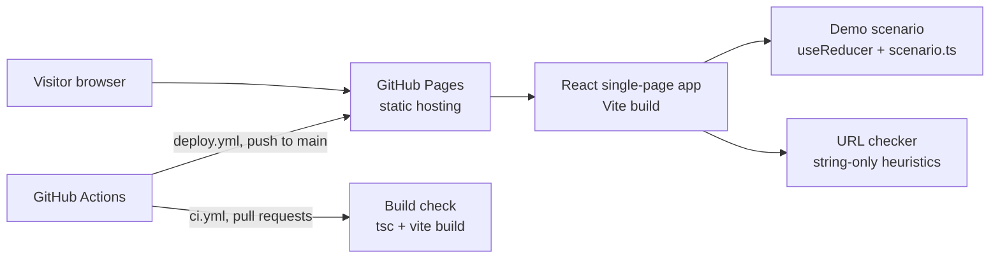
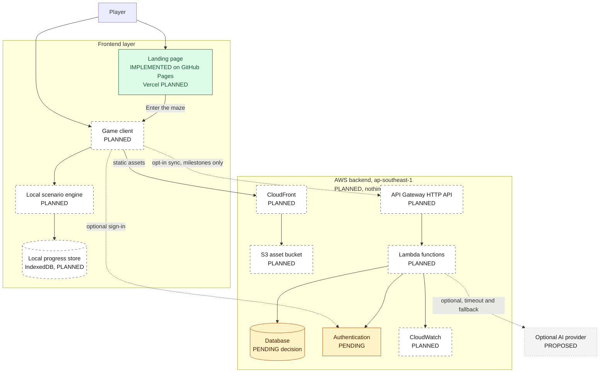

# SCAMMAZE architecture overview

> **Last reviewed:** 7 Nov 2026 · **Scope:** current implementation and target architecture
> **Sources of truth:** the repository on `main`, the master plan
> [`SCAMMAZE_KIROWEEN_2026_FULL_PLAN.md`](../../SCAMMAZE_KIROWEEN_2026_FULL_PLAN.md)
> (added in commit [`0665897`](https://github.com/teehihi/scam-maze/commit/0665897619ed026cf1166288e32579b9a0969228),
> translated to English in PR #3), and the owner's target architecture brief of 7 Nov 2026.
>
> This file fulfils the "architecture" deliverable listed in section 14 of the master plan
> (`docs/architecture/ARCHITECTURE.md` there).

Related documents: [Deployment](DEPLOYMENT.md) · [Database strategy](DATABASE_STRATEGY.md) ·
[Cost estimation](../finops/COST_ESTIMATION.md) · [Project progress](../PROJECT_PROGRESS.md)

## 1. Status legend

Every architecture statement in `docs/` uses one of these labels.

| Label | Meaning |
|---|---|
| `IMPLEMENTED` | Verified in the repository or in the deployed environment. |
| `PLANNED` | Part of the intended architecture, not implemented yet. |
| `PROPOSED` | An option under consideration, not agreed. |
| `PENDING` | A decision that has not been made. |
| `DEPRECATED` | Previously considered, no longer recommended. |

**Nothing on AWS has been provisioned.** No custom domain has been purchased. The database is not chosen.

## 2. What exists today (`IMPLEMENTED`)

Verified on `main` at commit `9a80a43` (7 Nov 2026).

| Area | Current implementation |
|---|---|
| Application | One single-page app at the repository root (no monorepo yet): React 19, TypeScript, Vite 8, Tailwind CSS v4. Package manager pnpm (`packageManager: pnpm@10.26.0`). No lockfile committed yet. |
| Pages | One landing page (`src/App.tsx`) with sections: hero, problem, Vietnam and worldwide, learning loop, demo scenario, URL checker, features, Kiro, risks, footer. No router. |
| Demo scenario | One short branching demo of "The Missing Parcel" in `src/data/scenario.ts` (TypeScript data, not JSON). Two steps, two choices each, three endings. Logic is a pure `useReducer` reducer in `src/components/ScenarioDemo.tsx`. It does **not** yet meet the plan's rule of at least two safe, two unsafe and one ambiguous route. |
| URL checker | `src/lib/urlCheck.ts`: deterministic, string-only heuristics. No network calls. Never returns "safe". Known false positives on official country domains (for example `google.co.uk`), see [Project progress](../PROJECT_PROGRESS.md). |
| "AI explanation" toggle | Shows **pre-written sample text** from the scenario data. No AI provider is called. |
| State and storage | In-memory React state only. No `localStorage`, IndexedDB or service worker. Progress is lost on reload. The site is **not** offline-capable beyond an already-loaded page. |
| Backend, API, database, auth | **None.** The app makes no `fetch` or XHR calls. |
| Environment variables | Only `VITE_BASE` (build time, optional, default `/`), read in `vite.config.ts`. |
| Tests | **None.** No test runner is installed. Quality gate today: `pnpm build` (TypeScript build + Vite build). |
| CI/CD | `.github/workflows/ci.yml` builds every pull request and uploads `dist` as an artifact. `.github/workflows/deploy.yml` builds and deploys to GitHub Pages on every push to `main`. |
| Hosting | GitHub Pages: <https://teehihi.github.io/scam-maze/>. The latest deployment (`9a80a43`) was reported `success` by the GitHub Deployments API on 7 Nov 2026. |
| Kiro | `.kiro/steering/` has `safety.md`, `icons.md`, `language.md`, `audience.md`. There are **no** `.kiro/specs/` or `.kiro/hooks/` yet. |

## 3. Target architecture

The target separates a **landing page** from a **game client**, keeps gameplay **local and
deterministic**, and uses a small **serverless AWS backend** only for persistence and
server-side operations.

| Layer | Target technology | Status |
|---|---|---|
| Landing page | React + Vite (existing stack) | `IMPLEMENTED` (on GitHub Pages) |
| Landing page hosting on Vercel | Vercel | `PLANNED` (today: GitHub Pages) |
| Game client | Separate frontend app on Vercel | `PLANNED` |
| Local scenario engine | Pure TypeScript engine, versioned scenario files, schema validation (plan section 4.1) | `PLANNED` (a demo reducer is `IMPLEMENTED`) |
| Local progress store | IndexedDB (plan section 4.1) | `PLANNED` |
| Offline shell | Service worker / PWA (plan F11, section 3.3) | `PLANNED` |
| Backend API | Amazon API Gateway **HTTP API** | `PLANNED` |
| Compute | AWS Lambda | `PLANNED` |
| Lambda runtime language | Python (plan: FastAPI + Pydantic) or TypeScript (shares types with the client) | `PENDING` |
| Database | DynamoDB, RDS PostgreSQL or Neon PostgreSQL | `PENDING`, see [Database strategy](DATABASE_STRATEGY.md) |
| Static assets | Amazon S3 | `PLANNED` |
| CDN | Amazon CloudFront | `PLANNED` |
| Authentication | Amazon Cognito or an alternative | `PENDING` |
| Monitoring | Amazon CloudWatch | `PLANNED` |
| AI capabilities | Optional AI provider behind the backend | `PROPOSED` |
| Region | `ap-southeast-1` (Singapore) | `PLANNED` |

**Reading the diagram**

- The **game engine runs in the browser**. Branching, evidence, replay and the transfer test do
  not need the backend.
- The **backend handles persistence and server-side operations** only (dotted lines are optional
  and opt-in).
- **Static assets** are delivered through CloudFront from a private S3 bucket.
- The **database is undecided**; Lambda code should talk to it through a small storage interface.
- **AI is optional**. The game works when AI is off, slow, rate-limited or unreachable.

## 4. Component responsibilities

### 4.1 Landing page (`IMPLEMENTED`, hosting move to Vercel `PLANNED`)

Introduces SCAMMAZE, explains the learning loop, shows a small playable demo and the URL checker,
and links to the game. It has no backend dependency and must stay fully static.

### 4.2 Game client (`PLANNED`)

A separate app that will hold the real experience: the simulated Internet (chat, email,
notifications, browser, marketplace), multi-step scenarios S1, S2, S3 and holdout H1, Consequence
Replay, the Risk DNA Graph and the transfer test.

Also listed in the owner's brief, **none of them built yet**: a loading scene, a main menu, level
selection and character customization.

> **Plan conflict, needs an owner decision.** The master plan marks a "full 3D world" as
> explicitly out of scope (section 3.1, P2) and lists 3D/multiplayer overbuild as a high risk
> (section 13). Character customization is not in the plan's feature contract. 3D environments,
> character models and character customization are therefore `PROPOSED` only, and they drive
> asset, CDN and storage costs.

### 4.3 Local scenario engine (`PLANNED`)

Pure TypeScript, no network access, no AI SDK (plan section 4.5). It owns:

- loading downloaded, versioned scenario definitions;
- branching state and deterministic transitions (same scenario version + same decisions →
  same result);
- evidence inspection state and the evidence graph data;
- replay of the user's own decision sequence, with alternative branches labelled hypothetical;
- scoring as a pure function that never turns "unknown" into "safe".

The plan leaves the state owner open (XState or Zustand, section 4.1). Status: `PENDING`.

### 4.4 Backend (`PLANNED`)

Request flow: `Game client → API Gateway HTTP API → Lambda → Database`.

| Use the backend for | Do not use the backend for |
|---|---|
| Optional account and profile | Each click, choice, evidence inspection or graph interaction |
| Opt-in progress sync across devices | Scenario branching or scoring |
| Mission completion summaries | Rendering scenario content |
| Learning reports and transfer test results | Analytics of raw behaviour by default |
| Achievements and inventory, **if** approved | |
| Server-side validation, authentication, authorization | |
| Administrative operations | |
| Optional AI requests (keys stay server-side) | |

Sync is batched at milestones (for example "mission completed") and must tolerate failure: the
client keeps local progress and retries later.

### 4.5 Static assets (`PLANNED`)

`Game client → CloudFront → S3 (private, origin access control)`.

Images, audio, UI assets and mission resources; 3D models and textures only if 3D is approved.
Assets use content-hashed file names, long cache lifetimes, compression, and lazy loading per
mission, so the game does not download everything at start-up. Until the game client exists, the
landing page keeps its assets in its own build.

## 5. Data flow and ownership

| Data | Where it lives | Notes |
|---|---|---|
| Scenario definitions | Client (downloaded, cached) | Versioned; authored content only. |
| Branching state, temporary decisions, evidence state, replay data | Client memory, then IndexedDB | Never sent by default. |
| Current mission progress | IndexedDB | Survives reloads and network loss. |
| Profile, preferences | Backend database (`PENDING`) | Only if the user creates an account. |
| Completed mission summaries, learning progress, transfer test results | Backend database (`PENDING`) | Only with opt-in sync; summaries, not raw event streams. |
| Achievements, inventory, customization | Backend database (`PENDING`) | Only if these features are approved. |

The plan requires that **guest play works without an account or email** (F01) and that
**nothing is sent to the backend unless the user opts in** (section 4.4). Accounts are therefore
optional add-ons, not a gate. Retention and deletion rules must be defined before any personal
data is stored; see [Database strategy](DATABASE_STRATEGY.md#7-privacy-retention-and-deletion).

## 6. Authentication boundary (`PENDING`)

- Default: **guest mode**, no authentication, no backend calls.
- Optional sign-in only to enable sync. Candidate: Amazon Cognito (`PROPOSED`). Alternatives
  stay open until the database and sync scope are decided.
- Backend routes that read or write user data require a valid token; public routes (for example
  a health check) carry no user data.
- No SMS-based sign-in or MFA in the MVP: it adds per-message cost, and a scam-awareness product
  should not train people to type codes received by SMS.

## 7. Optional AI integration (`PROPOSED`)

Follows plan section 4.5:

- the game core never imports an AI SDK and never calls a provider;
- requests go through a backend Lambda, so keys never reach the browser;
- the payload is minimal (scenario version, anonymized event IDs, approved evidence IDs);
- timeout about 2.5 s, structured output validation, rate limit and budget limit;
- on timeout, error or quota, the authored explanation is shown instead;
- AI output never changes facts, scoring, outcomes or the evidence graph.

Paid AI calls are **not** part of the core gameplay loop. AI provider costs are not covered by
AWS promotional credits unless the provider is an eligible AWS service; see
[Cost estimation](../finops/COST_ESTIMATION.md).

## 8. Security, privacy and reliability boundaries

**Security**

- Least-privilege IAM: one role per function, access only to its own table, bucket or secret.
- No secrets in the repository or in `VITE_*` variables (Vite inlines them into public JavaScript).
- Validate every request body and parameter on the backend; restrict CORS to known frontend origins.
- Throttle API routes to limit abuse and cost.
- Never request or store real passwords, OTPs, cards or banking data; simulations use fictional
  values and reserved domains (`.test`, `.example`, `.invalid`).
- Do not expose internal resource names, ARNs or stack traces in API responses.

**Privacy**

- Collect the minimum: no raw behavioural analytics by default (plan section 5.2).
- Never log passwords, OTPs, tokens, credentials or free-text personal content.
- Prefer local processing; document exactly what is synchronized.
- Define retention and deletion, including a user-triggered "delete my data".

**Reliability**

- Core gameplay works without AI and without the backend.
- Scenario execution is deterministic and reproducible.
- Network failure must not destroy local progress; sync retries with back-off.
- AI calls have a timeout and an authored fallback.

## 9. Reconciliation with the master plan

| Topic | Master plan | Owner's target brief | Current status |
|---|---|---|---|
| Frontend stack | React + TypeScript + Vite + Tailwind | Existing stack | `IMPLEMENTED` |
| Frontend hosting | One of Vercel, Cloudflare Pages, Netlify | Vercel for landing and game | GitHub Pages `IMPLEMENTED`; Vercel `PLANNED` |
| Repository layout | Monorepo (`apps/web`, `packages/*`, `services/api`) | Separate landing and game client | Single app at root `IMPLEMENTED`; split `PLANNED` |
| Backend | FastAPI + Pydantic on a stable host, only for the optional coach | API Gateway HTTP API + Lambda for persistence and AI | Serverless `PLANNED`; runtime language `PENDING` |
| FastAPI on an always-on host | Listed | Not listed | `DEPRECATED` (recommended): conflicts with the cost rules. FastAPI on Lambda through an adapter is `PROPOSED` if Python is chosen. Owner to confirm. |
| Database | PostgreSQL for scenario metadata and opt-in anonymized results | DynamoDB or PostgreSQL | `PENDING` |
| Progress storage | IndexedDB, privacy-first, server storage optional | Backend persistence for profiles and progress | Both are compatible if sync is opt-in; `PLANNED` |
| Accounts | Guest play without email (F01) | User profiles, authentication | Accounts must stay optional; auth `PENDING` |
| 3D and customization | Full 3D world out of scope | Character models, 3D if required, character customization | `PROPOSED`, conflict flagged in section 4.2 |
| Scenario state owner | XState or Zustand | Not specified | `PENDING`; demo uses `useReducer` |
| Visual system | "Cyber-noir detective lab", dark and light modes (section 3.5) | Not specified | Flat, minimal light theme `IMPLEMENTED` at the owner's request (PR #2) |
| Tests | Vitest, Playwright, fast-check, coverage target | Tests for meaningful logic | None yet |

## 10. Known inaccuracies on the live landing page

The landing page copy describes some planned capabilities in the present tense. Documentation is
the source of truth until the copy is corrected (tracked in [Project progress](../PROJECT_PROGRESS.md)).

| Claim on the page | Reality |
|---|---|
| Hero: "100% — Core runs offline, no AI needed" | No AI is needed (true), but there is no service worker; the site is not offline-capable. |
| Features: "state-machine engine with curated JSON scenarios that run fully offline" | Demo uses a reducer and a TypeScript data file; no offline support. |
| Features: "Scenario authoring", "Learning analytics", "Optional AI" | Not implemented. |
| Kiro section: "Specs" and "Hooks" | No `.kiro/specs/` or `.kiro/hooks/` exist yet. Steering exists. |
