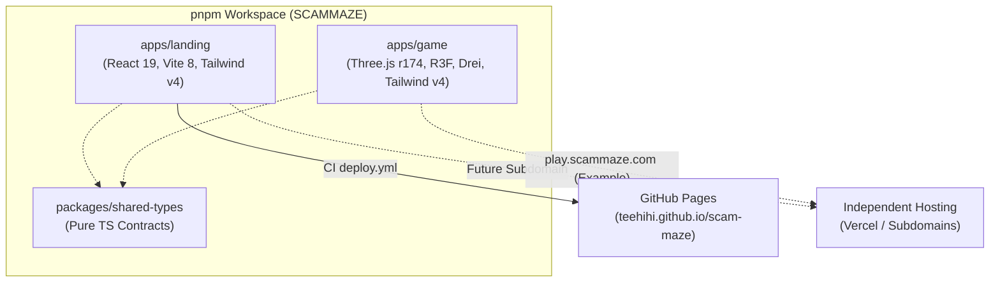
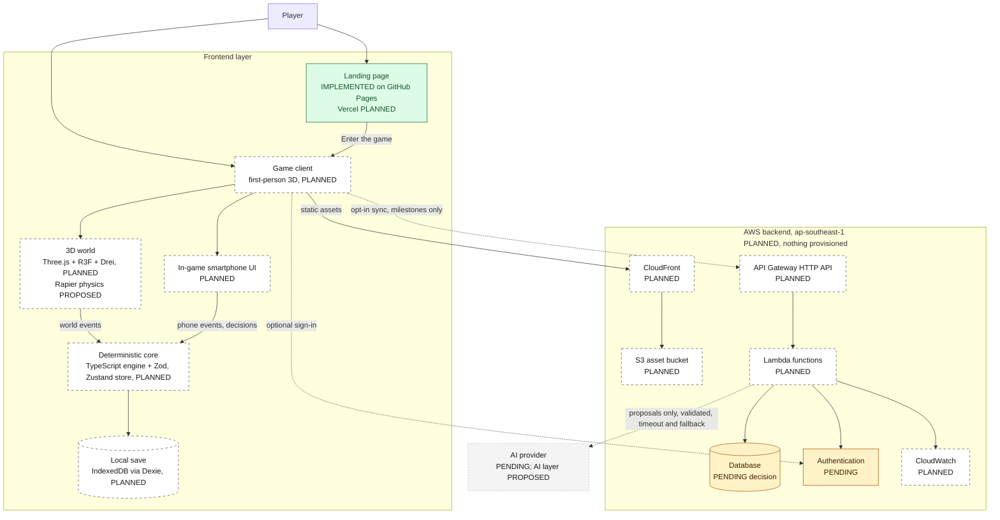

# SCAMMAZE architecture overview

> **Last reviewed:** 8 Nov 2026 · **Scope:** current implementation and target architecture
> **Sources of truth:** the repository on `main`; the canonical product definition
> [`docs/product/PRODUCT_POSITIONING.md`](../product/PRODUCT_POSITIONING.md) (owner decision of
> 8 Nov 2026: first-person 3D narrative game); the master plan
> [`SCAMMAZE_KIROWEEN_2026_FULL_PLAN.md`](../../SCAMMAZE_KIROWEEN_2026_FULL_PLAN.md)
> (added in commit [`0665897`](https://github.com/teehihi/scam-maze/commit/0665897619ed026cf1166288e32579b9a0969228),
> translated to English in PR #3, product framing amended 8 Nov 2026); and the owner's target
> architecture brief of 7 Nov 2026.
>
> This file fulfils the "architecture" deliverable listed in section 14 of the master plan
> (`docs/architecture/ARCHITECTURE.md` there).

Related documents: [Deployment](DEPLOYMENT.md) · [Database strategy](DATABASE_STRATEGY.md) ·
[Cost estimation](../finops/COST_ESTIMATION.md) · [Project progress](../PROJECT_PROGRESS.md)

## 1. Status legend

Every architecture statement in `docs/` uses one of these labels.

| Label | Meaning |
|---|---|
| `IMPLEMENTED` | Verified in the repository or in the deployed environment. |
| `PLANNED` | Part of the intended architecture, not implemented yet. |
| `PROPOSED` | An option under consideration, not agreed. |
| `PENDING` | A decision that has not been made. |
| `DEPRECATED` | Previously considered, no longer recommended. |

**Nothing on AWS has been provisioned.** No custom domain has been purchased. The database is not chosen.

## 2. What exists today (`IMPLEMENTED`)

Verified on `feat/game-foundation-monorepo-main-menu` (9 Nov 2026):

| Area | Current implementation |
|---|---|
| Repository Architecture | **pnpm monorepo** with `apps/landing`, `apps/game`, and `packages/shared-types`. Unified workspace scripts: `pnpm dev:landing`, `pnpm dev:game`, `pnpm build:landing`, `pnpm build:game`, `pnpm build`, `pnpm typecheck`. |
| Landing Application | Located in `apps/landing`: React 19, TypeScript, Vite 8, Tailwind CSS v4, `lucide-react`, self-hosted fonts. Deploys to GitHub Pages via `.github/workflows/deploy.yml`. Features 4 responsive landing sections and a 9-section Full-Page Knowledge Hub (`/#docs`, `/#privacy`, `/#license`, etc.). |
| Game Application | Located in `apps/game`: React 19, TypeScript, Vite 8, **Three.js r174**, **React Three Fiber v9**, **Drei v10**, Tailwind CSS v4. Implements the cinematic first-person 3D street scene serving as the game's Main Menu. |
| 3D Environment & Assets | Binary glTF models verified from `Kiroween/Asset3D/`: `low_poly_city_asset_pack.glb` (Calipo, CC-BY 4.0) and `low_poly_cars_pack.glb` (matisosanimation, CC-BY 4.0). Renders modular buildings (B1–B5, corner, shopfront, hospital), road asphalt with dashed lines, streetlights with warm point lights, low-poly trees, and parked cars along curbs. |
| Camera & Controls | First-person eye-level camera (`y ≈ 2.05m`) facing down the street towards an atmospheric vanishing point. Smooth breathing idle motion and pointer parallax lerping. Configurable FOV (60°–85°). |
| Menu UI & Modals | Interactive UI overlay over 3D Canvas: `NEW GAME` (opens Prologue introduction modal), `CONTINUE` (disabled with clear notice), `SETTINGS` (real-time graphics quality, FOV, sound toggle, master volume with `localStorage` persistence), `CREDITS` (verified third-party asset licenses), and WebGL fallback detector. |
| Shared Contracts | `packages/shared-types`: pure TypeScript definitions for scene IDs, graphics quality, game settings, and scenario metadata. |
| Quality Gates | Root `pnpm typecheck` and `pnpm build` validate all workspace packages cleanly. |

## 3. Target architecture

The target separates a **landing page** from a **first-person 3D game client**, keeps gameplay
**local and deterministic**, and uses a small **serverless AWS backend** only for optional AI
proxying, persistence and server-side operations.

| Layer | Target technology | Status |
|---|---|---|
| Landing page | React + Vite (in `apps/landing`) | `IMPLEMENTED` (on GitHub Pages) |
| Landing page hosting on Vercel | Vercel | `PLANNED` (today: GitHub Pages) |
| Game client (`apps/game`) | First-person 3D game client with Main Menu scene; React 19 + TypeScript + Vite 8 (section 3.1) | `IMPLEMENTED` (foundation & 3D main menu) |
| 3D rendering | **Three.js r174** (primary 3D engine) via **React Three Fiber v9**, with **Drei v10** utilities; WebGL 2 baseline | `IMPLEMENTED` |
| Physics | **Rapier** | `PROPOSED`; prototype required |
| Gameplay state | **Zustand** stores | `PLANNED` |
| In-game smartphone UI | 2D React UI rendered as an overlay or in-world surface; fictional apps | `PLANNED` |
| Narrative engine + scam intelligence engine (deterministic core) | Pure **TypeScript** chapter state machines, evidence and tactic definitions, versioned scenario files validated with **Zod** | `PLANNED` (a legacy demo reducer exists in `src/legacy/`) |
| Local progress store | **IndexedDB** through **Dexie** | `PLANNED` |
| Offline shell | Service worker / PWA (plan F11, section 3.3) | `PLANNED` |
| Backend API | Amazon API Gateway **HTTP API** | `PLANNED` |
| Compute | AWS Lambda | `PLANNED` |
| Lambda runtime language | Python (plan: FastAPI + Pydantic) or TypeScript (shares types with the client) | `PENDING` |
| Database | DynamoDB, RDS PostgreSQL or Neon PostgreSQL | `PENDING`, see [Database strategy](DATABASE_STRATEGY.md) |
| Static assets | Amazon S3 | `PLANNED` |
| CDN | Amazon CloudFront | `PLANNED` |
| Authentication | Amazon Cognito or an alternative | `PENDING` |
| Monitoring | Amazon CloudWatch | `PLANNED` |
| AI layer | Bounded AI scam actor (signature capability) and optional hint/debrief phrasing, behind the backend, with schema validation and authored fallbacks | `PROPOSED` |
| AI provider | Not selected | `PENDING` |
| Region | `ap-southeast-1` (Singapore) | `PLANNED` |

**Reading the diagram**

- The **game runs in the browser**: the 3D world and the phone emit events; the deterministic
  core (narrative engine and scam intelligence engine) decides what happens. Branching, evidence,
  consequences, replay and the transfer check do not need the backend.
- The **backend handles persistence and server-side operations** only (dotted lines are optional
  and opt-in).
- **Static assets** are delivered through CloudFront from a private S3 bucket.
- The **database is undecided**; Lambda code should talk to it through a small storage interface.
- **AI only proposes**. The game works when AI is off, slow, rate-limited or unreachable;
  authored dialogue is used instead.

### 3.1 Game application stack

**Owner decision, 8 Nov 2026.** This is the stack for the future game application. **None of
these libraries is installed**, and no game code exists. The landing page keeps its own verified
stack (section 2) and is not changed by this decision.

| Concern | Technology | Role | Status |
|---|---|---|---|
| Application | React 19 + TypeScript + Vite | Same base as the landing page; separate app | `PLANNED` |
| 3D rendering engine | **Three.js** | The primary and only 3D renderer (WebGL 2 baseline) | `PLANNED` |
| React integration | **React Three Fiber** | Declarative Three.js scene graph inside React | `PLANNED` |
| 3D utilities | **Drei** | Reusable helpers (for example controls, loaders, LOD, instancing helpers) | `PLANNED` |
| Physics | **Rapier** | Character collision, movement against walls and props | `PROPOSED` |
| Gameplay state | **Zustand** | Container for engine state and UI/game state; no rules inside stores | `PLANNED` |
| Deterministic scenario engine | **TypeScript** (pure functions) | Chapter state machines, evidence, tactics, consequences, scoring; no React, Three.js or network imports | `PLANNED` |
| Runtime schema validation | **Zod** | Validates scenario files, saved state on load, and AI proposals before the engine sees them | `PLANNED` |
| Local persistence | **IndexedDB** via **Dexie** | Local saves with versioned schema; clear-data support | `PLANNED` |
| In-game phone and overlays | React (2D DOM) | Phone apps, dialogue, debrief | `PLANNED` |
| Entity Component System (ECS) | Not chosen | Option for future evaluation only if prototype profiling shows a need (for example many NPCs or props with shared behaviour) | `PROPOSED` (not approved) |

Boundaries:

- **Three.js is the 3D engine.** PixiJS is a 2D renderer and is **not** the 3D engine for
  SCAMMAZE; it is not part of this stack.
- **ECS is not an architectural decision.** Do not introduce an ECS library or structure the
  engine around ECS without a documented evaluation and owner approval.
- **Dependency direction:** React Three Fiber scene → reads Zustand → Zustand applies events
  through the pure TypeScript engine. The engine never imports React, Three.js, Rapier, Zustand
  or Dexie, so it can be unit-tested on its own and stays deterministic.
- **Physics is not game logic.** Rapier (if adopted) only handles movement and collision; it
  emits events such as "entered locker area" but never decides outcomes.
- **Versions are not pinned yet.** When installing, choose versions that are compatible with
  React 19 and with each other, and record them in the pull request.

**Requires a prototype or benchmark before the MVP build relies on it** (results to be recorded
in [Project progress](../PROJECT_PROGRESS.md)):

| Item | What to measure |
|---|---|
| Three.js + React Three Fiber + Drei scene | Frame rate and frame time on integrated-GPU laptops for the apartment and street; draw calls; memory; load time and download size |
| Rapier | WebAssembly download size and initialisation time; first-person character controller behaviour; CPU cost per frame |
| Quality tiers (Low/Medium/High) | Whether the Low tier stays playable on the weakest target device |
| Dexie persistence | Save and load time; schema migration between scenario versions |
| Zustand + React Three Fiber | That state updates do not trigger unnecessary React re-renders of the 3D scene |
| ECS (only if considered) | Whether it measurably simplifies or speeds up NPC and prop updates compared with plain components |

No triangle, draw-call or memory budgets are set until these benchmarks exist
([product positioning, section 10.1](../product/PRODUCT_POSITIONING.md#101-performance-first-browser-3d)).

## 4. Component responsibilities

### 4.1 Landing page (`IMPLEMENTED`, hosting move to Vercel `PLANNED`)

Introduces SCAMMAZE and links to the game through `VITE_GAME_URL`. It has no backend dependency
and must stay fully static. Its copy still describes the earlier "linked digital environments"
concept; see section 10.

### 4.2 Game client (`PLANNED`)

**Owner decision, 8 Nov 2026:** the game is a browser-based, **first-person 3D narrative game**
in a small persistent world (one apartment and one street for the MVP) with chapter-based
stories. The digital interfaces (messages, email, websites, marketplace, bank and parcel apps)
live on an **in-game smartphone** inside the 3D world. Full definition:
[product positioning](../product/PRODUCT_POSITIONING.md).

Components inside the game client, all `PLANNED`:

- **3D world runtime** (Three.js + React Three Fiber + Drei, Rapier proposed for physics; see
  section 3.1): rendering, first-person movement, interaction,
  NPCs, area-based loading, quality tiers. Emits world events such as `visited_locker`.
- **In-game smartphone UI**: 2D React UI; emits phone events such as `opened_link`,
  `entered_code`.
- **Deterministic core** (section 4.3): the only component that changes game state.
- **Debrief and replay**: reads the event log; links missed clues back to world and phone
  locations.

Performance principles (WebGL 2 baseline, integrated GPUs first, baked lighting, LOD and
instancing, quality tiers, budgets set from prototype benchmarks) are in
[product positioning, section 10.1](../product/PRODUCT_POSITIONING.md#101-performance-first-browser-3d).

Status of items from the 7 Nov brief: loading scene and main menu `PLANNED` (as part of the
slice); level selection replaced by chapter progression in one world `PLANNED`; character
customization `PROPOSED`, future scope, not in the MVP. A *full* or open 3D world and
multiplayer remain out of scope.

### 4.3 Deterministic core: narrative engine and scam intelligence engine (`PLANNED`)

Pure TypeScript, no network access, no AI SDK (plan section 4.5). It runs outside the render
loop and does not depend on the 3D library. It owns game, mission and chapter state, persistent
world and player state (exposed information, simulated balance, NPC trust, skills demonstrated),
evidence and tactic definitions, decision validation, consequences and scoring. AI proposals are
accepted or rejected here. It also owns:

- loading downloaded, versioned scenario definitions;
- branching state and deterministic transitions (same scenario version + same decisions →
  same result);
- evidence inspection state and the evidence graph data;
- replay of the user's own decision sequence, with alternative branches labelled hypothetical;
- scoring as a pure function that never turns "unknown" into "safe".

State ownership (`PLANNED`, owner decision, 8 Nov 2026; resolves the plan's open "XState or
Zustand" choice in favour of **Zustand**): the engine's transitions are pure TypeScript functions
`(state, event) → state`; a Zustand store holds the current engine state, applies events through
those functions and persists through Dexie. Zustand is the state *container*; the rules live in
the engine, so they stay testable without React, Three.js or Zustand. XState is not used.

### 4.4 Backend (`PLANNED`)

Request flow: `Game client → API Gateway HTTP API → Lambda → Database`.

| Use the backend for | Do not use the backend for |
|---|---|
| Optional account and profile | Each click, choice, evidence inspection or graph interaction |
| Opt-in progress sync across devices | Scenario branching or scoring |
| Mission completion summaries | Rendering scenario content |
| Learning reports and transfer test results | Analytics of raw behaviour by default |
| Achievements and inventory, **if** approved | |
| Server-side validation, authentication, authorization | |
| Administrative operations | |
| Optional AI requests (keys stay server-side) | |

Sync is batched at milestones (for example "mission completed") and must tolerate failure: the
client keeps local progress and retries later.

### 4.5 Static assets (`PLANNED`)

`Game client → CloudFront → S3 (private, origin access control)`.

3D models (glTF with mesh compression), compressed textures, audio, UI assets and chapter
resources. The 3D direction is approved, so asset size is now a primary cost and performance
driver. Assets use content-hashed file names, long cache lifetimes, compression, and loading per
area and per chapter, so the game does not download everything at start-up. Until the game
client exists, the landing page keeps its assets in its own build. For the hackathon, assets may
also ship inside the game's own static build if that keeps cost and setup lower (`PENDING`).

## 5. Data flow and ownership

| Data | Where it lives | Notes |
|---|---|---|
| Scenario definitions | Client (downloaded, cached) | Versioned; authored content only. |
| Branching state, temporary decisions, evidence state, replay data | Client memory, then IndexedDB | Never sent by default. |
| Current mission progress | IndexedDB | Survives reloads and network loss. |
| Persistent world and player state (exposed fictional information, simulated balance, NPC trust, skills demonstrated, chapter flags) | IndexedDB | Written only by the deterministic core; never by AI. Includes `scenarioVersion` so saves do not mix versions. |
| AI conversation context | Client memory for the current scene | Only minimal, fictional game context is sent to the AI proxy; not stored remotely by default. |
| Profile, preferences | Backend database (`PENDING`) | Only if the user creates an account. |
| Completed mission summaries, learning progress, transfer test results | Backend database (`PENDING`) | Only with opt-in sync; summaries, not raw event streams. |
| Achievements, inventory, customization | Backend database (`PENDING`) | Only if these features are approved. |

The plan requires that **guest play works without an account or email** (F01) and that
**nothing is sent to the backend unless the user opts in** (section 4.4). Accounts are therefore
optional add-ons, not a gate. Retention and deletion rules must be defined before any personal
data is stored; see [Database strategy](DATABASE_STRATEGY.md#7-privacy-retention-and-deletion).

## 6. Authentication boundary (`PENDING`)

- Default: **guest mode**, no authentication, no backend calls.
- Optional sign-in only to enable sync. Candidate: Amazon Cognito (`PROPOSED`). Alternatives
  stay open until the database and sync scope are decided.
- Backend routes that read or write user data require a valid token; public routes (for example
  a health check) carry no user data.
- No SMS-based sign-in or MFA in the MVP: it adds per-message cost, and a scam-awareness product
  should not train people to type codes received by SMS.

## 7. AI layer (`PROPOSED`; provider `PENDING`)

The AI layer is now a meaningful product component (signature capability: the **Bounded Scam
Actor**), but it remains optional at runtime and only **proposes** content. Capability matrix,
contract and priorities: [product positioning, section 8](../product/PRODUCT_POSITIONING.md#8-ai-product-strategy).

Rules, following plan section 4.5:

- the deterministic core accepts or rejects every AI proposal against a schema and the node's
  allowed tactics; AI never writes game state, never decides outcomes, never adds evidence;
- AI is called only on meaningful events (a player message to the scammer, a hint request, the
  debrief), never per frame;
- the game core never imports an AI SDK and never calls a provider;
- requests go through a backend Lambda, so keys never reach the browser;
- the payload is minimal (scenario version, anonymized event IDs, approved evidence IDs);
- timeout about 2.5 s, structured output validation, rate limit and budget limit;
- on timeout, error or quota, the authored explanation is shown instead;
- AI output never changes facts, scoring, outcomes or the evidence graph.

Paid AI calls are **not** part of the core gameplay loop. AI provider costs are not covered by
AWS promotional credits unless the provider is an eligible AWS service; see
[Cost estimation](../finops/COST_ESTIMATION.md).

## 8. Security, privacy and reliability boundaries

**Security**

- Least-privilege IAM: one role per function, access only to its own table, bucket or secret.
- No secrets in the repository or in `VITE_*` variables (Vite inlines them into public JavaScript).
- Validate every request body and parameter on the backend; restrict CORS to known frontend origins.
- Throttle API routes to limit abuse and cost.
- Never request or store real passwords, OTPs, cards or banking data; simulations use fictional
  values and reserved domains (`.test`, `.example`, `.invalid`).
- Do not expose internal resource names, ARNs or stack traces in API responses.

**Privacy**

- Collect the minimum: no raw behavioural analytics by default (plan section 5.2).
- Never log passwords, OTPs, tokens, credentials or free-text personal content.
- Prefer local processing; document exactly what is synchronized.
- Define retention and deletion, including a user-triggered "delete my data".

**Reliability**

- Core gameplay works without AI and without the backend, including offline once assets and
  scenarios have loaded.
- The 3D world degrades through quality tiers; a phone-centred fallback keeps a chapter playable
  on devices that cannot run the 3D world (`PROPOSED`).
- Scenario execution is deterministic and reproducible.
- Network failure must not destroy local progress; sync retries with back-off.
- AI calls have a timeout and an authored fallback.

## 9. Reconciliation with the master plan

| Topic | Master plan | Owner's target brief | Current status |
|---|---|---|---|
| Frontend stack | React + TypeScript + Vite + Tailwind | Existing stack | `IMPLEMENTED` |
| Frontend hosting | One of Vercel, Cloudflare Pages, Netlify | Vercel for landing and game | GitHub Pages `IMPLEMENTED`; Vercel `PLANNED` |
| Repository layout | Monorepo (`apps/web`, `packages/*`, `services/api`) | Separate landing and game client | Single app at root `IMPLEMENTED`; split `PLANNED` |
| Backend | FastAPI + Pydantic on a stable host, only for the optional coach | API Gateway HTTP API + Lambda for persistence and AI | Serverless `PLANNED`; runtime language `PENDING` |
| FastAPI on an always-on host | Listed | Not listed | `DEPRECATED` (recommended): conflicts with the cost rules. FastAPI on Lambda through an adapter is `PROPOSED` if Python is chosen. Owner to confirm. |
| Database | PostgreSQL for scenario metadata and opt-in anonymized results | DynamoDB or PostgreSQL | `PENDING` |
| Progress storage | IndexedDB, privacy-first, server storage optional | Backend persistence for profiles and progress | Both are compatible if sync is opt-in; `PLANNED` |
| Accounts | Guest play without email (F01) | User profiles, authentication | Accounts must stay optional; auth `PENDING` |
| Product framing | "Safe simulated Internet" (section 0) | Owner decision 8 Nov 2026: first-person 3D narrative game, persistent world, chapters | 3D game `PLANNED`; plan section 0 amended; [positioning](../product/PRODUCT_POSITIONING.md) is canonical |
| 3D world | Full 3D world out of scope (3.1 P2) | Small first-person 3D world is the core platform | Small world `PLANNED`; full/open world still out of scope; plan 3.1 amended |
| Character customization | Not in the feature contract | Listed in the 7 Nov brief | `PROPOSED`, future scope, not in the MVP |
| AI role | Optional coach adapter | Bounded AI layer as a meaningful component; deterministic core decides | `PROPOSED`; provider `PENDING`; same safety boundaries |
| Scenario state owner | XState or Zustand | Zustand for gameplay state; deterministic engine in pure TypeScript | `PLANNED` (Zustand); XState not used; legacy demo uses `useReducer` |
| 3D and physics libraries | Not specified (3D out of scope) | Three.js + React Three Fiber + Drei; Rapier proposed | Three.js stack `PLANNED`; Rapier `PROPOSED`; nothing installed |
| Schema validation and local persistence | Zod/JSON Schema; IndexedDB/Dexie | Zod; IndexedDB/Dexie | `PLANNED`; consistent with the plan |
| Visual system | "Cyber-noir detective lab", dark and light modes (section 3.5) | Game: stylized realism / stylized low-poly, not Halloween | Landing page: dark cinematic theme `IMPLEMENTED` (PR #7, replaced the flat theme of PR #2); game art `PLANNED`; plan 3.5 amended |
| Tests | Vitest, Playwright, fast-check, coverage target | Tests for meaningful logic | None yet |

## 10. Known inaccuracies on the live landing page

Reviewed against the PR #7 landing page on 8 Nov 2026. The previous list (offline claims,
features, Kiro specs and hooks) no longer applies: that copy was removed in PR #7. Documentation
is the source of truth until the copy is corrected (tracked in [Project progress](../PROJECT_PROGRESS.md)).

| On the page | Reality |
|---|---|
| Product concept: "Five fictional digital environments, linked together" (messages, websites, email, social, marketplace); no mention of a 3D world, a neighbourhood, NPCs or a first-person game | Superseded by the 8 Nov 2026 owner decision (3D narrative game with an in-game phone). Copy update `PENDING`. |
| Interactive previews ("Try the preview…", evidence workspace) | Accurate: labelled as simulated examples, not the real mission engine. |
| Mission case files 001–003 | Accurate as plans: `src/data/missions.ts` states none is playable. Chapter 4 and the Prologue are not shown. |
| "Enter the game" | Accurate: opens a "world is being prepared" dialog because `VITE_GAME_URL` is not set. |
