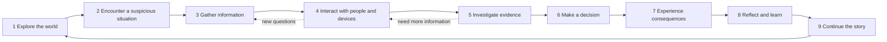
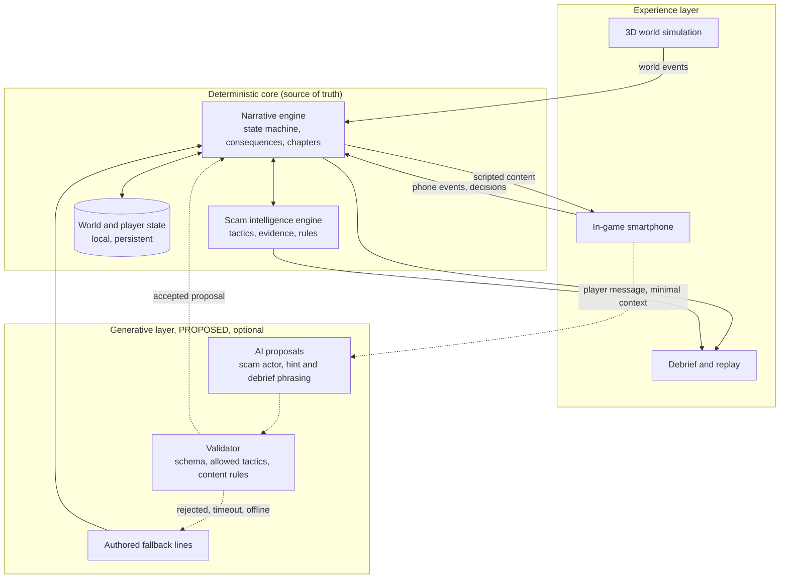

# SCAMMAZE product positioning

> **Canonical document.** This is the authoritative source for what SCAMMAZE is. If another
> document disagrees with it, this document wins and the other document should be corrected.
>
> **Version:** 2.0 · **Date:** 8 Nov 2026 · **Owner decision recorded:** 8 Nov 2026
> **Status labels:** `IMPLEMENTED`, `PLANNED`, `PROPOSED`, `PENDING`, `DEPRECATED`, as defined in
> [OVERVIEW.md](../architecture/OVERVIEW.md#1-status-legend).
>
> Supersedes the product definition in [`docs/positioning.md`](../positioning.md) (v1.0, 7 Nov 2026)
> and the "safe simulated Internet" framing in sections 0, 3.4 and 3.5 of the
> [master plan](../../SCAMMAZE_KIROWEEN_2026_FULL_PLAN.md). Audience, evidence and writing rules
> from v1.0 are carried over in sections 4, 3.2 and 13.6.

**Nothing described here as a game feature exists yet.** Today the repository contains a landing
page only ([project progress](../PROJECT_PROGRESS.md)). The 3D game is `PLANNED`; every AI
capability is `PROPOSED`.

---

## 1. Executive product definition

| Field | Definition |
|---|---|
| Product name | **SCAMMAZE** |
| One sentence | A browser-based, first-person 3D narrative game in which players live an ordinary life in a small fictional neighbourhood, meet real-world-inspired scams through people and devices around them, and learn to recognise and respond to deception by experiencing its consequences, safely. |
| Elevator pitch | Most scams do not look like scams. They arrive on an ordinary day, from a familiar-looking sender, at the moment you are expecting something. SCAMMAZE puts you in that moment. You walk around your neighbourhood, check your phone, talk to people, look for evidence, and decide what to do. A scammer can argue back. Your choices change the story, and the game shows you exactly which clue you missed and where you could have found it. |
| Product category | Narrative simulation game for scam awareness (serious game); first-person exploration with life-simulation elements. |
| Platform | Web browser. Desktop and laptop first (keyboard and mouse); mobile browsers are future scope (section 11). No install, no account needed to play. |
| Target experience | An immersive indie first-person story: a small, detailed, believable world; calm pacing; the tension of a suspicious request; a clear debrief afterwards. Not a quiz, not a lecture, not horror. |
| Hackathon | Kiroween 2026, category **Frankenstein**. |
| Product maturity | **Pre-MVP.** Landing page `IMPLEMENTED` on GitHub Pages. Game `PLANNED`. No backend, no AI integration, no 3D code yet. |

### Full product description

SCAMMAZE is set in one small, persistent fictional neighbourhood. The player is a young adult
who has just moved into a new apartment. Over a series of chapters, ordinary life brings
ordinary needs: a parcel that has not arrived, a job search, a second-hand purchase, a message
from family. Each need is the opening a scammer uses.

The scams are delivered the way they are in real life: through an in-game smartphone (messages,
email, websites, a bank app, a parcel app) and through people in the world. The evidence is
spread across both. A parcel locker on the street, a conversation with a neighbour, the sender
address of an email, the domain of a payment page, a detail in a call: the player has to connect
them.

The core rules are deterministic and authored: what counts as evidence, what each decision does,
what the consequence is. On top of that, a bounded AI layer makes the scammer feel alive: it can
answer the player's questions and push back when challenged, within limits the scenario defines.
If AI is off or unavailable, the same scene runs on authored dialogue.

Consequences are simulated and persistent. Information the player gives away in one chapter can
be used against them in a later one. After each chapter, a debrief replays the player's decisions
and links every warning sign back to where it appeared in the world.

The product promise is modest and specific: practise the decisions scams depend on, in a safe
place, and leave with habits that work anywhere. It does not promise immunity.

---

## 2. Vision, mission, north star and promise

| Element | Statement |
|---|---|
| **Vision** (the world we want) | People recognise deception by habit, because they have already practised the moment it happens. |
| **Mission** (what we build) | A safe, believable game world where people rehearse the pressure, doubt and decision of a scam, see the consequences of each choice, and learn verification habits they can use in any country. |
| **North-star statement** | *A safe, living world where people learn to spot scams before facing them in real life.* (Evolves the master plan's "a safe, interactive Internet where people learn to spot scams before facing them in real life.") |
| **North-star measure** (`PLANNED`, not measured) | Share of players who choose an independent verification action in a scam situation they have not seen before (the transfer check, section 11). |
| **Core product promise** | You can make the wrong choice here, see exactly what it would cost, and understand why, without losing anything real. |

---

## 3. Problem and opportunity

### 3.1 Why current formats are not enough

- **Quizzes test recognition, not decisions.** A quiz shows one screenshot and asks "scam or not?"
  Real scams are rarely a single screen; they are a sequence of small, reasonable-sounding steps
  under time pressure.
- **Static content explains, but does not rehearse.** Advice such as "never share your one-time
  password (OTP)" is widely known. Knowing a rule is different from applying it when a convincing
  person is rushing you.
- **Context is missing.** Scams work because they fit into the victim's day: the parcel they are
  waiting for, the job they applied for. Isolated examples remove the context that makes scams
  persuasive.
- **There is no safe way to be wrong.** People cannot practise failing at a scam in real life.

### 3.2 Evidence of the gap

Carried over from v1.0; survey data, not SCAMMAZE results.

| Market | Finding | Source |
|---|---|---|
| Worldwide | 57% of adults experienced a scam in the past 12 months, and 23% lost money (survey of 46,000 adults in 42 markets). | [GASA, Global State of Scams 2025](https://gasa.org/knowledge-base/blog/global-scams-on-the-rise-over-half-of-adults-worldwide-report-scam-encounters) |
| Vietnam | 85% of adults encountered a scam in the past year; 55% felt confident they could recognise scams, yet 75% of those exposed interacted with the scammer (survey of 1,250 adults). | [GASA, State of Scams in Vietnam 2026](https://gasa.org/knowledge-base/reports/state-of-scams-in-vietnam-2026) |

The second row is the core insight: **confidence and awareness do not stop people from
engaging.** The gap is between knowing and doing.

### 3.3 The opportunity

A game can provide what static formats cannot: a believable context, a sequence of decisions,
a person who pushes back, consequences that carry forward, and a debrief that shows exactly where
the evidence was. That is the experience SCAMMAZE intends to build.

### 3.4 What SCAMMAZE can and cannot credibly promise

| Can promise | Cannot promise |
|---|---|
| A safe place to practise decisions under realistic pressure | That players become immune to scams |
| Consequences that are explained with evidence | That a scenario reflects every real scam variant |
| Verification habits that are not tied to one brand or country | Measured learning outcomes, until a study is run and reported |
| A game that works without AI | That any URL, message or site is "safe" |

---

## 4. Target audience

SCAMMAZE serves **two primary audiences with equal weight**: internet users in **Vietnam** and
internet users **everywhere else** ([audience steering](../../.kiro/steering/audience.md)).
It is never designed for one and adapted for the other.

| Segment | Who | What they need |
|---|---|---|
| **Primary A** | Young adults and students aged 16+ (study participants 18+, plan section 5.2), in Vietnam and worldwide | A game that feels like a game, short chapters, situations from their own life stage: first parcel deliveries, first job search, second-hand buying |
| **Primary B** | Everyday internet users who rely on messaging, digital payments, online shopping and online recruitment | Familiar situations, no jargon, habits that transfer to real apps |
| **Secondary** | Educators, schools, libraries, community and digital-skills groups | Self-contained chapters that fit a lesson, a clear debrief, no sign-up |
| **Time-bound** | Kiroween 2026 judges | A playable vertical slice and a demo that shows the integration in under 3 minutes, in English |

Implications for content: fictional brands and reserved domains only; tactics that exist
everywhere (urgency, impersonation, too-good-to-be-true, OTP requests, off-platform payment);
no country-specific currency, phone format or payment method in core chapters. English first;
Vietnamese planned (master plan F19).

---

## 5. Core gameplay loop

The central identity: **Physical world → Digital interaction → Investigation → Decision →
Consequence → Learning.**



| Stage | What the player does | How it connects to the next stage |
|---|---|---|
| 1. Explore the world | Walks around the apartment and street, notices objects, people and routines. | Establishes what "normal" looks like, so the unusual stands out. |
| 2. Encounter a suspicious situation | Receives a message, email or call on the in-game phone, or is approached by someone. | The situation fits a need the world has set up (for example an expected parcel). |
| 3. Gather information | Reads carefully, checks the sender, opens links in the in-game browser, notes details. | Raises questions the phone alone cannot answer. |
| 4. Interact with people and devices | Talks to NPCs, visits locations (the parcel locker), uses official in-game apps, questions the sender. | People and places provide evidence that confirms or contradicts the digital story. |
| 5. Investigate evidence | Collects clues into an evidence notebook; the game shows which clues are linked. | Gives the player a reason for their decision, not a guess. |
| 6. Make a decision | Comply, refuse, verify through an independent channel, stall, report. | Each option is a defined branch with defined effects. |
| 7. Experience consequences | Sees simulated effects: on the in-game bank balance, on NPC trust, on what the scammer now knows. | Consequences are clearly labelled as simulated and carry into world state. |
| 8. Reflect and learn | Chapter debrief: replay of decisions, missed warning signs, where each clue was in the world, the safer alternative. | Turns the experience into a habit the player can name. |
| 9. Continue the story | The next chapter starts in the same world, shaped by earlier decisions. | Earlier mistakes can return; learned habits can be tested in a new context. |

---

## 6. World and chapter structure

### 6.1 Persistent world + chapter-based narrative (`PLANNED`)

- **One world, one player identity.** A single fictional neighbourhood (working name `TBD`) and
  one player character whose life continues across chapters.
- **A small explorable hub.** The player's apartment and one street segment with a few places,
  for example a convenience store, a parcel locker, a café and a bus stop. Generic enough to read
  as "a neighbourhood" in Vietnam and elsewhere; no real brands or landmarks.
- **Chapters** introduce one scam story each, with its own missions, NPC interactions and events.
- **Character progression** is knowledge, not power: verification habits the player has
  demonstrated, an evidence notebook, NPC relationships and the state of their simulated life
  (balance, exposed information).
- **NPC relationships.** Neighbours and shopkeepers remember how the player treated them and what
  happened; a trusted NPC can become a source of advice, or be impersonated later.
- **Incremental expansion.** New chapters add a location or a few NPCs (for example an office for
  the job chapter) instead of a large open world.

### 6.2 Persistent world state (deterministic)

| State | Examples | Changed by |
|---|---|---|
| Exposed information | Name, phone number, address, ID photo, "card details" (all fictional) | Player decisions only |
| Simulated finances | In-game bank balance and transaction history | Player decisions only |
| NPC relationships | Trust level per NPC, facts the NPC knows | Player decisions and authored events |
| Skills demonstrated | "Verified through official channel", "Checked domain", "Refused OTP request" | Rule engine, from evidence and decisions |
| Chapter flags | Reported the scammer, blocked the number, contacted the bank | Player decisions |

**AI never writes to this state** (section 8.3).

### 6.3 How earlier decisions affect later chapters (examples, `PROPOSED`)

- Gave away a phone number and address in Chapter 1 → in Chapter 2 the "recruiter" already knows
  the player's name and street, which makes the approach more convincing (data reuse).
- Reported the parcel scam to a neighbour in Chapter 1 → that neighbour warns the player about a
  similar message in a later chapter.
- Lost simulated money in Chapter 3 → in Chapter 4 the family member's "emergency" request lands
  while the balance is already low, raising the pressure.

### 6.4 Chapters (proposed narrative content)

All chapters below are `PROPOSED` until written as specs and confirmed by the owner. They map to
the master plan scenarios S1–S3 and H1.

| Chapter | Situation | Physical world | Digital interaction | Key skills | Plan ID |
|---|---|---|---|---|---|
| **Prologue: Moving In** | First day in the new apartment | Apartment, street, meet a neighbour | Set up the phone, receive normal messages | Movement, interaction, the phone, what "normal" looks like | — |
| **Chapter 1: The Missing Parcel** | A furniture order has not arrived | Parcel locker, shopkeeper who receives parcels | Fake courier SMS, look-alike tracking site, OTP request, "support" chat | Link provenance, urgency, OTP safety, independent verification | S1 |
| **Chapter 2: The Dream Job** | Job hunting after moving | Café meeting, a printed flyer | Recruiter chat, a suspicious form, an advance-fee request | Identity verification, too-good-to-be-true, fee red flags | S2 |
| **Chapter 3: The Impossible Deal** | Buying a second-hand item | Meeting point on the street, inspecting the item | Fictional marketplace, seller chat, off-platform payment | Seller evidence, platform protections, pressure | S3 |
| **Chapter 4: The Family Emergency** | A relative "in trouble" | The player is away from home (bus stop) | Message from a "new number", voice-call pressure, urgent transfer | Out-of-band contact verification | H1 (holdout) |

Chapter 4 is also the **transfer test**: it uses a different channel and vocabulary, and must not
be taught by the earlier chapters' content (plan section 3.2, H1).

### 6.5 Content rules for every chapter

- At least **two safe, two unsafe and one ambiguous route** (master plan section 3.2).
- Fictional companies, people, phone numbers; reserved domains only (`.test`, `.example`,
  `.invalid`).
- No real OTPs, passwords, card numbers or payments; in-game values are clearly fictional.
- Consequences are labelled **simulated**; the player is never shamed.

---

## 7. Technology chimera — the Frankenstein identity

### 7.1 The components

| Component | Responsibility | Input | Output | Relationship | Why it is necessary |
|---|---|---|---|---|---|
| **A. 3D world simulation** | Render the neighbourhood; first-person movement; interaction with objects, places and NPCs | Player input; world state (which NPCs are where, what the locker shows) | World events (`visited_locker`, `talked_to_npc`, `picked_up_item`) | Feeds events to the narrative engine; displays evidence that the scam intelligence engine has defined; hosts the phone | Gives scams context and physical evidence; without it, there is no "ordinary day" to interrupt |
| **B. Branching narrative engine** | Chapter state machine; conditional dialogue; decisions; deterministic consequences; persistent world and character state | World events, phone events, decisions, validated AI intents | State transitions, consequences, next events, unlocked dialogue | The single owner of truth; every other component reads from it or proposes to it | Makes the story reproducible, testable and fair; the same choices always lead to the same result |
| **C. Digital life simulation** | In-game smartphone: messages, email, notifications, browser with fictional sites, bank app, parcel app, marketplace | Scripted messages from the narrative engine; AI scam actor replies; player taps and typing | Phone events (`opened_link`, `entered_code`, `checked_sender`, `called_number`) | Lives inside the 3D world as an object the player raises; its evidence fields are defined by the scam intelligence engine | This is where most real scams happen; it must feel like a real phone, not a quiz screen |
| **D. Scam intelligence engine** | Curated scam tactics, evidence definitions, red-flag rules, evidence-to-decision links, explanations | Authored scenario annotations; events from A and C | Evidence discovered, skills demonstrated, evidence graph, explanation IDs | Tells A and C what counts as evidence; tells B whether a decision was informed; constrains the AI layer's allowed tactics | Makes every consequence explainable with evidence instead of a verdict; prevents invented claims |
| **E. Generative AI layer** (`PROPOSED`) | Bounded conversational behaviour: the scam actor's replies, optional hint phrasing, optional debrief phrasing | Minimal context: chapter, current node, allowed tactics, player message, evidence already found | Structured proposals (intent, tactic ID, text) validated against schemas | Proposes only; the narrative engine and scam intelligence engine accept or reject | Lets the scammer respond to the player's own questions, which authored branches alone cannot do |
| **F. Learning analytics and consequence replay** | Event log of the chapter; replay; missed-signal analysis; debrief; transfer check | The event log; evidence graph; decisions | Debrief: decision timeline, missed clues with their world location, safer alternative, skills demonstrated | Reads from B and D; points back into A and C (replay shows where the clue was) | Turns an experience into learning; provides the data for the north-star measure |

### 7.2 Interdependence: one moment, every component

Chapter 1, a single interaction, traced through the system:

1. **(C)** A message from "SwiftParcel" says the parcel is held and links to
   `swiftparcel-verify.test`. **(D)** has annotated the domain and the urgency phrase as evidence.
2. **(A)** The player walks downstairs to the parcel locker. The locker screen shows no pending
   delivery. **(D)** registers this as physical evidence that contradicts the message.
3. **(C → E)** Back on the phone, the player types to the "support agent": *"The locker says
   nothing is waiting for me."* **(E)** proposes a reply using an allowed tactic, the plausible
   excuse: *"The locker system is delayed today, that's why we need to verify by code."*
4. **(B + D)** The proposal is validated: the tactic is allowed at this node, the text contains no
   real brand, URL or amount, and it adds no new evidence. It is shown. If AI is unavailable,
   **(B)** shows the authored line for the same tactic.
5. **(B)** The player chooses to call the courier's number printed on the locker. This is an
   independent verification; **(D)** marks the skill as demonstrated; **(B)** applies the safe
   consequence and sets chapter flags.
6. **(F)** The debrief replays the timeline and shows that the locker screen was the clue that
   broke the story, with a link back to that place in the world.

Remove any one component and the moment fails: without **A** there is no locker to contradict the
message; without **C** there is no realistic scam; without **B** outcomes are not reproducible;
without **D** nothing is explainable; without **E** the scammer cannot answer the player's own
challenge; without **F** the player does not learn why it worked.

### 7.3 Hybrid intelligence architecture



**Deterministic core** owns game state, mission state, scenario rules, evidence definitions,
decision validation, scoring, consequences, chapter progression and persistent player and world
state.

**Generative layer** may produce NPC and scammer dialogue, hint and explanation wording, and,
at authoring time only, drafts of scenario variations. It only **proposes**.

---

## 8. AI product strategy

### 8.1 Capability matrix

All capabilities are `PROPOSED`. Priority: **P0** = demonstrate in the hackathon MVP;
**P1** = after the MVP works; **P2** = later; **No** = do not build.

| Capability | Player value | Technical role | Priority | MVP feasibility | Risks |
|---|---|---|---|---|---|
| **AI Scam Actor** | Practise pushing back against a scammer who answers your actual questions | Proposes scammer replies as `{intent, tacticId, text}` within the node's allowed tactics; the core decides outcomes | **P0** (signature) | Medium: one conversation, small schema, authored fallback for every tactic | Harmful or real-world-usable scam text; latency; cost; prompt injection from player text |
| **AI Investigation Assistant** | Graduated hints when stuck; help connecting clues | Re-phrases **authored** hints at the hint level the core selects; never reveals undiscovered evidence | P1 | High if hints are authored first | Spoilers; over-reliance; invented clues |
| **AI Learning Analyst** | Personal debrief: "you tend to trust urgency from familiar brands" | Pattern detection is **deterministic** (rules over the event log); AI only phrases the summary | P1 | High for rule-based analysis; AI phrasing optional | Over-claiming; profiling sensitivity; must not store raw behaviour remotely |
| **AI NPC** | Neighbours you can talk to naturally | Character-bounded small talk with limited memory of authored facts | P2 | Low for the hackathon: many characters, many failure modes | Off-topic chat, inconsistency, cost, breaks immersion when wrong |
| **AI-generated scenario variations** | More replay value, fresh transfer tests | **Authoring-time** drafts of variations that keep learning objectives and evidence; human review before use | P2 (authoring tool only) | Medium as an offline tool; not needed for the MVP | Content quality, unreviewed claims; runtime generation is excluded (plan section 3.1) |
| **AI Narrative Director** | "The story adapts to me" | Would choose subsequent events from player history | **No** | — | Conflicts with deterministic, testable chapters; persistent world state (section 6.3) already gives adaptation without AI |

### 8.2 Signature capability: the Bounded Scam Actor

**Selected: AI Scam Actor**, in a bounded form.

Why:

- **It is what other formats cannot do.** A quiz cannot argue back. The decisive moment in a real
  scam is often the reply to "are you sure?", and this is the only capability that lets players
  practise it.
- **It serves the learning goal directly.** Every reply is tied to a named manipulation tactic
  (urgency, authority, plausible excuse, isolation, sunk cost), so the debrief can explain it.
- **It is safe to bound.** The scammer's goals, tactics, facts and limits are authored per node;
  outcomes stay deterministic; there is an authored line for every tactic, so the scene works with
  AI off.
- **It is demonstrable in the MVP.** One conversation in Chapter 1 is enough to show adaptive
  behaviour to judges, with an AI on/off toggle to prove resilience.

**Contract (illustrative, not implemented):**

```ts
// Sent from the backend proxy to the provider; never from the browser.
type ScamActorRequest = {
  chapterId: string; scenarioVersion: string; nodeId: string;
  allowedTactics: TacticId[];          // authored per node
  knownFacts: string[];                // fictional facts the scammer may use
  evidenceFoundIds: EvidenceId[];      // what the player has already discovered
  playerMessage: string;               // trimmed, length-limited
};
type ScamActorProposal = {
  intent: "persuade" | "deflect" | "escalate" | "give_up";
  tacticId: TacticId;                  // must be in allowedTactics
  text: string;                        // max length enforced
};
```

**Validation before display:** schema valid; `tacticId` allowed at this node; length limit;
no real brands, URLs, phone numbers, or real payment instructions; no new facts or evidence;
no step-by-step guidance usable for real fraud; timeout about 2.5 s. Otherwise use the authored
line for the same tactic and intent.

**Player input:** the MVP offers authored reply options plus an optional short free-text field.
Free text is the only path to the AI; the decision itself is always one of the node's defined
choices. Input modality is `PENDING` owner confirmation.

### 8.3 What AI must never do

AI must never independently change the player's financial state, decide mission success or
failure, invent evidence, override scenario rules, change deterministic outcomes, write to
persistent world state, or make claims about real-world threats, brands, websites or people.

### 8.4 Operating rules

- **Optional by design.** Every AI moment has an authored fallback. The game is complete and
  playable when the provider is down, slow, rate-limited, out of quota, or the player is offline
  after assets and scenarios have loaded.
- **Event-driven.** AI is called only on meaningful events (a player message to the scammer, a
  hint request, the end-of-chapter debrief), never per frame or per ordinary interaction.
- **Server-side keys.** Requests go through a backend proxy (`PLANNED`, API Gateway + Lambda per
  [OVERVIEW.md](../architecture/OVERVIEW.md)); provider secrets never reach the browser.
- **Minimal data.** No personal data is sent; only fictional game context and the player's
  in-game message.
- **Budgets.** A per-session and per-day cap on AI calls; cost tracked in
  [cost estimation](../finops/COST_ESTIMATION.md).
- **Provider:** `PENDING`. No provider is selected or integrated. Paid providers need explicit
  owner approval.

---

## 9. Differentiation

| Format | What it does well | What it lacks | What SCAMMAZE adds |
|---|---|---|---|
| Phishing awareness quiz | Fast, recognisable examples | Single screens, no sequence, no pressure, no consequence | Multi-step scams in context, consequences that carry forward |
| Static scam education website | Accurate, citable advice | No practice; knowing is not doing | Rehearsal of the decision, with a debrief tied to evidence |
| Chatbot-based scam education | Conversational, answers questions | The player talks *about* scams instead of facing one; no world, no evidence, no stakes | The AI plays the scammer inside a world with evidence and rules; outcomes are not decided by the chatbot |
| Generic 3D narrative game | Immersion, exploration, story | Not designed around learning; no evidence model, no debrief | A scam intelligence engine and debrief that make every consequence explainable |

Examples of the first two formats are listed in master plan section 2.3. SCAMMAZE does not claim
to be the first anti-scam game; its claim is the **connected loop**: world → phone → investigation
→ decision → consequence → evidence-linked debrief.

---

## 10. Visual and experience direction

- **Art direction: Stylized Realism / Stylized Low-poly** (owner decision, 8 Nov 2026).
  Believable everyday places with simplified geometry, flat or lightly textured materials and a
  consistent palette. The goal is a recognisable identity and browser performance, not
  photorealism.
- **Believable everyday environments.** An apartment with personal objects, a street with shops,
  a parcel locker, signage with fictional brands. Readable at a glance in Vietnam and elsewhere.
- **First-person camera.** Calm movement, no head bob by default, adjustable field of view and
  mouse sensitivity, to reduce motion sickness.
- **Atmosphere.** Warm daytime light; tension comes from the situation (a buzzing phone, a
  countdown on a page), not from horror effects.
- **Halloween is not the art direction.** No pumpkins, ghosts, zombies, haunted houses or
  Halloween decoration in the core identity. The category is Frankenstein, not Costume Contest.
- **In-game smartphone UI.** A 2D interface on a phone the player raises in first person. It
  should feel like a real phone (status bar, notifications, apps), use fictional apps and brands,
  and keep evidence inspectable (full sender, full domain). It must stay readable at small sizes.
- **NPC interaction.** Look at an NPC and press a key to talk; dialogue with clear speaker names,
  subtitles always on, choices as text options.
- **Accessibility and readability.** Rebindable keys, full keyboard control, subtitles, scalable
  UI text, colour-blind-safe warning colours with text labels, reduced-motion option, pause
  anywhere, no time limits that cannot be extended, WCAG 2.2 AA target for all 2D UI.
- **Reference.** The owner cited the everyday-life exploration feel of indie games such as
  "Phở Anh Hai" as an internal reference for the general experience. **Do not copy** its assets,
  code, characters, branding or other intellectual property, and do not mention it in external
  copy.

### 10.1 Performance-first browser 3D

| Area | Principle |
|---|---|
| Rendering API | WebGL 2 as the baseline; WebGPU only as an optional path when available. Device support varies. |
| CPU vs GPU | CPU: game logic, narrative engine, input, physics, NPC updates. GPU: rendering. Keep the narrative and scam engines out of the render loop. |
| Integrated GPUs | Assume many players use laptops with integrated graphics; design for them first. |
| Assets and memory | glTF models with mesh compression; compressed textures; texture atlases; few unique materials; a total download size budget set after prototyping. |
| Area-based loading | Load the apartment and the street as separate areas; load chapter-specific content per chapter. |
| LOD and instancing | Levels of detail for distant objects; instancing for repeated props. |
| Lighting | Baked lighting; at most a small number of dynamic lights; limited or no real-time shadows. |
| Quality tiers | Low / Medium / High presets, chosen by a short device check and changeable by the player. |
| NPC budget | A handful of NPCs in the hub, simple animation; no crowd simulation. |
| AI latency | Show a diegetic "typing…" indicator; never block movement or the game loop on an AI call. |

**Low-poly does not guarantee smooth performance on every computer.** Triangle, draw-call and
memory budgets will be set from prototype benchmarks on real target devices, not chosen in
advance. A small, carefully built world is preferred over a large world that runs poorly.

The 3D library is `PENDING`. A React-based option such as React Three Fiber (Three.js) fits the
existing React and TypeScript stack; Babylon.js and PlayCanvas are alternatives. No library has
been installed.

---

## 11. MVP scope and non-goals

### 11.1 Recommended vertical slice (`PLANNED`, pending owner approval of details)

One polished slice instead of many unfinished chapters.

| Element | Scope |
|---|---|
| World | One apartment and one street segment (parcel locker, convenience store, one more place) |
| NPCs | Three or four: a neighbour, a shopkeeper, a courier, plus the remote scammer on the phone |
| Movement and interaction | First-person movement, look-and-interact, pick up and inspect, talk |
| In-game smartphone | Messages, browser with fictional sites, bank app (simulated balance), official parcel app |
| Narrative | Short Prologue (tutorial) and **one complete chapter: The Missing Parcel** |
| Decision paths | At least two safe, two unsafe and one ambiguous route (plan rule); meaningfully different consequences |
| Consequences | Deterministic; simulated balance, exposed information and NPC trust update; clearly labelled simulated |
| Bounded AI | One AI Scam Actor conversation with an AI on/off toggle and authored fallback |
| Learning feedback | Chapter debrief: decision timeline, missed clues with their location, safer alternative, skills demonstrated |
| Transfer check | One short, phone-only scenario with a different scam type, as a minimal transfer test |
| Persistence | Local only (browser storage); no account, no backend required to play |
| Platform | Desktop browsers with keyboard and mouse; Low/Medium quality tiers |
| Fallback | Phone-centred play if 3D cannot run on a device: the chapter's phone interactions and decisions stay playable over a static scene (`PROPOSED`, section 15) |

### 11.2 Non-goals for the hackathon

- A large or open world; procedural world generation.
- Chapters 2–4 as full 3D chapters (future scope; Chapter 4's transfer role is covered by the
  short transfer check).
- Multiplayer, voice chat, real-time voice synthesis.
- Character customization (future scope).
- AI NPCs, AI narrative director, runtime AI-generated scenarios.
- Mobile touch controls (future scope).
- Accounts, cloud save, leaderboards.
- A real-world URL scanner inside the game (the legacy URL checker stays out of the MVP).
- Combat, horror or Halloween content.

---

## 12. Kiroween 2026 positioning

### 12.1 Why SCAMMAZE belongs in Frankenstein

The category asks entrants to "stitch together a chimera of technologies into one app" and to
"bring together seemingly incompatible elements to build something unexpectedly powerful"
(category text as published for Kiroween on [kiro.dev](https://kiro.dev/blog/kiroween-2025/);
re-check the 2026 rules before submitting).

SCAMMAZE stitches together parts that do not usually meet:

- a **3D game world** (real-time rendering, physics, first-person input),
- a **phone and web UI simulation** (2D application interfaces) living inside that world,
- a **deterministic rule and narrative engine** (state machines, reproducible outcomes),
- a **generative language model** (non-deterministic by nature),
- a **learning analytics layer** (event logs, replay, measurement).

The "seemingly incompatible" pair is the point: **a non-deterministic AI and a deterministic,
testable game**. SCAMMAZE makes them work together through a proposal-and-validation contract,
so the scammer can improvise while the rules, evidence and outcomes stay fixed. Section 7.2 shows
that removing any one part breaks the experience.

### 12.2 Judging criteria

The five criteria, 20% each, as recorded in master plan section 1.2 (re-check the official rules).
Category fit does not guarantee a prize.

| Criterion | Evidence to demonstrate (not claim) |
|---|---|
| **Potential Impact** | The cited confidence gap (section 3.2); clear audiences in Vietnam and worldwide; the transfer check; a small usability session with consenting adults, reported honestly; stated limits (section 3.4) |
| **Technological Implementation** | A working first-person slice in the browser; the narrative engine with tests for every branch; the AI proposal-and-validation contract working live and with AI off; `.kiro/` specs, steering and hooks that were actually used; quality tiers |
| **Design** | Consistent stylized low-poly world; a phone UI that feels real; readable subtitles and evidence; accessibility options; no confusing dead ends; a debrief that teaches |
| **Innovation / Idea** | The connected loop (section 5) and the interdependence trace (section 7.2); the Bounded Scam Actor; persistent consequences across chapters |
| **Presentation** | A video under 3 minutes recorded from the running build: walk to the locker, the scammer argues back, two paths diverge, the debrief links a clue to its place in the world, AI toggled off and the scene still works; live URL; public repository |

Stage one (theme fit and substantial Kiro use, plan section 1.2) must pass before any of the above
matters.

---

## 13. Product messaging

All external copy must reflect the implemented reality at the time it is published. Replace
future-tense claims with present tense only after the feature works.

### 13.1 Taglines

- **Primary:** *Every scam starts on an ordinary day.*
- Alternative 1: *The world is fictional. The tricks are real.*
- Alternative 2: *Walk into the trap. Learn the way out.*
- Alternative 3: *Practise the moment before you click.*

Brand line kept from v1.0 for the landing page: *Escape the scam maze.*

### 13.2 30-second pitch

> Most scams don't look like scams. They arrive on an ordinary day, when you're expecting a parcel
> or waiting to hear about a job. SCAMMAZE is a first-person 3D game that puts you in that moment.
> You walk around your neighbourhood, check your phone, talk to people and look for evidence.
> The scammer can argue back. Your choices change the story, and afterwards the game shows you
> exactly which clue you missed and where it was.

### 13.3 60-second pitch

> Most people know the rules: don't click strange links, never share your one-time code. Yet in
> surveys, many people who feel confident still end up talking to scammers. Knowing a rule is not
> the same as using it when someone is rushing you.
>
> SCAMMAZE is a browser-based, first-person 3D game where you practise that moment safely. You've
> just moved into a new apartment. Your parcel is late, and a message says it's on hold. You can
> follow the link, or walk downstairs and check the parcel locker yourself. The "support agent"
> answers your questions and pushes back when you doubt them, because an AI plays the scammer
> within strict limits. The rules underneath are fixed: what counts as evidence, what each choice
> does, what it costs. Mistakes carry into later chapters, and every chapter ends with a debrief
> that links each warning sign to where you could have found it.
>
> Fictional world, fictional brands, real tactics. It works with AI turned off, and it never asks
> for anything real.

### 13.4 Short Devpost description

> A first-person 3D narrative game where you live an ordinary life, meet real-world-inspired scams
> through your phone and the people around you, and learn to spot deception by experiencing its
> consequences, safely.

### 13.5 Full Devpost positioning draft

> Draft. Adjust every sentence to what is implemented and verified at submission time.

> **SCAMMAZE** is a browser-based, first-person 3D narrative game about the moment a scam works.
>
> **The problem.** Scam advice is everywhere, but advice is not practice. Real scams are a
> sequence of small, reasonable-looking steps that arrive at the right moment in someone's day.
> Quizzes and static pages cannot recreate that pressure, and nobody can practise failing in
> real life.
>
> **What it is.** You play a young adult who has just moved into a small fictional neighbourhood.
> Your parcel is late. A message says it is on hold and asks you to confirm with a one-time code.
> You can follow the link, question the "support agent", or walk downstairs and check the parcel
> locker. The evidence is spread across your phone and the world. Your decision changes the story,
> its simulated consequences carry into later chapters, and a debrief shows which clue you missed
> and where it was.
>
> **Why Frankenstein.** SCAMMAZE stitches together a 3D game world, a simulated smartphone and
> web, a deterministic narrative and rule engine, a generative AI that plays the scammer, and a
> learning replay. The unusual pair is a non-deterministic language model inside a deterministic,
> testable game: the AI only proposes replies within authored tactics, and the rule engine
> decides what is shown and what happens. Turn AI off and the same scene runs on authored
> dialogue.
>
> **Safe by design.** Fictional brands and reserved domains only; no real credentials, codes or
> payments; nothing is ever called "safe"; consequences are labelled as simulated.
>
> **Built with Kiro.** Specs define every chapter's state machine, steering files encode the safety
> and content rules, and hooks test every branch.

### 13.6 Why SCAMMAZE is a Frankenstein project (one paragraph)

> SCAMMAZE joins technologies that rarely share one product: a real-time 3D world, a simulated
> phone and web, a deterministic narrative and rule engine, a generative AI scammer, and a
> learning replay. None of them teaches scam resistance alone. Together, a clue found in the 3D
> world contradicts a message on the phone, the AI scammer improvises an excuse within rules the
> engine enforces, the decision has a reproducible consequence, and the debrief links the outcome
> back to the place where the evidence was.

### 13.7 Voice and writing rules (carried over from v1.0)

- Plain English for native and non-native readers: short sentences, common words, no idioms.
- Explain acronyms once ("one-time password (OTP)").
- Calm and direct; never mocking, never fear as the main motivator, never victim-blaming.
- Never say a link or message is "safe"; never say "first ever" or "guaranteed".
- Complete sentences only; no concatenated fragments (localization comes later).

---

## 14. Safety, privacy and responsible learning

- Fictional brands, people and identities; reserved domains (`.test`, `.example`, `.invalid`).
- Never collect real passwords, OTPs, card numbers, banking credentials or real payments; in-game
  fields accept only fictional values and say so.
- Never direct players to real suspicious websites; in-game links never leave the game.
- Never claim that any website, URL or message is definitively safe.
- No operational instructions that would help commit real fraud; AI scammer dialogue is confined
  to fictional, defensive gameplay and validated before display.
- Simulated consequences are clearly separated from real-world outcomes.
- No fear-based or victim-blaming messaging; no claim of scam immunity.
- Privacy: play is local and anonymous by default; no raw behavioural data leaves the device
  without opt-in consent; study participants are consenting adults.

---

## 15. Open decisions

| Decision | Status |
|---|---|
| 3D library (React Three Fiber, Babylon.js, PlayCanvas, other) | `PENDING` |
| AI provider and monthly AI budget | `PENDING` (paid provider needs explicit approval) |
| Scam Actor input modality (options only, or options plus free text) | `PENDING` |
| Phone-centred fallback mode for devices without adequate 3D support | `PROPOSED` |
| Neighbourhood name, character names, chapter content | `PENDING` (chapters `PROPOSED`) |
| Mobile browser support timeline | `PENDING` (future scope) |
| Updating the live landing page copy to the 3D direction | `PENDING` |
| Database for any future cloud save | `PENDING` ([database strategy](../architecture/DATABASE_STRATEGY.md)) |
